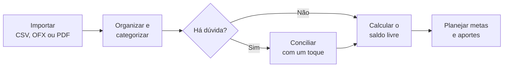
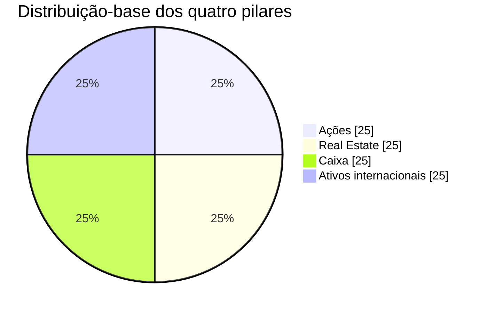
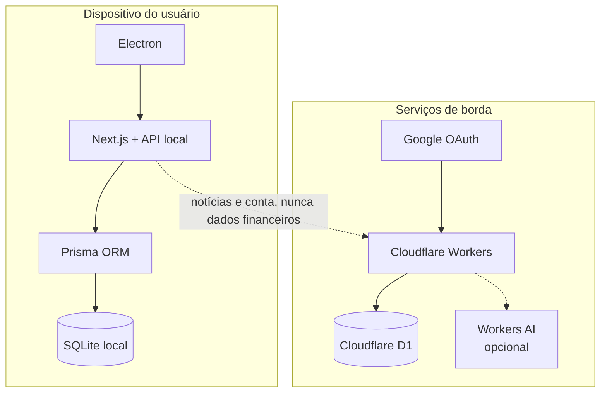

<div align="center">
  <picture>
    <source media="(prefers-color-scheme: dark)" srcset="./icon-talentum-dark.svg">
    <source media="(prefers-color-scheme: light)" srcset="./icon-talentum-light.svg">
    
  </picture>

  # Talentum

  **Seu piloto automático financeiro, local-first e open-source.**
https://talentum-tech.vercel.app

  [](#estado-do-projeto)
  [-1A110A)](#arquitetura)
  [](#privacidade-por-princípio)
  [](#como-contribuir)
  [](./LICENSE)
</div>

> *Talentum* vem do latim: uma unidade de grande valor e, por extensão, aquilo que nos foi confiado para administrar e multiplicar.

O Talentum nasce para quem quer cuidar melhor do dinheiro, mas não tem tempo para alimentar planilhas ou classificar cada compra manualmente. O aplicativo pretende importar extratos, organizar transações, antecipar compromissos e transformar dados financeiros em próximos passos claros — mantendo os dados sensíveis no dispositivo do usuário.

> [!IMPORTANT]
> O projeto está em pré-alpha. Já funcionam, sobre o banco local cifrado e protegido por senha: importação de extratos CSV, OFX e PDF, categorização por regras, cartões com faturas, conferência de pagamento e benefícios, contas e chaves Pix próprias, primeiro acesso, conciliação, orçamento, metas, dívidas, patrimônio, notificações, pontos de restauração, backup cifrado, exportação, histórico com reversão e o dashboard; na web, o login com Google com verificação em duas etapas, a comunidade, as notícias e a página de downloads protegida; e a janela Electron protegida. Nenhum instalador assinado foi publicado ainda. As áreas descritas abaixo são a visão do produto. O que está pronto e o que está planejado em cada parte fica em [`docs/PRODUCT.md`](./docs/PRODUCT.md) e [`docs/ROADMAP.md`](./docs/ROADMAP.md).

## O problema que queremos resolver

O saldo exibido pelo banco raramente conta a história inteira. Faturas, assinaturas, débitos automáticos e metas futuras competem pelo mesmo dinheiro; ao mesmo tempo, registrar tudo à mão cria uma rotina que poucas pessoas conseguem sustentar.

O Talentum propõe um fluxo de baixa fricção:



## O que compõe o Talentum

| | Área | Para que serve |
| :---: | --- | --- |
|  | **Início** | Ponto de partida sem números financeiros: aviso de privacidade e atalhos para importar um extrato ou cadastrar contas. |
|  | **Dashboard** | Mostra o Saldo Livre de Risco, o saldo consolidado, os gastos do mês e a média diária, só depois que os dados locais confirmam cada valor. |
|  | **Extratos, cartões e benefícios** | Importa CSV, OFX e PDF, organiza lançamentos, acompanha faturas, recorrências, anuidade, cashback, milhas e pontos. |
|  | **Conciliação financeira** | Resolve classificações incertas, confere faturas e registra juros, descontos ou gastos em dinheiro. |
|  | **Planejamento** | Orçamento do mês por categoria, dívidas com ordem de pagamento e plano de quitação, modo sobrevivência e rendas previstas. |
|  | **Patrimônio e metas** | Acompanha objetivos, simula a divisão de uma sobra entre metas e simula novos aportes pelos quatro pilares, sem sugerir venda. |
|  | **Invest** | Reúne notícias econômicas, prioriza ativos da carteira, produz resumos e preserva o crédito da fonte. |
|  | **Histórico e perfil** | Mantém a timeline, pontos de restauração, exportações, backups, missões, XP, níveis e conquistas. |

Funções globais complementam essas áreas: notificações acionáveis, importação rápida, seleção de conta e lançamento expresso de despesas em espécie.

## Saldo livre, não apenas saldo bancário

Uma das métricas centrais é o **Saldo Livre de Risco**: o valor disponível depois de considerar faturas abertas, contas recorrentes e débitos previstos até o fim do período. A intenção é substituir a falsa sensação de disponibilidade por uma leitura realista do que pode ser gasto.

Quando houver dívidas caras ou saldo negativo, o produto deverá entrar em **modo de sobrevivência**: pausar sugestões de investimento, priorizar a quitação dos juros mais altos e reconstruir a liquidez antes de retomar o planejamento patrimonial.

## Metodologia ARCA

O módulo patrimonial usa como referência a metodologia ARCA, idealizada por **Thiago Nigro (Primo Rico)**. Ela organiza o patrimônio em quatro pilares com meta-base de 25% cada:

| Pilar | Papel na carteira | Exemplos |
| --- | --- | --- |
| **A — Ações** | Crescimento e participação em empresas brasileiras | Ações negociadas na B3 |
| **R — Real Estate** | Exposição imobiliária e geração de renda | Fundos imobiliários e ativos imobiliários |
| **C — Caixa** | Segurança, reserva e liquidez | Tesouro Selic e CDBs com liquidez diária |
| **A — Ativos internacionais** | Diversificação global e proteção cambial | ETFs, BDRs e ativos no exterior |



Para evitar movimentações motivadas por pequenas oscilações, um pilar é considerado equilibrado entre **22,5% e 27,5%**. O motor deverá priorizar novos aportes no pilar mais defasado, sem incentivar vendas desnecessárias.

> [!NOTE]
> O Talentum é uma ferramenta de organização e educação financeira. Ele não oferece recomendação individual de investimento. ARCA e Primo Rico são referências creditadas aos seus respectivos titulares e não indicam afiliação ou endosso ao projeto.

## Privacidade por princípio

Os dados financeiros pertencem ao usuário. A arquitetura planejada separa o que precisa permanecer local do mínimo necessário na nuvem.



- Extratos, transações, estabelecimentos, saldos e carteira ficam no SQLite local.
- A nuvem mantém apenas identidade mínima, aceites, sessões, versões publicadas, autorizações de download, a comunidade e notícias públicas; nunca recebe valores financeiros.
- O backup cifrado com senha (AES-256-GCM, chave derivada por scrypt) existe e é só local: o arquivo é baixado neste computador e, sem a senha, não abre — não há recuperação de senha ([ADR 0007](./docs/decisions/0007-local-encrypted-backup.md)). Guardar backups em nuvem continua em aberto, e nada disso é anunciado como "conhecimento zero".
- O usuário poderá exportar os próprios dados em formatos abertos, como JSON e CSV.

## Arquitetura

O aplicativo desktop será uma experiência full-stack local. O Electron abre e gerencia a janela; o Next.js entrega a interface e os Route Handlers; o Prisma acessa o SQLite no próprio computador.

| Camada | Tecnologia | Responsabilidade planejada |
| --- | --- | --- |
| Desktop | Electron | Empacotamento e janela nativa para Windows e Linux; macOS planejado (build assinado e notarizado) |
| Aplicação | Next.js, React e TypeScript | Interface, renderização e API local |
| Estilo | CSS próprio com tokens | Sistema visual responsivo nos temas claro e escuro |
| Dados | Prisma ORM e SQLite | Persistência local tipada |
| Importação | Parsers CSV, OFX e PDF (texto lido localmente, sem OCR) | Extração local de extratos e faturas |
| Identidade | Google OAuth 2.0 | Conta única para landing page e aplicativo |
| Site público | Next.js na Vercel | Landing page e BFF mínimo de sessão, isolados do app desktop |
| Borda | Cloudflare Workers e D1 | Login (web e desktop), verificação em duas etapas, sessões, downloads autorizados, comunidade, notícias e resumos |
| IA (opcional) | Cloudflare Workers AI | Resumos de notícias públicas, nunca com dados financeiros |

## Identidade visual

A marca combina a sobriedade de uma balança com um corte ascendente em âmbar. O repositório mantém duas imagens SVG com transparência real:

| Uso | Arquivo | Cores principais |
| --- | --- | --- |
| Fundos claros | [`icon-talentum-light.svg`](./icon-talentum-light.svg) | Ébano `#1A110A` e âmbar |
| Fundos escuros | [`icon-talentum-dark.svg`](./icon-talentum-dark.svg) | Alabastro e âmbar |

Paleta-base: **Alabastro** `#F4F1EA`, **Ébano** `#1A110A`, **Âmbar clássico** `#B8773D`, **Grafite** `#4A4A4A` e **Nogueira** `#5C4033`.

Os ícones usados neste README pertencem ao [Bootstrap Icons](https://icons.getbootstrap.com/), distribuído sob licença MIT. Novos elementos iconográficos públicos devem manter essa mesma família para preservar consistência.

## Estado do projeto

O repositório está em **pré-alpha**. Hoje ele contém a visão consolidada, documentação, identidade visual, base Next.js full-stack, API REST local, Prisma com SQLite cifrado (libSQL), cofre local com senha, Docker para desenvolvimento e shell Electron.

Já funcionam de ponta a ponta, sobre o banco local:

- importação de extrato em **CSV e OFX**, com prévia antes de gravar, conferência do papel de cada coluna, deduplicação por arquivo e por lançamento, gravação atômica e reversão do lote; PDF com leitores de layout versionados e confiança por campo na prévia;
- cartões de crédito com faturas, itens digitados ou importados, conferência do pagamento contra o extrato da conta, termômetro de isenção da anuidade e saldo de cashback, pontos e milhas; a fatura em aberto entra no Saldo Livre de Risco;
- desbloqueio com senha e código de recuperação, bloqueio automático por inatividade e autenticador (TOTP) opcional; o arquivo do banco inteiro é cifrado;
- categorização automática por regras de estabelecimento, sugestão de transferência entre contas próprias e lançamento rápido em dinheiro;
- listagem de lançamentos;
- cadastro de perfil local, instituições e contas com saldo informado;
- painel com Saldo Livre de Risco, saldo consolidado, gastos do mês, média diária, comprometido no período e gastos por categoria;
- orçamento mensal por categoria, metas com contribuições datadas, dívidas com plano de quitação e modo sobrevivência, e patrimônio pelos quatro pilares da metodologia ARCA com simulação do próximo aporte.

Implementados além do MVP: central de notificações local, pontos de restauração, backup cifrado local, exportação em JSON e CSV, exclusão dos dados locais, gamificação por hábitos e o aviso de nova versão. Na nuvem, o código do Worker e da landing page cobre login com Google, verificação em duas etapas, exclusão de conta, comunidade, notícias e resumos; publicar depende de segredos, configurações nos provedores, artefatos assinados e validação no ambiente publicado. Ainda não existe: instalador assinado em nenhum sistema, backup em nuvem, Open Finance, sincronização entre dispositivos e webhooks.

### Roadmap inicial

O plano completo, com MVP, macrofeatures posteriores, dependências e critérios de conclusão, está em [`docs/ROADMAP.md`](./docs/ROADMAP.md). O primeiro release concentra-se em cadastro/download, Electron seguro, persistência local, importação CSV e OFX, conciliação e Saldo Livre de Risco.

## Desenvolvimento local

### Pré-requisitos

- Node.js 22.13 ou superior;
- pnpm `11.1.2`;
- Git.

### Preparação

```bash
git clone https://github.com/luizfelipe-pacifico/talentum.git
cd talentum
pnpm install
cp .env.example .env
pnpm prisma:generate
pnpm hooks:install
```

O banco local é cifrado e abre só com a senha que você cria no primeiro acesso a `http://127.0.0.1:3000` ("Proteja seus dados"). Guarde o código de recuperação mostrado em seguida: sem a senha e sem ele, os dados não podem ser abertos por ninguém. As migrações são aplicadas pelo próprio app a cada desbloqueio; detalhes em [`docs/decisions/0009-local-vault-and-encrypted-database.md`](./docs/decisions/0009-local-vault-and-encrypted-database.md).

`pnpm hooks:install` é obrigatório para contribuir: ativa os hooks que bloqueiam commit e push quando o typecheck, o linter ou algum teste, inclusive os de regressão, falha. Confira com `git config --get core.hooksPath`, que deve imprimir `.githooks`.

### Comandos disponíveis

| Comando | Ação |
| --- | --- |
| `pnpm dev` | Libera a porta 3000, limpa o cache do Next.js e inicia o servidor local (as migrações rodam no desbloqueio) |
| `pnpm dev:all` | Abre o Electron em `http://localhost:3000`; reaproveita um servidor já no ar, seja do Docker ou de um `pnpm dev` em outro terminal |
| `pnpm docker:up` | Constrói e inicia o app local em `localhost:3000` e a LP em `localhost:3100` |
| `pnpm docker:up:detached` | Inicia os dois serviços em segundo plano e aguarda os healthchecks |
| `pnpm docker:down` | Encerra os dois serviços sem remover o volume SQLite |
| `pnpm build` | Gera a build de produção do Next.js |
| `pnpm start` | Executa a build de produção na porta 3000 |
| `pnpm typecheck` | Verifica os tipos TypeScript |
| `pnpm lint` | Roda o linter (Biome) |
| `pnpm test` | Roda a suíte, inclusive os testes de regressão |
| `pnpm test:e2e` | Roda os testes ponta a ponta (Playwright) num servidor isolado; antes, uma vez: `pnpm test:e2e:install` |
| `pnpm hooks:install` | Ativa os hooks que rodam typecheck e testes antes de commit e push e garante que sejam executáveis |
| `pnpm prisma:generate` | Gera o Prisma Client |
| `pnpm prisma:validate` | Valida o schema Prisma |
| `pnpm prisma:migrate` | Cria uma migração nova contra um banco de rascunho em `temp/`; o banco cifrado a recebe no próximo desbloqueio |
| `pnpm test:manual` | Sobe o servidor isolado de teste em `127.0.0.1:3210`, com o cofre criado pela senha sintética documentada em `docs/BEST_PRACTICES.md` |

O Docker é só ferramenta de desenvolvimento: não é forma de instalar nem de hospedar o Talentum, e os instaladores para Windows, Linux e macOS nunca exigem Docker. Para que `localhost:3000` use o banco cifrado dentro do Docker, suba o app com `pnpm docker:up:detached` e abra a janela com `pnpm dev:all`, que se anexa ao container. Skills de design para o Claude Code ficam em `.claude/skills/`; origem, licença e revisão estão em [`docs/BEST_PRACTICES.md`](./docs/BEST_PRACTICES.md).

Os containers executam os servidores Next.js como usuários não-root; a janela Electron é iniciada no host. O app local usa um volume nomeado para o SQLite, que não entra na imagem. A LP é servida separadamente em `http://localhost:3100`, preservando o limite arquitetural entre o site público e o produto local.

## Documentação

A documentação técnica fica em `docs/`, em inglês, concentrada em poucos documentos extensos e indexada em [`docs/README.md`](./docs/README.md).

- [`ARCHITECTURE.md`](./docs/ARCHITECTURE.md): visão geral, fluxos, contratos de API e as duas camadas, Web (LP, BFF, Worker e D1) e Electron (desktop, app local, SQLite).
- [`SECURITY.md`](./docs/SECURITY.md): autenticação, refresh tokens, controles obrigatórios e gestão de segredos.
- [`DATABASE.md`](./docs/DATABASE.md): regras de modelagem, schema local (Prisma/SQLite), schema cloud (D1) e migrations.
- [`PRODUCT.md`](./docs/PRODUCT.md): visão do produto, funcionalidades e rotas do MVP, onboarding, dashboard e aviso de nova versão.
- [`DESIGN-SYSTEM.md`](./docs/DESIGN-SYSTEM.md): marca, tokens dos dois temas, tipografia, ilustrações de estado e QA visual.
- [`ROADMAP.md`](./docs/ROADMAP.md): MVP e sequência planejada de todas as macrofeatures.
- [`BEST_PRACTICES.md`](./docs/BEST_PRACTICES.md): organização do repositório, práticas de engenharia e guia completo de desenvolvimento.
- [`MEMORY-AI.md`](./docs/MEMORY-AI.md): como o mantenedor trabalha, para agentes de IA.
- [`decisions/`](./docs/decisions/): registros de decisões de arquitetura (ADRs).

## Como contribuir

Contribuições são bem-vindas desde esta fase inicial. Antes de começar:

1. Leia a documentação relacionada à área que pretende alterar.
2. Abra uma issue descrevendo o problema, a proposta e os critérios de aceite.
3. Crie uma branch curta, como `feat/importacao-ofx` ou `docs/privacidade`.
4. Faça mudanças pequenas, sem dados financeiros reais ou credenciais.
5. Ative os hooks com `pnpm hooks:install`. Toda correção de bug começa por um teste em `tests/regression/` que falha antes da correção. Execute as verificações disponíveis e descreva o resultado no pull request.
6. Use commits no padrão [Conventional Commits](https://www.conventionalcommits.org/).

Parsers comunitários devem usar amostras sintéticas e anonimizadas. Nunca envie extratos, nomes, documentos, tokens, chaves ou bancos SQLite reais ao repositório.

## Licença e transparência

O Talentum é distribuído sob a [licença MIT](./LICENSE). Dependências e recursos de terceiros permanecem sob suas respectivas licenças. Consulte também as políticas de contribuição, conduta e segurança em [`.github/`](./.github/).

---

<div align="center">
  <strong>Clareza para o presente. Disciplina para o futuro.</strong>
</div>
