# ARCA Vision: the original product document, rewritten

> **Status: historical, non-normative.** This document is a complete, illustrated English rewrite of the original product document `App de Gestão Financeira ARCA.pdf` (30 pages, in this folder). It exists so that nobody needs to read the PDF again. It records what the original vision said; it is **not** a requirement and it does **not** describe implemented behavior.
>
> Current requirements live in [PRODUCT.md](PRODUCT.md), [ARCHITECTURE.md](ARCHITECTURE.md), [DATABASE.md](DATABASE.md) and [DESIGN-SYSTEM.md](DESIGN-SYSTEM.md); delivery order lives in [ROADMAP.md](ROADMAP.md). **Where they differ from this document, those documents win.** Ideas that the project has since replaced carry a **Superseded by** note pointing to the current document. Nothing in this file is marked **Current** unless it exists in the code.

## Contents

- [About the source](#about-the-source)
- [How the vision evolved](#how-the-vision-evolved)
- [1. Problem, vision and audience](#1-problem-vision-and-audience)
- [2. Principles](#2-principles)
- [3. The three pillars of the solution](#3-the-three-pillars-of-the-solution)
- [4. The product concept: a financial autopilot](#4-the-product-concept-a-financial-autopilot)
- [5. The ARCA methodology](#5-the-arca-methodology)
- [6. Navigation: from four tabs to six](#6-navigation-from-four-tabs-to-six)
- [7. Tab 1 — `Início` (executive dashboard)](#7-tab-1--início-executive-dashboard)
- [8. Tab 2 — `Extratos, Cartões & Benefícios`](#8-tab-2--extratos-cartões--benefícios)
- [9. Tab 3 — `Conciliação Financeira`](#9-tab-3--conciliação-financeira)
- [10. Tab 4 — `Gestão de Patrimônio & Metas`](#10-tab-4--gestão-de-patrimônio--metas)
- [11. Tab 5 — `Invest` (market and news)](#11-tab-5--invest-market-and-news)
- [12. Tab 6 — `Histórico & Perfil`](#12-tab-6--histórico--perfil)
- [13. Supporting screens and global modules](#13-supporting-screens-and-global-modules)
- [14. Balance intelligence, surplus and survival mode](#14-balance-intelligence-surplus-and-survival-mode)
- [15. Gamification](#15-gamification)
- [16. Onboarding and first access](#16-onboarding-and-first-access)
- [17. Product decisions raised and how they were answered](#17-product-decisions-raised-and-how-they-were-answered)
- [18. Technical ideas in the source](#18-technical-ideas-in-the-source)
- [19. Monetization](#19-monetization)
- [20. Supersession summary](#20-supersession-summary)
- [21. Glossary of Portuguese terms](#21-glossary-of-portuguese-terms)

## About the source

The PDF is a browser printout (dated 5 September 2026) of a design conversation between the maintainer and an AI assistant. It contains thirteen question-and-answer turns plus a closing "thank you". Pages 1 to 16 hold the conversation; pages 16 to 30 repeat the same content as two Markdown files the assistant was asked to produce (`DOCUMENTACAO_PROJETO.md`, a consolidated spec, and `HISTORICO_DA_CONVERSA.md`, a transcript of the conversation). The repetition adds no new ideas, so this rewrite follows the conversation once and folds in the consolidated spec.

The PDF contains a single raster image (page 3, an allocation pie chart, recreated in [section 5.3](#53-the-sample-allocation-chart-in-the-source)). Every other visual is a text-mode diagram, which this rewrite recreates as Mermaid diagrams or as `text` wireframes.

Conventions used here:

- Portuguese product names, tab names and UI labels are kept as written, in backticks, with an English gloss on first use.
- Emoji used in the source as icons or status lights are written as bracketed words, such as `[green]` or `[trophy]`. **Superseded by** [DESIGN-SYSTEM.md](DESIGN-SYSTEM.md): the interface uses its documented icon set, not emoji.
- Names of people shown in example screens are replaced with the synthetic name `Ana`. Bank names in examples are replaced with `Banco A` / `Banco B`. Public market tickers (`VALE3`, `PETR4`, `IVVB11`, `HGLG11`, `XPML11`, `WRLD11`) and news outlets are kept because they are public examples.
- Money uses the Brazilian format of the source (`R$ 1.000,00`).
- Notes headed **Source inconsistency** point out places where the PDF contradicts itself. They are observations, not corrections of the vision.

## How the vision evolved

The product was designed incrementally. Each turn added an area or a rule; later turns reorganized earlier ones. The table summarizes the thirteen turns; the diagram shows how the navigation changed.

| Turn | The maintainer asked for | What the answer added |
| --- | --- | --- |
| 1 | A finance app that reads bank statements, organizes spending by itself, sets purchase goals and organizes investments with the ARCA methodology; idea only, no architecture | Vision, value proposition, audience, the three pillars (reader, goals, ARCA portfolio) |
| 2 | A fast, didactic, low-text first-run walkthrough; open source; deeper research on ARCA | 45-second onboarding carousel, ARCA anatomy, rebalancing by contribution, worked example |
| 3 | A ±10% tolerance band; a news tab fed through a proxy, with summary and credit to the source | Tolerance band (22.5%–27.5%), news feed design |
| 4 | A dashboard with spending and average progress; ranking, badges and missions | First navigation (4 tabs), dashboard layout, XP, levels, badges, missions |
| 5 | Missing navigation: monthly statement import and anything else overlooked | 5 tabs (adds `Extratos`), supporting screens |
| 6 | Draw the import flow; track credit-card benefits (miles, cashback, annual fee) | Three-step import flow, card ROI module, `Faturas & Benefícios` sub-tab |
| 7 | Use SQLite, Electron, Cloudflare and maybe Ollama; Google sign-up with an external database | Five open product decisions (sync, formats, AI, privacy, social ranking) |
| 8 | 100% local; D1 for authentication and backup; Google sign-up before download; a history route | Landing page to desktop journey, encrypted backup, `Histórico` timeline, 6 tabs |
| 9 | Summarize the official stack | Stack tables, component communication diagram |
| 10 | Prisma ORM and full-stack Next.js inside Electron, an API layer; is Ollama free? | Next.js-in-Electron architecture, Prisma schema, local API example, Ollama answer |
| 11 | Users should not need Ollama locally; how to host it and stay fast? | Cloudflare Workers AI for summaries, Worker example, comparison table |
| 12 | What is still missing in the product idea (not technical)? | Four rules: committed money, surplus destination, survival mode, initial data onboarding |
| 13 | Register automatic debits and benefits; dividend and bill notifications; a reconciliation tab; cash entries; document every tab | Alerts center, express cash entry, final 6-tab map with full component lists |

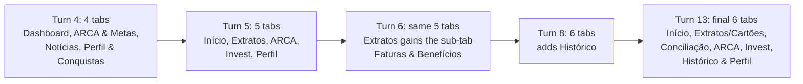

## 1. Problem, vision and audience

### The problem

Most people lack financial education, and those who try to organize their money give up because of **manual friction**: typing every coffee or categorizing every entry demands daily discipline that a busy routine consumes. Spreadsheets and traditional finance apps are abandoned for that reason. The product targets two pains at once: weak financial education and lack of time.

### The vision

Turn the application into a **financial autopilot** (`piloto automático financeiro`) that combines passive automation for day-to-day money with a methodological guide for the future.

- **Value proposition:** zero typing effort, immediate smart categorization, and complete clarity about where the money is going and where it should go.
- **Audience:** people with an intense routine who want to organize their finances, cut invisible spending and invest without becoming market specialists.

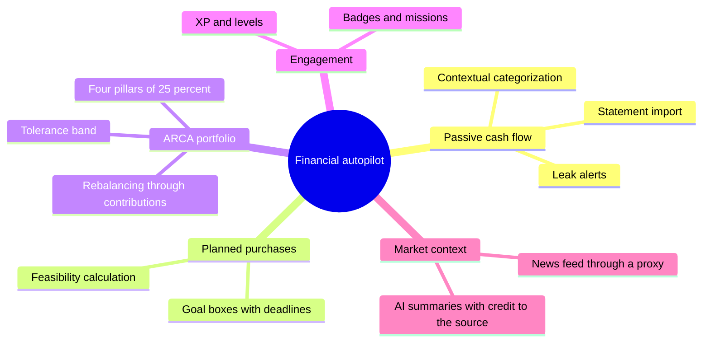

## 2. Principles

The consolidated spec closes with three principles; turn 2 adds the open-source rationale.

| Principle | Original wording | Meaning |
| --- | --- | --- |
| Zero friction | `Zero Fricção` | Automation from statements comes first; quick manual reconciliation only where it is needed. Manual forms are the exception (cash, uncertain entries). |
| Absolute privacy | `Privacidade Absoluta` | Financial data is processed locally (SQLite through Prisma inside Electron). The cloud has no knowledge of real financial values. |
| Guided decisions | `Decisões Guiadas` | Preventive alerts to avoid interest, lightweight news summaries in the cloud, and disciplined allocation with a safety margin. |
| Open source | — | Builds immediate trust for sensitive financial data, lets anyone audit the categorization algorithms, and attracts contributors to integrate new banks. |

> **Superseded by** [PRODUCT.md — Principles](PRODUCT.md#principles), which restates these principles as current product rules.

## 3. The three pillars of the solution

### Pillar 1 — Passive cash-flow management (`O Leitor`, "the reader")

- **Zero routine intrusion:** the person exports a statement (PDF, OFX) or connects through Open Finance, and the system processes the data immediately.
- **Contextual categorization:** smart reading understands generic entries; for example, it recognizes a Pix payment or a card-machine charge by the merchant's name and files it under Food, Leisure, Transport or Fixed.
- **Financial leak alert** (`Alerta de Ralo Financeiro`): objective notifications about forgotten subscriptions, hidden bank fees, or silent budget overruns in specific categories.

### Pillar 2 — Goals and achievements (`A Compra Planejada`, "the planned purchase")

- **Allocation by objective:** goal boxes (`caixinhas`) tied to real deadlines, such as an end-of-year trip, an emergency reserve or a car down payment.
- **Feasibility calculation:** the app analyzes the person's average free balance and computes how much must be deposited each month to reach the goal on time.

### Pillar 3 — Recommended portfolio through the ARCA methodology

The methodology splits wealth into four equal pillars of 25% each, and a **rebalancing engine** computes the person's current share in each pillar and points to the class that needs new contributions to return to 25%. Details in [section 5](#5-the-arca-methodology).

> **Superseded by** [PRODUCT.md — MVP scope](PRODUCT.md#mvp-scope): the MVP imports CSV and OFX, not PDF, and excludes ARCA, goals beyond the MVP features, AI and leak alerts; those belong to later roadmap stages. Open Finance is [ROADMAP.md](ROADMAP.md) Stage 22.

## 4. The product concept: a financial autopilot

Turn 12 summarized the whole product as a four-stage pipeline. The PDF drew it as a box:

```text
┌────────────────────────────────────────────────────────────────────────┐
│                      PILOTO AUTOMÁTICO FINANCEIRO                      │
│                                                                        │
│  [ LEITOR ] ──► [ TRIAGEM ] ──► [ SALDO REAL ] ──► [ DECISÃO ARCA ]    │
│  Lê extrato     Valida dúvidas  Desconta contas    Indica onde         │
│  sem digitação  com 1 toque     futuras do mês     aportar (±10%)      │
└────────────────────────────────────────────────────────────────────────┘
```

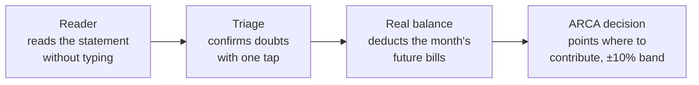

> **Superseded by** [PRODUCT.md — Product vision and scope](PRODUCT.md#product-vision-and-scope), which keeps the same pipeline with the last stage generalized to "Decision".

## 5. The ARCA methodology

The ARCA methodology was created by Thiago Nigro ("O Primo Rico", Grupo Primo). It aims at long-term preservation and growth of wealth through balanced allocation, neutralizing volatility by splitting total wealth into four equal parts. In turn 13 the maintainer asked that the product **credit the methodology and its author** but not repeat the ARCA name everywhere, because ARCA is a methodology, not a feature brand.

The PDF lists three sources for this section: "O Método ARCA, Thiago Nigro (Grupo Primo) — Blog Frontini", "Plano de Previdência ARCA — O Primo Rico" and "Método ARCA: Saiba como investir com o Primo Rico".

### 5.1 The four pillars

```text
                    [ PATRIMÔNIO TOTAL ]
                             │
      ┌──────────┬───────────┴───┬──────────┐
      ▼          ▼               ▼          ▼
    [25%]      [25%]           [25%]      [25%]
      A          R               C          A
    Ações    Real Estate       Caixa    Ativos Int.
```

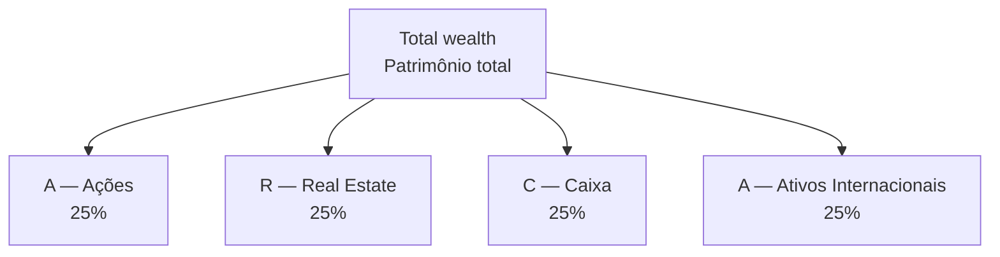

| Letter | Pillar | Role in the portfolio | Typical assets named in the source |
| --- | --- | --- | --- |
| A | `Ações` (local stocks) | Capital growth and dividends | Shares of large companies on B3 |
| R | `Real Estate` (property) | Passive income, predictable daily/monthly distributions | Real-estate funds (FIIs) and property assets |
| C | `Caixa` (cash, liquid fixed income) | Safety and reserve; protects in downturns and provides "ammunition" for opportunities | Treasury bonds (`Tesouro Selic`), daily-liquidity CDBs, operating reserves |
| A | `Ativos Internacionais` (international assets) | Currency protection; shields wealth from risks specific to the domestic market | International ETFs, BDRs, foreign stocks, dollar exposure |

### 5.2 Tolerance band (`Banda de Aporte`)

In turn 3 the maintainer set a margin of 10% above and below the target: inside it, a pillar counts as balanced. The margin is **relative** to the 25% target (±2.5 percentage points), so each pillar is balanced between **22.5% and 27.5%** of total wealth. The band stops the app from recommending unnecessary contributions because of small daily market swings.

| Share of the pillar | Status | Light in source | What the app does |
| --- | --- | --- | --- |
| 22.5% to 27.5% | `Equilibrado` (balanced) | `[green]` | No corrective contribution required |
| Below 22.5% | `Defasado` (lagging) | `[yellow]` / `[red]` | The pillar moves to the top of the queue for the next contributions |
| Above 27.5% | `Sobrecarregado` (overweight) | `[blue]` | New contributions to this pillar freeze until the others grow and restore the proportion |

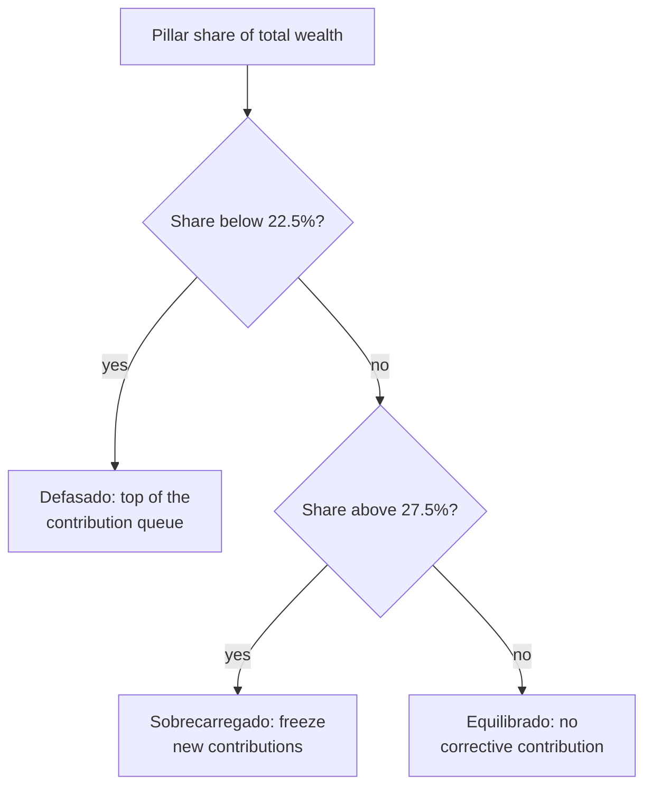

### 5.3 The sample allocation chart in the source

Page 3 contains the PDF's only image: a pie chart titled `FUNDO A.R.C.A. GRÃO`. It is recreated below with its exact labels and values. The PDF shows it without comment; note that it does **not** follow the 25/25/25/25 target described in the text.

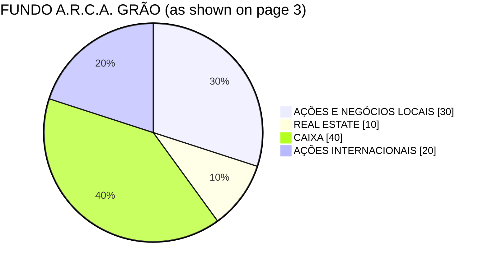

### 5.4 Rebalancing without selling

The differentiator is not only showing the split but saying **where new money should go** to rebalance the portfolio **without selling anything**, which avoids income tax and fees on sales.

Worked example from the source: a total portfolio of R$ 40.000,00 after market swings.

| Pillar | Current value | Current share | Status shown in the source |
| --- | --- | --- | --- |
| Ações | R$ 13.000,00 | 32.5% | `[green]` Above target |
| Real Estate | R$ 9.000,00 | 22.5% | `[yellow]` Below target |
| Caixa | R$ 11.000,00 | 27.5% | `[green]` Above target |
| Ativos Internacionais | R$ 7.000,00 | 17.5% | `[red]` Most lagging |

If the person will contribute R$ 1.000,00 this month:

1. The app identifies `Ativos Internacionais` as the pillar furthest from the 25% target.
2. The primary recommendation directs **100% of the new contribution** to that pillar, without suggesting sales of the pillars that grew.
3. If the pillar is empty, the app recommends buying a global index ETF directly (the source names `IVVB11` or `WRLD11`).

> **Source inconsistency.** The example table was written in turn 2, before the band existed. Under the band of turn 3, Ações at 32.5% would be `Sobrecarregado` `[blue]`, and Real Estate (22.5%) and Caixa (27.5%) sit exactly on the band limits, which the text classifies as `Equilibrado`. The recommendation itself (Ativos Internacionais, the only pillar below 22.5%) is the same under both readings.

The next-contribution calculator (`Calculadora do Próximo Aporte`) wraps this logic: the person types "Tenho R$ 500 para aportar" ("I have R$ 500 to invest") and the app says exactly which pillar should receive it.

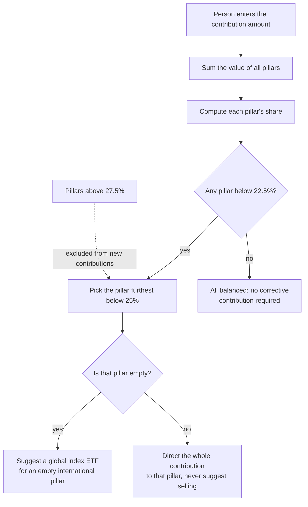

> **Superseded by** [ARCHITECTURE.md — 2.7 Net worth and contributions](ARCHITECTURE.md#27-net-worth-and-contributions) (**Planned**, [ROADMAP.md](ROADMAP.md) Stage 14): the suggestion first checks survival mode, simulates distributing the contribution, explains the calculation, and must not be presented as individual financial advice. Naming specific products (such as an ETF ticker) is not a requirement.

## 6. Navigation: from four tabs to six

### 6.1 First structure (turn 4): four tabs

1. **Dashboard (`Início`)** — balance, spending, progress of the average and the gamification panel.
2. **`ARCA & Metas`** — the four-pillar portfolio, rebalancing with the 10% band, goal boxes.
3. **`Notícias (Invest)`** — proxy aggregator with economic news, quick summaries and credit to the outlets.
4. **`Perfil & Conquistas`** — levels, global/friends ranking, badges and mission history.

### 6.2 Adjusted structure (turn 5): five tabs on a bottom bar

Turn 5 noticed a gap: there was no place to import statements, validate entries, manage categories or control access. Putting statement reading inside the dashboard would clutter the home screen, so a dedicated tab was added.

```text
┌────────────────────────────────────────────────────────────────────────────┐
│ [home] Início  [card] Extratos  [chart] ARCA  [news] Invest  [gear] Perfil │
└────────────────────────────────────────────────────────────────────────────┘
```

Turn 6 attached a sub-tab to `Extratos`:

```text
[ Início ] [ Extratos ] [ ARCA ] [ Invest ] [ Perfil ]
               │
               └── sub-tab: [ Faturas & Benefícios ]
                     • statement and card-bill reading
                     • triage of doubtful categories
                     • miles / cashback counter
                     • annual-fee exemption monitor
```

### 6.3 Consolidated map (turn 8): six tabs

```text
┌──────────────────────────────────────────────────────────────────────────┐
│ [ Início ] [ Extratos ] [ ARCA ] [ Invest ] [ Histórico ] [ Perfil ]     │
└──────────────────────────────────────────────────────────────────────────┘
```

1. `Início` — executive view of balance, daily spending average and a shortcut to the active mission.
2. `Extratos & Benefícios` — PDF/OFX importer, triage of doubtful categories, cashback/miles calculator, annual-fee exemption.
3. `ARCA & Metas` — the four-pillar matrix with the 10% margin, next-contribution calculator, goal boxes.
4. `Invest` — news through a proxy with AI summaries (Ollama/Workers) and direct credit to the author.
5. `Histórico` — timeline of imports, entry edits, goals met and achievements.
6. `Perfil & Gamificação` — XP level, ranking, local privacy control and a manual backup trigger.

### 6.4 Final map (turn 13): six tabs

Turn 13 added `Conciliação` and merged `Histórico` with `Perfil`. This is the most complete structure in the PDF; [sections 7 to 12](#7-tab-1--início-executive-dashboard) describe each tab.

```text
┌───────────────────────────────────────────────────────────────────────────────────────┐
│ [ Início ] [ Extratos/Cartões ] [ Conciliação ] [ ARCA ] [ Invest ] [ Histórico ]     │
└───────────────────────────────────────────────────────────────────────────────────────┘
```

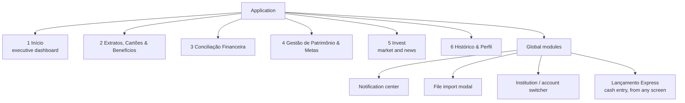

> **Superseded by** [PRODUCT.md — Navigation areas](PRODUCT.md#navigation-areas) and [Route map](PRODUCT.md#route-map), which define the current areas and routes.

## 7. Tab 1 — `Início` (executive dashboard)

**Goal:** a clear view of current financial health in under three seconds of reading.

### 7.1 The dashboard sketch (turn 4)

```text
┌──────────────────────────────────────────────────────────────┐
│  Olá, Ana!                       [trophy] Nível 4 • 1.250 XP │
│  ──────────────────────────────────────────────────────────  │
│  SALDO LIVRE MÊS            MÉDIA DE GASTOS DIÁRIA           │
│  R$ 3.450,00                R$ 85,00 / dia (Meta: R$ 100)    │
│                                                              │
│  [ BARRA DE PROGRESSO DE GASTOS NO MÊS ]                     │
│  ██████████████████░░░░░░░ 68% do orçamento limite           │
│                                                              │
│  GRÁFICO DE EVOLUÇÃO (Média Móvel de Gastos vs Aportes)      │
│  ┌────────────────────────────────────────────────────────┐  │
│  │   /\_        Gastos (em queda)                         │  │
│  │  /   \__/\_                                            │  │
│  │ /          \ Aportes (em alta)                         │  │
│  └────────────────────────────────────────────────────────┘  │
│                                                              │
│  MISSÃO DIÁRIA ATIVA                                         │
│  [target] "Importe o extrato desta semana para ganhar +50XP" │
└──────────────────────────────────────────────────────────────┘
```

Glosses: `Saldo livre mês` = free balance this month; `Média de gastos diária` = daily spending average against a daily target; the progress bar shows the share of the monthly budget limit already spent; the evolution chart compares the moving average of spending (falling) with contributions (rising); `Missão diária ativa` = the active daily mission.

> **Source inconsistency.** The sketch shows "Nível 4 • 1.250 XP", but in the level table ([section 15](#15-gamification)) 1,250 XP is level 2 and level 4 starts at 3,501 XP.

### 7.2 Components in the final spec (turns 5 and 13)

| Component | Description |
| --- | --- |
| `Saldo Real Drenado` (drained real balance) | Account balance minus the mapped bills and card statements due by month end. See [section 14.1](#141-committed-money-saldo-real-drenado) |
| Consolidated balance and month's free balance | Total balance across accounts plus the free balance of the month (turn 5) |
| `Média de Gastos Diária` | Dynamic daily consumption against the ideal limit so the budget is not exceeded |
| `Widget de Notificações Ativas` | Today's statement due dates, debits and dividend payments |
| `Resumo de Gamificação` | Current XP level, progress and a shortcut to the day's mission |
| `Status da Carteira` | Simplified visual indicator of portfolio balance (green/yellow/red per pillar in turn 5) |

> **Superseded by** [PRODUCT.md — Dashboard specification](PRODUCT.md#dashboard-specification). The **Current** dashboard metrics are implemented in `src/server/dashboard-metrics.ts`; XP, missions and portfolio status are not part of the MVP.

## 8. Tab 2 — `Extratos, Cartões & Benefícios`

**Goal:** import bank files and manage the efficiency of credit cards. This is "where the import and categorization magic happens".

### 8.1 Components

- **Drag-and-drop area** (`Área de Drag & Drop`): a prominent button to upload PDF or OFX files, or to connect through Open Finance.
- **Validation hub** (`Hub de Validação`, nicknamed "the Tinder of expenses"): entries the categorizer is unsure about appear at the top for one-tap validation. In the final map this moves to `Conciliação`.
- **Smart transaction list** (`Lista Inteligente de Lançamentos`): search with filters by date, category, bank and keyword; entries grouped visually by day.
- **Recurring spending and subscription detector:** a dedicated view that maps monthly services (streaming, music, gym) to detect price increases or duplicate charges.
- **Bills and automatic debits panel** (`Painel de Faturas & Débitos Automáticos`): register recurring bills (electricity, internet, streaming) with their due days. In turn 13 the maintainer required that the person register automatic debits on the card and the card's benefits, so the app knows on which day each debit happens.
- **Card return calculator** and **annual-fee exemption thermometer** (section 8.3).

### 8.2 Import flow (turn 6)

The goal is to finish reading a statement in **three simple steps, without typing**.

| Step | Name | What happens |
| --- | --- | --- |
| 1 | Selection or upload | The person clicks the main import button in `Extratos`, drags a PDF/OFX file, picks one from the device or uses Open Finance. The reader extracts dates, merchant names and amounts. Target: automatic processing in under 2 seconds. |
| 2 | Processing and auto-categorization | Local rules and a merchant dictionary classify about 85% to 95% of transactions (Uber → Transport, iFood → Food). Entries identical to previous months are confirmed without intervention. |
| 3 | Quick validation hub (`Smart Triage`) | Only for purchases the algorithm did not recognize. Instead of a form, interactive cards resolve each one with one tap, for example "Padaria do Zé é Alimentação?" `[Sim / Mudar]`. Finishing earns XP. |

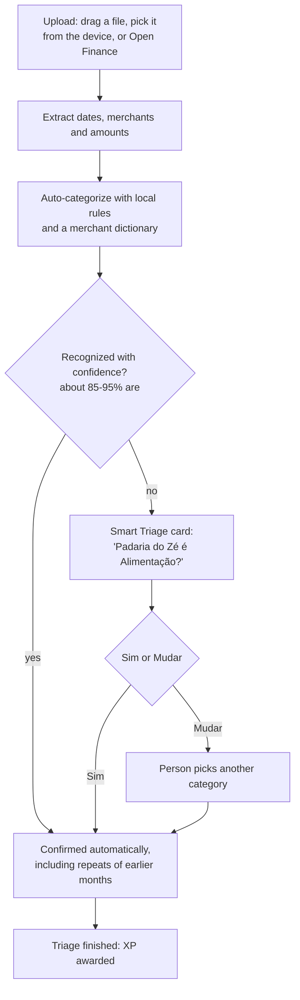

A small Smart Triage card, as described in the text:

```text
┌──────────────────────────────────────┐
│  Padaria do Zé           R$ 18,50    │
│  É Alimentação?                      │
│                                      │
│      [ Sim ]          [ Mudar ]      │
└──────────────────────────────────────┘
```

> **Superseded by** [PRODUCT.md — Feature 4, CSV and OFX import](PRODUCT.md#feature-4--csv-and-ofx-import) and [ARCHITECTURE.md — 2.5 Import and reconciliation](ARCHITECTURE.md#25-import-and-reconciliation-local): the MVP imports **CSV and OFX**; PDF is [ROADMAP.md](ROADMAP.md) Stage 7 and Open Finance Stage 22. CSV and OFX importers exist (**Current**); PDF import remains **Planned**. The 85–95% and 2-second figures are aspirations from the source, not measured targets.

### 8.3 Cards, benefits and annual fee module (turn 6)

People who concentrate spending on a credit card want efficiency, and often do not know whether the benefits beat the annual fee. This module lives inside tab 2 as a view complementary to the card bill.

**1. Real return calculator (`ROI do Cartão`)**

- Inputs: the total accumulated on the bill plus the card's rule (for example, 1.8 points per dollar, or 1% cashback).
- Annual fee: records the fee charged and compares it with the value generated in benefits.
- Health indicator: a simple metric saying whether the card produces profit or loss. Example: "This month you earned R$ 120,00 in cashback and paid R$ 45,00 in annual fee. Net profit: +R$ 75,00."

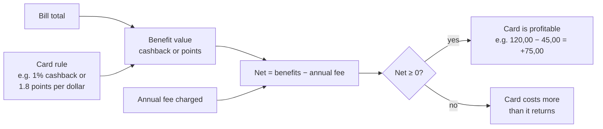

**2. Annual-fee exemption thermometer (`Termômetro de Isenção de Anuidade`)**

Many cards waive the fee when monthly spending reaches a threshold (for example, "spend R$ 5.000 for a 100% discount"). A progress bar shows how much is still missing in the current month.

**3. Estimated miles and cashback panel**

- Miles/points generated: an estimate based on the imported bill and the period's average dollar rate.
- Expiry alert: a basic reminder so idle points are not lost.

An illustrative layout composed from the text (the PDF has no drawing of this panel):

```text
┌───────────────────────────────────────────────────┐
│  FATURAS & BENEFÍCIOS — Cartão A                  │
│                                                   │
│  Retorno do mês                                   │
│  Cashback  + R$ 120,00                            │
│  Anuidade  − R$  45,00                            │
│  Lucro líquido  + R$ 75,00          [ lucro ]     │
│                                                   │
│  Isenção de anuidade (meta R$ 5.000)              │
│  ███████████████░░░░░░░░░  faltam R$ ...          │
│                                                   │
│  Pontos estimados: ...     Expiram em: ...        │
└───────────────────────────────────────────────────┘
```

> **Superseded by** [ROADMAP.md](ROADMAP.md) Stage 8 (cards, statements and benefits). Until then an open card statement is represented as a `ScheduledObligation` ([PRODUCT.md — V, Saldo Livre de Risco](PRODUCT.md#v--saldo-livre-de-risco)).

## 9. Tab 3 — `Conciliação Financeira`

**Goal:** a central place for adjustments (`Central de Ajustes`). Anything the system could not resolve with 100% confidence is handled here: the person confirms by clicking "reconcile", or adds a discount or interest. The maintainer asked that it be very simple and quick (turn 13).

| Component | Description |
| --- | --- |
| Quick validation (`Smart Triage`) | Transactions with doubtful categories appear as cards for one-tap confirmation |
| Interest and discount adjustment | A quick field for late fees or discounts obtained for early payment |
| Express cash entry (`Lançamento Express de Dinheiro`) | A three-field form (amount, category, quick note) for cash expenses, e.g. `R$ 15 — Café — Dinheiro` |
| Bill versus statement check | A `Conciliado` button marking that the card charge was checked against the bank statement |

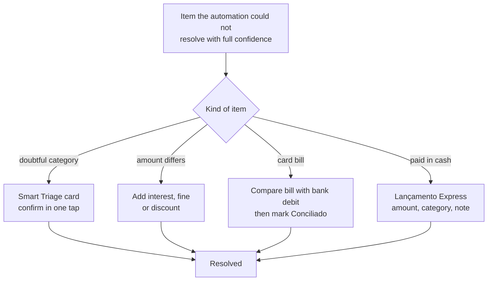

> **Superseded by** [PRODUCT.md — Feature 6, Reconciliation](PRODUCT.md#feature-6--reconciliation).

## 10. Tab 4 — `Gestão de Patrimônio & Metas`

**Goal:** build wealth and reach financial goals through pillar allocation and purchase goal boxes. (Earlier names: `ARCA & Metas`, `ARCA & Objetivos`.)

| Component | Description |
| --- | --- |
| Four-pillar matrix (`Matriz dos 4 Pilares`) | Balanced view of wealth in Ações, Imóveis/FIIs, Caixa and Ativos Internacionais, crediting the ARCA methodology by Thiago Nigro |
| Tolerance band (±10%) | 22.5% to 27.5% per pillar, avoiding unnecessary contributions caused by daily swings ([section 5.2](#52-tolerance-band-banda-de-aporte)) |
| Next-contribution calculator | The person enters the amount; the system says which pillar needs it most ([section 5.4](#54-rebalancing-without-selling)) |
| Goal boxes (`Caixinhas de Objetivos`) | Planned purchases with a progress bar and a monthly feasibility calculation |
| Surplus destination (`Destinação do Superávit`) | At month end, an automatic suggestion to send the leftover budget to goals or investments ([section 14.2](#142-surplus-destination-destinação-do-superávit)) |

**Goal feasibility.** The app reads the person's average free balance and computes the required monthly deposit. The source's examples: "Deposite R$ 200/mês até dezembro para comprar seu notebook" ("deposit R$ 200 a month until December to buy your laptop") and "Deposite R$ 300/mês para viajar em Dezembro". Quick goal templates in onboarding are `Reserva`, `Viagem` and `Carro`.

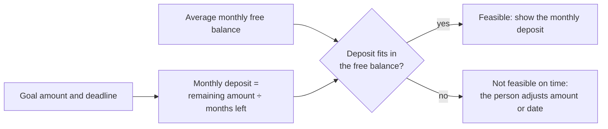

> The feasibility diagram makes explicit the comparison the source describes in one sentence ("analyzes the average free balance and computes how much must be deposited per month"); the source gives no formula.

> **Superseded by** [ROADMAP.md](ROADMAP.md) Stage 12 (goals and savings pots) and Stage 14 (net worth and ARCA), and [ARCHITECTURE.md — 2.7](ARCHITECTURE.md#27-net-worth-and-contributions). Neither is part of the MVP.

## 11. Tab 5 — `Invest` (market and news)

**Goal:** follow the economic scenario without noise, with smart summaries, in the style of the Investing.com feed. It connects the person's portfolio to real news and focuses on what affects their assets.

### 11.1 Feed sketch (turn 3)

```text
┌──────────────────────────────────────────────┐
│  FEED DE MERCADO                             │
│                                              │
│  [ Tudo ]  [ Minha Carteira ]  [ Macro ]     │
│                                              │
│  ┌────────────────────────────────────────┐  │
│  │ VALE3 - Minério de ferro sobe 2.4%     │  │
│  │ Fonte: InfoMoney • Há 15 min           │  │
│  │                                        │  │
│  │ "Altas nas cotações em Dalian trazem   │  │
│  │ otimismo para o setor de mineração..." │  │
│  │                                        │  │
│  │ [ Resumo com IA ] [ Ler no Criador ↗ ] │  │
│  └────────────────────────────────────────┘  │
└──────────────────────────────────────────────┘
```

Glosses: `Feed de mercado` = market feed; filters `Tudo` (all), `Minha Carteira` (my portfolio), `Macro` (macroeconomics); the card shows ticker and headline, source and age, an excerpt, and two buttons: `Resumo com IA` (AI summary) and `Ler no Criador` (read at the creator's site).

### 11.2 How the tab works

1. **Aggregation through a proxy.** A proxy server fetches RSS feeds and APIs of financial news portals. This avoids CORS blocks in the client and protects the person's access data.
2. **Contextual filter by portfolio.** Two modes: `Mercado Geral` / `Visão Geral do Mercado` (general market) and `Ativos da Minha Carteira` (my portfolio's assets). If the person has registered assets (e.g. `PETR4`, `IVVB11`, `HGLG11`), the feed prioritizes articles about those companies or their sectors (stocks, real estate, international).
3. **Cards.** Each card shows title, original source, time and estimated reading time.
4. **Summary mode** (pop-up or drawer). Clicking a card opens a quick read generated as bullet points with the main facts and the potential impact on the four pillars.
5. **Direct attribution.** At the bottom of the summary, the button "Ler matéria completa em [Nome do Veículo]" ("read the full article at [outlet name]") sends the person to the original site, giving authorship credit and traffic to the creator.

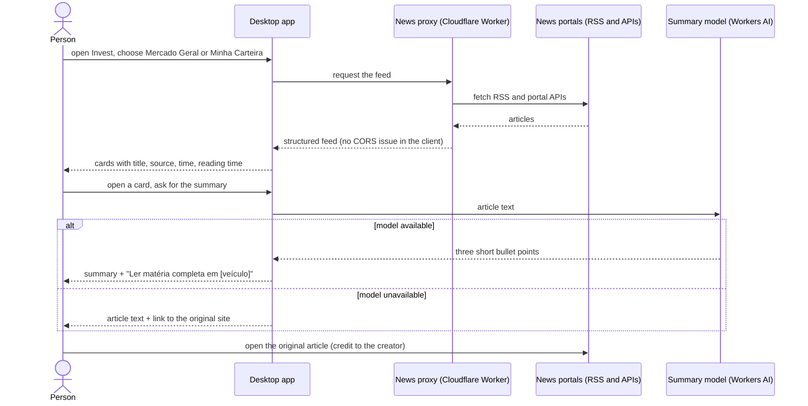

> **Superseded by** [ARCHITECTURE.md — 2.8 News and summaries](ARCHITECTURE.md#28-news-and-summaries) (**Planned**, [ROADMAP.md](ROADMAP.md) Stages 15–16): the Worker fetches only allowed sources, and the summarizer receives only the public text of the article, **never the portfolio or any financial data**. A portfolio-based filter must therefore run locally.

## 12. Tab 6 — `Histórico & Perfil`

**Goal:** show the timeline of the person's use of the system, social achievements and local data management. Turn 8 described the history as a "black box" and logbook that combines operational history, wealth evolution and the gamification journey.

### 12.1 Timeline (turn 8)

The PDF shows four timeline entries:

```text
  Hoje - 14:32 • Importação de Extrato
  │  Extrato do Banco A (PDF) importado com sucesso. 32 transações
  │  adicionadas e 2 categorizadas manualmente. (+50 XP)      [ Desfazer ]
  │
  Ontem - 18:10 • Rebalanceamento
  │  Aporte de R$ 500,00 registrado no pilar Ativos Internacionais (IVVB11)
  │  para restabelecer a margem de tolerância de 25%. (+100 XP)
  │
  01 Set 2026 • Conquista Desbloqueada
  │  Ganhou a badge "Mestre da Média" por manter os gastos diários de
  │  agosto 12% abaixo da meta histórica.
  │
  28 Ago 2026 • Meta Atingida
     A caixinha "Viagem de Fim de Ano" atingiu 100% do valor esperado.
```

The `[ Desfazer ]` (undo) button on the import entry illustrates the restore point below; the PDF describes it in text only.

> **Source inconsistency.** The badge "Mestre da Média" appears only in this timeline example; it is not in the badge list of [section 15.3](#153-badges).

### 12.2 Features

| Feature | Description |
| --- | --- |
| Timeline filter | Switch between `Tudo` (all), `Ações do Sistema` (system actions: imports, backups), `Financeiro` (contributions, large expenses) and `Gamificação` (badges, levels) |
| Restore point (`Ponto de Restauração`) | Each timeline node created by an import has a button to undo it, for example when the wrong month's statement was uploaded. The final spec extends undo to past entries and edits |
| Gamification panel | XP level table, wall of unlocked and locked badges, the week's missions, global/friends ranking |
| Local-first privacy | Settings of the local SQLite database and a trigger for the encrypted cloud backup |
| Open-source and data | Explanation of how data is saved locally, export and backup in open formats (JSON/CSV), and links to contribute to the GitHub repository (turn 5) |

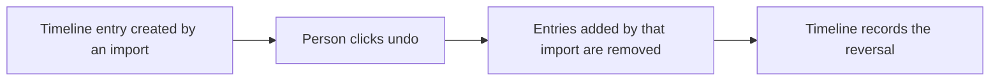

> The restore-point diagram is a minimal reading of "undo the import"; the source does not specify the mechanics.

> **Superseded by** [ARCHITECTURE.md — 2.10 History](ARCHITECTURE.md#210-history) and [PRODUCT.md — Feature 8](PRODUCT.md#feature-8--history-reversal-and-local-safety); history must hold minimal metadata, never tokens or raw document content. Export is [ROADMAP.md](ROADMAP.md) Stage 19.

## 13. Supporting screens and global modules

Besides the tabs, the PDF names modals and screens reachable from the top of the app.

| Module | Description |
| --- | --- |
| Smart notification center (`Central de Notificações Inteligentes`) | Alerts for a week's statement not imported, a pillar far below target after a sudden market drop, a new badge or level. Turn 13 adds dividend days and bill/debit reminders (below) |
| File import modal (PDF/OFX) | A visual processor showing the reading in real time: "Lendo 45 transações... 38 categorizadas com sucesso..." ("reading 45 transactions... 38 categorized") |
| Institution/account switcher | Filters the statement by `Banco A`, `Banco B` or a consolidated view of all accounts |
| `Lançamento Express` (express entry) | A minimal interface reachable from any screen for quick manual entries in three fields: amount, category and quick note |

Import modal, as described in text:

```text
┌───────────────────────────────────────────┐
│  Importando extrato                       │
│                                           │
│  Lendo 45 transações...                   │
│  ████████████████████░░░░░                │
│  38 categorizadas com sucesso...          │
└───────────────────────────────────────────┘
```

Express entry, as described in text:

```text
┌───────────────────────────────────────────┐
│  Lançamento Express                       │
│                                           │
│  Valor      [ R$ 15,00          ]         │
│  Categoria  [ Café            ▼ ]         │
│  Nota       [ Dinheiro          ]         │
│                                           │
│                       [ Lançar ]          │
└───────────────────────────────────────────┘
```

### 13.1 Alerts and notifications (consolidated)

| Trigger | Example message from the source |
| --- | --- |
| Dividend day of a mapped asset | "Hoje o fundo XPML11 paga seus proventos. Fique atento ao saldo disponível!" ("Today the XPML11 fund pays its dividends. Watch your available balance.") |
| Card bill or automatic debit due | "Sua fatura de R$ 1.200 vence hoje. Abra o app para conferir se o débito ocorreu corretamente e evitar juros." ("Your R$ 1,200 bill is due today. Open the app to check the debit went through and avoid interest.") |
| Recurring mapped expense (e.g. card bill every day 10) | A reminder to check whether the bill was paid and debited correctly |
| Week's statement not imported | Reminder to import |
| Pillar far below target after a market drop | Attention alert for the pillar |
| New badge or level | Achievement notice |
| Month-end surplus | Surplus destination prompt ([section 14.2](#142-surplus-destination-destinação-do-superávit)) |
| Financial leaks | Forgotten subscriptions, hidden fees, silent budget overruns ([section 3](#3-the-three-pillars-of-the-solution)) |

> **Superseded by** [ROADMAP.md](ROADMAP.md) Stage 10 (notification center); not part of the MVP.

## 14. Balance intelligence, surplus and survival mode

Turn 12 listed four product rules still undefined; turn 13 accepted them. Three are here; the fourth (initial data) is in [section 16.4](#164-initial-financial-data).

### 14.1 Committed money (`Saldo Real Drenado`)

**Problem:** people reading a statement take the available balance as money they can spend. Example: the balance shows R$ 2.000 today, but the R$ 1.200 card bill is due on the 10th and the R$ 600 rent is due too.

**Rule:** a metric called `Saldo Real Drenado` ("drained real balance") automatically deducts the month's mapped fixed costs and open card bills, showing only the `Saldo Livre de Risco` ("risk-free free balance"): money the person can really spend without going into debt. In turn 13 the maintainer added that the person must register automatic debits and card benefits so the app knows the day of each debit.

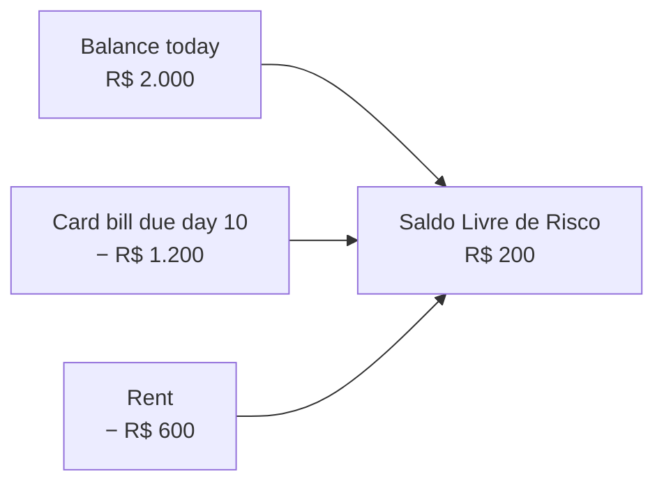

> **Superseded by** [PRODUCT.md — V, Saldo Livre de Risco](PRODUCT.md#v--saldo-livre-de-risco). The name `Saldo Livre de Risco` became the product's central metric; uncertain future income never increases it. The calculation is **Current** in `src/server/dashboard-metrics.ts`.

### 14.2 Surplus destination (`Destinação do Superávit`)

When the reader detects that the month has turned and there is a surplus (for example, R$ 400 left from the planned budget), the app starts a destination flow with a visual prompt: "Sobraram R$ 400 este mês. Deseja direcionar R$ 200 para a Meta 'Viagem' e R$ 200 para o pilar de Ativos Internacionais?" ("R$ 400 left this month. Send R$ 200 to the 'Trip' goal and R$ 200 to the International Assets pillar?"). This closes the loop between passive saving and active investing.

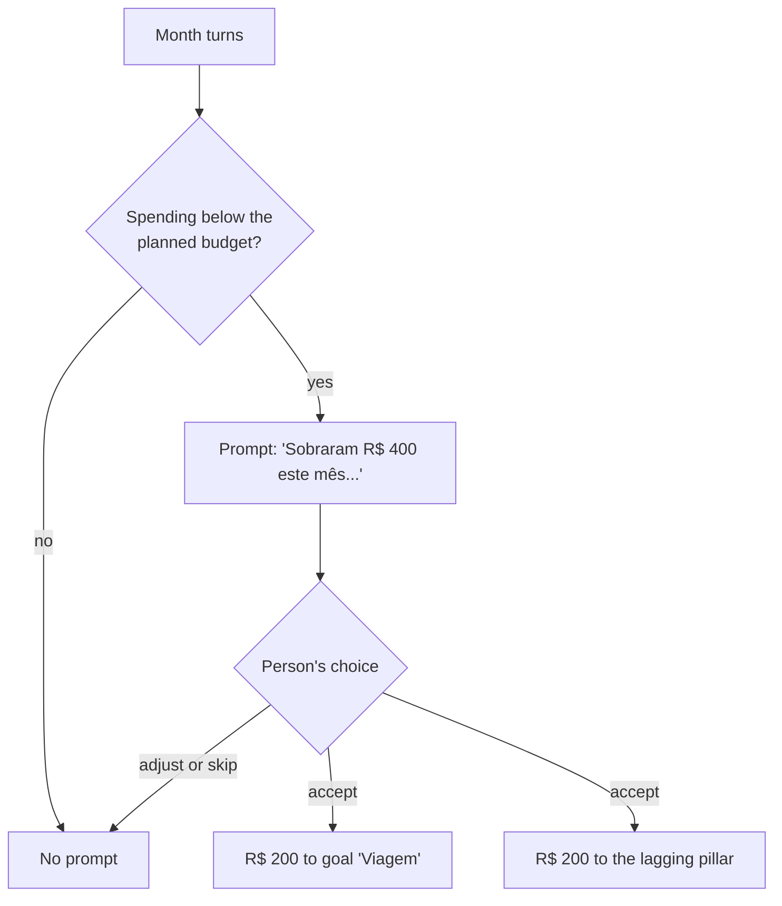

> **Superseded by** [ROADMAP.md](ROADMAP.md) Stage 9 (budget and monthly planning) and Stages 12 and 14.

### 14.3 Survival and payoff mode (`Modo Sobrevivência / Quitação`)

The ARCA methodology is for building and rebalancing wealth, but a person may arrive in debt or in overdraft. When the balance is negative or bills are piling up, the app temporarily **freezes the ARCA cards** (investing 25% in stocks makes no sense while paying 12% a month in card interest) and redirects all focus to paying off the most expensive interest and rebuilding the `Caixa` (liquidity) pillar.

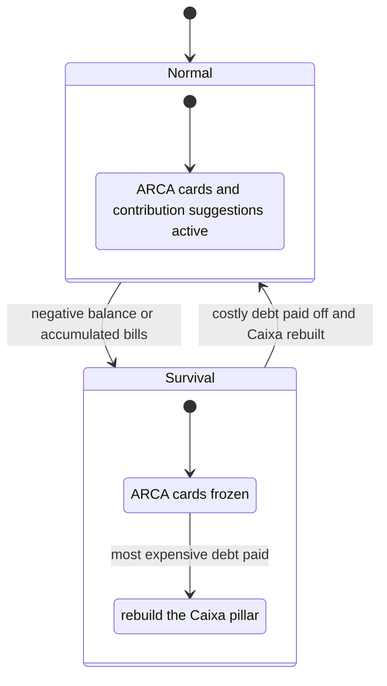

> **Superseded by** [ROADMAP.md](ROADMAP.md) Stage 13 (survival mode and debts); [ARCHITECTURE.md — 2.7](ARCHITECTURE.md#27-net-worth-and-contributions) makes the survival check the first step of any contribution suggestion.

## 15. Gamification

Gamification (ranking, missions, achievements) addresses the main weakness of finance apps: retention. Daily tasks and contributions become rewarded habits without making the app tiring. To avoid harmful behavior, such as opening the app only to farm points, **every scored action must promote a healthy financial habit**.

### 15.1 XP sources

| Source | Reward |
| --- | --- |
| Consistency: weekly access and importing the updated statement | Routine points (e.g. +50 XP for importing the week's statement) |
| Contributions aligned with the rebalancing recommendation | The largest XP amount (e.g. +100 XP in the timeline example) |
| Real saving: month's spending below the historical average | The saved difference is converted into bonus XP |
| Finishing Smart Triage | XP (turn 6) |

### 15.2 Levels

| Level | Title | XP required |
| --- | --- | --- |
| 1 | `Poupador Iniciante` (beginner saver) | 0 – 500 |
| 2 | `Construtor de Caixa` (cash builder) | 501 – 1.500 |
| 3 | `Estrategista ARCA` (ARCA strategist) | 1.501 – 3.500 |
| 4 | `Mestre do Rebalanceamento` (rebalancing master) | 3.501 – 7.000 |
| 5 | `Investidor Inabalável` (unshakeable investor) | 7.001+ |

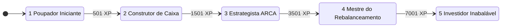

### 15.3 Badges

| Badge | Awarded when |
| --- | --- |
| `Escudo de Emergência` (emergency shield) | The `Caixa` pillar (25%) covers six months of living costs |
| `Equilíbrio Perfeito` (perfect balance) | All four pillars stay within the band (22.5%–27.5%) for three consecutive months |
| `Leitor de Mercado` (market reader) | At least ten news summaries read in the news tab |
| `Meta Batida` (goal reached) | A goal box reaches 100% without early withdrawals |

### 15.4 Missions (`Quadro de Missões`)

Missions are grouped by frequency and appear dynamically.

| Frequency | Mission | Task |
| --- | --- | --- |
| Daily / weekly | `Checagem Semanal` (weekly check) | Import the bank statement for the last 7 days |
| Daily / weekly | `Radar de Notícias` (news radar) | Read 2 summaries about assets in the portfolio |
| Monthly | `Aporte Disciplinado` (disciplined contribution) | Make at least 1 contribution to the most lagging pillar |
| Monthly | `Operação Pega-Ralo` (leak hunt) | Review the automated categories and confirm the entries |

### 15.5 Ranking and privacy

The profile showed a global/friends ranking. Turn 7 asked how a ranking can work in a privacy-focused app and proposed that it score **actions and XP** only (for example, "Ana scored 500 points this week by importing the statement and keeping the portfolio balanced") and **never** show anyone's money values. The PDF leaves this decision unanswered.

> **Superseded by** [ROADMAP.md](ROADMAP.md) Stage 17 and [DATABASE.md — Remote data pending approval](DATABASE.md#remote-data-pending-approval): social ranking stays opt-in and must never reveal net worth, income, spending or habits; whether XP is synchronized remotely is **Open**.

## 16. Onboarding and first access

### 16.1 From landing page to desktop app (turn 8)

To make sure the software is used with a valid account without complicating installation, download requires a Google sign-up first; the desktop app then asks for the same Google account.

```text
┌─────────────────────────────────────────────────────────────────┐
│                       LANDING PAGE (LP)                         │
│  1. Usuário clica em "Baixar para Windows / Linux"              │
│  2. Modal de Auth abre: "Entre com o Google para liberar o app" │
│  3. Google Auth valida e salva o registro no Cloudflare D1      │
│  4. Download do executável (.exe ou .AppImage) é liberado       │
└─────────────────────────────────────────────────────────────────┘
                                │
                                ▼
┌─────────────────────────────────────────────────────────────────┐
│                     APP DESKTOP (Electron)                      │
│  1. Primeira abertura: pede login com a mesma conta do Google   │
│  2. O D1 valida a sessão via token seguro                       │
│  3. O app cria o banco SQLite local vinculado ao ID do usuário  │
└─────────────────────────────────────────────────────────────────┘
```

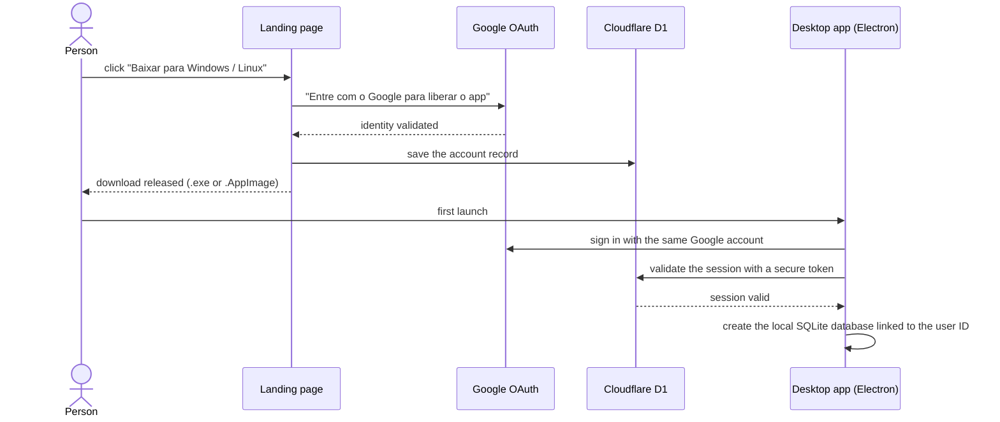

> **Superseded by** [ARCHITECTURE.md — 2.3 Web sign-up, login and download](ARCHITECTURE.md#23-web-sign-up-login-and-download) and [PRODUCT.md — Cloud track](PRODUCT.md#cloud-track-sign-up-session-and-downloads); every frontend-to-backend request uses the action-code protocol of [ARCHITECTURE.md — 2.1](ARCHITECTURE.md#21-action-code-protocol).

### 16.2 First-run carousel (turn 2)

To fight first-access abandonment, the introduction must take **at most 45 seconds**, as a carousel of direct cards with micro-interactions, little text, showing what each tab does.

```text
┌──────────────────────────┐ ┌──────────────────────────┐ ┌──────────────────────────┐
│ 1  O Leitor Automatizado │ │ 2  Metas Sem Fricção     │ │ 3  Investimento          │
│                          │ │                          │ │    Inteligente           │
│ "Conecte ou envie o      │ │ "Diga o que quer         │ │ "Acompanhe seus          │
│  extrato. Nós            │ │  comprar. O app calcula  │ │  investimentos divididos │
│  organizamos a bagunça." │ │  o caminho."             │ │  em 4 pilares            │
│                          │ │                          │ │  equilibrados."          │
│ ┌──────────────────────┐ │ │ [Reserva] [Viagem]       │ │   ┌──┬──┐                │
│ │ Importar meu primeiro│ │ │ [Carro]                  │ │   │A │R │  simplified    │
│ │ extrato (PDF/OFX)    │ │ │                          │ │   ├──┼──┤  four-pillar   │
│ └──────────────────────┘ │ │                          │ │   │C │A │  chart         │
│          ● ○ ○           │ │          ○ ● ○           │ │   └──┴──┘   ○ ○ ●        │
└──────────────────────────┘ └──────────────────────────┘ └──────────────────────────┘
```

| Card | Message | Quick action |
| --- | --- | --- |
| 1 `O Leitor Automatizado` (the automated reader) | "Connect or send the statement. We sort out the mess." | Big button "Importar meu primeiro extrato (PDF/OFX)" |
| 2 `Metas Sem Fricção` (frictionless goals) | "Say what you want to buy. The app works out the path." | Quick goal choice: `Reserva`, `Viagem`, `Carro` |
| 3 `Investimento Inteligente` (smart investing) | "Follow your investments split into 4 balanced pillars." | Simplified graphic of the four pillars |

### 16.3 The first 45 seconds as a journey

The scores (1 to 5) express the friction the source wanted to avoid; they are an interpretation, not numbers from the PDF.

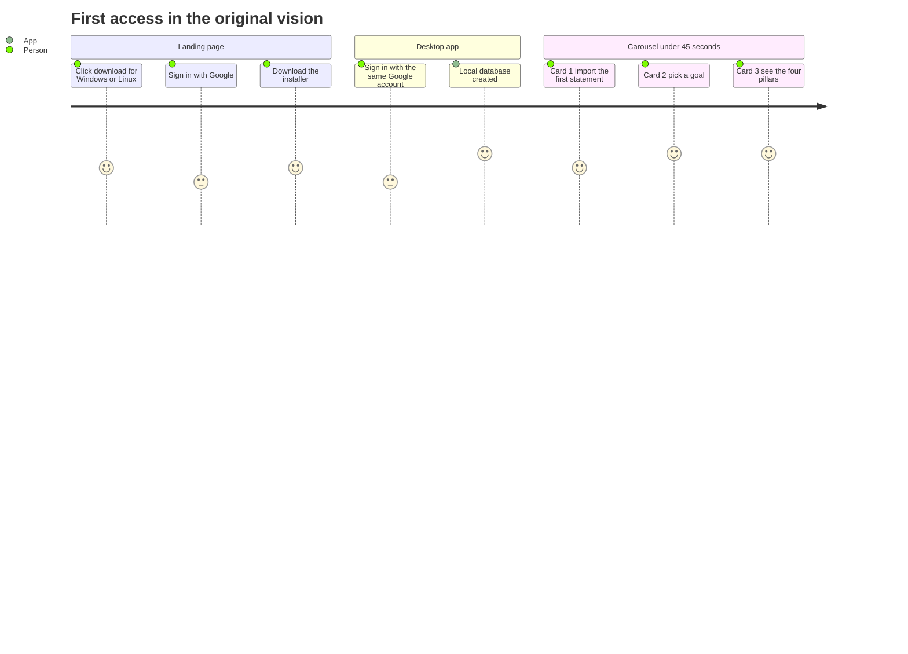

### 16.4 Initial financial data

For the ARCA calculation to work, the person must say where they start from. Turn 12 offered two options and turn 13 accepted the proposal ("Perfeito") without choosing between them:

- a quick three-question form: "How much do you already have in Treasury/CDB?", "Do you hold stocks/FIIs?", "Do you have dollars or assets abroad?";
- or starting from absolute zero (R$ 0 invested) and building the portfolio only from new contributions found in statements.

> **Superseded by** [PRODUCT.md — Onboarding and initial financial snapshot](PRODUCT.md#onboarding-and-initial-financial-snapshot) and [Feature 1](PRODUCT.md#feature-1--financial-onboarding).

## 17. Product decisions raised and how they were answered

Turn 7 raised five decisions before choosing a stack; turn 12 raised four more. The table records the question, the options offered and what the PDF settled.

| # | Question | Options offered | Outcome in the PDF |
| --- | --- | --- | --- |
| 7.1 | Sync and multiple devices | A: 100% local, no server cost, maximum privacy, no sync. B: hybrid, local SQLite plus an encrypted copy in Cloudflare D1 or Turso | **100% local**; D1 for authentication and a backup so local deletion cannot destroy everything (turn 8) |
| 7.2 | Supported statement formats; what happens when a bank changes its PDF layout | Recommended: OFX (structured) plus PDFs of the three largest banks; possibly a community repository of per-bank parsers | Not answered explicitly; later turns keep PDF and OFX |
| 7.3 | AI for summaries and categorization | Local Ollama (free, needs RAM/GPU); cloud (Cloudflare Workers AI, Groq, Gemini); rule fallback (regex/dictionary categorizing about 80%, AI only for news and truly ambiguous cases) | **Cloudflare Workers AI** for summaries (turn 11); local rules and a merchant dictionary for categorization (turn 6) |
| 7.4 | Privacy of statements, which hold highly sensitive data (CPF, real balance, spending habits): discard raw PDF/OFX files after extraction or keep them locally? Does the external database keep only metadata (email, XP, badges) or balances too? | External database candidates: Supabase, Firebase or Cloudflare D1. The source notes that keeping financial data in local SQLite attracts privacy-minded users | Turn 8: local SQLite keeps everything, including raw statements; the cloud holds only account metadata and the encrypted backup |
| 7.5 | Social gamification versus privacy | Rank by actions and XP, never show money values | Not answered |
| 12.1 | Committed money | A `Saldo Real Drenado` metric | Accepted; automatic debits and card benefits must be registered (turn 13) |
| 12.2 | Month-end surplus | Automatic surplus destination prompt | Accepted ("Gostei do exemplo") |
| 12.3 | Accounts in the red | Survival / payoff mode | Accepted ("Perfeito") |
| 12.4 | Initial financial data | Three-question form, or start from zero | Accepted ("Perfeito"), without picking one option |

> **Superseded by** [DATABASE.md — Data placement policy](DATABASE.md#data-placement-policy): financial data stays local and D1 receives none. Multi-device sync is [ROADMAP.md](ROADMAP.md) Stage 23. Whether raw imported files are kept is governed by [PRODUCT.md](PRODUCT.md) and [SECURITY.md](SECURITY.md).

## 18. Technical ideas in the source

The maintainer said in turn 1 that architecture and security were out of scope, but turns 7 to 11 drifted into a technical stack. Everything in this section is **historical**. Each part ends with what replaced it.

### 18.1 The "official stack" of turn 9, revised in turns 10 and 11

**Desktop client**

| Layer | Technology | Justification given |
| --- | --- | --- |
| Base framework | Electron | Native builds for Windows and Linux; handles local file processing |
| Frontend / UI | React + Tailwind CSS | Modular, reactive components; fluid styling for dashboards and cards |
| Full-stack framework (turn 10) | Next.js (App Router) | Renders the UI and serves a local REST API (`/api`) |
| Local database | SQLite (via better-sqlite3, or Prisma/TypeORM; turn 10 fixes Prisma) | Stores 100% of financial data on the computer; no balance data reaches the cloud |
| File parsing | PDF.js / Node-OFX | Extracts raw data from PDF and OFX statements in Electron's main process |

**Cloud and authentication (Cloudflare)**

| Service | Technology | Role |
| --- | --- | --- |
| Edge compute | Cloudflare Workers | Serverless layer for the landing page, session validation and the news proxy |
| Cloud database | Cloudflare D1 | Only account metadata (user ID, email, XP level, badges, download validation hash) and the encrypted backup blob |
| Authentication | Google OAuth 2.0 (Google Cloud) | Single sign-on on the landing page and on the app's first launch, linking the licence of use |

**Intelligence and proxy**

| Module | Technology | Role |
| --- | --- | --- |
| Feed proxy | Cloudflare Worker (CORS proxy) | Collects news and RSS from financial portals and serves a structured feed |
| Summary engine | Cloudflare Workers AI (Llama 3 / Mistral); fallback: local Ollama | Bullet-point summaries; users with a dedicated GPU could switch to Ollama |

**Security and backup**

- **End-to-end encryption:** before sending the SQLite snapshot to D1, the app encrypts it locally with AES-256-GCM using a key derived from and bound to the user's session.
- **Zero knowledge:** neither Cloudflare administrators nor the open-source community can see money values, statements or balances in the backups. Only the user's executable with an active session can decrypt a backup to restore it.
- **Why:** if the disk fails or the app is uninstalled by accident, the person could lose everything; a periodic encrypted snapshot linked to the Google account prevents that without violating local-first.

```mermaid
flowchart LR
    LP["Landing page"] -- Google Auth --> D1[("Cloudflare D1<br/>user record")]
    LP -- releases download --> APP["Electron app<br/>Windows / Linux"]
    APP --> DB[("Local SQLite<br/>statements, spending, ARCA,<br/>miles, milestones")]
    APP --> PR["PDF/OFX processor<br/>local extraction"]
    APP --> AI["Workers AI / Ollama<br/>news summaries"]
    APP -- "encrypted backup (E2EE)" --> D1
```

```mermaid
sequenceDiagram
    participant A as Desktop app
    participant K as Local crypto (AES-256-GCM)
    participant D as Cloudflare D1
    A->>A: periodic snapshot of local SQLite
    A->>K: encrypt with a key bound to the session
    K-->>A: ciphertext
    A->>D: upload linked to the Google account
    Note over D: stores only ciphertext (zero knowledge)
    D-->>A: on restore, ciphertext back to the same account
    A->>K: decrypt locally with the active session
```

> **Superseded by:**
> - [DESIGN-SYSTEM.md](DESIGN-SYSTEM.md): Tailwind is **not used**. It is configured in PostCSS but not imported; the UI is hand-written CSS.
> - [PRODUCT.md — MVP scope](PRODUCT.md#mvp-scope) and [ARCHITECTURE.md — 2.5](ARCHITECTURE.md#25-import-and-reconciliation-local): MVP import is **CSV and OFX**; PDF.js and an OFX library are installed but unused, and no parser exists yet.
> - [DATABASE.md — Data placement policy](DATABASE.md#data-placement-policy): **D1 receives no financial data**. It holds minimal identity, sessions, consents, releases and download grants. XP and badges in D1 are not allowed until a feature needs them and is approved.
> - [ARCHITECTURE.md — 2.9 Backup and restore](ARCHITECTURE.md#29-backup-and-restore): encrypted backup is **Planned** ([ROADMAP.md](ROADMAP.md) Stage 18) and goes to object storage through the Worker, not into D1 rows; the decryption key is never stored in the cloud. The current design does not adopt the session-bound key of the original idea.

### 18.2 Next.js full-stack inside Electron (turn 10)

Electron's main process starts a local Next.js server; Next.js serves both the React UI and a local API layer (`/app/api/...`); Prisma talks to the local SQLite file.

```text
┌────────────────────────────────────────────────────────────────────────┐
│                        PROCESSO ELECTRON (Main)                        │
│  1. Inicializa o servidor local do Next.js (ex: http://localhost:3000) │
│  2. Define o caminho do SQLite: env DATABASE_URL="file:./local.db"     │
└────────────────────────────────────────────────────────────────────────┘
                                   │
                                   ▼
┌────────────────────────────────────────────────────────────────────────┐
│                       NEXT.JS FULL-STACK (Local)                       │
│                                                                        │
│  ┌───────────────────────────┐       ┌───────────────────────────────┐ │
│  │   FRONTEND (Pages/App)    │ ────► │ CAMADA DE API (Route Handlers)│ │
│  │  Components, Dashboards   │ fetch │  /api/extratos, /api/arca     │ │
│  └───────────────────────────┘       └───────────────┬───────────────┘ │
│                                                      │                 │
│                                                      ▼                 │
│                                      ┌───────────────────────────────┐ │
│                                      │          PRISMA ORM           │ │
│                                      └───────────────┬───────────────┘ │
└──────────────────────────────────────────────────────┼─────────────────┘
                                                       │
                                                       ▼
                                       [ BANCO SQLITE LOCAL (local.db) ]
```

The API layer "handles heavy processing and hides Prisma from the views". Example route: `POST /api/arca/rebalancear` reads `valorAporte` (contribution amount), loads all `AtivoArca` rows, sums `valorAtual`, sorts assets by their share ascending, and returns the first one as `pilarRecomendado` with `percentualAtual` (two decimals), `sugestaoAporte` (the full amount) and `status: "SUGESTAO_GERADA"`.

> **Source inconsistency.** The example route's comment says it finds the pillar "below 22.5%", but the code never checks the band: it always returns the asset with the smallest share, even when every pillar is balanced. It also ranks individual assets rather than pillar totals, so a pillar with several assets is not summed.

> **Superseded by** [ARCHITECTURE.md — 4.8 Local API contract](ARCHITECTURE.md#48-local-api-contract) and the [route map](PRODUCT.md#route-map): routes such as `/api/extratos`, `/api/arca`, `/api/arca/rebalancear` and `/api/resumo` do not exist. Every renderer request uses a single-use action code ([ARCHITECTURE.md — 2.1](ARCHITECTURE.md#21-action-code-protocol)). The local database file is `temp/talentum-local.db` in development and `/data/talentum-local.db` in Docker, not `local.db`.

### 18.3 The Prisma schema sketch (turn 10)

The PDF proposed four models, with no relations between them. Field names are Portuguese: `valor` = amount, `tipo` = type, `pilar` = pillar, `nomeAtivo` = asset name, `xpGanha` = XP earned.

```mermaid
erDiagram
    UsuarioMetadados {
        String id PK "uuid"
        String googleId UK
        String email
        Int xpTotal "default 0"
        Int nivelAtual "default 1"
        DateTime criadoEm
    }
    Transacao {
        String id PK "uuid"
        DateTime data
        String descricao
        String estabelecimento "optional"
        Float valor "money as Float"
        String tipo "ENTRADA or SAIDA"
        String categoria "e.g. Alimentacao"
        Boolean validado "default true"
        String banco "optional"
        DateTime criadoEm
    }
    AtivoArca {
        String id PK "uuid"
        String pilar "ACOES, REAL_ESTATE, CAIXA, INTERNACIONAL"
        String nomeAtivo "e.g. IVVB11, Tesouro Selic"
        Float valorAtual
        Float percentual
        DateTime atualizadoEm
    }
    HistoricoTimeline {
        String id PK "uuid"
        String titulo
        String descricao
        String categoria "IMPORTACAO, REBALANCEAMENTO, CONQUISTA"
        Int xpGanha "default 0"
        DateTime criadoEm
    }
```

> **Superseded by** [DATABASE.md — Local SQLite (Prisma)](DATABASE.md#local-sqlite-prisma). **Current** in `prisma/schema.prisma`: money is stored as **integer cents** (`BigInt` fields such as `amountCents` and `balanceCents`), never `Float`; every table has an opaque `id`; relations use foreign-key IDs; financial rows are scoped by `profileId`; categories, institutions and accounts are tables, not free strings.

### 18.4 AI summaries: Ollama versus Workers AI (turns 10 and 11)

**Turn 10, Ollama.** Ollama is free open-source software that downloads and runs language models (Llama 3, Phi-3, Mistral) on the user's machine. The app would call its local HTTP endpoint (`localhost`, port 11434, `/api/generate`). The user must install Ollama and download a model (for example `ollama run llama3`). If Ollama is not running, the interface shows the article text with the link to the original site, without freezing the app.

**Turn 11, Workers AI.** Requiring Ollama is a barrier (multi-gigabyte models, heavy RAM/GPU use), so summaries move to Cloudflare Workers AI at the edge. The source's claims: the free plan includes 10,000 "neurons" per day, enough for thousands of daily summaries; responses in milliseconds; the Electron installer stays under about 80 MB.

```text
┌────────────────────────────────────────────────────────┐
│            APP DESKTOP (Next.js / Electron)            │
│  Usuário clica em "Gerar Resumo da Notícia"            │
└───────────────────────────┬────────────────────────────┘
                            │
              Requisição HTTP leve (fetch)
                            │
                            ▼
┌────────────────────────────────────────────────────────┐
│            CLOUDFLARE WORKER (Serverless API)          │
│                                                        │
│  1. Recebe o texto completo da notícia                 │
│  2. Chama o modelo: @cf/meta/llama-3-8b-instruct       │
│  3. Retorna o resumo formatado em tópicos              │
└────────────────────────────────────────────────────────┘
```

The example Worker received `textoNoticia` (article text), prompted the model as "a financial assistant" to summarize the article in three short, direct bullet points, and returned the model output as JSON. The local Next.js route `app/api/resumo/route.ts` forwarded the text to the Worker and returned `{ resumo }`.

| Characteristic | Local Ollama | Cloudflare Workers AI |
| --- | --- | --- |
| App weight | Several GB (model download) | Light (about 80 MB) |
| Impact on the PC | High RAM and CPU/GPU use | None on the user's machine |
| Cost | Free | Free (the table says "10k requests a day"; the text says "10,000 neurons a day") |
| Installation | Ollama must be installed first | None; works immediately |

> The two cost figures above disagree in the source (requests versus neurons). Free-tier limits are provider claims from September 2026 and were not verified for this rewrite.

> **Superseded by** [ARCHITECTURE.md — 2.8](ARCHITECTURE.md#28-news-and-summaries) and [ROADMAP.md](ROADMAP.md) Stage 16: summaries of public content through Workers AI with prompt-injection protection and a no-AI fallback; Ollama remains a future option that requires an ADR. AI is not part of the MVP.

### 18.5 Final stack summary (turn 10)

| Layer | Technology | Role |
| --- | --- | --- |
| Desktop shell | Electron | Windows/Linux executable that runs the Next.js server in the background |
| Full-stack framework | Next.js (App Router) | UI (React/Tailwind) and a local REST API (`/api`) |
| ORM and database | Prisma ORM + SQLite | Typed data layer over `local.db` on the computer |
| Auth and cloud | Google OAuth + Cloudflare D1 | Landing-page login and encrypted backup |
| AI | Ollama (turn 10), then Cloudflare Workers AI (turn 11) | News summaries |
| Security and backup | AES-256-GCM | End-to-end encrypted SQLite snapshot |

> **Superseded by** [ARCHITECTURE.md](ARCHITECTURE.md). The Electron shell, local Next.js app, Prisma with SQLite, and the Cloudflare Worker with D1 exist in the repository; Tailwind, PDF parsing, AI and cloud backup do not.

## 19. Monetization

The PDF does not discuss monetization, pricing, plans or a business model. Its only cost considerations are about running costs: Option A of turn 7 (no database server cost for the maintainer), Ollama being free, and Cloudflare free tiers. The open-source model is justified by trust, auditability and community contributions, not revenue.

## 20. Supersession summary

| Original idea | Status now | Where |
| --- | --- | --- |
| Money stored as `Float` | Integer cents (`BigInt`), **Current** | [DATABASE.md](DATABASE.md#money-and-time) |
| PDF and OFX import, Open Finance | CSV and OFX in the MVP (**Planned**); PDF Stage 7; Open Finance Stage 22 | [PRODUCT.md](PRODUCT.md#mvp-scope), [ROADMAP.md](ROADMAP.md) |
| D1 stores account metadata, XP, badges and the backup blob | D1 receives no financial data; XP sync is **Open**; backup **Planned** via object storage | [DATABASE.md](DATABASE.md#data-placement-policy), [ARCHITECTURE.md](ARCHITECTURE.md#29-backup-and-restore) |
| React + Tailwind CSS | Tailwind not used; hand-written CSS | [DESIGN-SYSTEM.md](DESIGN-SYSTEM.md) |
| Emoji icons and status lights | Documented icon set and tokens | [DESIGN-SYSTEM.md](DESIGN-SYSTEM.md) |
| Prisma models `UsuarioMetadados`, `Transacao`, `AtivoArca`, `HistoricoTimeline` | Current schema with opaque IDs, foreign keys, `profileId` scoping | [DATABASE.md](DATABASE.md#local-sqlite-prisma) |
| Local APIs `/api/extratos`, `/api/arca`, `/api/arca/rebalancear`, `/api/resumo` with plain `fetch` | Documented local API contract with single-use action codes | [ARCHITECTURE.md](ARCHITECTURE.md#48-local-api-contract) |
| `local.db` | `temp/talentum-local.db` (dev), `/data/talentum-local.db` (Docker) | [ARCHITECTURE.md](ARCHITECTURE.md) |
| `Saldo Real Drenado` | `Saldo Livre de Risco`, **Current** calculation | [PRODUCT.md](PRODUCT.md#v--saldo-livre-de-risco) |
| Six-tab navigation | Current navigation areas and route map | [PRODUCT.md](PRODUCT.md#navigation-areas) |
| 45-second onboarding carousel and initial data options | Onboarding specification | [PRODUCT.md](PRODUCT.md#onboarding-and-initial-financial-snapshot) |
| Dashboard sketch | Dashboard specification | [PRODUCT.md](PRODUCT.md#dashboard-specification) |
| ARCA rebalancing | Stage 14, survival check first, not individual advice | [ARCHITECTURE.md](ARCHITECTURE.md#27-net-worth-and-contributions) |
| News proxy and AI summaries; Ollama | Stages 15–16; summarizer never sees financial data; Ollama needs an ADR | [ARCHITECTURE.md](ARCHITECTURE.md#28-news-and-summaries) |
| Global/friends ranking | Opt-in, never reveals values; Stage 17 | [DATABASE.md](DATABASE.md#remote-data-pending-approval) |
| E2EE backup with a session-bound key | Stage 18; key never in the cloud | [ARCHITECTURE.md](ARCHITECTURE.md#29-backup-and-restore) |
| Timeline with restore points | History and reversal: MVP Feature 8 and Stage 11 | [PRODUCT.md](PRODUCT.md#feature-8--history-reversal-and-local-safety) |
| Card ROI, exemption thermometer, miles | Stage 8 | [ROADMAP.md](ROADMAP.md) |
| Notification center, budget, goals, survival mode | Stages 10, 9, 12, 13 | [ROADMAP.md](ROADMAP.md) |

## 21. Glossary of Portuguese terms

| Term | English |
| --- | --- |
| `Aba` | Tab |
| `Aporte` | Contribution (new money invested) |
| `Anuidade` | Annual card fee |
| `Caixinha` | Goal box / savings pot |
| `Carteira` | Portfolio |
| `Conciliação` / `Conciliado` | Reconciliation / reconciled |
| `Defasado` | Lagging (below the band) |
| `Equilibrado` | Balanced (inside the band) |
| `Extrato` | Bank statement |
| `Fatura` | Credit-card bill |
| `FII` | Brazilian real-estate investment fund |
| `Lançamento` | Entry / transaction |
| `Meta` | Goal |
| `Patrimônio` | Net worth / wealth |
| `Pilar` | Pillar |
| `Proventos` | Dividends and other distributions |
| `Ralo financeiro` | Financial leak |
| `Saldo` | Balance |
| `Sobrecarregado` | Overweight (above the band) |
| `Superávit` | Surplus |
| `Triagem` | Triage |
