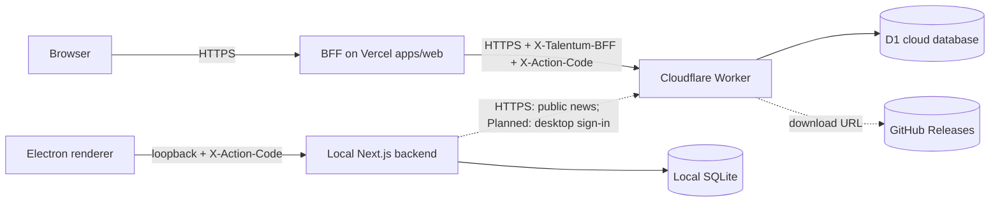
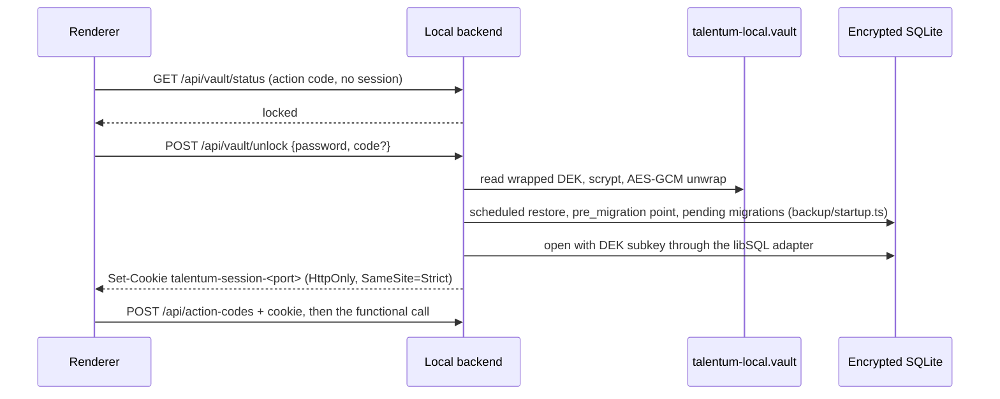
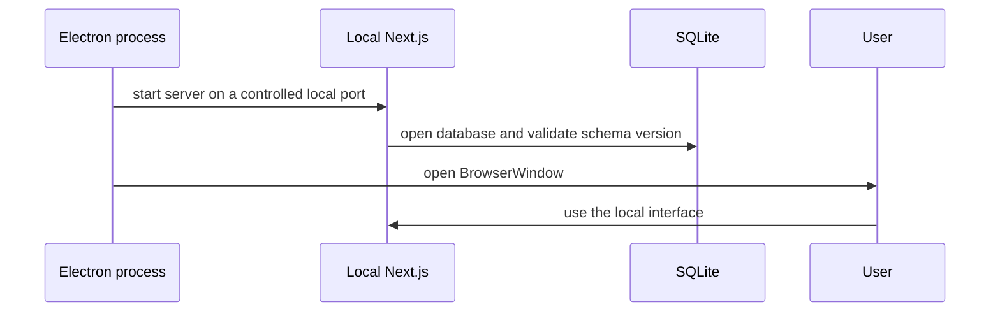
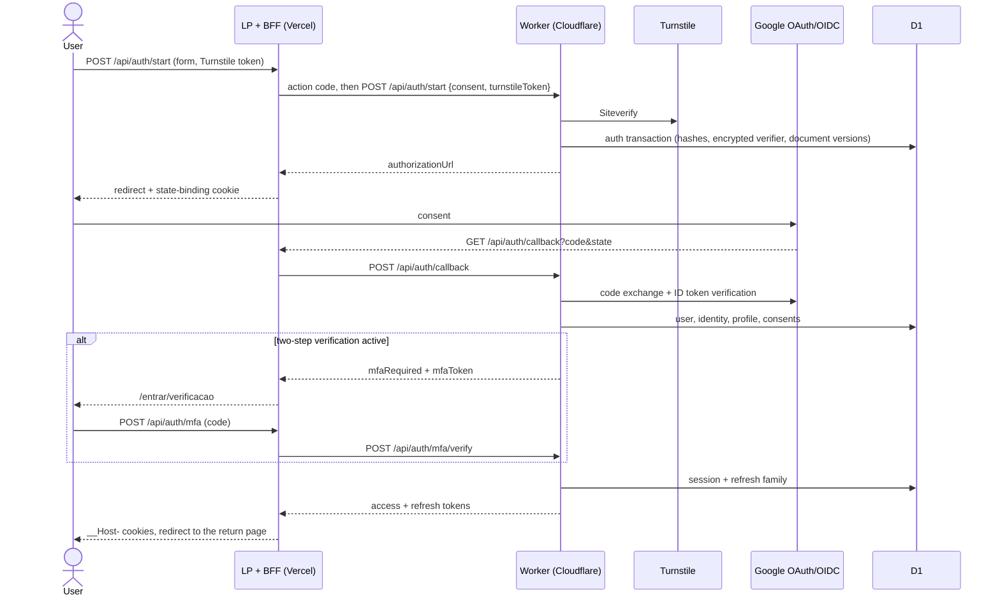
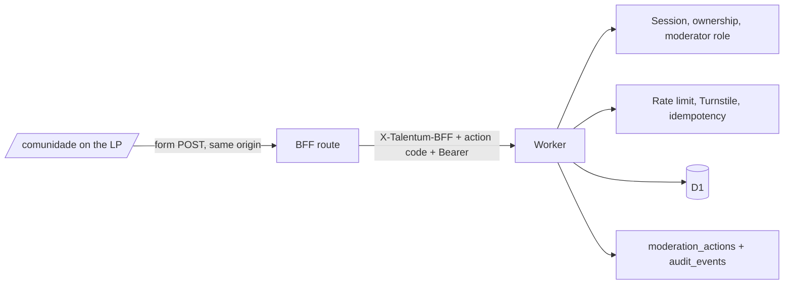
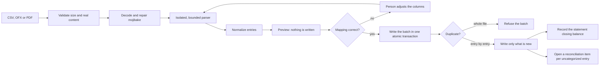
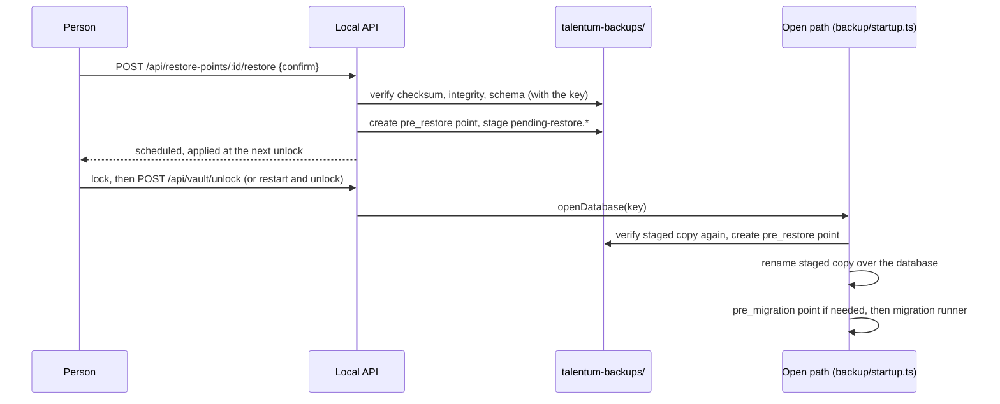
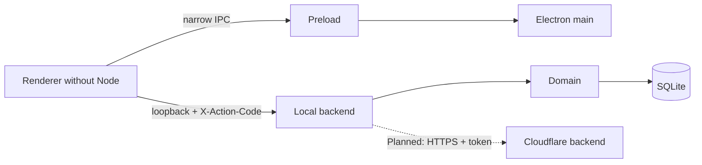

# Talentum Architecture

This document is the single source for how Talentum is built and how it runs: the product shape, the two runtime layers (the public Web layer and the local Electron layer), the cross-layer runtime flows, the action-code protocol, every backend contract (cloud and local), Cloudflare setup and deployment, operations, and the shared API conventions. Statements carry the status labels defined in [README.md](README.md#status-labels). Security policy, secret handling and threat rules live in [SECURITY.md](SECURITY.md); table-level schemas live in [DATABASE.md](DATABASE.md); product scope and screens live in [PRODUCT.md](PRODUCT.md).

## Contents

- [1. Overview](#1-overview)
- [2. Cross-layer runtime flows and the action-code protocol](#2-cross-layer-runtime-flows-and-the-action-code-protocol)
- [3. Layer 1: Web](#3-layer-1-web)
- [4. Layer 2: Electron](#4-layer-2-electron)
- [5. Error format and shared API conventions](#5-error-format-and-shared-api-conventions)
- [6. Open items](#6-open-items)

## 1. Overview

### 1.1 Product shape

**Current.** Talentum is a local-first personal finance application. The repository contains two deliberately separated products:

- **Web layer:** a public landing page (LP) with a minimal backend-for-frontend (BFF) in `apps/web/`, meant for Vercel, plus a Cloudflare Worker with a D1 database in `cloudflare/`. It handles sign-up/login (web and desktop, with optional two-step verification), the account page, the protected downloads page and download grants, the feedback community, and public economic news with summaries.
- **Electron layer:** the desktop application. A local Next.js app in `src/` serves both the user interface and the local API (route handlers in `src/app/api`, server code in `src/server`); `electron/` holds the shell (`main.cjs`, `preload.cjs`); `prisma/` holds the local SQLite schema and migrations.

The two layers share nothing at runtime except the documented HTTPS contracts described below. The financial system and the Electron shell are never deployed to, or included in the build of, the Vercel project. **Planned:** Windows, Linux and macOS installers are published on GitHub Releases (macOS only after it is signed and notarized); D1 stores only release metadata and grants by ID.



The local backend's only cloud calls today are the public news routes (**Current**, no personal or financial data, [§2.8](#28-news-and-summaries)); desktop sign-in through the Worker is Current on the cloud side and in Electron, with the packaged Worker URL still Open ([§4.7](#47-desktop-authentication)).

### 1.2 Local-first principle and central rule

Every interface is an untrusted client. The browser and the Electron renderer never access a database, Prisma, storage, OAuth or any privileged service directly. Every read and write goes through a documented, validated and authorized backend contract.

Normative rules (apply to both layers):

1. Every frontend operation corresponds to a documented backend endpoint or command.
2. No authorization rule exists only in the frontend.
3. Every persisted table, including join tables, has an opaque `id`; relations use foreign keys by ID.
4. Primary financial data stays local. Any new synchronization requires a privacy and threat review.
5. Confidential data is not sent to the frontend. Encryption does not make it safe to expose something unnecessary.
6. Changes to architecture, API, schema or security update the documentation in the same change set.
7. External integrations use adapters, timeouts, response validation and fail-safe behavior. **Current state:** every Worker outbound call (Google, Turnstile, news hosts, Workers AI) has a timeout and validates the response, and AI or feed failures fall back safely; a separate adapter layer is **Planned**.

### 1.3 Responsibilities by component

| Component | May | Must not |
| --- | --- | --- |
| Web frontend (LP pages) | render public data and authorized responses | hold secrets, query a database or decide authorization |
| BFF (`apps/web` route handlers) | hold first-party session cookies, request action codes, proxy to the Worker | hold financial rules, own a database or reach local data |
| Worker (cloud backend) | authenticate, authorize, rate-limit and persist cloud data | receive cleartext financial data without an approved case |
| Electron renderer | display state and call allowed contracts | use Node, Prisma, the filesystem or a persistent token directly |
| Local backend (`src/app/api`, `src/server`) | run the domain, persist finances and (Planned) integrate with the cloud | trust renderer input |
| Electron main process | expose minimal native capabilities through the preload | expose generic IPC or load privileged remote content |

### 1.4 Repository layout

**Current** (matches the tree; there is no `packages/` and no `turbo.json`):

```text
apps/
  web/                 @talentum/web: public LP + BFF (Next.js, port 3100). No Electron, Prisma, SQLite or financial domain.
src/                   local Next.js app (product UI and local API)
  app/                 App Router pages and layouts; route handlers in app/api
  components/          components owned by the local app
  hooks/               React hooks
  lib/                 client helpers (API client, formatting, charts)
  server/              server-only code: database, action codes, metrics
  types/               shared TypeScript types
  middleware.ts        loopback Host check for /api
electron/              main.cjs (window, navigation, permissions, IPC) and preload.cjs
prisma/                schema.prisma + 12 migrations (local SQLite only)
cloudflare/            Worker (src/index.ts), D1 migrations, wrangler.jsonc (tracked working config), wrangler.example.jsonc, .dev.vars.example
design/estados-vetor/  vector sources for empty-state illustrations
public/                static assets of the local app
scripts/               dev, dev:all, migrate-dev (new migrations against a scratch database), desktop packaging prep, palette validator, the isolated end-to-end server, asset generators, typecheck helpers
tests/                 node:test suites; tests/regression/ holds regression tests; tests/e2e/ holds Playwright specs
.githooks/             versioned pre-commit and pre-push hooks
.github/               CI workflow (workflows/ci.yml), CONTRIBUTING, CODE_OF_CONDUCT and the vulnerability-reporting policy (SECURITY.md)
LICENSE                open-source license
.claude/               agent skills and tooling
docs/                  normative documentation and ADRs (docs/decisions/)
README.md, CLAUDE.md, AGENTS.md   project overview, AI agent rules, pointer for other agents
package.json, pnpm-workspace.yaml root scripts, dependencies, build allowances and overrides
biome.json, playwright.config.ts  linter/formatter rules and end-to-end test configuration
Dockerfile             local app image (Ubuntu 24.04 base)
Dockerfile.web         LP/BFF image (node:22-bookworm-slim)
compose.yaml           talentum-local (127.0.0.1:3000) and talentum-web (127.0.0.1:3100)
```

**Planned (not adopted).** The earlier target layout split the code into `apps/web`, `apps/desktop`, `packages/contracts` (shared schemas without secrets), `packages/domain` (business rules), `packages/db-local` (Prisma/SQLite and migrations) and `workers/` (Cloudflare backend). None of `apps/desktop`, `packages/` or `workers/` exists. Whether to migrate to that layout is **Open**; until a decision is recorded, extend the current canonical paths above.

### 1.5 Related documents

- [SECURITY.md](SECURITY.md): authentication, sessions, secrets, threat rules.
- [DATABASE.md](DATABASE.md): local Prisma models and D1 tables.
- [PRODUCT.md](PRODUCT.md): routes, onboarding, dashboard formulas, product scope.
- [BEST_PRACTICES.md](BEST_PRACTICES.md): development workflow, commands, tests.
- [DESIGN-SYSTEM.md](DESIGN-SYSTEM.md): branding, states, visual QA.
- [ROADMAP.md](ROADMAP.md): sequencing of planned work.
- [decisions/0001-web-hosting.md](decisions/0001-web-hosting.md): web hosting decision.
- [decisions/0002-own-ofx-parser.md](decisions/0002-own-ofx-parser.md): own bounded OFX reader.
- [decisions/0003-local-device-key.md](decisions/0003-local-device-key.md): local device key protecting own Pix identifiers.
- [decisions/0004-electron-packaging.md](decisions/0004-electron-packaging.md): desktop packaging with `electron-builder`.
- [decisions/0009-local-vault-and-encrypted-database.md](decisions/0009-local-vault-and-encrypted-database.md): local password, encrypted database, TOTP and desktop Google sign-in.

## 2. Cross-layer runtime flows and the action-code protocol

### 2.1 Action-code protocol

**Status: Current** in both layers (local app and Worker), with the differences noted below.

Every functional frontend request follows this protocol:

1. The frontend tells the backend which method and path it intends to call (`POST /api/action-codes` with `{ "method", "path" }`).
2. The backend returns an opaque, random code valid for at most 60 seconds (`{ "actionCode", "expiresInSeconds": 60 }`).
3. The frontend sends the real request with the code in the `X-Action-Code` header.
4. The backend validates and consumes the code atomically, then authenticates, authorizes, rate-limits and validates the action.
5. The code is discarded and never enters history, logs, URLs or analytics.

The issuing route is the exception to the rule, together with infrastructure liveness probes (`GET /api/health/live` locally, `GET /health` on the Worker), which return no application data and are never called by the interface. The code contains no `userId`, email, IP or business meaning. It reduces replay and binds intent to a call, but it does **not** replace access tokens, refresh tokens, authorization, CSRF protection, idempotency keys, validation or rate limiting.

Both issuers accept only `GET`, `POST`, `PUT`, `PATCH`, `DELETE`, only paths starting with `/api/`, and refuse to issue a code for `/api/action-codes` itself (`400 INVALID_ACTION_TARGET`). A missing, expired, reused or mismatched code returns `403 INVALID_ACTION_CODE`.

| Aspect | Local app (`src/server/action-codes.ts`) | Worker (`cloudflare/src/index.ts`) |
| --- | --- | --- |
| Who may request a code | a loopback caller (after the `HOST_NOT_ALLOWED` check) holding a live local session cookie (`401 VAULT_LOCKED` otherwise), except for the four public vault paths (`/api/vault/status`, `/setup`, `/unlock`, `/recover`); when `TALENTUM_LOCAL_BOOTSTRAP_SECRET` is set, also only a caller presenting it in `X-Talentum-Bootstrap` (`403 BOOTSTRAP_DENIED` otherwise) | the BFF (`X-Talentum-BFF`) for any route; anyone through `POST /api/public/action-codes` for the public news and desktop routes only, with a separate `context_hash` |
| Storage | in-memory `Map` keyed by SHA-256 of the code, record `{method, path, expiresAt, session}` (`session` is the SHA-256 of the session token) | D1 table `action_codes`, peppered hash of the code |
| Binding | method + path (`pathname` only, query string excluded) + local session: consumption fails once that session ends (manual lock, idle lock, restart) | method + path + `context_hash` |
| Consumption | record deleted on consume; expired records swept on each issue/consume | atomic `UPDATE … SET consumed_at` guarded by `consumed_at IS NULL AND expires_at > now`; the cron deletes rows one day after expiry |
| Rate limit on issuing | none | 60 per minute per client IP (`codes` and `public-codes` buckets) |

**Current limitation.** Local codes are bound to method, path and the local session ([ADR 0009](decisions/0009-local-vault-and-encrypted-database.md)); Worker codes are still bound to method and path only. Details in [SECURITY.md](SECURITY.md#action-codes). The local in-memory store serves only a single-process local backend; before any distributed execution it must be replaced by an atomic mechanism appropriate to the provider (**Planned**).

**Binding to path, not query string (Current, local).** The local code is bound to **method and path**, without the query. It identifies the contract (`GET /api/transactions`), not the filter values. The reason is correctness: the backend validates the code against the request `pathname`, so binding it to the whole URL would make every filtered listing fail. It does not weaken protection: the code exists against replay, while filters, ownership and `profileId` scoping are still validated by the backend on every request. Client and backend apply the same rule in `actionCodePath` (`src/lib/api-client.ts`) and `requireActionCode` (`src/server/http.ts`). Dynamic segments are part of the path, so a code issued for one batch does not serve another.

The local frontend implements the protocol once, in `src/lib/api-client.ts` (`callApi`, with the helpers `getJson`, `postJson`, `postForm` and `deleteJson`; `getWithActionCode` remains as an alias of `getJson`), so that no screen reimplements it partially. Route handlers share one HTTP edge in `src/server/http.ts` (`requireActionCode`, `guardWithProfile`, `ok`, `fail`). The BFF implements it once, in `apps/web/src/server/cloudflare.ts` (`cloud()`).

Manually validated call (local): issue a code for `GET /api/system/status`, send it in `X-Action-Code`, and receive `403` when reusing the same value.

### 2.2 Local app startup and runtime

**Current.**

- `pnpm dev` kills any previous process on port 3000, waits for the port to be released, removes `.next` and starts Next.js at `http://127.0.0.1:3000`. It does not touch the database.
- **Local vault ([ADR 0009](decisions/0009-local-vault-and-encrypted-database.md)).** The backend starts locked: no database connection and no data-encryption key in memory. The first request of the interface is `GET /api/vault/status`; the interface shows "Proteja seus dados" (no vault yet) or "Desbloquear o Talentum". Setup creates the key, the vault file and the encrypted database (migrating a plaintext database from an earlier version); setup and every unlock run the open path (`src/server/backup/startup.ts`) before Prisma connects — apply a scheduled restore, create an encrypted `pre_migration` restore point when migrations are pending, apply them with `src/server/vault/migrations.ts` ([§2.9](#29-backup-and-restore)) — then open the encrypted database through `@prisma/adapter-libsql` and issue a session cookie. No startup script runs before the server in any environment (`pnpm dev`, `pnpm test:manual`, Docker `CMD ["node", "server.js"]`, packaged app): without the key, nothing can read the database. Lock (manual, idle, or system sleep in the desktop app) zeroes the key, ends every session and closes the connection.



- `pnpm dev:all` probes `GET /api/health/live` and only then opens the Electron window at `http://localhost:3000` (falling back to `http://127.0.0.1:3000`; `TALENTUM_URL` overrides both). When a local backend already responds (from Docker or a `pnpm dev` in another terminal), the window attaches to it and does not stop it when closed; when nothing responds, the script starts the server and stops both processes together.
- The server listens only on IPv4 loopback; `localhost` reaches it through address-family fallback.
- Implemented and verifiable: persistent onboarding, profile, institutions, accounts, balance history and own Pix keys, categories, income sources, obligations and merchant rules (CRUD only), CSV and OFX statement import with batch undo, the transaction listing, detail, edit and history, the reconciliation queue with reversible decisions, the dashboard (all nine elements, including the cash projection and monthly cash flow) and the local timeline with reversal. Restore points, encrypted backup, exports, data deletion, the notification center and gamification are implemented (§2.9, §4.8). Cards, net worth, goals and news remain empty-state screens: they show no fictitious data, only the empty state. `src/lib/demo-data.ts` holds only navigation and theme configuration, never financial data, and area screens that are still placeholders confirm emptiness through `GET /api/local-summary`. `/invest` reads public news from the Worker through the local backend ([§2.8](#28-news-and-summaries)).

**Packaged startup (Current in code, see [ADR 0004](decisions/0004-electron-packaging.md)):** when `app.isPackaged` is true and `TALENTUM_URL` is unset, `electron/main.cjs` picks a free port on `127.0.0.1`, generates a per-run `TALENTUM_LOCAL_BOOTSTRAP_SECRET`, points `DATABASE_URL` at `talentum-local.db` in the Electron `userData` directory and `TALENTUM_MIGRATIONS_DIR` at the packaged `prisma/migrations` (the backend applies them at unlock; `prisma migrate deploy` is no longer run), spawns the standalone Next.js server (`resources/standalone/server.js`, shipped through `extraResources` so its `node_modules` survives; see the 2026-11-20 amendment in ADR 0004) with the Electron-embedded Node runtime, waits for `GET /api/health/live` (up to 60 seconds) and only then opens the window on that origin. The server process is killed when every window closes, which also drops the decryption key; on macOS the app stays in the Dock and `activate` starts the backend again (locked). The Linux AppImage was validated end to end on 2026-11-20 (setup, recovery code, onboarding, PDF import, lock, wrong password, unlock; encrypted database file in `userData`); Windows and macOS packages are still to be exercised (**Open**, see [Open items](#6-open-items)). A packaged app refuses to start with a debugging switch ([SECURITY.md](SECURITY.md#electron-hardening)).

**Target production startup:**



In production the process must choose an available port or use an authenticated local channel (the packaged startup above does both in code). The local API must never be exposed to the external network.

### 2.3 Web sign-up, login and download

**Status: Current** in code (BFF and Worker). End-to-end validation in the published environment depends on the Worker secrets, the Turnstile widget and the OAuth client being configured there (see the maintainer checklist in [§3.8](#38-cloudflare-setup-and-deployment)).

1. The visitor opens `/entrar` (the LP header, `/downloads`, `/conta` and `/comunidade/nova` lead there; `GET /api/auth/start` now only redirects to it). The page explains what the account stores, renders the Turnstile widget (action `login`) and the line "Ao continuar, você aceita os Termos de Uso e declara ter lido a Política de Privacidade (versão …)".
2. Submitting the form posts to BFF `POST /api/auth/start` (origin checked). The BFF requests a Worker action code and calls Worker `POST /api/auth/start` with `{consent: LEGAL_VERSIONS, turnstileToken}`. The Worker refuses any other document version (`CONSENT_REQUIRED`), verifies the Turnstile token with Siteverify, creates the OAuth transaction (hashed `state` and `nonce`, encrypted PKCE verifier and nonce, the accepted document versions) and returns the Google authorization URL.
3. The BFF sets `__Host-talentum-oauth-state` (hash binding the `state` to this browser) and `__Host-talentum-return` (validated return page), and redirects to Google.
4. Google redirects to BFF `GET /api/auth/callback`. The BFF checks the state binding, then calls Worker `POST /api/auth/callback`.
5. The Worker consumes the transaction once, exchanges the code, verifies the ID token, creates or updates the user, the OAuth identity and the public profile (public name = Google given name, editable in `/conta`), and records one `consents` row per document version (idempotent). Then:
   - with two-step verification active, it stores a 5-minute single-use challenge and answers `{mfaRequired, mfaToken}`; the BFF keeps the token in `__Host-talentum-mfa` and redirects to `/entrar/verificacao`, which posts the code to BFF `POST /api/auth/mfa` → Worker `POST /api/auth/mfa/verify`; only then is a session issued;
   - otherwise it issues the web session (15-minute access token, 30-day rotating refresh token, hashes only).
6. The BFF stores both tokens in `__Host-` cookies and redirects to the return page.
7. Private pages without an access cookie redirect to `/entrar?retorno=…`. With a refresh cookie, `/entrar` auto-submits a same-origin `POST /api/auth/refresh` (a visible `Continuar sessão` button is the no-JavaScript fallback); a failed refresh clears both cookies.
8. Choosing an artifact on `/downloads` posts to BFF `POST /api/releases/:releaseId/download-grants`. In the same request the BFF creates the grant (Worker, 2-minute single-use, hash only, audited) and redeems it (`POST /api/download-grants/redeem`, which claims it atomically for the same user and only then returns the artifact URL). The BFF checks the URL is `https` on a GitHub host and answers `303`. The grant value never reaches the browser.



Because releases of an open-source repository are public, the grant controls the LP experience and auditing; it does not make the binary private. **Planned:** installers signed and published by a release pipeline.

#### Desktop sign-in (RFC 8252)

**Status: Current** in the Worker, the BFF and Electron (`electron/cloud-auth.cjs`, [§4.7](#47-desktop-authentication)), all following the contract in [§3.5](#35-cloud-api-contract-worker-and-bff), "Desktop client"; the packaged app still needs the Worker URL (**Open**).

Chosen option ([ADR 0008](decisions/0008-cloud-mfa-and-desktop-login.md)): the Worker stays the only Google OAuth client and the LP callback stays the only redirect registered at Google. The desktop app is a public client that proves possession of its own PKCE verifier to the Worker and receives the result on a loopback redirect. No Google secret ships in the installer, and the desktop never sees a Google token.

1. The app picks a free port, listens on `http://127.0.0.1:<port>/callback`, generates its own PKCE verifier (43–128 chars) and a random `state`, shows the same clickwrap text as `/entrar`, and calls `POST /api/desktop/auth/start` (public action code).
2. The Worker validates the loopback redirect (IP literal, explicit port 1024–65535, path `/callback`, nothing else), stores the request (challenge, redirect, app `state`, single-use handoff hash; 10 minutes) and returns `signInUrl` = `<PUBLIC_WEB_URL>/api/auth/desktop?handoff=…`.
3. The app opens `signInUrl` in the system browser. The BFF exchanges the handoff once (`POST /api/auth/desktop/handoff`), sets the state-binding cookie and redirects to Google.
4. The normal callback runs (account creation and consent included; two-step verification in the browser when active). Instead of web tokens, the Worker issues a 60-second single-use code bound to the desktop request and answers `{desktopRedirect}`; the BFF re-validates that it is a loopback URL with only `code` and `state` and redirects the browser there.
5. The app checks `state`, then calls `POST /api/desktop/auth/token` with `{code, codeVerifier, redirectUri}`. Any attempt consumes the code; a wrong verifier, another redirect or an expired code fails with `INVALID_GRANT`. Success returns a desktop session (15-minute access token, 30-day rotating refresh token) of kind `DESKTOP`, which no BFF route accepts and vice versa.

### 2.4 Feedback community

**Status: Current** in code (Worker routes over the existing D1 tables and LP screens under `/comunidade`). Requires the Worker deploy, migration `0003` and the Turnstile widget in production.

1. `/comunidade` lists `PUBLISHED` and `CLOSED` posts (recent or most supported, cursor pagination); `/comunidade/[postId]` shows the post and its comments (one level of replies; removed comments stay as "conteúdo removido" so the thread keeps its shape).
2. Writing needs a session. Creating a post, comment or report also needs a Turnstile token and, for posts and comments, an `Idempotency-Key` generated when the form renders: a double submit creates one post.
3. The Worker normalizes plain text (NFC, no control or bidirectional characters, collapsed blank lines), enforces length limits and per-person rate limits, checks ownership for edits and deletes, and writes tombstones instead of deleting.
4. Authors are shown by public profile only (`profileId`, public name, month of joining); never e-mail, OAuth subject, account ID or IP.
5. Moderators are people with the `MODERATOR` row in `user_roles` (granted by the operator with `wrangler d1 execute`; no UI grants it). They see the report queue, hide, restore, close or reopen content, and dismiss reports; each decision writes `moderation_actions` and an `audit_events` row.



### 2.5 Import and reconciliation (local)

**Status: Current** for CSV, OFX and PDF import and for the reconciliation queue. PDF (Stage 7) reads text locally with `pdfjs-dist` under hard limits and a small registry of layout readers ([ADR 0006](decisions/0006-pdf-import.md)); `ofx-data-extractor` was removed in favour of an own bounded reader ([ADR 0002](decisions/0002-own-ofx-parser.md)).

The flow has two steps, and only the second one writes.



Requirements, all met by the current importer (`src/server/import/`):

- recognize the format by **content**, never by the extension or the declared type;
- compute a file fingerprint to prevent duplicate imports;
- also deduplicate entry by entry, so that statements with overlapping periods do not write the same entry twice;
- persist in an atomic transaction;
- keep traceability between file, batch and entries;
- declare every unreadable line instead of omitting it;
- record the interval the file covers, not only the import date;
- allow undoing a batch without affecting later unrelated changes, including keeping a balance entered by hand after the import, which requires the balance written by the batch to be identifiable rather than inferred from its creation instant;
- not retain the statement content: only entries and file metadata;
- never send a statement to external AI services.

**PDF import (Current, [ADR 0006](decisions/0006-pdf-import.md)).** `inspectStatementFile` (`src/server/import/inspect-file.ts`) sends a file whose first kilobyte holds the `%PDF-` signature to `src/server/import/pdf/`; everything else goes to the CSV/OFX path. The PDF path has three steps:

1. **Extraction in an isolated worker thread** (`pdf/extract.ts` supervises `pdf/extract-worker.ts`, which runs `pdf/read-pdf.ts`; shared types in `pdf/document.ts`). The server thread holds the unlocked vault key, so `pdfjs-dist` never runs there. `extractPdfText` copies the bytes, starts a `node:worker_threads` thread with the copy transferred in `workerData` (plus the numeric limits and nothing else), `env: {}`, no `argv`, `resourceLimits` (`PDF_WORKER_MAX_OLD_GENERATION_MB` 256, young generation 32, stack 4 MiB) and stdout/stderr drained and discarded, then waits for one message. Inside the thread PDF.js runs with its local worker module, no `eval`, no XFA, no scripting API, no font, CMap or range fetching. Limits: the 8 MiB upload ceiling, 40 pages (`MAX_PDF_PAGES`), 400,000 extracted characters (`MAX_PDF_CHARS`), 8 seconds cooperative inside the thread (`PDF_PARSE_TIMEOUT_MS`, checked between every asynchronous step) and 12 seconds hard, measured by the server, which calls `terminate()` (`PDF_WORKER_TIMEOUT_MS`). The reply is validated as untrusted input (strict schema, limits and coherence) before the layout reader sees it. Outcomes: `TOO_MANY_PAGES`, `PDF_TOO_MUCH_TEXT`, `PDF_TIMEOUT`, `PDF_ENCRYPTED`, `PDF_TOO_COMPLEX` (heap limit reached) and `PDF_READER_FAILED` (crash, unexpected exit or malformed reply); exceeding any limit refuses the whole file. At most `MAX_PDF_WORKERS` (2) threads run at once. Text items are grouped into visual lines by page and height.

   **Bundling.** `new Worker(new URL('./extract-worker.ts', import.meta.url), options)` is written literally so webpack emits the thread as its own chunk in `server/chunks/` under `next dev`, `next build` and the standalone output. File tracing does not follow `new Worker(new URL(...))`, so `scripts/desktop-prepare.mjs` and the `Dockerfile` copy `.next/server/chunks` into the standalone output, and the desktop prepare also copies `pdfjs-dist` (validated in the Linux AppImage on 2026-11-20). `next.config.ts` sets `output.workerPublicPath: './'` for the Node.js server compiler: without it webpack builds the chunk URL from the server `publicPath` (`/_next/`), which is not a disk path, and every PDF import fails. In the test runner the same line loads the TypeScript source with `--experimental-strip-types`, the only flag family the thread inherits.
2. **Layout reader** (`pdf/layouts.ts`): a registry of readers, each with `id`, `version`, `kind` (`bank` or `card`), `detect` (a score from 0 to 1) and `parse`. The highest score wins; the generic tabular reader always answers with 0.1 and is the last resort. Current readers: `fatura-cartao-generica@1` (statement with due date, closing date and declared total; an unsigned amount is a charge) and `extrato-tabular-generico@1` (lines that start with a date and end with an amount; balance lines feed the closing balance and never become entries). Both read Brazilian amounts (`1.234,56`); neither is named after an institution, because none was written from a real statement.
3. **Confidence** (`pdf/lines.ts`, `pdf/inspect.ts`): each entry carries the confidence of date, amount and description; the entry's confidence is the lowest of the three. A full date is 1; a day and month completed from the document's due date or period is 0.8, and 0.4 without such a reference. An amount with an explicit sign or `D`/`C` marker is 1; an unsigned amount is 0.9 on a card statement, 0.75 on a bank statement that marks outflows with a sign elsewhere, and 0.5 when nothing tells its direction. Entries below `PDF_MIN_CONFIDENCE` (0.7) are **not written**: they become `LOW_CONFIDENCE` issues that name the weakest field and the page, never the content. A line that starts with a date but has no readable amount becomes `AMOUNT_UNREADABLE`. A PDF that declares scripts, attachments or automatic actions gets the `PDF_ACTIVE_CONTENT_IGNORED` warning; nothing of it runs.

The PDF fingerprint is the SHA-256 of the extracted lines, so the same statement downloaded again with different metadata is a duplicate. The batch records the reader as `ImportBatch.parser` (`id@version`).

**Adding a layout reader.** (1) Write a `PdfLayoutParser` in `src/server/import/pdf/layouts.ts`, reusing `readLine`, `findLabeledDate` and `findLabeledAmount` from `lines.ts`, with an `id` never used before and `version: 1`; (2) make `detect` return a score above the generic readers only for documents with the layout's own labels; (3) add it to `PDF_LAYOUTS` before the generic readers; (4) build a synthetic fixture with `tests/helpers/synthetic-pdf.mjs` that reproduces the layout with invented data and add a test to `tests/import-pdf.test.mjs` covering detection, signs, dates and confidence; (5) when a reader's rules change, raise its `version`, so batches read by the old rules stay identifiable. Never commit a real statement, even redacted.

Imported entries are written with `status = 'posted'` (they already happened) and **without a category**. In the same transaction the importer opens one `ReconciliationItem` (reason `category_unknown`) per uncategorized entry, which feeds the reconciliation queue. Automatic classification by `MerchantRule` is **Planned**: the rules can be created through the API, but the importer does not apply them yet.

Reconciliation (**Current**): the person confirms, categorizes, links an obligation, records a financial adjustment (interest, fee, discount or correction) or pairs an own-account transfer. Each decision is one SQLite transaction that stores before/after JSON snapshots, creates a `FinancialAdjustment` or `OwnAccountTransfer` when applicable and records a timeline event; reverting restores the snapshots and reopens the item without deleting the audit trail (`src/server/reconciliation.ts`). Automatic pairing of own-account transfers during import, using the registered Pix identifiers, is **Planned**.

### 2.6 Risk-free balance

**Status: Current** for the dashboard calculation in `src/server/dashboard-metrics.ts` (formulas and criteria in [PRODUCT.md](PRODUCT.md)). The calculation starts from confirmed balances and subtracts obligations due within the period: scheduled obligations and, since Stage 8, the outstanding amount of each open `CardStatement` (`cardStatementObligations`). `loadCommittedObligations` in `src/server/dashboard-queries.ts` builds that list once for both dashboard routes and the survival status, leaving out an obligation linked to a card (`creditCardId`) whose statement of the same month exists, so the same bill is not subtracted twice (`withoutBillsCoveredByStatements`). Uncertain future income must not increase the free balance. The formula and its inclusion criteria require tests covering boundary dates, cancellations, partial payments and duplicates.

### 2.7 Net worth and contributions

**Status: Current** (Stage 14) in `src/server/arca-metrics.ts`, `GET /api/portfolio` and `POST /api/portfolio/contribution-simulation`. Each asset is assigned to one of four pillars: Stocks, Real Estate, Cash or International Assets, or kept outside them (it counts in net worth but not in the split). The system computes each pillar's share of the sum of the four pillars and uses the 22.5% to 27.5% range, inclusive, as the balance band. The method is the ARCA methodology by Thiago Nigro; the screens credit it and state that nothing is a recommendation.

A contribution simulation:

1. checks whether survival mode is active (`loadSurvival` in `src/server/planning-queries.ts`: known Saldo Livre de Risco below zero or an open debt with an overdue amount) and, if it is, answers `status: "survival"` without distributing anything;
2. computes the eligible portfolio total (the four pillars);
3. identifies pillars below the band;
4. simulates distributing the new contribution by water-filling from the lowest pillar, never above 25% of the new total, so no pillar is ever reduced and nothing is sold;
5. returns before and after values and shares so the screen explains the calculation, without presenting the output as individual financial advice. Nothing is written.

The formulas for the budget (Stage 9), goals (Stage 12) and debts (Stage 13) follow the same pattern in `src/server/budget-metrics.ts`, `goal-metrics.ts` and `debt-metrics.ts`; their criteria are in [PRODUCT.md](PRODUCT.md#planning-and-net-worth-features).

### 2.8 News and summaries

**Status: Current** in code (Stage 15 and 16).

- **Sources.** An allowlist in `cloudflare/src/news/sources.ts`, one entry today: Agência Brasil, Economia feed (`https://agenciabrasil.ebc.com.br/rss/economia/feed.xml`). Its about page states that reproduction is allowed when Agência Brasil is credited (checked on 2026-11-20); partner-agency material has its own rules, so only title, excerpt and link are kept and every screen credits the source and links to the original. Other public sources (IBGE, Banco Central) are **Open** until their terms are checked. A new source needs its hosts, its licence note there and here, and its host in the Electron external-link allowlist.
- **Fetching.** The cron (`*/30 * * * *`) fetches each feed with an 8-second timeout, a 1 MB cap and redirects confined to the source's hosts, and parses it defensively: a document with `DOCTYPE` or `ENTITY` is refused whole (no entity expansion, XXE or "billion laughs"); only the five predefined entities and valid numeric references are decoded; at most 50 items; links must be `https` on the source's hosts; description HTML becomes plain text. Stored in `news_items`: title, link, source key, publication date and an excerpt of at most 300 characters. Items older than 30 days are purged.
- **Serving.** `GET /api/news` and `GET /api/news/:id` are public Worker routes (public action code, 60/min/IP, Cache API for 5 minutes). The local app reads them only through its own backend (`src/server/cloud-news.ts`, configured by `TALENTUM_CLOUD_API_URL`): 5-second timeout, strict schema validation, `https` links, 5-minute memory cache, and nothing about the person is sent. Unset or unreachable, `/invest` shows the not-configured or offline state. Personalization, when it exists, is local.
- **Summaries.** `POST /api/news/:id/summary` fetches the public article page (same host rules, 1.5 MB), keeps only paragraph text (6,000 characters), and with the `AI` binding asks Workers AI (`@cf/meta/llama-3.1-8b-instruct` unless `AI_SUMMARY_MODEL` says otherwise) for a summary. Prompt-injection hardening: the system prompt states that the text between `<noticia>` and `</noticia>` is data, the delimiter is stripped from the content, no tools and no private data are given, `max_tokens` is 300, and the output is cleaned to plain text (no markup, no links, at most 700 characters) and discarded if it is too short or echoes the delimiter. Without the binding, over the global budget of 200 generations per hour, or on any AI failure, the summary is the first sentences of the article (`method: EXTRACT`); the interface labels both kinds. Summaries are cached in `news_summaries`. Financial data is never summarized or sent.

### 2.9 Backup and restore

**Status: Current** for local restore points, the local encrypted backup and the migration gate, all working on the encrypted database of [ADR 0009](decisions/0009-local-vault-and-encrypted-database.md); **Open** for any cloud storage of backups. The decision and its alternatives are in [ADR 0007](decisions/0007-local-encrypted-backup.md) and its amendment.

**Restore points (Current).** `src/server/backup/restore-core.ts` writes a consistent copy of the live database to `talentum-backups/<id>.sqlite`, next to the database file resolved from `DATABASE_URL` (`src/server/backup/paths.ts`), plus a copy of the device key (`<id>.key`) and a manifest (`<id>.json`) with kind, instant, schema version and SHA-256 of copy and key. The copy is **encrypted with the database key**, like the database: libSQL's `VACUUM INTO` writes a plaintext copy of an encrypted database, so `src/server/backup/libsql-file.ts` copies schema and rows inside a read transaction into a file opened with the key, checks row counts and `integrity_check`, and the copy opens only with this vault. The manifest on disk is the source of truth for the list, so restoring an older copy never hides the point that undoes it; `DatabaseBackup` rows are the in-database index. File names are derived on the server; the only variable part is a validated UUID. Kinds: `manual`, `pre_migration`, `pre_restore`, `pre_deletion`. Retention keeps at most 20 points, removing the oldest automatic ones first. Every backup operation in the running app goes through one in-process queue (`exclusive` in `src/server/backup/service.ts`) and needs the vault unlocked (the key comes from the session). Paths are built with `node:path` from `DATABASE_URL`, which in the packaged app points at Electron `userData` on Windows, Linux and macOS.

**Restoring (Current; applied at the next unlock).** The app verifies the point (SHA-256 of copy and key, `PRAGMA quick_check` with the key, and every applied migration known to the running database), creates a `pre_restore` point and **schedules** the swap by writing `pending-restore.sqlite`, `pending-restore.key` and, last, `pending-restore.json`. It never swaps the open file. The swap happens in the database open path (`src/server/backup/startup.ts`), at the next vault unlock (after a manual lock, auto-lock or a restart), before Prisma connects: it verifies the staged copy again (checksums, integrity with the key, migrations known to `prisma/migrations`), creates another `pre_restore` point of the database as it is at that moment, deletes stale `-journal`/`-wal`/`-shm` files and swaps database and device key with `rename`. A staged restore that fails verification is discarded and the current database stays in use; unlock is never blocked by it.



**Migration gate (Current).** The same open path then, when migrations are pending on a database that already has applied migrations, creates a verified, encrypted `pre_migration` restore point and records it in `DatabaseBackup`, and runs the migration runner (`src/server/vault/migrations.ts`). A pending destructive migration (`DROP TABLE`, `DROP COLUMN`, `TRUNCATE TABLE`, `DELETE FROM`) proceeds only with that verified point or, when the point could not be created, with `TALENTUM_VERIFIED_BACKUP_ID` naming a verified `DatabaseBackup` row of the current schema version. This runs identically in `pnpm dev`, `pnpm test:manual`, the Docker image and the packaged app, because none of them runs a startup script anymore ([§2.2](#22-local-app-startup-and-runtime)).

**Encrypted backup (Current, local only).** `POST /api/encrypted-backups` returns a `.talentum` file (format 2): AES-256-GCM under a key derived from the person's passphrase with scrypt (N = 2^17, r = 8, p = 1), versioned header authenticated as additional data; inside, a libSQL-encrypted copy of the database under a random key made for that file, that key and the device key (`src/server/backup/encrypted.ts`). The vault key never leaves the device. `POST /api/encrypted-backups/restore` (upload ceiling 200 MB, enforced by the API middleware from `Content-Length`) decrypts in memory, writes the still-encrypted copy, verifies the tag, the inner SHA-256, integrity and schema with the file key, rewrites the data under the current database key and schedules the restore as above, so a backup restores even after the vault password changed or on another device. There is **no key recovery**: losing the passphrase loses the backup. **Open:** storing backups with a cloud provider (needs its own ADR) and periodic automated restore drills.

### 2.10 History

**Status: Current** (local). Imports, manual transaction edits and reconciliation decisions write a redacted `TimelineEvent` with kind, title, description, instant and the opaque IDs of the related batch, transaction, revision or decision. Restore points, scheduled and cancelled restores, encrypted backups and month reviews also write events (not reversible). `GET /api/timeline-events` filters by domain (`imports`, `transactions`, `reconciliation`, `data`, `progress`, mapped to kinds in `src/server/timeline-filter.ts`) or `kind`, by a half-open period `from`/`to` (ISO 8601, at most five years) and pages with a cursor. `POST /api/timeline-events/:id/revert` reverts through the original use case (undo the batch, restore the revision snapshot or revert the decision) and refuses with `409` when the related state changed. Restoring the whole database is done through restore points (§2.9), not through the timeline. History is a product trail and supports undo; it never contains tokens, action codes, raw document content, file content, keys, passphrases or hashes.

## 3. Layer 1: Web

### 3.1 Scope

The Web layer delivers the public landing page, authenticates and signs up the user and, after backend validation, releases downloads for Windows and Linux (**Current**, with installers themselves **Planned**). Authenticated users taking part in a public feedback community is **Planned**.

### 3.2 Components

| Component | Status | Responsibility |
| --- | --- | --- |
| Vercel project (`apps/web`) | Current code; hosting domain Open | LP, downloads page and minimal session BFF only; no financial module or Electron code |
| Worker (`cloudflare/src/`) | Current | OAuth/OIDC with Google for the LP and the desktop app, two-step verification (TOTP), sessions, refresh rotation, consent, account deletion, per-route and per-user rate limits, Turnstile, exact CORS, releases and enforced download grants, feedback community, news and summaries, security and audit events, retention cron |
| D1 | Current | minimal identity, consents, sessions, two-step verification secrets (encrypted), action codes, rate-limit windows, release metadata and grants, community content, public news, security and audit events |
| GitHub Releases | Planned | signed Windows and Linux installers produced by a release pipeline |
| Edge | Partial | TLS by the providers (Current); security headers in the LP and Worker (Current); Turnstile in code (Current, widget creation pending, §3.8 step 11); WAF rules (Planned) |

### 3.3 Landing page and BFF on Vercel

**Current.**

- `apps/web` is the package `@talentum/web` (Next.js, port 3100). Its description and dependencies exclude Electron, Prisma, SQLite, parsers and the financial domain.
- Since `vercel.app` and `workers.dev` are different sites, the browser must not depend on a third-party refresh cookie. The BFF keeps first-party `Secure`, `HttpOnly` cookies and forwards authenticated calls to the Worker. It has no financial rule, no database and no access to local data; it exists only for the session, ephemeral codes and a controlled proxy.
- The BFF forwards the visitor's IP to the Worker in `X-Talentum-Client-IP` (from `x-forwarded-for` or `x-real-ip`) so that rate limits count people, not the BFF server.
- With the Worker unreachable or not configured, the BFF returns a controlled `503` (`WORKER_UNAVAILABLE` in `apps/web/src/server/worker-fetch.ts`, `WORKER_NOT_CONFIGURED` in `apps/web/src/server/cloudflare.ts`), and the LP shows the login notice for error (`?auth=erro`) or cancel (`?auth=cancelado`) from `components/lp/auth-notice.tsx`, instead of a 500 page.
- Content Security Policy (`apps/web/src/middleware.ts`): a fresh nonce per response, propagated by the middleware to the Next.js renderer, so that only scripts emitted by the render itself run (`'nonce-…' 'strict-dynamic'`), without allowing inline scripts indiscriminately. Only with `NODE_ENV=development` does the policy add `'unsafe-eval'` to `script-src` and `ws:` to `connect-src`, required by React and `next dev` reloading; without them the development page does not hydrate. Production builds have neither. `next.config.ts` adds `X-Content-Type-Options`, `X-Frame-Options: DENY`, `Referrer-Policy`, `Permissions-Policy` and HSTS.
- LP content does not depend on JavaScript to exist: server HTML is visible from the start, and the entrance animation only hides a block after the component has hydrated and confirmed the block is off-screen.
- In local development the LP has its own Docker image and is published only on `127.0.0.1:3100`. It does not reuse the local app image and does not include Prisma, SQLite, Electron or the financial domain at runtime.

**Indexing (Current).** `apps/web/src/app/robots.ts` and `apps/web/src/app/sitemap.ts` are Next.js metadata routes served at `/robots.txt` and `/sitemap.xml`. The sitemap lists only the LP (`/`). Robots allows the site, disallows `/api/` (BFF) and `/downloads` (requires a session), and points to the sitemap. The announced domain comes from `apps/web/src/site.ts` (see the domain Open item). `tests/web-seo.test.mjs` prevents private routes from entering the sitemap. The layout declares `robots` with `index` and `follow`, canonical, Open Graph and an X card from `metadataBase`. Because the layout is dynamic (it reads the CSP nonce), Next 15 would stream metadata in the body for clients outside its bot list; `htmlLimitedBots: /.*/` in `apps/web/next.config.ts` keeps title, description and canonical always in `<head>`. LP CSS is inlined into the HTML (`experimental.inlineCss`), which the CSP already allows with `style-src 'unsafe-inline'`. Measurements and decisions are in [DESIGN-SYSTEM.md](DESIGN-SYSTEM.md).

**Deployment isolation.** The Vercel project must receive only the files needed by the LP/BFF. The Electron shell, local backend, Prisma, SQLite, parsers, financial modules, desktop tests and internal packaging files are excluded from the deploy context. Prefer an isolated deploy project/repository or an allowlisted source artifact; do not connect the whole repository root to Vercel. **Open:** the Vercel project configuration is not versioned, so the repository cannot prove which files are uploaded; and `Dockerfile.web` copies the whole repository (`COPY . .`) into its build stage (the final image keeps only the standalone LP output).

### 3.4 Domain

**Open.** `apps/web/src/site.ts` uses `https://talentum-tech.vercel.app`, where the LP is published; its comment notes that `talentum.vercel.app` belongs to another project (on 2026-10-25 that address answered with another project's login). `cloudflare/wrangler.jsonc` (`ALLOWED_ORIGIN`, `PUBLIC_WEB_URL`) and older documentation still use `talentum.vercel.app`. The Worker builds the OAuth redirect URI from `PUBLIC_WEB_URL`, so the production callback, the OAuth client's registered redirect and the origin allowlist all depend on this decision. Fix `site.ts`, `wrangler.jsonc` and the OAuth client in the same change set.

### 3.5 Cloud API contract (Worker and BFF)

**Common Worker rules (Current):**

- Order of every request: CORS preflight → foreign `Origin` refused (`403 ORIGIN_NOT_ALLOWED`) → BFF secret or public route → action code (method + pathname, single use, 60 s) → route (session, authorization, rate limit, validation).
- BFF routes require `X-Talentum-BFF` matching `BFF_SHARED_SECRET` (`403 BFF_REQUIRED`). **Public routes** (news and the desktop client) have no BFF secret: the local backend of the desktop app cannot hold one. They take a code from `POST /api/public/action-codes`, which only issues codes for public routes; a public code is stored with a different `context_hash` and never opens a BFF route, and a BFF code never opens through the public context.
- Authenticated routes take `Authorization: Bearer <access token>` resolved against non-revoked, non-expired `auth_sessions` of an `ACTIVE` user. Sessions have a kind (`WEB` or `DESKTOP`): BFF routes accept only `WEB`, `/api/desktop/*` only `DESKTOP`.
- CORS: browsers never call the Worker. A preflight from the exact `ALLOWED_ORIGIN` gets `204` with `Access-Control-Allow-Origin` (no credentials, `Vary: Origin`, allowed headers `Content-Type, X-Action-Code` only); any other origin gets `403`. Because `X-Talentum-BFF` is never an allowed header, not even the allowed origin can complete a BFF call from a browser.
- Every JSON response carries `Cache-Control: no-store`, `Content-Security-Policy: default-src 'none'; frame-ancestors 'none'`, `Referrer-Policy: no-referrer`, `X-Content-Type-Options: nosniff`. Errors: `{error:{code,message}}` with the generic message. Request bodies are capped at 16 KiB (`413 PAYLOAD_TOO_LARGE`).
- Rate limits: fixed windows in `rate_limit_windows`, one atomic UPSERT per hit, key = peppered hash of bucket + subject. Subject is the visitor IP (from `X-Talentum-Client-IP` only after the BFF authenticates, else `CF-Connecting-IP`) or the user ID. Buckets and values live in `cloudflare/src/lib/limits.ts` (`BUCKETS`): codes 60/min/IP, public codes 60/min/IP, login 10/min/IP, callback 10/min/IP, refresh 20/min/IP, logout 20/min/IP, private reads 120/min/user, download grants 10/10 min/user, account deletion 3/h/user, community reads 120/min/IP, posts 5/h/user, comments 20/h/user, edits 30/h/user, votes 60/h/user, reports 10/day/user, moderation 120/h/user, news 60/min/IP, summaries 10/min/IP plus 200 AI generations/h globally, two-step verification 20/10 min/IP and enrollment 10/10 min/user, desktop start 10/min/IP, desktop token 20/min/IP. Values are not calibrated with telemetry (**Open**).
- Writes that create content take an `Idempotency-Key` header (8–128 `[A-Za-z0-9_-]`); the same key and body return the stored response, another body `409 IDEMPOTENCY_KEY_REUSED`, a concurrent duplicate `409 REQUEST_IN_PROGRESS`. Votes, moderation transitions, session revocation and grant redemption are idempotent by construction.
- Unknown routes `404 NOT_FOUND` (BFF) or `403 BFF_REQUIRED` (no BFF); unhandled errors `500 INTERNAL_ERROR`.
- Modules: `index.ts` (router, cron), `auth.ts`, `account.ts`, `releases.ts`, `community.ts`, `mfa/`, `news/`, `maintenance.ts`, `lib/` (crypto, HTTP, limits, events, text, Turnstile, idempotency).

**Worker routes (Current):**

| Method | Route | Access | Protection | Response |
| --- | --- | --- | --- | --- |
| `GET` | `/health` | infrastructure | `SELECT 1` | `{status, service}` |
| `POST` | `/api/action-codes` | BFF | codes bucket; target must be a known route | `{actionCode, expiresInSeconds: 60}` |
| `POST` | `/api/public/action-codes` | public | public-codes bucket; public targets only | same |
| `POST` | `/api/auth/start` | BFF | login bucket; `consent` must equal the current versions; Turnstile `login` | `{authorizationUrl}` |
| `POST` | `/api/auth/callback` | BFF | callback bucket; single-use transaction | web tokens, `{mfaRequired, mfaToken, expiresInSeconds: 300}` or `{desktopRedirect}` |
| `POST` | `/api/auth/mfa/verify` | BFF | `{mfaToken, code \| recoveryCode}`; 5 attempts per challenge; account lockout | same three shapes as the callback |
| `POST` | `/api/auth/refresh` | BFF | refresh bucket; `WEB` families only; reuse revokes and writes `REFRESH_REUSE` | web tokens |
| `POST` | `/api/auth/logout` | BFF | optional Bearer and/or `{refreshToken}`; always `{ok:true}` | `{ok: true}` |
| `POST` | `/api/auth/desktop/handoff` | BFF | `{handoff}` single use, 10 min | `{authorizationUrl}` |
| `GET`/`PATCH`/`DELETE` | `/api/me` | session | `PATCH {publicName}` 2–40 chars; `DELETE {confirm: "EXCLUIR"}` | `{user: {profileId, publicName, isModerator, memberSince}}` / `{ok}` |
| `GET` | `/api/me/sessions` | session | own live sessions only | `{sessions: [{id, createdAt, lastSeenAt, clientKind, current}]}` |
| `DELETE` | `/api/me/sessions/:sessionId` | session | scoped by `user_id` (`404` for another person's) | `{ok}` |
| `GET` | `/api/me/mfa` | session | | `{totp: NONE\|PENDING\|ACTIVE, recoveryCodesRemaining, recoveryCodesToReveal}` |
| `POST` | `/api/me/mfa/totp/enroll` | session | `409 MFA_ALREADY_ACTIVE` | `{ok}` |
| `GET` | `/api/me/mfa/totp/pending` | session | only while `PENDING` and < 15 min | `{secret, otpauthUri}` |
| `POST` | `/api/me/mfa/totp/activate` | session | `{code}` | `{ok}` |
| `POST` | `/api/me/mfa/recovery-codes/reveal` | session | once, within 10 min of generation | `{recoveryCodes}` |
| `POST` | `/api/me/mfa/recovery-codes` | session | `{code}` (current TOTP) | `{ok}` |
| `POST` | `/api/me/mfa/totp/disable` | session | `{code \| recoveryCode}` | `{ok}` |
| `GET` | `/api/releases` | session | published only | `{releases: [{id, version, channel, artifactId, platform: WINDOWS\|LINUX\|MACOS, architecture, sha256, signature}]}` |
| `POST` | `/api/releases/:releaseId/download-grants` | session | `{artifactId}`; 10/10 min/user; audited | `{grant, expiresInSeconds: 120}` |
| `POST` | `/api/download-grants/redeem` | session | `{grant}`; same user, single use, unexpired (`410 GRANT_INVALID`); GitHub `https` hosts only (`409`) | `{downloadUrl}` |
| `GET` | `/api/feedback/posts?sort=recent\|votes&cursor=` | BFF, optional session | 20 per page | `{posts: PostSummary[], nextCursor}` |
| `POST` | `/api/feedback/posts` | session | `{title 5–120, body 10–4000, turnstileToken}` + `Idempotency-Key` | `201 {post: {id}}` |
| `GET`/`PATCH`/`DELETE` | `/api/feedback/posts/:postId` | read public; edit author; delete author or moderator | tombstone on delete | `{post, comments, viewerCanModerate}` / `{post: {id}}` / `{ok}` |
| `POST` | `/api/feedback/posts/:postId/comments` | session | `{body 1–2000, parentCommentId?, turnstileToken}` + `Idempotency-Key`; one reply level | `201 {comment: {id}}` |
| `PATCH`/`DELETE` | `/api/feedback/comments/:commentId` | author (edit); author or moderator (delete) | | `{comment: {id}}` / `{ok}` |
| `PUT`/`DELETE` | `/api/feedback/posts/:postId/vote`, `/api/feedback/comments/:commentId/vote` | session | unique per person | `{voteCount, viewerHasVoted}` |
| `POST` | `/api/feedback/reports` | session | `{postId \| commentId, reason 5–500, turnstileToken}`; one per person and target; not own content | `201`/`200 {report: {id}}` |
| `GET` | `/api/feedback/profiles/:profileId` | BFF | | `{profile: {profileId, publicName, memberSince: "YYYY-MM"}, posts}` |
| `GET` | `/api/feedback/moderation/reports` | moderator | `403 FORBIDDEN` otherwise | `{reports: [{id, reason, createdAt, target}]}` |
| `POST` | `/api/feedback/moderation/actions` | moderator | `{action: HIDE\|RESTORE\|CLOSE\|REOPEN\|DISMISS, postId?\|commentId?\|reportId?, reason}` | `{ok}` |
| `GET` | `/api/news?limit=1..50&source=` | public or BFF | news bucket; Cache API 5 min | `{items: NewsItem[], updatedAt}` |
| `GET` | `/api/news/:newsId` | public or BFF | | `{item}` |
| `POST` | `/api/news/:newsId/summary` | public or BFF | summary buckets | `{summary: {text, method: AI\|EXTRACT, createdAt}, item}` |

`PostSummary` = `{id, title, excerpt, status, createdAt, updatedAt, author: {profileId, publicName} | null, voteCount, commentCount, viewerHasVoted, viewerIsAuthor}`. `NewsItem` = `{id, title, url, excerpt, publishedAt, source: {key, name, homepage, license}}`.

**Desktop client (public routes; contract for the Electron integration).** All calls first obtain a code from `POST /api/public/action-codes` with `{method, path}` and send it in `X-Action-Code`. Base URL: the Worker's public URL.

| Method | Route | Request | Response | Errors |
| --- | --- | --- | --- | --- |
| `POST` | `/api/desktop/auth/start` | `{redirectUri: "http://127.0.0.1:<1024–65535>/callback" or "http://[::1]:<port>/callback", codeChallenge: BASE64URL(SHA-256(verifier)) (43 chars), codeChallengeMethod: "S256", state: 16–128 [A-Za-z0-9_-], consent: {terms, privacy}}` | `{signInUrl, expiresInSeconds: 600}` — open `signInUrl` in the system browser | `400 INVALID_REDIRECT_URI`, `INVALID_CODE_CHALLENGE`, `INVALID_STATE`, `CONSENT_REQUIRED`; `429` |
| — | loopback `GET /callback?code=…&state=…` | the app compares `state` with its own and answers a small "you can close this tab" page | | ignore any other query |
| `POST` | `/api/desktop/auth/token` | `{code, codeVerifier (43–128 unreserved chars), redirectUri}` (same `redirectUri` as start) | `{accessToken, accessExpiresInSeconds: 900, refreshToken, refreshExpiresInSeconds: 2592000}` | `400 INVALID_GRANT` (consumed, expired after 60 s, wrong verifier or redirect; every attempt consumes the code) |
| `POST` | `/api/desktop/auth/refresh` | `{refreshToken}` | new pair (rotation) | `401 INVALID_REFRESH`, `401 REFRESH_REUSE_DETECTED` (family and session revoked) |
| `POST` | `/api/desktop/auth/logout` | `{refreshToken}` and/or `Authorization: Bearer` | `{ok: true}` | none (no oracle) |
| `GET` | `/api/desktop/me` | `Authorization: Bearer <desktop access token>` | `{user: {profileId, publicName, isModerator, memberSince}}` | `401 AUTH_REQUIRED` |

The desktop keeps the access token in memory and the refresh token in the operating-system vault; the renderer never receives either (rules in [SECURITY.md](SECURITY.md#desktop-sign-in)). The consent versions are the constants `LEGAL_VERSIONS` in `cloudflare/src/env.ts`; the app shows the same clickwrap text as `/entrar`, with links to `/termos` and `/privacidade` opened externally.

**BFF routes (Current, `apps/web/src/app/api`).** Every mutation checks `sameOrigin()` (missing `Origin` refused) and answers through `redirectNoStore`/`bffError` (`Cache-Control: no-store`).

| Method | Route | Behavior |
| --- | --- | --- |
| `GET` | `/api/auth/start`, `/api/auth/refresh` | `303` to `/entrar` (no state change) |
| `POST` | `/api/auth/start` | form `retorno`, `cf-turnstile-response`; the submit is the acceptance; redirects to Google or `/entrar?erro=desafio\|limite\|indisponivel` |
| `GET` | `/api/auth/callback` | state binding; session cookies, `/entrar/verificacao` (MFA) or the desktop loopback (re-validated) |
| `POST` | `/api/auth/mfa` | form `code` or `recoveryCode`; `/entrar/verificacao?erro=codigo\|bloqueado\|expirado` |
| `POST` | `/api/auth/refresh` | form `retorno`; rotates cookies or clears them and returns to `/entrar` |
| `POST` | `/api/auth/logout` | revokes by access and refresh token; always clears cookies; `303 /` |
| `GET` | `/api/auth/desktop?handoff=` | exchanges the handoff, sets the state cookie, redirects to Google; `/entrar?erro=desktop` on failure |
| `POST` | `/api/releases/:releaseId/download-grants` | create + redeem in one request; `303` to the GitHub artifact |
| `POST` | `/api/conta/*`, `/api/comunidade/*` | account and community forms (fields and notices in `apps/web/src/server/community-forms.ts`), each forwarding to the Worker route above and redirecting back with `?aviso=` |

The BFF middleware sends private pages (`/downloads`, `/conta/*`, `/comunidade/nova`) without an access cookie to `/entrar?retorno=…`. The cloud API never receives statements, transactions, balances or portfolios; frontends never use Cloudflare bindings.

### 3.6 Cloudflare Worker and D1

**Current.** The Worker (`cloudflare/src/`, entry `index.ts` with `fetch` and `scheduled`) accesses D1 only through the `DB` binding with bound prepared statements, and the optional `AI` binding for summaries. D1 tables come only from `cloudflare/migrations` (`0001_cloud_core` to `0004_release_macos`); their schema is documented in [DATABASE.md](DATABASE.md). Outbound calls go only to fixed URLs (Google token and JWKS, Turnstile Siteverify, the allowlisted news hosts), each with a timeout.

**Mandatory boundary between the databases.** All Prisma migrations in `prisma/migrations` belong only to the Electron local SQLite. They contain profiles, onboarding, institutions, accounts, Pix identifiers, balances, import batches and files, transactions, obligations, income, rules, reconciliation, timeline and backup metadata, cards, card statements and benefits, and **must never run on D1**. The browser and Electron never access D1 directly: every read or write goes through the Worker API. Do not use `prisma db push` on D1 and do not copy migrations from `prisma/migrations` into `cloudflare/migrations`.

### 3.7 Configuration variables (names and locations)

This table is the single list of configuration variables. Values are never written in documentation or version control; secret-handling policy (where secrets live, generation and rotation) is in [SECURITY.md](SECURITY.md#secrets-management).

| Variable | Kind | Local location | Production location |
| --- | --- | --- | --- |
| `DB` (binding), `database_name`, `database_id` | D1 binding (ID is not a secret) | `cloudflare/wrangler.jsonc` (tracked) | same |
| `APP_ENV` | plain var: environment name; `production` makes a missing Turnstile secret fail closed | `cloudflare/wrangler.jsonc` | same |
| `PUBLIC_WEB_URL` | plain var; base of the OAuth redirect URI | overridden in `cloudflare/.dev.vars` | `cloudflare/wrangler.jsonc` |
| `ALLOWED_ORIGIN` | plain var: the only origin accepted by CORS and the hostname Turnstile tokens must carry | overridden in `cloudflare/.dev.vars` | `cloudflare/wrangler.jsonc` |
| `TURNSTILE_SECRET_KEY` | secret; Turnstile Siteverify secret (optional outside production) | `cloudflare/.dev.vars` | Worker secret |
| `MFA_ENCRYPTION_KEY` | secret; key material for AES-GCM of TOTP secrets and one-time recovery-code reveals | `cloudflare/.dev.vars` | Worker secret |
| `AI` (binding), `AI_SUMMARY_MODEL` | optional Workers AI binding and model name for news summaries | not used locally | `cloudflare/wrangler.jsonc` (binding commented out until authorized) |
| `triggers.crons` | cron schedule for retention and news fetching | `cloudflare/wrangler.jsonc` | same |
| `SESSION_SIGNING_SECRET` | secret; derives the AES-GCM key that encrypts the PKCE verifier and nonce in `auth_transactions` (sessions are opaque hashed tokens, not signed) | `cloudflare/.dev.vars` | Worker secret |
| `TOKEN_HASH_PEPPER` | secret; pepper for the SHA-256 hashes of action codes, access and refresh tokens, `state`, `nonce`, download grants and rate-limit bucket keys | `cloudflare/.dev.vars` | Worker secret |
| `BFF_SHARED_SECRET` | secret; authenticates the BFF to the Worker through `X-Talentum-BFF` (compared as SHA-256 digests); also the source of the action codes' `context_hash` | `cloudflare/.dev.vars` | Worker secret |
| `GOOGLE_CLIENT_ID` | OAuth client identifier and expected ID-token audience (public; may be a plain var) | `cloudflare/.dev.vars` | Worker secret or var |
| `GOOGLE_CLIENT_SECRET` | secret; used in the code exchange | `cloudflare/.dev.vars` | Worker secret |
| `CLOUDFLARE_API_BASE_URL` | BFF server runtime: Worker URL | root `.env` | Vercel runtime env |
| `CLOUDFLARE_BFF_SHARED_SECRET` | BFF server runtime: must equal `BFF_SHARED_SECRET` | root `.env` | Vercel runtime env |
| `TURNSTILE_SITE_KEY` | BFF server runtime: public Turnstile site key rendered into `/entrar` and community forms (read server-side, not `NEXT_PUBLIC_`) | root `.env` | Vercel runtime env |
| `TALENTUM_CLOUD_API_URL` | local backend: Worker base URL for public news; unset = news screens show "not configured" | root `.env` or shell | packaged app: not set yet (default **Planned**) |
| `DOCKER_CLOUDFLARE_API_BASE_URL` | Worker URL seen from the `talentum-web` container | root `.env` | not used |
| `DATABASE_URL`, `DOCKER_DATABASE_URL` | local SQLite path (host, container) | root `.env` | not used (local only) |
| `TALENTUM_STANDALONE_BUILD` | build flag for Next standalone output (Docker images) | Dockerfiles | not used |
| `TALENTUM_URL` | Electron window URL override; when set, the packaged app does not start its own backend | shell env / `scripts/dev-all.mjs` | not used |
| `TALENTUM_LOCAL_BOOTSTRAP_SECRET` | per-run secret required by local `POST /api/action-codes` when set; generated by the packaged Electron app, never configured by hand | unset in development and Docker | generated per run in memory |
| `TALENTUM_LOCAL_KEY_FILE` | optional override of the local device key path ([ADR 0003](decisions/0003-local-device-key.md)) | shell env | not used |
| `TALENTUM_VERIFIED_BACKUP_ID` | opaque `DatabaseBackup` ID that allows a destructive local migration in the migration runner | shell env, only when needed | not used |
| `TALENTUM_VAULT_FILE` | optional override of the local vault file path ([ADR 0009](decisions/0009-local-vault-and-encrypted-database.md)) | shell env | not used |
| `TALENTUM_MIGRATIONS_DIR` | folder of local migrations read by the runner; set by the packaged app | packaged Electron app | not used |
| `TALENTUM_CLOUD_ORIGIN` | development-only **Worker** base URL used by desktop Google sign-in (HTTPS or loopback HTTP); ignored by the packaged app, which has no Worker URL yet (**Open**) | shell env | not used |
| `TALENTUM_E2E_PORT`, `TALENTUM_E2E_VAULT_PASSWORD`, `TALENTUM_E2E_SKIP_VAULT_SETUP` | isolated test server port, synthetic vault password override and first-run mode ([BEST_PRACTICES.md](BEST_PRACTICES.md#manual-testing-in-the-browser)) | shell env, tests only | not used |
| `TALENTUM_E2E_URL` | base URL of the running local backend for the end-to-end tests | shell env | not used |
| `TALENTUM_UPDATE_CHECK` | `off` disables the new-version query to GitHub in `GET /api/updates`; any other value or unset keeps it on | shell env; set to `off` by `scripts/e2e-server.mjs` | not used |
| `APPLE_API_KEY`, `APPLE_API_KEY_ID`, `APPLE_API_ISSUER` (or `APPLE_ID`, `APPLE_APP_SPECIFIC_PASSWORD`, `APPLE_TEAM_ID`) | macOS notarization credentials read by `electron-builder` (`build.mac.notarize`); **Planned**, never committed, only in the protected release environment of a Mac | release environment | not used |

None of the BFF variables uses the `NEXT_PUBLIC_` prefix. The LP calls its own BFF; the BFF calls the Worker; the Worker queries D1. If `CLOUDFLARE_BFF_SHARED_SECRET` and `BFF_SHARED_SECRET` differ, every Worker route answers `403 BFF_REQUIRED`.

### 3.8 Cloudflare setup and deployment

Commands below are POSIX shell; on Windows PowerShell use the equivalents (`Copy-Item` for `cp`, `Invoke-RestMethod` for `curl`).

**Step 1: authenticate Wrangler.** From the repository root:

```sh
pnpm exec wrangler login
pnpm exec wrangler whoami
```

The first command opens the Cloudflare account authorization in the browser; the second must show the authenticated account.

**Step 2: create the production D1 database** (only when the database does not exist yet):

```sh
pnpm exec wrangler d1 create talentum-cloud-production
```

Keep the returned `database_id`. The database identifier is not a credential, but secrets and tokens must never go into the configuration file. D1 offers no specific South America location: let Cloudflare choose the initial location automatically, and set `--location` only after measuring real latency and recording an architecture decision.

**Step 3: confirm the active configuration.** `cloudflare/wrangler.jsonc` is the tracked working configuration (name `talentum`, `main: src/index.ts`, D1 binding `DB` for `talentum-cloud-production`, `migrations_dir: migrations`, and the plain vars). Do **not** copy `cloudflare/wrangler.example.jsonc` over it: the example is a reference with a placeholder database ID, and copying it would destroy the real configuration. Only when creating a brand-new environment (a fork or a separate account) should you start a new config from the example and replace its placeholder with the `database_id` from step 2. Every script passes `--config cloudflare/wrangler.jsonc`; the Worker reaches the database only through `env.DB`.

**Step 4: prepare local secrets.**

```sh
cp cloudflare/.dev.vars.example cloudflare/.dev.vars
```

Fill in every name listed in `cloudflare/.dev.vars.example`: `SESSION_SIGNING_SECRET`, `TOKEN_HASH_PEPPER`, `BFF_SHARED_SECRET`, `GOOGLE_CLIENT_ID`, `GOOGLE_CLIENT_SECRET`, plus the local overrides `PUBLIC_WEB_URL` and `ALLOWED_ORIGIN` (during `wrangler dev` they make the login callback return to the local LP, not the published domain). Generate each of the three random secrets independently, with at least 32 random bytes, running once per variable:

```sh
node -e "console.log(require('node:crypto').randomBytes(32).toString('base64url'))"
```

`cloudflare/.dev.vars` is local and ignored by Git. In development the LP reads `CLOUDFLARE_BFF_SHARED_SECRET` from the root `.env` and the Worker reads `BFF_SHARED_SECRET` from `cloudflare/.dev.vars`; **both must hold the same value**. When the LP runs in a container, point `DOCKER_CLOUDFLARE_API_BASE_URL` at `http://host.docker.internal:8787`; `compose.yaml` declares the `extra_hosts` entry that makes that name resolve on Docker for Linux.

**Step 5: apply and verify migrations locally.**

```sh
pnpm run cloudflare:migrations:list:local
pnpm run cloudflare:migrations:apply:local
pnpm exec wrangler d1 execute talentum-cloud-production --local --config cloudflare/wrangler.jsonc --command "SELECT name FROM sqlite_schema WHERE type = 'table' ORDER BY name"
pnpm run cloudflare:dev
```

In another terminal, check the connection:

```sh
curl http://localhost:8787/health
```

The expected response contains `status: ok` and `service: talentum-cloud-api`.

**Step 6: review and apply in production.** Always list pending migrations before changing the remote database:

```sh
pnpm run cloudflare:migrations:list:remote
pnpm run cloudflare:migrations:apply:remote
```

**Step 7: register remote secrets.** Register each secret interactively; never pass the value on the command line:

```sh
pnpm exec wrangler secret put SESSION_SIGNING_SECRET --config cloudflare/wrangler.jsonc
pnpm exec wrangler secret put TOKEN_HASH_PEPPER --config cloudflare/wrangler.jsonc
pnpm exec wrangler secret put BFF_SHARED_SECRET --config cloudflare/wrangler.jsonc
pnpm exec wrangler secret put GOOGLE_CLIENT_ID --config cloudflare/wrangler.jsonc
pnpm exec wrangler secret put GOOGLE_CLIENT_SECRET --config cloudflare/wrangler.jsonc
```

The OAuth client secret must stay secret; the public client identifier may be a plain variable instead. Register in the Google OAuth client, as the production redirect, exactly `<PUBLIC_WEB_URL>/api/auth/callback` for the production `PUBLIC_WEB_URL` (the production domain is **Open**, see the domain section).

**Step 8: deploy and validate the Worker.**

```sh
pnpm run cloudflare:deploy
```

Wrangler returns the `workers.dev` address. Validate `GET /health` there, and keep that endpoint free of database, account or dependency-version information.

**Git-connected deploy.** When creating the application from this repository in the Cloudflare dashboard, choose **Workers**, not Pages, and configure:

- root directory: repository root;
- build command: `pnpm run cloudflare:build` (a `wrangler deploy --dry-run`);
- deploy command: `pnpm run cloudflare:deploy`;
- production branch: `main`.

Do not use `pnpm run build` there: it builds the local product's Next.js. Do not use `npx wrangler deploy` without `--config`, because the Worker config lives in `cloudflare/`. `cloudflare/wrangler.jsonc` must exist in the pipeline environment and is tracked because the D1 ID is not secret; `.dev.vars`, API tokens and values set with `wrangler secret put` stay out of Git.

**Step 9: connect the Vercel LP/BFF.** Register in the LP's Vercel project:

- `CLOUDFLARE_API_BASE_URL`: the Worker's public URL;
- `CLOUDFLARE_BFF_SHARED_SECRET`: exactly the same value as `BFF_SHARED_SECRET`;
- public variables only when proven non-confidential.

**Step 11: provider changes for the cloud completion (apply only after explicit authorization).** The repository side is done; these settings live in provider dashboards or remote resources and are **not applied**:

1. **Turnstile widget** (Cloudflare dashboard → Turnstile): create a Managed widget for the LP hostname(s) of `ALLOWED_ORIGIN` (the production domain is still Open, §3.4). Register the site key as the Vercel env `TURNSTILE_SITE_KEY` and the secret with `pnpm exec wrangler secret put TURNSTILE_SECRET_KEY --config cloudflare/wrangler.jsonc`. **Do this before deploying this Worker version**: in production a missing secret makes login and community posting answer `503 CHALLENGE_UNAVAILABLE` (fail closed). For local testing use Cloudflare's documented test keys (always-pass site key `1x00000000000000000000AA` with secret `1x0000000000000000000000000000000AA`), never the real ones.
2. **Two-step verification key**: generate 32 random bytes (command in step 4) and run `wrangler secret put MFA_ENCRYPTION_KEY`. Without it, `/api/me/mfa*` answers `503 MFA_UNAVAILABLE`. Rotating it makes every enrolled secret unreadable: people must disable and re-enroll (document before rotating).
3. **D1 migrations `0003` and `0004`**: list, review and apply remotely (step 6). `0004` rebuilds `release_artifacts` to accept `MACOS`; pending download grants (2-minute lifetime) are dropped by the rebuild.
4. **Cron**: `cloudflare/wrangler.jsonc` now declares `triggers.crons: ["*/30 * * * *"]`; the next deploy activates retention purges and news fetching. Confirm it under Workers → Settings → Triggers.
5. **Workers AI (optional, has usage cost)**: add `"ai": { "binding": "AI" }` to `cloudflare/wrangler.jsonc` (commented in the example) and optionally `AI_SUMMARY_MODEL`. Without it summaries use the first sentences of the article (`method: EXTRACT`).
6. **Moderator role**: grant with `pnpm exec wrangler d1 execute talentum-cloud-production --remote --config cloudflare/wrangler.jsonc --command "INSERT INTO user_roles(id,user_id,role,granted_at) VALUES(lower(hex(randomblob(16))),'<user id>','MODERATOR',datetime('now'))"` after looking up the account by ID (never paste e-mails into tickets or logs).
7. **Vercel**: env `TURNSTILE_SITE_KEY`; confirm the project's Root Directory is `apps/web` (the build check proves the build output, not the uploaded context); WAF rate-limit rule on `/api/auth/*`, `/api/conta/*`, `/api/comunidade/*` and `/api/releases/*` (Log first, then 429).
8. **Google OAuth client**: no change for the desktop flow (it reuses `<PUBLIC_WEB_URL>/api/auth/callback`).
9. **GitHub**: enable secret scanning with push protection, Dependabot alerts, code scanning (the `Security` workflow uploads CodeQL results) and a branch rule requiring the `CI` and `Security` checks.
10. **Domain decision** (§3.4): `ALLOWED_ORIGIN` must equal the LP origin exactly, or every browser preflight and the Turnstile hostname check fail.

**Step 10: workflow for cloud schema changes.**

1. Create a new numbered SQL migration in `cloudflare/migrations`.
2. Ensure every table has an opaque `id` and relations use IDs and foreign keys.
3. Apply to a disposable local database.
4. Run the API tests (`pnpm cloudflare:test`, `pnpm test`) and review indexes, constraints and operational rollback.
5. List pending remote migrations.
6. Apply to the remote D1.
7. Deploy the Worker compatible with the new schema.
8. Update [DATABASE.md](DATABASE.md) and this document in the same change set.

### 3.9 Operations

**Pre-publication checklist:** run the [checklist before publishing the Worker](SECURITY.md#before-publishing-the-worker) in SECURITY.md, which notes the status of each control.

**Acceptance criteria for the Web layer:**

- `/downloads` does not open without a valid session (Current: middleware redirect plus server-side `/api/me` check);
- the frontend holds no secrets nor any persistent token readable by JavaScript (Current: `HttpOnly` cookies);
- download grants expire, are single use, are validated before the URL is revealed and are audited (Current: 2-minute grants, `DOWNLOAD_GRANT_CREATED`/`_REDEEMED` audit events); public artifacts keep checksum and signature (signed artifacts Planned);
- public feedback content never reveals email, token, IP or OAuth identifier (Current, `worker-community.test.mjs`);
- community actions are authorized and rate-limited in the backend (Current);
- a deploy manifest proves the LP build reaches no desktop code (Current in CI: `scripts/web-isolation-check.mjs`; the uploaded context depends on the Vercel Root Directory, §3.8 step 11);
- private responses use `Cache-Control: no-store` (Current).

**Local Docker for the Web layer (Current).** `compose.yaml` service `talentum-web` builds `Dockerfile.web`, binds `127.0.0.1:3100`, reads `DOCKER_CLOUDFLARE_API_BASE_URL` and `CLOUDFLARE_BFF_SHARED_SECRET`, and health-checks `/`.

## 4. Layer 2: Electron

### 4.1 Goal

The desktop app is local-first: it processes and stores financial data on the device. The renderer is an untrusted frontend and talks only to the local backend. Cloud services receive only the documented minimum. Salary, institutions, balances, Pix keys, statements, transactions, debts and investments stay exclusively on the device and pass only through the local API.

### 4.2 Current state

**Current.**

- The Next.js App Router (`src/app`) provides the interface and the local API of MVP features 1 to 8, stages 10, 11, 17, 18 and 19 and the local vault: 101 route handlers under `src/app/api` (listed in [Local API contract](#48-local-api-contract)).
- Prisma is configured for SQLite with 37 models created by 15 migrations. Money is stored as `BigInt` cents. Details in [DATABASE.md](DATABASE.md).
- The financial tables, the CSV/OFX importer, reconciliation, the dashboard and the timeline are implemented. The interface does not present fixtures as the user's data: the absence of records produces an empty or unknown state, never an invented zero. Without a local profile the dashboard leads to `/onboarding`, which now runs the persistent four-step flow (see [PRODUCT.md](PRODUCT.md)).
- With Compose (a development tool only, never a distribution or self-hosting path), the encrypted SQLite file lives at `/data/talentum-local.db` with its vault `/data/talentum-local.vault` inside the persistent volume `talentum-data`; the container starts the server directly (migrations run at unlock), binds `127.0.0.1:3000` and health-checks `/api/health/live`. Docker runs only the local server; the graphical Electron shell stays on the host and opens the configured loopback address (`http://localhost:3000` by default). `pnpm dev:all` detects a running local backend and attaches the window to it instead of competing for the port.
- The local device key that protects own Pix identifiers lives in `talentum-local.key` next to the database file ([ADR 0003](decisions/0003-local-device-key.md)).
- The whole database is encrypted at rest and opens only after a local password unlock; every local API route except the action-code issuer, the liveness probe and four vault routes requires the resulting session ([ADR 0009](decisions/0009-local-vault-and-encrypted-database.md)). Windows, Linux and macOS are targets; installers never require Docker.
- The local app and the Electron renderer receive a per-request nonce Content Security Policy from `src/middleware.ts` (`src/server/csp.ts`); `'unsafe-eval'` and `ws:` exist only under `next dev` (**Current**).
- Packaging is configured with `electron-builder` (NSIS for Windows, AppImage for Linux, DMG and ZIP for macOS on Apple silicon and Intel; [ADR 0004](decisions/0004-electron-packaging.md)). The installers record Electron fuses (`build.electronFuses`). Signed Windows installers and signed, notarized macOS builds are Planned: they need a code-signing certificate, and for macOS a Mac and an Apple Developer ID.



### 4.3 Desktop shell (`electron/main.cjs`)

**Current controls:**

- `BrowserWindow` with `contextIsolation: true`, `nodeIntegration: false`, `sandbox: true` and `preload.cjs`; frameless window, no application menu, single-instance lock.
- In development and with Docker, loads `TALENTUM_URL` or `http://localhost:3000`. In a packaged build without `TALENTUM_URL`, starts its own backend on a random loopback port with a per-run bootstrap secret and loads that origin (**Current** in code; see [2.2](#22-local-app-startup-and-runtime)).
- `setWindowOpenHandler` denies every new window; allowed external links (`https:` to `github.com`, `icons.getbootstrap.com` or the news source `agenciabrasil.ebc.com.br`) open in the system browser.
- `will-navigate` blocks navigation outside the local backend origin, opening allowlisted hosts externally.
- A deny-all permission request handler refuses camera, notifications, geolocation and every other browser permission.
- IPC is accepted only from frames whose origin is the local backend (trusted-sender check).
- `powerMonitor` `suspend` and `lock-screen` (macOS, Windows, and Linux where the desktop reports them) send `vault:lock-requested` to the windows, which lock the local vault through `POST /api/vault/lock`.
- macOS lifecycle: closing the last window stops the packaged backend (the key leaves memory) but keeps the app in the Dock; `activate` starts the backend and a new window. Other systems quit.

### 4.4 Boundaries

| Boundary | Rule | Status |
| --- | --- | --- |
| Renderer | `nodeIntegration: false`, `contextIsolation: true`, sandbox enabled | Current |
| Renderer | restrictive CSP | Current (nonce-based, `src/server/csp.ts`) |
| Preload | minimal per-method API; never exposes `ipcRenderer`, filesystem or generic shell | Current |
| Main | validates sender on every IPC | Current |
| Main | validates arguments, origin and destination schema on every IPC | Current for `app:update-install` (string, strict SemVer greater than the installed version); the other channels take no arguments |
| Local backend | binds to loopback only | Current (`127.0.0.1:3000` in development and Docker; `127.0.0.1:<random port>` when packaged) |
| Local backend | random port when feasible and an ephemeral per-run secret | Current in code for the packaged app only (`TALENTUM_LOCAL_BOOTSTRAP_SECRET` checked by `POST /api/action-codes`); development and Docker use the fixed port and no secret. Delivery of the secret to the renderer is unverified (Open) |
| Local backend | rejects non-loopback `Host` (DNS rebinding) | Current |
| SQLite | reachable only through the local backend persistence | Current |
| Cloud | reachable only through the local backend, never from the renderer | Current: the local backend reads public news from the Worker; desktop sign-in integration Planned |

### 4.5 IPC

**Current.** `electron/preload.cjs` adds the `electron` and `platform-<process.platform>` classes to the document element and exposes, through `contextBridge`, a single object `window.talentumWindow`:

| Member | Channel | Notes |
| --- | --- | --- |
| `minimize()`, `toggleMaximize()`, `close()` | `window:minimize`, `window:toggle-maximize`, `window:close` (send, no arguments) | |
| `chrome()` | `window:chrome` (invoke, no arguments) | `{platform, systemLayout, maximized, fullscreen}`; `systemLayout` is the Linux desktop button layout, read by the main process |
| `setTheme(theme)` | `window:theme` (send, `'light'` or `'dark'`) | Windows only: the main process picks the overlay colours; any other value is ignored |
| `onStateChange(callback)` | `window:state` (main to renderer) | `{maximized, fullscreen}`; returns an unsubscribe function |
| `bootstrapSecret()` | `app:bootstrap-secret` (invoke) | per-run local bootstrap secret, or `null` |
| `installUpdate(version)` | `app:update-install` (invoke, one string) | the main process downloads, verifies and runs the installer; see below |
| `cloudAccount.status()`, `.signIn()`, `.signOut()` | `cloud:status`, `cloud:sign-in`, `cloud:sign-out` (invoke, no arguments) | returns only `{available, connected, persistent, displayName}`; never a token (§4.7) |
| `onVaultLockRequest(callback)` | `vault:lock-requested` (main to renderer) | returns an unsubscribe function; the callback receives no event object |

`main.cjs` answers every channel only for a trusted sender (frame on the app origin). Only `app:update-install` (a version string) and `window:theme` (`'light'` or `'dark'`) take an argument, both validated in the main process; the others take none.

**`app:update-install` (Current in code).** The renderer only names the version. The main process (`electron/main.cjs` with the pure `electron/update-verify.cjs`) refuses anything that is not strict SemVer greater than `app.getVersion()`, picks the installer of the running platform (`Talentum-<v>-Windows-x64.exe` or `Talentum-<v>-macOS-<arch>.dmg`; Linux answers `unsupported-platform` and the window links to the release page), reads the release from the fixed official repository through the GitHub API, downloads only from GitHub hosts over HTTPS with the exact published size, hashes while writing (`0600` file in a fresh temporary directory) and calls `verifyInstaller`: the SHA-256 must equal the `digest` GitHub publishes for the asset, and an Ed25519 signature of `talentum-update:v1:<file name>:<sha256>` (the `<file>.sig` asset) must verify against `UPDATE_SIGNING_PUBLIC_KEY`. That key does not exist yet (**Planned** with release signing), so the handler refuses with `SIGNING_KEY_MISSING` before downloading anything and nothing unsigned is ever executed. On success Windows runs the NSIS installer and macOS opens the DMG in Finder; the app then quits.

**Open:** no packaged build has been exercised end to end, so the delivery of the bootstrap secret and the update flow are verified only by tests that read the code. A packaged smoke test is required before the first release.

### 4.6 Mandatory shell controls

1. Do not load remote content in a privileged window. (Current: only the local origin loads.)
2. Deny navigation and new windows by default. (Current.)
3. Validate an allowlist before `shell.openExternal`. (Current.)
4. Keep `webSecurity` and deny mixed content. (Current by Electron default; not explicitly configured.)
5. Deny unexpected permissions. (Current.)
6. Validate sender and schema of every IPC. (Current: sender on every channel; the only channel with an argument, `app:update-install`, validates it.)
7. Prefer a secure custom protocol over `file://`. (Planned; the app currently loads over loopback HTTP.)
8. Disable unused Electron features with fuses. (**Current** in the installer configuration: `build.electronFuses` turns off `NODE_OPTIONS`, `--inspect` arguments and extra `file://` privileges and turns on cookie encryption. `runAsNode` stays on because the packaged backend and `prisma migrate deploy` start with `ELECTRON_RUN_AS_NODE`; turning it off requires moving both to `utilityProcess` (Planned). `onlyLoadAppFromAsar` and ASAR integrity stay off because `asar` is off.)
9. Sign packages, updates and manifests. (Planned; packages are built unsigned, see [ADR 0004](decisions/0004-electron-packaging.md). The update flow already refuses to execute anything without a verified signature.)
10. Never send cleartext finances to the community or the cloud backend. (Current.)

### 4.7 Desktop authentication

Two separate things, never mixed ([ADR 0009](decisions/0009-local-vault-and-encrypted-database.md)):

**Local vault (Current).** A local password, optionally with an authenticator app, unlocks the encrypted local database. It is the only key to the financial data and never leaves the device. Routes in §4.8; threat model in [SECURITY.md](SECURITY.md#local-vault-and-desktop-login).

**Talentum account through "Entrar com Google" (Current in the Worker, the BFF and `electron/cloud-auth.cjs`; the packaged app has no Worker URL yet, so it reports the account as unavailable).** Creates or links the cloud account used for downloads, updates and community. It does **not** unlock the local vault: no key to local data exists in the cloud. The flow is in [§2.3](#23-web-sign-up-login-and-download), "Desktop sign-in", and the exact contract — routes, fields, status codes and TTLs — in [§3.5](#35-cloud-api-contract-worker-and-bff), "Desktop client"; this section only describes the Electron side. `electron/cloud-auth.cjs` is an RFC 8252 native public client (no client secret), tested by `tests/electron-cloud-auth.test.mjs` against a fake Worker that reproduces that contract:

1. Before every call the main process obtains a fresh public action code: `POST {worker}/api/public/action-codes` `{method, path}` → `{actionCode, expiresInSeconds: 60}`, sent as `X-Action-Code`. A code is single use and bound to that exact method and path.
2. It creates a PKCE verifier (32 random bytes, base64url, 43 chars), `codeChallenge = BASE64URL(SHA-256(verifier))` and `state` (16 random bytes, base64url), and starts a one-shot HTTP listener on `http://127.0.0.1:<random port>/callback`.
3. `POST /api/desktop/auth/start` with `{redirectUri, codeChallenge, codeChallengeMethod: "S256", state, consent: {terms, privacy}}` (the versions are `LEGAL_VERSIONS`, equal to `cloudflare/src/env.ts`; the settings screen shows the consent line first). The app opens only the returned `signInUrl` in the **system browser** (never a `webview`), after checking that it is `https://…/api/auth/desktop?handoff=…` and nothing else.
4. The listener accepts only `GET /callback` whose `state` matches (constant-time); a missing or wrong `state` gets `400` and the listener keeps waiting; any other path gets `404`. It closes after the first valid callback or 5 minutes. The page has `Content-Security-Policy: default-src 'none'` and no external resource.
5. It immediately calls `POST /api/desktop/auth/token` with `{code, codeVerifier, redirectUri}` (the code lives 60 s and any attempt consumes it) → `{accessToken, accessExpiresInSeconds, refreshToken, refreshExpiresInSeconds}`. Anything outside that shape is refused (`CLOUD_TOKEN_INVALID`). The public name comes from `GET /api/desktop/me` with `Authorization: Bearer` (`user.publicName`).
6. Refresh: `POST /api/desktop/auth/refresh` `{refreshToken}` 30 s before the access token expires, one rotation at a time (two parallel rotations would look like reuse and revoke the family). A `400`/`401` (`INVALID_REFRESH`, `REFRESH_REUSE_DETECTED`) clears the local connection.
7. Sign-out deletes the local copy first, then calls `POST /api/desktop/auth/logout` `{refreshToken}` with `Authorization: Bearer` while the access token is valid (best effort; the Worker always answers `{ok: true}`).

The access token lives only in main-process memory. The refresh token and the public name are sealed with Electron `safeStorage` (Keychain on macOS, DPAPI on Windows, libsecret or KWallet on Linux) in `talentum-cloud-session.bin` in `userData`, mode `0600`, written atomically. With the Linux `basic_text` backend, or no encryption available, nothing is written and the connection lasts until the app closes. The renderer only sees `{available, connected, persistent, displayName}`; with `available: false` the settings screen says the account is not available in this version. The base URL is the **Worker** (not the LP). In development `TALENTUM_CLOUD_ORIGIN` points at it (HTTPS, or loopback HTTP); the packaged app ignores the environment and, until a Worker URL is fixed (**Open**, see the domain item in [§6](#6-open-items)), `DEFAULT_CLOUD_ORIGIN` is `null` and `status()` returns `available: false`. Paths are the constants in `CLOUD_ENDPOINTS`; changing them requires changing §3.5 and the Worker together. An earlier draft of this section assumed `/api/desktop/action-codes`, `/api/desktop/auth/revoke` and refresh through the token endpoint, and noted that the cloud side did not exist; that is **resolved**: the client now follows the Worker's implemented contract.

### 4.8 Local API contract

**Current routes** (all under `src/app/api`). Every route except the first and the last requires a single-use `X-Action-Code`, and every code outside the four public vault routes is issued only to a live local session and accepted only with that same session's cookie on the request (`401 VAULT_LOCKED` otherwise; enforced in `src/server/action-codes.ts`, enumerated over every route file by `tests/vault-session-enforcement.test.mjs`); every route that touches financial data also resolves the local profile on the server and scopes its queries by `profileId` (a request without a profile answers `{ "hasProfile": false }`).

| Method | Route | Purpose |
| --- | --- | --- |
| `POST` | `/api/action-codes` | bootstrap; Zod validation (`method` enum, `path` starting with `/api/`, max 200 chars); requires `X-Talentum-Bootstrap` when the backend runs with a bootstrap secret; issues a 60-second action code |
| `GET` | `/api/vault/status` | public; `{state: "uninitialized" \| "locked" \| "unlocked", totpEnabled, retryAfterSeconds, hasExistingData}` (`unlocked` only for the caller's own live session) |
| `POST` | `/api/vault/setup` | public; `{password}` → `201 {recoveryCode, migratedExistingData}` + session cookie; `409 VAULT_ALREADY_SET_UP` when a vault exists; `400 WEAK_PASSWORD` |
| `POST` | `/api/vault/unlock` | public; `{password, code?}` → `{unlocked, recoveryCode}` + session cookie (`recoveryCode` is non-null only when the previous one was never confirmed and was just replaced); `401 INVALID_CREDENTIALS` for any wrong factor; `429 UNLOCK_THROTTLED` with `retryAfterSeconds` and `Retry-After` |
| `POST` | `/api/vault/recover` | public; `{recoveryCode, newPassword, code?}` → `{unlocked, recoveryCode}` (new code; the used one stops working) + session cookie; same errors as unlock |
| `POST` | `/api/vault/lock` | locks for every window and clears this cookie |
| `POST` | `/api/vault/activity` | real user input (sent at most once a minute by the interface) postpones the idle lock; `{secondsUntilAutoLock}` |
| `GET`/`PATCH` | `/api/vault/settings` | `{autoLockMinutes, recoveryConfirmed, totpEnabled, backupCodesRemaining}`; `PATCH {autoLockMinutes: 1..60}` |
| `POST` | `/api/vault/password` | `{currentPassword, newPassword}`; rewraps the key, nothing is re-encrypted |
| `POST` | `/api/vault/recovery-code` | `{password}` → `{recoveryCode}`; the previous code stops working |
| `POST` | `/api/vault/recovery-code/confirm` | the person declared the code saved; idempotent |
| `POST` | `/api/vault/totp` | `{password}` → `{secret, qr: {size, cells}}` (QR module matrix drawn by the interface; pending for 10 minutes, in memory only) |
| `POST` | `/api/vault/totp/confirm` | `{code}` (6 digits) → `{backupCodes}` (10, shown once) |
| `POST` | `/api/vault/totp/disable` | `{password, code}` (TOTP or backup code) |
| `GET` | `/api/system/status` | check frontend/API communication (`{status, service: "talentum-local-api", timestamp}`) |
| `GET` | `/api/local-summary` | per-area counts: accounts, transactions, pending transactions, open obligations and imports |
| `GET`/`POST` | `/api/profile` | read and create the local profile |
| `GET`/`POST` | `/api/onboarding` | read the onboarding state; create the profile if needed and open or resume a draft session |
| `PATCH` | `/api/onboarding/:onboardingId` | save a step and its answers with optimistic concurrency (`version`) |
| `POST` | `/api/onboarding/:onboardingId/complete` | complete onboarding; requires privacy, currency and time zone answers and writes them to `UserPreference` |
| `GET` | `/api/dashboard` | dashboard indicators computed from local SQLite |
| `GET` | `/api/dashboard/categories` | spending by category in the period |
| `GET` | `/api/dashboard/risk-free-balance` | breakdown of the risk-free balance and the daily projection to period end (G-1) |
| `GET` | `/api/dashboard/cash-flow` | income and outflow per calendar month, only where a statement covers the month (G-3) |
| `GET`/`POST` | `/api/institutions` | list and register institutions |
| `GET`/`PATCH`/`DELETE` | `/api/institutions/:institutionId` | detail, rename and delete an institution |
| `GET`/`POST` | `/api/accounts` | list and register accounts with an informed balance |
| `GET`/`PATCH`/`DELETE` | `/api/accounts/:accountId` | detail, edit, deactivate and delete an account |
| `GET`/`POST` | `/api/accounts/:accountId/balance-snapshots` | balance history and new informed balance |
| `GET`/`POST` | `/api/accounts/:accountId/pix-identifiers` | list (masked) and register own Pix keys |
| `GET`/`PATCH`/`DELETE` | `/api/accounts/:accountId/pix-identifiers/:pixIdentifierId` | detail (cleartext only with `?reveal=1`), edit and remove a key |
| `GET`/`POST` | `/api/categories` | list and create categories |
| `PATCH`/`DELETE` | `/api/categories/:categoryId` | edit and delete a category |
| `GET`/`POST` | `/api/incomes` | list and register expected income sources; `POST` requires `idempotencyKey` (UUID per submit): `201` when created, `200` with the same `incomeId` on a replay or a concurrent duplicate |
| `GET`/`POST` | `/api/obligations` | list and register scheduled obligations; optional `creditCardId` (card of the same profile, else `404 CARD_NOT_FOUND`) marks the obligation as that card's bill; `POST` requires `idempotencyKey` (UUID per submit): `201` when created, `200` with the same `obligationId` on a replay or a concurrent duplicate. Both lists answer `{ hasProfile: false }` before onboarding |
| `PATCH`/`DELETE` | `/api/obligations/:obligationId` | edit (status, description, `creditCardId` or `null` to unlink) and delete an obligation |
| `GET`/`POST` | `/api/merchant-rules` | list active rules (with the category name) and create one; recreating a deactivated rule reactivates it |
| `POST` | `/api/merchant-rules/apply` | reapply active rules to pending, uncategorized items (`{applied, suggested, conflicts}`); idempotent |
| `DELETE` | `/api/merchant-rules/:ruleId` | deactivate a rule; what it already categorized stays, with its auditable decision |
| `POST` | `/api/imports/inspect` | inspect a statement without writing anything |
| `GET`/`POST` | `/api/imports` | list batches and write a whole batch |
| `GET`/`DELETE` | `/api/imports/:importBatchId` | detail and undo a batch |
| `GET` | `/api/csv-mappings` | list saved column mappings |
| `DELETE` | `/api/csv-mappings/:mappingId` | forget a saved mapping |
| `GET` | `/api/transactions` | list entries with validated filters and cursor pagination |
| `POST` | `/api/transactions` | quick manual cash entry: `{accountId, occurredOn: "YYYY-MM-DD", description, amountCents (signed string), categoryId?, idempotencyKey (UUID)}`; only `cash` accounts, no future date, at most one year back; `201` when written, `200` with the same `transactionId` when the key repeats with the same content, `409 IDEMPOTENCY_KEY_REUSED` when it repeats with other content |
| `GET`/`PATCH` | `/api/transactions/:transactionId` | detail and edit (description, category and status only) |
| `GET` | `/api/transactions/:transactionId/history` | immutable revision history of one entry |
| `GET` | `/api/reconciliation-items` | list up to 100 pending items of the profile |
| `GET` | `/api/reconciliation-items/:reconciliationItemId` | entry, categories and decisions of one item |
| `POST` | `/api/reconciliation-items/:reconciliationItemId/decisions` | confirm, categorize, link an obligation, adjust or pair a transfer |
| `POST` | `/api/reconciliation-decisions/:decisionId/revert` | restore the previous state and reopen the item |
| `GET`/`POST` | `/api/cards` | list cards with the nearest open statement and the next cycle; register a card (nickname unique per profile) |
| `GET`/`PATCH`/`DELETE` | `/api/cards/:cardId` | detail with statements, benefits and the fee-waiver thermometer; edit or deactivate; delete only without statements |
| `POST` | `/api/cards/:cardId/statements` | register a statement (one per due date) |
| `POST` | `/api/cards/:cardId/benefits` | register a cashback, points or miles program (one per program) |
| `PATCH`/`DELETE` | `/api/card-benefits/:benefitId` | update balance and expiration; remove |
| `GET`/`PATCH`/`DELETE` | `/api/card-statements/:statementId` | items, payments and payment candidates; correct dates or total, cancel or reopen; delete |
| `POST` | `/api/card-statements/:statementId/items` | typed item, idempotent by the form's `clientKey` |
| `DELETE` | `/api/card-statements/:statementId/items/:itemId` | remove an item |
| `POST` | `/api/card-statements/:statementId/items/import` | write items from a CSV, OFX or PDF file (preview first with `POST /api/imports/inspect`) |
| `POST` | `/api/card-statements/:statementId/payments` | link a bank entry as payment of the statement |
| `DELETE` | `/api/card-statements/:statementId/payments/:paymentId` | undo the link |
| `GET` | `/api/card-statement-checks` | open statements with payment candidates and recently paid statements (`/conciliacao/faturas`) |
| `GET` | `/api/timeline-events` | redacted events, optional `kind` filter (`import`, `transaction_edit`, `reconciliation`) and cursor |
| `POST` | `/api/timeline-events/:timelineEventId/revert` | revert an import, edit or reconciliation through its original use case |
| `GET`/`PUT` | `/api/budgets` | budget summary of a month (`?month=AAAA-MM`); upsert one category limit |
| `DELETE` | `/api/budgets/:budgetId` | remove a limit |
| `POST` | `/api/budgets/copy` | copy limits between months without overwriting |
| `GET`/`POST` | `/api/goals` | goals with progress, required monthly deposit and feasibility; create a goal |
| `GET`/`PATCH`/`DELETE` | `/api/goals/:goalId` | detail with contributions, edit or archive, delete |
| `POST` | `/api/goals/:goalId/contributions` | dated deposit or withdrawal, idempotent by `idempotencyKey` |
| `DELETE` | `/api/goals/:goalId/contributions/:contributionId` | remove a contribution |
| `POST` | `/api/goals/surplus-allocation` | arithmetic split of a surplus among active goals (writes nothing) |
| `GET`/`POST` | `/api/debts` | debts, both payment orders, totals and survival status; create |
| `PATCH`/`DELETE` | `/api/debts/:debtId` | edit, mark paid, delete |
| `POST` | `/api/debts/payoff-plan` | month-by-month payoff simulation (writes nothing) |
| `GET`/`PUT` | `/api/survival` | survival status and essential split; set the essential categories |
| `GET`/`POST` | `/api/assets` | active assets with their latest value; create an asset with its first value, idempotent |
| `PATCH`/`DELETE` | `/api/assets/:assetId` | rename, change pillar, deactivate, delete |
| `GET`/`POST` | `/api/assets/:assetId/snapshots` | dated values of an asset; record a new one, idempotent |
| `GET` | `/api/timeline-events` | redacted events filtered by `domain` or `kind`, period `from`/`to` and cursor |
| `POST` | `/api/timeline-events/:timelineEventId/revert` | revert an import, edit or reconciliation through its original use case |
| `GET`/`PATCH` | `/api/notifications` | notifications derived from local data; mark read/unread or dismissed/restored by stable key (idempotent) |
| `GET`/`PUT` | `/api/notification-preferences` | quiet mode and per-kind on/off (PUT replaces the whole set) |
| `GET`/`POST` | `/api/restore-points` | list restore points and the scheduled restore; create one (`idempotencyKey` required). Device-level: action code, no profile required |
| `DELETE` | `/api/restore-points/:restorePointId` | delete a restore point (`409 RESTORE_POINT_IN_USE` while it protects a scheduled restore) |
| `POST` | `/api/restore-points/:restorePointId/restore` | verify and schedule a restore; body `{ "confirm": "restore" }`; applied at the next unlock |
| `GET`/`DELETE` | `/api/pending-restore` | read or cancel the scheduled restore |
| `POST` | `/api/encrypted-backups` | download a passphrase-encrypted backup (`application/octet-stream`, `Content-Disposition: attachment`) |
| `POST` | `/api/encrypted-backups/restore` | `multipart/form-data` with `file` and `passphrase`; `Content-Length` checked first (200 MB); verify and schedule a restore |
| `GET` | `/api/exports/json` | download every local table as JSON (format in [DATABASE.md](DATABASE.md#export-format)) |
| `GET` | `/api/exports/transactions-csv` | download transactions as CSV with formula neutralization |
| `POST` | `/api/local-data/deletion` | delete all local data; body `{ "confirmation": "APAGAR MEUS DADOS", "includeRestorePoints"?: boolean }`; creates a `pre_deletion` point first unless restore points are deleted too |
| `GET` | `/api/gamification` | XP, level, missions, badges and XP history derived from local data |
| `POST` | `/api/gamification/month-reviews` | mark the current or previous month as reviewed (idempotent per month) |
| `GET` | `/api/updates` | new-version notice: `{status: "update-available" \| "up-to-date" \| "unavailable", currentVersion, release?, notify}`; see below |
| `POST` | `/api/updates/postpone` | postpone the notice of one version for 24 hours (`UserPreference` `updates.postponed`) |
| `GET` | `/api/news` | public economic news read server-side from the Worker (`src/server/cloud-news.ts`): `{status: "ok", items, updatedAt}`, or `{status: "unconfigured"}` without `TALENTUM_CLOUD_API_URL`, or `{status: "offline"}`; 5-second timeout, strict schema, `https` links only, 5-minute memory cache, nothing local sent |
| `GET` | `/api/news/:newsId` | one item (`404 NEWS_NOT_FOUND`, also for a malformed ID) |
| `POST` | `/api/news/:newsId/summary` | summary of the public article from the Worker (`method: AI` or `EXTRACT`); the request body is ignored |
| `GET` | `/api/health/live` | infrastructure only; health check without application data (`{status: "ok"}`) |

Every route under `/api` refuses with `403 HOST_NOT_ALLOWED` any request whose `Host` is not `localhost`, `127.0.0.1` or `[::1]` (`src/middleware.ts`, `src/server/local-host.ts`), against DNS rebinding. Responses built with the shared helpers in `src/server/http.ts` send `Cache-Control: no-store`. `tests/regression/dashboard-honesty.test.mjs` checks that every local route other than `action-codes` and `health` requires an action code and scopes by profile.

**Dashboard.** `GET /api/dashboard` returns the risk-free balance, the consolidated balance with the base date of the oldest informed balance (`balanceReferenceDate`), the committed total in the period with the count of estimated obligations (`committedEstimatedCount`), month spending and daily average with the change against the same interval of the previous month, and the counts of accounts with known and unknown balance, pending reconciliation items (`ReconciliationItem.status = 'pending'`) and imports. `GET /api/dashboard/categories` returns the period's spending slices, already ordered, with the tail summed into `Outros` and uncategorized entries in their own slice; the sum of the slices always equals `totalCents`.

`GET /api/dashboard/risk-free-balance` returns the verdict breakdown (balance, committed amount and the difference), the daily projection to the end of the period and the obligations that compose it; `shortfallDay` is the first day the projected balance turns negative, or `null`. **Forecast future income does not enter the projection**: including it would turn the Saldo Livre de Risco into a forecast. An obligation already overdue before the window is anchored on the first day instead of being omitted: it is still owed, and hiding it would make the projection optimistic.

`GET /api/dashboard/cash-flow` returns income and outflow per calendar month. The rule governing the route is honesty, not aesthetics:

| Month situation | Response |
| --- | --- |
| no imported statement | **not returned** |
| statement covering the whole month | returned with `coverage: "full"` |
| statement covering part of the month | returned with `coverage: "partial"` |
| covered, with no entry | returned with zeros: here zero is a fact |

Without any batch with a known period the response carries `months: []` and `coverageRanges: 0`. **An empty series is different from a series of zeros**: the first says "I don't know", the second would claim there was no movement.

**Current (L-4 resolved 2026-11-20):** `GET /api/dashboard` and `GET /api/dashboard/risk-free-balance` read the same `loadConsolidatedBalance` (`src/server/dashboard-queries.ts`), which sums only accounts in `REFERENCE_CURRENCY` (`BRL`, `src/server/dashboard-metrics.ts`) and returns `accountsInOtherCurrency`; both routes expose that count and the Dashboard states it. Month spending, categories and cash flow still sum every account; onboarding offers only BRL, so this matters only after onboarding decision 8.

**Local alerts (Current).** `GET /api/dashboard` also returns `alerts`, computed by the pure `src/server/alerts.ts` from `loadAlertInputs`: `obligation_overdue` (open obligations due before today), `obligation_due_soon` (due today or in the next 3 days, even across month end) and `stale_data` (active accounts whose latest balance, statement end or entry is older than 30 days; accounts that never had data are left to the unknown-balance warning). Each lists at most 5 items with the total in `count`; amounts travel as cent strings.

**Automatic categorization and transfer detection (Current).** `persistImport` and manual entries plan the reconciliation of new uncategorized entries with the pure `src/server/reconciliation-plan.ts`: first an own-transfer candidate (same amount with the opposite sign in another own account within 3 days, confidence raised when a description contains an own Pix key, compared through the HMAC index in `src/server/auto-reconciliation.ts`), then merchant rules (`src/server/categorization.ts`). A rule applied automatically writes the category with a `rule` decision that `POST /api/reconciliation-decisions/:decisionId/revert` reverts. `GET /api/reconciliation-items/:id` adds `suggestion` (the rule that matches now), ranks `transferCandidates` with `confidence` and `ownPix`, excludes entries already paired, and returns `proposedPattern` for creating a rule from the decision.

**Update notice (Current; installation gated).** `GET /api/updates` queries `https://api.github.com/repos/luizfelipe-pacifico/talentum/releases` from the backend (`src/server/updates.ts`): fixed repository, no identifying header, 5-second timeout, 1 MB ceiling, strict zod validation, every URL required to point to the official repository on `github.com`, stable releases only (no `draft`, no `prerelease`), strict SemVer greater than `package.json` `version`, notes reduced to at most 600 characters of plain text, 6-hour cache (30 minutes after a failure). `release.asset` is the installer for the server's own platform and architecture. `notify` is false while the same version is postponed. `TALENTUM_UPDATE_CHECK=off` turns the query off (the end-to-end server sets it). Installation is the `app:update-install` IPC in [4.5](#45-ipc).

**Statement import.** `POST /api/imports/inspect` receives the file as `multipart/form-data` in the `file` field, optionally with `mapping` and `dialect` as JSON. It **persists nothing**: it returns the format, encoding, detected dialect, proposed role of each column, covered period, closing balance, a preview of the first entries, per-line issues, the fingerprint and the available accounts. For a PDF it also returns `pdf` (reader id, name and version, kind, page count, the count of low-confidence lines, the threshold, whether active content was declared, and the due date, closing date and total the document declares) and a `confidence` object on each preview row; for CSV and OFX `pdf` is `null`. It is safe to call as often as needed while the person adjusts the mapping.

`POST /api/imports` receives the same fields plus `accountId` and writes the whole batch in one SQLite transaction: `ImportBatch`, `ImportFile`, the new `Transaction` rows, the `ImportIssue` rows, the reconciliation items, the closing-balance `BalanceSnapshot` and a timeline event. It answers `201` with the counts read, written and duplicated. The file stays in the client between the two steps and is sent again on confirmation, so the statement exists only on the device and only while a request is processed; this replaced the earlier three-step design with a server-side draft (see Feature 4 in [PRODUCT.md](PRODUCT.md)).

The format is decided by **content**, never by the extension or the declared `Content-Type`. The statement content is not retained: `ImportFile` stores the sanitized name, size, type, encoding and the SHA-256 of the normalized text.

Deduplication works on two levels:

| Situation | Control | Response |
| --- | --- | --- |
| the same file sent again | `ImportBatch.fingerprint` unique per profile | `409 DUPLICATE_BATCH` |
| statements with overlapping periods | `Transaction.externalId` unique per account | `201`, with `duplicateCount` |

Without a source identifier in the file, the comparison uses civil day, amount and description, consuming one occurrence at a time: two identical, legitimate entries on the same day remain two.

`DELETE /api/imports/:importBatchId` undoes the batch: it removes the entries born from it and the balance it recorded, without affecting other batches.

**Reusable column mapping.** Inspection returns `headerSignature`, computed over the normalized column labels. It identifies the **layout**, not the content: two statements from the same bank in different months have different fingerprints and the same signature. When the signature matches a `CsvMappingProfile` of the profile, inspection reapplies the saved mapping and answers `mappingSource: "salvo"` with the mapping name, so the screen declares the reuse instead of applying it silently. The possible values are `inferido`, `salvo` and `informado`. `POST /api/imports` accepts `rememberMapping=true` in the multipart body and then saves or updates the mapping for that layout. The save happens **outside** the batch transaction: keeping the mapping is a convenience, and failing at it must not undo an import that is already correct. The mapping stores only the separator, header flag, decimal separator and the role of each column; no value, entry or statement excerpt is retained.

**Accounts, balances and Pix keys.** Two deletions are **refused** rather than executed, because the foreign key would cause silent damage:

| Situation | Foreign key | Response |
| --- | --- | --- |
| account with entries or batches | `Transaction` is `CASCADE` | `409 ACCOUNT_HAS_HISTORY`: deactivate instead of deleting |
| institution with accounts | `Account.institutionId` is `SET NULL` | `409 INSTITUTION_HAS_ACCOUNTS`: the accounts would be orphaned |

Deactivating (`PATCH` with `isActive: false`) removes the account from the dashboard totals and keeps its whole history; it is the operation that replaces deletion when a past exists. Changing the currency of an account that already has entries answers `409 ACCOUNT_CURRENCY_LOCKED`: the stored cents would stay the same and start meaning something else. Each balance is a **dated fact**, never an overwrite: `POST` on `balance-snapshots` appends a record, and the dashboard adds the latest one to the entries after it. The response distinguishes a balance entered by hand from one that came from a statement through `fromImport`.

Own Pix keys exist only to recognize transfers between the person's own accounts. The contract never returns the cleartext value or the ciphertext in a listing, only `maskedValue`. The value leaves only through `GET` of the item with `?reveal=1`, an explicit request answered with `no-store` like every private route. Uniqueness is per profile and uses the HMAC index of the normalized value, so the same key written differently (for example, a formatted and an unformatted synthetic CPF) is recognized as repeated and answers `409 PIX_KEY_ALREADY_REGISTERED`. The key value is not editable: changing it would change the index and the pairing history would stop making sense; for another key, register a new one and deactivate the old one, which still explains older statements. The cryptographic construction and its limits are in [ADR 0003](decisions/0003-local-device-key.md).

**Onboarding, planning and transactions.** Onboarding updates use `version` to detect concurrent edits, and every operation is scoped by the `profileId` resolved in the backend. Categories, planning and commitments travel money as integer cents in a `string`; a forecast income source is never added to the balance before it exists as an effective transaction. The transaction edit accepts only description, category and status, validates ownership and category in the backend and persists before/after in the same SQLite transaction (`TransactionRevision`).

**Budget, goals, debts and net worth.** Every route validates its body with a strict Zod schema (unknown fields answer `400`), checks ownership of every referenced id against the profile (`404` otherwise) and stores money as `BigInt` cents and rates as integer basis points. Writes a network retry can repeat carry a client-generated `idempotencyKey` (goal contributions, asset creation, asset values): a repeat answers the original id with `replayed: true`, the same key reused for another resource answers `409 IDEMPOTENCY_KEY_REUSED`, and a race between two identical requests is resolved by the unique index (`P2002` handled in the route until the shared Prisma error mapper exists). A budget limit is an upsert on `(profileId, categoryId, month)`. A goal withdrawal is checked after the write inside the same transaction and refused with `409 GOAL_OVERDRAWN` when it would leave the goal negative. The three simulation routes write nothing. Writes record a redacted `TimelineEvent` of kind `planning`, without amounts or typed names.
**Cards, statements and benefits (Stage 8).** Every route above validates its body with Zod, resolves the profile on the server and scopes each query by `profileId`; an opaque ID from another profile answers `404`. Money travels as integer cents in a string; dates as civil `YYYY-MM-DD` validated for real (31 February is refused). Writes that can repeat are idempotent by a database constraint: `409 CARD_ALREADY_EXISTS`, `409 STATEMENT_ALREADY_EXISTS`, `409 BENEFIT_ALREADY_EXISTS`; a typed item sent again with the same `clientKey` answers `200` with `replayed: true`; an imported file sent again writes nothing new and reports `duplicateCount`. Linking a payment revalidates in the backend that the entry belongs to the profile, is an outflow (`PAYMENT_NOT_OUTFLOW`), does not pay another statement (`409 TRANSACTION_ALREADY_LINKED`, also the answer to a concurrent race, by the unique `transactionId`) and does not exceed what is still owed (`409 PAYMENT_EXCEEDS_OUTSTANDING`); linking the same entry to the same statement again answers `200` with `replayed: true`. The statement's `status` is recomputed in the same transaction. Payment candidates are outflows from 15 days before to 7 days after the due date, from the card's payment account when one is set, equal to (`exact`) or below (`partial`) the outstanding amount; nothing is linked automatically.

**Monetary values travel as integer cents in a `string`** (`BigInt` is not JSON-serializable) and are formatted only at render time. The backend returns no formatted monetary text. No dashboard endpoint returns individual transactions, entry descriptions or file content. Formulas and criteria for each indicator are in [PRODUCT.md](PRODUCT.md).

Local route handlers serve only the interface running on the same device and orchestrate use cases and local Prisma access.

**Planned local routes** (they must be born together with their use cases and tests; this table does not authorize empty scaffolding):

| Method | Route | Use case |
| --- | --- | --- |
| `POST` | `/api/portfolio/contribution-simulation` | simulate a contribution by pillars |

The earlier candidates `POST /api/reconciliations/:id/resolve` and `GET /api/timeline` are superseded by the Current reconciliation-decision and timeline-event routes above.

### 4.9 Prisma and SQLite

**Current.** The database file is encrypted and Prisma reaches it through `@prisma/adapter-libsql`, opened only after unlock ([ADR 0009](decisions/0009-local-vault-and-encrypted-database.md), [DATABASE.md](DATABASE.md#encryption-at-rest-and-the-local-vault)). `prisma/schema.prisma` targets SQLite through `DATABASE_URL` (the host default lives under the ignored `temp/` directory; the container uses `DOCKER_DATABASE_URL` inside the `talentum-data` volume; the packaged app uses the Electron `userData` directory). The 15 migrations in `prisma/migrations` are listed in [DATABASE.md](DATABASE.md); all are local-only. The server accesses the database through `src/server/db.ts`. Scripts: `prisma:generate`, `prisma:validate`, `prisma:migrate` (against a scratch database). Migrations are applied by `src/server/vault/migrations.ts` at unlock.

## 5. Error format and shared API conventions

### 5.1 Error format

**Current shapes:**

- Worker and local API: `{ "error": { "code": "<STABLE_CODE>", "message": "<safe message>" } }`. The Worker always uses the generic message `A solicitação não pôde ser concluída.`; the local API uses messages such as `A ação não pôde ser validada.`.
- BFF availability errors: `{ "error": { "code": "WORKER_UNAVAILABLE" | "WORKER_NOT_CONFIGURED" } }` with status `503` (no `message`).
- BFF form-route errors: `{ "error": { "code": "forbidden" } }` from `bffError`, except the download route's historical bare strings `{ "error": "invalid_artifact" }` and `{ "error": { "code": "download_unavailable" } }`; account and community forms answer with redirects carrying `?aviso=`.

There is no `requestId` or correlation identifier in any response (**Planned**). Known codes: `BFF_REQUIRED`, `RATE_LIMITED`, `INVALID_ACTION_TARGET`, `INVALID_ACTION_CODE`, `INVALID_CALLBACK`, `INVALID_AUTH_TRANSACTION`, `OAUTH_EXCHANGE_FAILED`, `INVALID_ID_TOKEN`, `AUTH_FAILED`, `INVALID_REFRESH`, `REFRESH_REUSE_DETECTED`, `AUTH_REQUIRED`, `RELEASE_NOT_FOUND`, `NOT_FOUND`, `INTERNAL_ERROR`, `HOST_NOT_ALLOWED`, and since the cloud completion `ORIGIN_NOT_ALLOWED`, `PAYLOAD_TOO_LARGE`, `INVALID_BODY`, `CONSENT_REQUIRED`, `CHALLENGE_FAILED`, `CHALLENGE_UNAVAILABLE`, `ACCOUNT_BLOCKED`, `MFA_*` and `INVALID_MFA_CODE`, `DESKTOP_REQUEST_EXPIRED`, `INVALID_REDIRECT_URI`, `INVALID_CODE_CHALLENGE`, `INVALID_STATE`. The local API adds `BOOTSTRAP_DENIED`, the vault codes `VAULT_LOCKED`, `VAULT_NOT_SET_UP`, `VAULT_ALREADY_SET_UP`, `INVALID_CREDENTIALS`, `UNLOCK_THROTTLED`, `WEAK_PASSWORD`, `INVALID_TOTP`, `TOTP_NOT_PENDING`, `TOTP_ALREADY_ENABLED`, `TOTP_NOT_ENABLED`, `INVALID_AUTO_LOCK`, `INVALID_VAULT_REQUEST`, `VAULT_DATABASE_UNAVAILABLE`, `VAULT_UNAVAILABLE`, and per-domain codes such as `DUPLICATE_BATCH`, `ACCOUNT_HAS_HISTORY`, `ACCOUNT_CURRENCY_LOCKED`, `INSTITUTION_HAS_ACCOUNTS`, `PIX_KEY_ALREADY_REGISTERED`, `ONBOARDING_CHANGED`, `ONBOARDING_INCOMPLETE`, `TIMELINE_EVENT_NOT_REVERSIBLE`, `TIMELINE_REVERT_CONFLICT`, the importer's `FILE_TOO_LARGE`, `BINARY_CONTENT`, `UNSUPPORTED_FORMAT`, `UNREADABLE_ENCODING`, `TOO_MANY_ROWS`, `TOO_MANY_COLUMNS`, `PARSE_TIMEOUT` and `LENGTH_REQUIRED`, the middleware's `BODY_TOO_LARGE`, the manual entry's `ACCOUNT_NOT_CASH` and `IDEMPOTENCY_KEY_REUSED`, `DECISION_CONFLICT`, and `*_NOT_FOUND` / `INVALID_*` codes per resource. Write conflicts that reach the database are translated by one shared mapper, `prismaFailure` in `src/server/http.ts`: `P2002` becomes `409` and `P2025` becomes `404`, with the route's own code when it has one (`RESOURCE_CONFLICT` / `RESOURCE_NOT_FOUND` otherwise), and any other failure becomes `500 INTERNAL_ERROR` with a generic message. The source of truth is the route code.

**Planned target shape** (adds a non-sensitive correlation identifier):

```json
{
  "error": {
    "code": "IMPORT_UNSUPPORTED_FORMAT",
    "message": "O formato do arquivo não é compatível.",
    "requestId": "req_example"
  }
}
```

Public messages must not include local paths, SQL queries, internal names, tokens or imported document content. No response includes a stack trace in production (Current: both backends catch and return generic codes).

### 5.2 Conventions

- JSON in UTF-8, except explicitly documented binary uploads (Current; the BFF download-grant route takes form data and the local import routes take `multipart/form-data` by design).
- Input validated at the boundary with Zod or equivalent (Current in the local API routes; the Worker validates by hand).
- Opaque IDs, never sequential when exposed (Current: UUIDs and random tokens).
- Dates and instants in ISO 8601; currency as an ISO 4217 code (Current for dates).
- Monetary values as integers in the smallest unit, sent as strings in JSON (Current).
- Errors with a stable code and a safe message (Current); non-sensitive correlation identifier (Planned).
- Cursor pagination for large collections (Current for `GET /api/transactions` and `GET /api/timeline-events`, with deterministic ordering and `id` as the tie-breaker; other listings are bounded, for example 100 reconciliation items).
- Idempotency for repeatable operations: **Current** as client-generated idempotency keys for goal contributions and asset values, and as an upsert for budget limits; import re-submission is caught by the batch fingerprint and per-entry `externalId`, and onboarding updates by `version`. Idempotency keys for imports and backups remain **Planned**.
- Idempotency for imports, backups and repeatable operations (Current for restore-point creation through `idempotencyKey`, notification state, notification preferences (PUT), month reviews (unique per month) and data deletion (no profile answers `deleted: false`); Planned as a general idempotency-key mechanism; import re-submission is caught by the batch fingerprint and per-entry `externalId`, and onboarding updates by `version`).
- Idempotency for imports, backups and repeatable operations (Current for manual cash entries through a client-generated `idempotencyKey` unique per profile; import re-submission is caught by the batch fingerprint and per-entry `externalId`, onboarding updates by `version`, profile creation by the unique `singletonKey`, and reconciliation decisions and reverts by a conditional claim on the row. A general idempotency-key mechanism for the other writes is Planned).
- Private responses with `Cache-Control: no-store` (Current).

## 6. Open items

Security gaps of both layers (Vercel deploy isolation, action-code binding and retention, the local per-run secret, security-event recording, rate-limit coverage, BFF origin checks and the local app CSP) are owned by [SECURITY.md](SECURITY.md#open-items) and listed only there.

1. **Production domain.** `apps/web/src/site.ts` uses `talentum-tech.vercel.app`; `cloudflare/wrangler.jsonc` `PUBLIC_WEB_URL`/`ALLOWED_ORIGIN` and older documentation use `talentum.vercel.app`, which belongs to another project. The OAuth redirect and origin allowlist depend on the choice; fix code, config and the OAuth client together (§3.4).
2. **Repository layout.** Whether to migrate to the earlier `apps/desktop` + `packages/*` + `workers/` target layout or keep the current layout is undecided.
3. **Desktop sign-in client.** The Worker and BFF contract is Current (§3.5); the Electron loopback listener and keychain storage are not implemented.
4. **Error shape consistency.** BFF form routes return bare-string errors while other routes use `{error:{code,message}}`; no response has a correlation identifier.
5. **Release pipeline.** CI exists (`.github/workflows/ci.yml` runs Prisma generate/validate, typecheck, tests and the local, LP and Worker builds) and packaging is configured with `electron-builder`, but no workflow builds installers, nothing signs them and nothing publishes to GitHub Releases; no packaged build has been validated end to end.
6. **Worker adapters.** Outbound calls now have timeouts and response validation, but there is still no adapter layer around Google, Turnstile, Workers AI and D1 (normative rule 7).
7. **D1 location.** Left to Cloudflare's automatic choice until latency is measured and a decision is recorded.
8. ~~**Dashboard currency consistency.**~~ **Resolved 2026-11-20:** verdict and projection share `loadConsolidatedBalance` and the reference currency ([4.8](#48-local-api-contract)). Spending aggregates across currencies remain tied to onboarding decision 8 ([PRODUCT.md](PRODUCT.md), L-4).
9. **Migration gate coverage.** Closed: at vault setup and every unlock, in `pnpm dev`, the Docker image and the packaged app, the open path creates a verified, encrypted `pre_migration` restore point with its `DatabaseBackup` row before the migration runner (§2.9). Remaining: no packaged build has exercised it end to end.
10. **Import limits (partially resolved 2026-11-20).** `PARSE_TIMEOUT_MS` is enforced as a cooperative deadline inside `inspectStatement` (`422 PARSE_TIMEOUT`), and the middleware refuses an upload by its declared `Content-Length` (`413`, `411` when absent) before the route runs (`src/server/body-limits.ts`). PDF parsing runs in an isolated worker thread with memory limits and a hard deadline (§2.5, **Current**). **Open:** the CSV and OFX parsers still run in the request process, so a single pathological regular expression inside one row is not interrupted mid-row.
