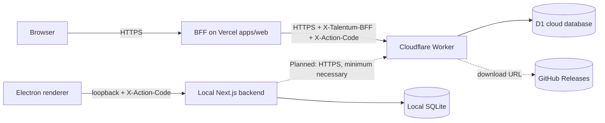
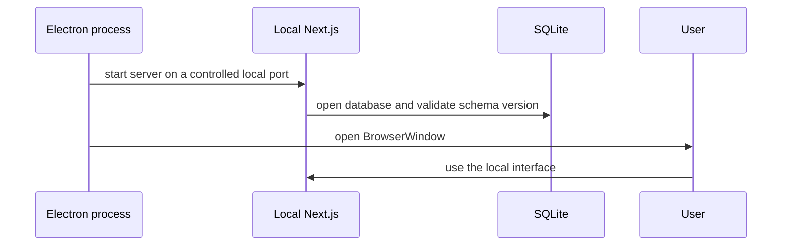
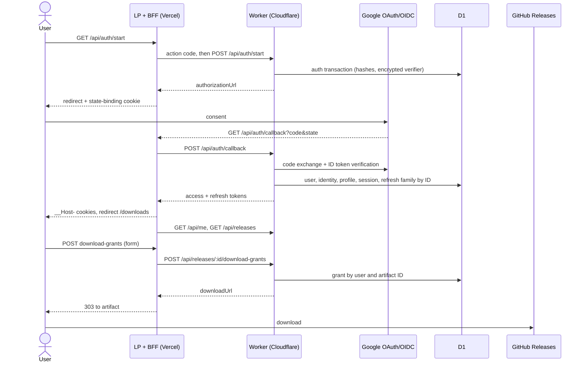
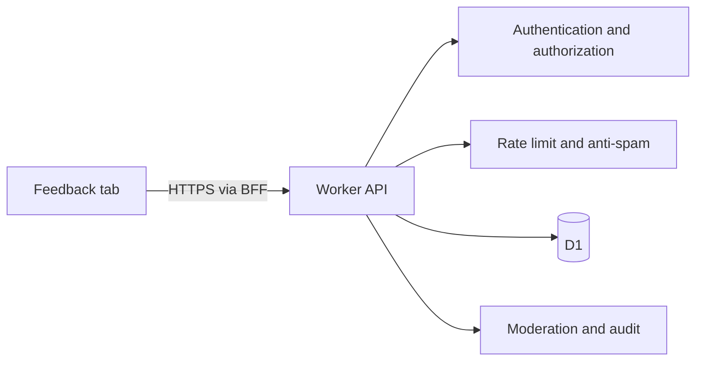
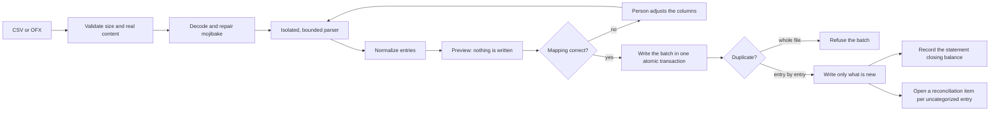
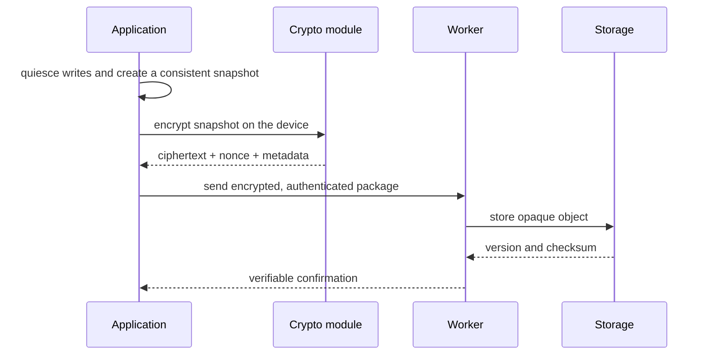
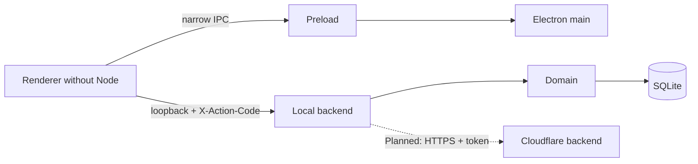

# Talentum Architecture

This document is the single source for how Talentum is built and how it runs: the product shape, the two runtime layers (the public Web layer and the local Electron layer), the cross-layer runtime flows, the action-code protocol, every backend contract (cloud and local), Cloudflare setup and deployment, operations, and the shared API conventions. Statements carry the status labels defined in [README.md](README.md#status-labels). Security policy, secret handling and threat rules live in [SECURITY.md](SECURITY.md); table-level schemas live in [DATABASE.md](DATABASE.md); product scope and screens live in [PRODUCT.md](PRODUCT.md).

## Contents

- [1. Overview](#1-overview)
- [2. Cross-layer runtime flows and the action-code protocol](#2-cross-layer-runtime-flows-and-the-action-code-protocol)
- [3. Layer 1: Web](#3-layer-1-web)
- [4. Layer 2: Electron](#4-layer-2-electron)
- [5. Error format and shared API conventions](#5-error-format-and-shared-api-conventions)
- [6. Open items](#6-open-items)

## 1. Overview

### 1.1 Product shape

**Current.** Talentum is a local-first personal finance application. The repository contains two deliberately separated products:

- **Web layer:** a public landing page (LP) with a minimal backend-for-frontend (BFF) in `apps/web/`, meant for Vercel, plus a Cloudflare Worker with a D1 database in `cloudflare/`. It handles sign-up/login, the protected downloads page and download grants.
- **Electron layer:** the desktop application. A local Next.js app in `src/` serves both the user interface and the local API (route handlers in `src/app/api`, server code in `src/server`); `electron/` holds the shell (`main.cjs`, `preload.cjs`); `prisma/` holds the local SQLite schema and migrations.

The two layers share nothing at runtime except the documented HTTPS contracts described below. The financial system and the Electron shell are never deployed to, or included in the build of, the Vercel project. **Planned:** Windows and Linux installers are published on GitHub Releases; D1 stores only release metadata and grants by ID.



The dashed line from the local backend to the Worker is **Planned**: the current local backend makes no network call to the cloud.

### 1.2 Local-first principle and central rule

Every interface is an untrusted client. The browser and the Electron renderer never access a database, Prisma, storage, OAuth or any privileged service directly. Every read and write goes through a documented, validated and authorized backend contract.

Normative rules (apply to both layers):

1. Every frontend operation corresponds to a documented backend endpoint or command.
2. No authorization rule exists only in the frontend.
3. Every persisted table, including join tables, has an opaque `id`; relations use foreign keys by ID.
4. Primary financial data stays local. Any new synchronization requires a privacy and threat review.
5. Confidential data is not sent to the frontend. Encryption does not make it safe to expose something unnecessary.
6. Changes to architecture, API, schema or security update the documentation in the same change set.
7. External integrations use adapters, timeouts, response validation and fail-safe behavior. **Current state:** the Worker calls Google endpoints and D1 inline (`e.DB.prepare`) with no adapter layer and no explicit fetch timeout; adapters are **Planned**.

### 1.3 Responsibilities by component

| Component | May | Must not |
| --- | --- | --- |
| Web frontend (LP pages) | render public data and authorized responses | hold secrets, query a database or decide authorization |
| BFF (`apps/web` route handlers) | hold first-party session cookies, request action codes, proxy to the Worker | hold financial rules, own a database or reach local data |
| Worker (cloud backend) | authenticate, authorize, rate-limit and persist cloud data | receive cleartext financial data without an approved case |
| Electron renderer | display state and call allowed contracts | use Node, Prisma, the filesystem or a persistent token directly |
| Local backend (`src/app/api`, `src/server`) | run the domain, persist finances and (Planned) integrate with the cloud | trust renderer input |
| Electron main process | expose minimal native capabilities through the preload | expose generic IPC or load privileged remote content |

### 1.4 Repository layout

**Current** (matches the tree; there is no `packages/` and no `turbo.json`):

```text
apps/
  web/                 @talentum/web: public LP + BFF (Next.js, port 3100). No Electron, Prisma, SQLite or financial domain.
src/                   local Next.js app (product UI and local API)
  app/                 App Router pages and layouts; route handlers in app/api
  components/          components owned by the local app
  hooks/               React hooks
  lib/                 client helpers (API client, formatting, charts)
  server/              server-only code: database, action codes, metrics
  types/               shared TypeScript types
  middleware.ts        loopback Host check for /api
electron/              main.cjs (window, navigation, permissions, IPC) and preload.cjs
prisma/                schema.prisma + 11 migrations (local SQLite only)
cloudflare/            Worker (src/index.ts), D1 migrations, wrangler.jsonc (tracked working config), wrangler.example.jsonc, .dev.vars.example
design/estados-vetor/  vector sources for empty-state illustrations
public/                static assets of the local app
scripts/               dev, dev:all, migration preflight, desktop packaging prep, palette validator, the isolated end-to-end server, asset generators, typecheck helpers
tests/                 node:test suites; tests/regression/ holds regression tests; tests/e2e/ holds Playwright specs
.githooks/             versioned pre-commit and pre-push hooks
.github/               CI workflow (workflows/ci.yml), CONTRIBUTING, CODE_OF_CONDUCT and the vulnerability-reporting policy (SECURITY.md)
LICENSE                open-source license
.claude/               agent skills and tooling
docs/                  normative documentation and ADRs (docs/decisions/)
README.md, CLAUDE.md, AGENTS.md   project overview, AI agent rules, pointer for other agents
package.json, pnpm-workspace.yaml root scripts, dependencies, build allowances and overrides
biome.json, playwright.config.ts  linter/formatter rules and end-to-end test configuration
Dockerfile             local app image (Ubuntu 24.04 base)
Dockerfile.web         LP/BFF image (node:22-bookworm-slim)
compose.yaml           talentum-local (127.0.0.1:3000) and talentum-web (127.0.0.1:3100)
```

**Planned (not adopted).** The earlier target layout split the code into `apps/web`, `apps/desktop`, `packages/contracts` (shared schemas without secrets), `packages/domain` (business rules), `packages/db-local` (Prisma/SQLite and migrations) and `workers/` (Cloudflare backend). None of `apps/desktop`, `packages/` or `workers/` exists. Whether to migrate to that layout is **Open**; until a decision is recorded, extend the current canonical paths above.

### 1.5 Related documents

- [SECURITY.md](SECURITY.md): authentication, sessions, secrets, threat rules.
- [DATABASE.md](DATABASE.md): local Prisma models and D1 tables.
- [PRODUCT.md](PRODUCT.md): routes, onboarding, dashboard formulas, product scope.
- [BEST_PRACTICES.md](BEST_PRACTICES.md): development workflow, commands, tests.
- [DESIGN-SYSTEM.md](DESIGN-SYSTEM.md): branding, states, visual QA.
- [ROADMAP.md](ROADMAP.md): sequencing of planned work.
- [decisions/0001-web-hosting.md](decisions/0001-web-hosting.md): web hosting decision.
- [decisions/0002-own-ofx-parser.md](decisions/0002-own-ofx-parser.md): own bounded OFX reader.
- [decisions/0003-local-device-key.md](decisions/0003-local-device-key.md): local device key protecting own Pix identifiers.
- [decisions/0004-electron-packaging.md](decisions/0004-electron-packaging.md): desktop packaging with `electron-builder`.

## 2. Cross-layer runtime flows and the action-code protocol

### 2.1 Action-code protocol

**Status: Current** in both layers (local app and Worker), with the differences noted below.

Every functional frontend request follows this protocol:

1. The frontend tells the backend which method and path it intends to call (`POST /api/action-codes` with `{ "method", "path" }`).
2. The backend returns an opaque, random code valid for at most 60 seconds (`{ "actionCode", "expiresInSeconds": 60 }`).
3. The frontend sends the real request with the code in the `X-Action-Code` header.
4. The backend validates and consumes the code atomically, then authenticates, authorizes, rate-limits and validates the action.
5. The code is discarded and never enters history, logs, URLs or analytics.

The issuing route is the exception to the rule, together with infrastructure liveness probes (`GET /api/health/live` locally, `GET /health` on the Worker), which return no application data and are never called by the interface. The code contains no `userId`, email, IP or business meaning. It reduces replay and binds intent to a call, but it does **not** replace access tokens, refresh tokens, authorization, CSRF protection, idempotency keys, validation or rate limiting.

Both issuers accept only `GET`, `POST`, `PUT`, `PATCH`, `DELETE`, only paths starting with `/api/`, and refuse to issue a code for `/api/action-codes` itself (`400 INVALID_ACTION_TARGET`). A missing, expired, reused or mismatched code returns `403 INVALID_ACTION_CODE`.

| Aspect | Local app (`src/server/action-codes.ts`) | Worker (`cloudflare/src/index.ts`) |
| --- | --- | --- |
| Who may request a code | any loopback caller (after the `HOST_NOT_ALLOWED` check); when `TALENTUM_LOCAL_BOOTSTRAP_SECRET` is set, only a caller presenting it in `X-Talentum-Bootstrap` (`403 BOOTSTRAP_DENIED` otherwise) | only the BFF (`X-Talentum-BFF` required) |
| Storage | in-memory `Map` keyed by SHA-256 of the code, record `{method, path, expiresAt}` | D1 table `action_codes`, peppered hash of the code |
| Binding | method + path (`pathname` only, query string excluded) | method + path + `context_hash` |
| Consumption | record deleted on consume; expired records swept on each issue/consume | atomic `UPDATE … SET consumed_at` guarded by `consumed_at IS NULL AND expires_at > now`; rows are kept, not deleted |
| Rate limit on issuing | none | 30 per minute per client IP (`codes` bucket) |

**Current limitation.** Codes are bound to method and path only, not to a session or origin; the details and the planned binding are in [SECURITY.md](SECURITY.md#action-codes). The local in-memory store serves only a single-process local backend; before any distributed execution it must be replaced by an atomic mechanism appropriate to the provider (**Planned**).

**Binding to path, not query string (Current, local).** The local code is bound to **method and path**, without the query. It identifies the contract (`GET /api/transactions`), not the filter values. The reason is correctness: the backend validates the code against the request `pathname`, so binding it to the whole URL would make every filtered listing fail. It does not weaken protection: the code exists against replay, while filters, ownership and `profileId` scoping are still validated by the backend on every request. Client and backend apply the same rule in `actionCodePath` (`src/lib/api-client.ts`) and `requireActionCode` (`src/server/http.ts`). Dynamic segments are part of the path, so a code issued for one batch does not serve another.

The local frontend implements the protocol once, in `src/lib/api-client.ts` (`callApi`, with the helpers `getJson`, `postJson`, `postForm` and `deleteJson`; `getWithActionCode` remains as an alias of `getJson`), so that no screen reimplements it partially. Route handlers share one HTTP edge in `src/server/http.ts` (`requireActionCode`, `guardWithProfile`, `ok`, `fail`). The BFF implements it once, in `apps/web/src/server/cloudflare.ts` (`cloud()`).

Manually validated call (local): issue a code for `GET /api/system/status`, send it in `X-Action-Code`, and receive `403` when reusing the same value.

### 2.2 Local app startup and runtime

**Current.**

- `pnpm dev` kills any previous process on port 3000, waits for the port to be released, applies `prisma migrate deploy`, removes `.next` and starts Next.js at `http://127.0.0.1:3000`.
- `pnpm dev:all` probes `GET /api/health/live` and only then opens the Electron window at `http://localhost:3000` (falling back to `http://127.0.0.1:3000`; `TALENTUM_URL` overrides both). When a local backend already responds (from Docker or a `pnpm dev` in another terminal), the window attaches to it and does not stop it when closed; when nothing responds, the script starts the server and stops both processes together.
- The server listens only on IPv4 loopback; `localhost` reaches it through address-family fallback.
- Implemented and verifiable: persistent onboarding, profile, institutions, accounts, balance history and own Pix keys, categories, income sources, obligations and merchant rules (CRUD only), CSV and OFX statement import with batch undo, the transaction listing, detail, edit and history, the reconciliation queue with reversible decisions, the dashboard (all nine elements, including the cash projection and monthly cash flow) and the local timeline with reversal. Cards, net worth, goals, news and gamification remain empty-state screens: they show no fictitious data, only the empty state. `src/lib/demo-data.ts` holds only navigation and theme configuration, never financial data, and area screens that are still placeholders confirm emptiness through `GET /api/local-summary`.

**Packaged startup (Current in code, see [ADR 0004](decisions/0004-electron-packaging.md)):** when `app.isPackaged` is true and `TALENTUM_URL` is unset, `electron/main.cjs` picks a free port on `127.0.0.1`, generates a per-run `TALENTUM_LOCAL_BOOTSTRAP_SECRET`, runs `prisma migrate deploy` against `talentum-local.db` in the Electron `userData` directory, spawns the standalone Next.js server with the Electron-embedded Node runtime, waits for `GET /api/health/live` (up to 60 seconds) and only then opens the window on that origin. The server process is killed when every window closes. No packaged build has been validated end to end in this repository (**Open**, see [Open items](#6-open-items)).

**Target production startup:**



In production the process must choose an available port or use an authenticated local channel (the packaged startup above does both in code). The local API must never be exposed to the external network.

### 2.3 Web sign-up, login and download

**Status: Current** (implemented in the BFF and the Worker; end-to-end validation in the published environment depends on secrets and the OAuth client being configured there).

1. The visitor on the LP follows a link to `GET /api/auth/start` on the BFF.
2. The BFF requests a Worker action code, then calls Worker `POST /api/auth/start`. The Worker creates an OAuth transaction (hashed `state` and `nonce`, PKCE verifier and nonce encrypted with AES-GCM), and returns the Google authorization URL (Authorization Code + PKCE S256, `openid email profile`).
3. The BFF sets the `__Host-talentum-oauth-state` cookie, which holds a hash binding the `state` to this browser (login-CSRF protection), and redirects to Google.
4. Google redirects to BFF `GET /api/auth/callback`. The BFF checks the state binding, then calls Worker `POST /api/auth/callback` with `{code, state}`.
5. The Worker consumes the transaction once, exchanges the code, verifies the ID token (RS256 signature against Google keys, issuer, audience, expiry, nonce, verified email), upserts the user, OAuth identity and public profile by ID, creates an opaque session (15-minute access token) and a refresh-token family (30-day refresh token), storing only peppered hashes.
6. The BFF stores both tokens in `__Host-` cookies (`Secure`, `HttpOnly`, `SameSite=Lax`, path `/`) and redirects to `/downloads`.
7. `/downloads` (server-rendered) calls Worker `GET /api/me` and `GET /api/releases` with the access token as a Bearer header. Without an access cookie, the BFF middleware redirects to `/api/auth/refresh` (when a refresh cookie exists) or `/api/auth/start`.
8. Choosing an artifact posts a form to BFF `POST /api/releases/:releaseId/download-grants`. The Worker records a 5-minute grant (hash only) by user and artifact ID and returns the artifact's download URL; the BFF answers `303` to that URL.



Because releases of an open-source repository are public, the grant controls the LP experience and auditing; it does not make the binary private. The LP neither contains nor runs the desktop system. **Planned:** installers signed and published by a release pipeline. Packaging configuration exists (`electron-builder`, [ADR 0004](decisions/0004-electron-packaging.md)) and CI validates builds, but no pipeline signs or publishes installers yet.

### 2.4 Feedback community

**Status: Planned.** The D1 tables exist (`feedback_posts`, `feedback_comments`, `feedback_post_votes`, `feedback_comment_votes`, `feedback_reports`, `moderation_actions`), but the Worker has no feedback route and the LP has no feedback tab.

1. The tab reads published posts from the Worker with cursor pagination.
2. An authenticated user submits a post, comment, vote or report to a documented route.
3. The backend validates session, schema, ownership, rate limit, anti-spam and content state.
4. The action is persisted in its own table, related by IDs, and generates an audit record when needed.
5. The response contains only public content and a minimal public profile.
6. Moderation can hide content without destroying the trail of relations and decisions.



Anyone may read content in state `PUBLISHED`. Creating a post, commenting, voting and reporting require a session. The backend enforces ownership, moderation, limits and sanitization; the frontend never writes to D1.

### 2.5 Import and reconciliation (local)

**Status: Current** for CSV and OFX import and for the reconciliation queue; PDF is Stage 7 of [ROADMAP.md](ROADMAP.md) (**Planned**). `pdfjs-dist` is installed but unused; `ofx-data-extractor` was removed in favour of an own bounded reader ([ADR 0002](decisions/0002-own-ofx-parser.md)).

The flow has two steps, and only the second one writes.



Requirements, all met by the current importer (`src/server/import/`):

- recognize the format by **content**, never by the extension or the declared type;
- compute a file fingerprint to prevent duplicate imports;
- also deduplicate entry by entry, so that statements with overlapping periods do not write the same entry twice;
- persist in an atomic transaction;
- keep traceability between file, batch and entries;
- declare every unreadable line instead of omitting it;
- record the interval the file covers, not only the import date;
- allow undoing a batch without affecting later unrelated changes, including keeping a balance entered by hand after the import, which requires the balance written by the batch to be identifiable rather than inferred from its creation instant;
- not retain the statement content: only entries and file metadata;
- never send a statement to external AI services.

Imported entries are written with `status = 'posted'` (they already happened) and **without a category**. In the same transaction the importer opens one `ReconciliationItem` (reason `category_unknown`) per uncategorized entry, which feeds the reconciliation queue. Automatic classification by `MerchantRule` is **Planned**: the rules can be created through the API, but the importer does not apply them yet.

Reconciliation (**Current**): the person confirms, categorizes, links an obligation, records a financial adjustment (interest, fee, discount or correction) or pairs an own-account transfer. Each decision is one SQLite transaction that stores before/after JSON snapshots, creates a `FinancialAdjustment` or `OwnAccountTransfer` when applicable and records a timeline event; reverting restores the snapshots and reopens the item without deleting the audit trail (`src/server/reconciliation.ts`). Automatic pairing of own-account transfers during import, using the registered Pix identifiers, is **Planned**.

### 2.6 Risk-free balance

**Status: Current** for the dashboard calculation in `src/server/dashboard-metrics.ts` (formulas and criteria in [PRODUCT.md](PRODUCT.md)). The calculation starts from confirmed balances and subtracts obligations due within the period: open card statements, recurring bills and automatic debits. Uncertain future income must not increase the free balance. The formula and its inclusion criteria require tests covering boundary dates, cancellations, partial payments and duplicates.

### 2.7 Net worth and contributions

**Status: Planned.** Each asset is assigned to one of four pillars: Stocks, Real Estate, Cash or International Assets. The system computes each pillar's share of the considered net worth and uses the 22.5% to 27.5% range as the balance band.

A contribution suggestion:

1. checks whether survival mode is active;
2. computes the eligible portfolio total;
3. identifies pillars below the band;
4. simulates distributing the new contribution;
5. explains the calculation, without presenting the output as individual financial advice.

### 2.8 News and summaries

**Status: Planned.** The Worker fetches only allowed sources, normalizes metadata and returns links to the original content. The summarizer receives the public text of the news item, never the full portfolio or the user's financial data. AI failures must keep title, source and link available.

### 2.9 Backup and restore

**Status: Planned** for backup and restore themselves. **Current:** a migration gate. `scripts/migration-preflight.mjs` runs before `prisma migrate deploy` in `pnpm dev` and `pnpm dev:all`; when a pending migration contains destructive SQL (`DROP TABLE`, `DROP COLUMN`, `TRUNCATE TABLE`, `DELETE FROM`) it stops unless `TALENTUM_VERIFIED_BACKUP_ID` names a `DatabaseBackup` row with status `verified`, a `verifiedAt` instant, a 64-hex checksum, a positive size and the current schema version. **Open:** nothing in the application creates `DatabaseBackup` rows yet, the Docker image and the packaged app do not run the preflight, and the target cloud flow below is not implemented.



Restore downloads the encrypted object, validates integrity, decrypts locally into a temporary destination, validates the database and only then replaces the active database in a recoverable way.

### 2.10 History

**Status: Current** (local). Imports, manual transaction edits and reconciliation decisions write a redacted `TimelineEvent` with kind, title, description, instant and the opaque IDs of the related batch, transaction, revision or decision. `POST /api/timeline-events/:id/revert` reverts through the original use case (undo the batch, restore the revision snapshot or revert the decision) and refuses with `409` when the related state changed. History is a product trail and supports undo; it never contains tokens, action codes, raw document content, file content, keys or hashes.

## 3. Layer 1: Web

### 3.1 Scope

The Web layer delivers the public landing page, authenticates and signs up the user and, after backend validation, releases downloads for Windows and Linux (**Current**, with installers themselves **Planned**). Authenticated users taking part in a public feedback community is **Planned**.

### 3.2 Components

| Component | Status | Responsibility |
| --- | --- | --- |
| Vercel project (`apps/web`) | Current code; hosting domain Open | LP, downloads page and minimal session BFF only; no financial module or Electron code |
| Worker (`cloudflare/src/index.ts`) | Current | OAuth/OIDC with Google, sessions, refresh rotation, rate limiting (two buckets), releases and download grants |
| Worker: community, audit events, Turnstile | Planned | feedback routes, `audit_events`/`security_events` writes, bot challenge |
| D1 | Current | minimal identity, sessions, action codes, rate-limit windows, release metadata and grants; feedback tables exist unused |
| GitHub Releases | Planned | signed Windows and Linux installers produced by a release pipeline |
| Edge | Partial | TLS by the providers (Current); security headers in the LP and Worker (Current); WAF and Turnstile (Planned) |

### 3.3 Landing page and BFF on Vercel

**Current.**

- `apps/web` is the package `@talentum/web` (Next.js, port 3100). Its description and dependencies exclude Electron, Prisma, SQLite, parsers and the financial domain.
- Since `vercel.app` and `workers.dev` are different sites, the browser must not depend on a third-party refresh cookie. The BFF keeps first-party `Secure`, `HttpOnly` cookies and forwards authenticated calls to the Worker. It has no financial rule, no database and no access to local data; it exists only for the session, ephemeral codes and a controlled proxy.
- The BFF forwards the visitor's IP to the Worker in `X-Talentum-Client-IP` (from `x-forwarded-for` or `x-real-ip`) so that rate limits count people, not the BFF server.
- With the Worker unreachable or not configured, the BFF returns a controlled `503` (`WORKER_UNAVAILABLE` in `apps/web/src/server/worker-fetch.ts`, `WORKER_NOT_CONFIGURED` in `apps/web/src/server/cloudflare.ts`), and the LP shows the login notice for error (`?auth=erro`) or cancel (`?auth=cancelado`) from `components/lp/auth-notice.tsx`, instead of a 500 page.
- Content Security Policy (`apps/web/src/middleware.ts`): a fresh nonce per response, propagated by the middleware to the Next.js renderer, so that only scripts emitted by the render itself run (`'nonce-…' 'strict-dynamic'`), without allowing inline scripts indiscriminately. Only with `NODE_ENV=development` does the policy add `'unsafe-eval'` to `script-src` and `ws:` to `connect-src`, required by React and `next dev` reloading; without them the development page does not hydrate. Production builds have neither. `next.config.ts` adds `X-Content-Type-Options`, `X-Frame-Options: DENY`, `Referrer-Policy`, `Permissions-Policy` and HSTS.
- LP content does not depend on JavaScript to exist: server HTML is visible from the start, and the entrance animation only hides a block after the component has hydrated and confirmed the block is off-screen.
- In local development the LP has its own Docker image and is published only on `127.0.0.1:3100`. It does not reuse the local app image and does not include Prisma, SQLite, Electron or the financial domain at runtime.

**Indexing (Current).** `apps/web/src/app/robots.ts` and `apps/web/src/app/sitemap.ts` are Next.js metadata routes served at `/robots.txt` and `/sitemap.xml`. The sitemap lists only the LP (`/`). Robots allows the site, disallows `/api/` (BFF) and `/downloads` (requires a session), and points to the sitemap. The announced domain comes from `apps/web/src/site.ts` (see the domain Open item). `tests/web-seo.test.mjs` prevents private routes from entering the sitemap. The layout declares `robots` with `index` and `follow`, canonical, Open Graph and an X card from `metadataBase`. Because the layout is dynamic (it reads the CSP nonce), Next 15 would stream metadata in the body for clients outside its bot list; `htmlLimitedBots: /.*/` in `apps/web/next.config.ts` keeps title, description and canonical always in `<head>`. LP CSS is inlined into the HTML (`experimental.inlineCss`), which the CSP already allows with `style-src 'unsafe-inline'`. Measurements and decisions are in [DESIGN-SYSTEM.md](DESIGN-SYSTEM.md).

**Deployment isolation.** The Vercel project must receive only the files needed by the LP/BFF. The Electron shell, local backend, Prisma, SQLite, parsers, financial modules, desktop tests and internal packaging files are excluded from the deploy context. Prefer an isolated deploy project/repository or an allowlisted source artifact; do not connect the whole repository root to Vercel. **Open:** the Vercel project configuration is not versioned, so the repository cannot prove which files are uploaded; and `Dockerfile.web` copies the whole repository (`COPY . .`) into its build stage (the final image keeps only the standalone LP output).

### 3.4 Domain

**Open.** `apps/web/src/site.ts` uses `https://talentum-tech.vercel.app`, where the LP is published; its comment notes that `talentum.vercel.app` belongs to another project (on 2026-10-25 that address answered with another project's login). `cloudflare/wrangler.jsonc` (`ALLOWED_ORIGIN`, `PUBLIC_WEB_URL`) and older documentation still use `talentum.vercel.app`. The Worker builds the OAuth redirect URI from `PUBLIC_WEB_URL`, so the production callback, the OAuth client's registered redirect and the origin allowlist all depend on this decision. Fix `site.ts`, `wrangler.jsonc` and the OAuth client in the same change set.

### 3.5 Cloud API contract (Worker and BFF)

**Common Worker rules (Current):**

- Every route except `GET /health` requires the `X-Talentum-BFF` header matching `BFF_SHARED_SECRET`; otherwise `403 BFF_REQUIRED`. The browser therefore cannot call the Worker directly.
- Every route except `/health` and `POST /api/action-codes` requires a valid action code (`403 INVALID_ACTION_CODE`).
- Authenticated routes require `Authorization: Bearer <access token>`, resolved against `auth_sessions` (`401 AUTH_REQUIRED`).
- Every JSON response carries `Cache-Control: no-store`, `Content-Security-Policy: default-src 'none'; frame-ancestors 'none'`, `Referrer-Policy: no-referrer` and `X-Content-Type-Options: nosniff`.
- Rate limiting exists only in two IP-keyed buckets with one-minute windows stored in D1 `rate_limit_windows`: `codes` (30/min) and `login` (10/min). The IP is `X-Talentum-Client-IP` (from the BFF), else `CF-Connecting-IP`.
- No CORS headers are sent; `ALLOWED_ORIGIN` is declared but unused. CORS allowlisting is **Planned**.
- Unknown routes return `404 NOT_FOUND`; unhandled exceptions return `500 INTERNAL_ERROR`.

**Worker routes (Current):**

| Method | Route | Access | Protection actually applied | Response |
| --- | --- | --- | --- | --- |
| `GET` | `/health` | infrastructure | none; runs `SELECT 1` on D1 | `{status: "ok" \| "degraded", service: "talentum-cloud-api"}` |
| `POST` | `/api/action-codes` | BFF only | `X-Talentum-BFF`; rate limit `codes` 30/min per IP; target validation | `{actionCode, expiresInSeconds: 60}` |
| `POST` | `/api/auth/start` | BFF only, public user | action code; rate limit `login` 10/min per IP | `{authorizationUrl}` |
| `POST` | `/api/auth/callback` | BFF only, OAuth transaction | action code; transaction single-use and 10-minute expiry; no rate limit | `{accessToken, accessExpiresInSeconds: 900, refreshToken, refreshExpiresInSeconds: 2592000}` |
| `POST` | `/api/auth/refresh` | BFF only, valid refresh token | action code; single-use rotation; reuse revokes family and session (`compromise_detected_at` set; nothing written to `security_events`); no rate limit | same shape as callback |
| `POST` | `/api/auth/logout` | authenticated | action code; Bearer session; revokes session and refresh families | `{ok: true}` |
| `GET` | `/api/me` | authenticated | action code; Bearer session; `no-store` | `{user: {id, public_name, avatar_url}}` |
| `GET` | `/api/releases` | authenticated | action code; Bearer session; `no-store` (no private cache) | `{releases: [{id, version, channel, artifactId, platform, architecture, sha256, signature}]}` (published only) |
| `POST` | `/api/releases/:releaseId/download-grants` | authenticated | action code; Bearer session; artifact must belong to a published release; no rate limit | `{downloadUrl, grant, expiresInSeconds: 300}` |

`/api/me` and `/api/releases` exist only on the Worker; the BFF calls them server-side from the `/downloads` page and exposes no route for them.

**BFF routes (Current, `apps/web/src/app/api`):**

| Method | Route | Protection | Behavior |
| --- | --- | --- | --- |
| `GET` | `/api/auth/start` | Worker `login` limit applies | sets the state-binding cookie, redirects to Google; on failure redirects to `/?auth=erro` |
| `GET` | `/api/auth/callback` | state-binding cookie check (timing-safe) | missing `code`/`state` redirects to `/?auth=cancelado`; mismatch or Worker failure redirects to `/?auth=erro`; success sets session cookies and redirects to `/downloads` |
| `GET` | `/api/auth/refresh` | refresh cookie; no origin check; no rate limit | rotates both cookies and redirects to `/downloads`; on failure clears cookies and redirects to `/api/auth/start` |
| `POST` | `/api/auth/logout` | `sameOrigin()` (returns true when `Origin` is missing; `SameSite=Lax` then protects) | tries Worker logout, always clears cookies, `303` to `/` |
| `POST` | `/api/releases/:releaseId/download-grants` | `sameOrigin()`; form data `artifactId` | `303` to the Worker-provided `downloadUrl`; errors `{error: "forbidden"}` (403), `{error: "invalid_artifact"}` (400), `{error: "download_unavailable"}` (Worker status) |

The BFF middleware redirects `/downloads` without an access cookie to `/api/auth/refresh` or `/api/auth/start`.

**Planned cloud routes (feedback; the tables exist, no route does):**

| Method | Route | Access | Additional protection |
| --- | --- | --- | --- |
| `GET` | `/api/feedback/posts` | public | pagination and per-IP limit |
| `POST` | `/api/feedback/posts` | authenticated | low limit + anti-spam |
| `GET` | `/api/feedback/posts/:postId` | public | published content only |
| `PATCH` | `/api/feedback/posts/:postId` | author/moderator | ownership validated in the backend |
| `DELETE` | `/api/feedback/posts/:postId` | author/moderator | tombstone and audit |
| `POST` | `/api/feedback/posts/:postId/comments` | authenticated | low limit + anti-spam |
| `PATCH` | `/api/feedback/comments/:commentId` | author/moderator | ownership in the backend |
| `DELETE` | `/api/feedback/comments/:commentId` | author/moderator | tombstone and audit |
| `PUT`/`DELETE` | `/api/feedback/posts/:postId/vote` | authenticated | uniqueness and anti-bot limit |
| `PUT`/`DELETE` | `/api/feedback/comments/:commentId/vote` | authenticated | uniqueness and anti-bot limit |
| `POST` | `/api/feedback/reports` | authenticated | very low limit |

**Other planned edge routes:**

| Method | Route | Allowed data |
| --- | --- | --- |
| `GET` | `/news` | public filters and minimized assets, when necessary |
| `POST` | `/summaries` | public content of the news item |

The earlier candidate `POST /auth/exchange` (OAuth code plus client proof) is superseded by the Current `/api/auth/callback` flow. **Planned** for Electron sign-in: a public-client flow (see the Electron layer).

**Planned protections not yet implemented:** per-user strict limit on download grants; rate limits on callback, refresh and private routes; idempotency keys on writes where a network retry could duplicate data; rate-limit values calibrated with telemetry and versioned. Listings must return only a minimal public profile, never email, OAuth subject, IP or session IDs.

The cloud API never receives statements, transactions, balances or portfolios in cleartext. Frontends never import a Prisma/D1 client or use Cloudflare bindings; even public feedback goes through the API to keep moderation, pagination and caching controlled.

### 3.6 Cloudflare Worker and D1

**Current.** The Worker is a single module (`cloudflare/src/index.ts`) that accesses D1 only through the `DB` binding (`env.DB`), inline with prepared statements. D1 tables come only from `cloudflare/migrations` (`0001_cloud_core`, `0002_cloud_auth_runtime`); their schema is documented in [DATABASE.md](DATABASE.md).

**Mandatory boundary between the databases.** All eleven Prisma migrations in `prisma/migrations` belong only to the Electron local SQLite. They contain profiles, onboarding, institutions, accounts, Pix identifiers, balances, import batches and files, transactions, obligations, income, rules, reconciliation, timeline and backup metadata, and **must never run on D1**. The browser and Electron never access D1 directly: every read or write goes through the Worker API. Do not use `prisma db push` on D1 and do not copy migrations from `prisma/migrations` into `cloudflare/migrations`.

### 3.7 Configuration variables (names and locations)

This table is the single list of configuration variables. Values are never written in documentation or version control; secret-handling policy (where secrets live, generation and rotation) is in [SECURITY.md](SECURITY.md#secrets-management).

| Variable | Kind | Local location | Production location |
| --- | --- | --- | --- |
| `DB` (binding), `database_name`, `database_id` | D1 binding (ID is not a secret) | `cloudflare/wrangler.jsonc` (tracked) | same |
| `APP_ENV` | plain var: environment name (declared, currently unused by code) | `cloudflare/wrangler.jsonc` | same |
| `PUBLIC_WEB_URL` | plain var; base of the OAuth redirect URI | overridden in `cloudflare/.dev.vars` | `cloudflare/wrangler.jsonc` |
| `ALLOWED_ORIGIN` | plain var: intended CORS origin (declared, currently unused) | overridden in `cloudflare/.dev.vars` | `cloudflare/wrangler.jsonc` |
| `SESSION_SIGNING_SECRET` | secret; derives the AES-GCM key that encrypts the PKCE verifier and nonce in `auth_transactions` (sessions are opaque hashed tokens, not signed) | `cloudflare/.dev.vars` | Worker secret |
| `TOKEN_HASH_PEPPER` | secret; pepper for the SHA-256 hashes of action codes, access and refresh tokens, `state`, `nonce`, download grants and rate-limit bucket keys | `cloudflare/.dev.vars` | Worker secret |
| `BFF_SHARED_SECRET` | secret; authenticates the BFF to the Worker through `X-Talentum-BFF` (compared as SHA-256 digests); also the source of the action codes' `context_hash` | `cloudflare/.dev.vars` | Worker secret |
| `GOOGLE_CLIENT_ID` | OAuth client identifier and expected ID-token audience (public; may be a plain var) | `cloudflare/.dev.vars` | Worker secret or var |
| `GOOGLE_CLIENT_SECRET` | secret; used in the code exchange | `cloudflare/.dev.vars` | Worker secret |
| `CLOUDFLARE_API_BASE_URL` | BFF server runtime: Worker URL | root `.env` | Vercel runtime env |
| `CLOUDFLARE_BFF_SHARED_SECRET` | BFF server runtime: must equal `BFF_SHARED_SECRET` | root `.env` | Vercel runtime env |
| `DOCKER_CLOUDFLARE_API_BASE_URL` | Worker URL seen from the `talentum-web` container | root `.env` | not used |
| `DATABASE_URL`, `DOCKER_DATABASE_URL` | local SQLite path (host, container) | root `.env` | not used (local only) |
| `TALENTUM_STANDALONE_BUILD` | build flag for Next standalone output (Docker images) | Dockerfiles | not used |
| `TALENTUM_URL` | Electron window URL override; when set, the packaged app does not start its own backend | shell env / `scripts/dev-all.mjs` | not used |
| `TALENTUM_LOCAL_BOOTSTRAP_SECRET` | per-run secret required by local `POST /api/action-codes` when set; generated by the packaged Electron app, never configured by hand | unset in development and Docker | generated per run in memory |
| `TALENTUM_LOCAL_KEY_FILE` | optional override of the local device key path ([ADR 0003](decisions/0003-local-device-key.md)) | shell env | not used |
| `TALENTUM_VERIFIED_BACKUP_ID` | opaque `DatabaseBackup` ID that unlocks a destructive local migration in the preflight | shell env, only when needed | not used |
| `TALENTUM_E2E_URL` | base URL of the running local backend for the end-to-end tests | shell env | not used |

None of the BFF variables uses the `NEXT_PUBLIC_` prefix. The LP calls its own BFF; the BFF calls the Worker; the Worker queries D1. If `CLOUDFLARE_BFF_SHARED_SECRET` and `BFF_SHARED_SECRET` differ, every Worker route answers `403 BFF_REQUIRED`.

### 3.8 Cloudflare setup and deployment

Commands below are POSIX shell; on Windows PowerShell use the equivalents (`Copy-Item` for `cp`, `Invoke-RestMethod` for `curl`).

**Step 1: authenticate Wrangler.** From the repository root:

```sh
pnpm exec wrangler login
pnpm exec wrangler whoami
```

The first command opens the Cloudflare account authorization in the browser; the second must show the authenticated account.

**Step 2: create the production D1 database** (only when the database does not exist yet):

```sh
pnpm exec wrangler d1 create talentum-cloud-production
```

Keep the returned `database_id`. The database identifier is not a credential, but secrets and tokens must never go into the configuration file. D1 offers no specific South America location: let Cloudflare choose the initial location automatically, and set `--location` only after measuring real latency and recording an architecture decision.

**Step 3: confirm the active configuration.** `cloudflare/wrangler.jsonc` is the tracked working configuration (name `talentum`, `main: src/index.ts`, D1 binding `DB` for `talentum-cloud-production`, `migrations_dir: migrations`, and the plain vars). Do **not** copy `cloudflare/wrangler.example.jsonc` over it: the example is a reference with a placeholder database ID, and copying it would destroy the real configuration. Only when creating a brand-new environment (a fork or a separate account) should you start a new config from the example and replace its placeholder with the `database_id` from step 2. Every script passes `--config cloudflare/wrangler.jsonc`; the Worker reaches the database only through `env.DB`.

**Step 4: prepare local secrets.**

```sh
cp cloudflare/.dev.vars.example cloudflare/.dev.vars
```

Fill in every name listed in `cloudflare/.dev.vars.example`: `SESSION_SIGNING_SECRET`, `TOKEN_HASH_PEPPER`, `BFF_SHARED_SECRET`, `GOOGLE_CLIENT_ID`, `GOOGLE_CLIENT_SECRET`, plus the local overrides `PUBLIC_WEB_URL` and `ALLOWED_ORIGIN` (during `wrangler dev` they make the login callback return to the local LP, not the published domain). Generate each of the three random secrets independently, with at least 32 random bytes, running once per variable:

```sh
node -e "console.log(require('node:crypto').randomBytes(32).toString('base64url'))"
```

`cloudflare/.dev.vars` is local and ignored by Git. In development the LP reads `CLOUDFLARE_BFF_SHARED_SECRET` from the root `.env` and the Worker reads `BFF_SHARED_SECRET` from `cloudflare/.dev.vars`; **both must hold the same value**. When the LP runs in a container, point `DOCKER_CLOUDFLARE_API_BASE_URL` at `http://host.docker.internal:8787`; `compose.yaml` declares the `extra_hosts` entry that makes that name resolve on Docker for Linux.

**Step 5: apply and verify migrations locally.**

```sh
pnpm run cloudflare:migrations:list:local
pnpm run cloudflare:migrations:apply:local
pnpm exec wrangler d1 execute talentum-cloud-production --local --config cloudflare/wrangler.jsonc --command "SELECT name FROM sqlite_schema WHERE type = 'table' ORDER BY name"
pnpm run cloudflare:dev
```

In another terminal, check the connection:

```sh
curl http://localhost:8787/health
```

The expected response contains `status: ok` and `service: talentum-cloud-api`.

**Step 6: review and apply in production.** Always list pending migrations before changing the remote database:

```sh
pnpm run cloudflare:migrations:list:remote
pnpm run cloudflare:migrations:apply:remote
```

**Step 7: register remote secrets.** Register each secret interactively; never pass the value on the command line:

```sh
pnpm exec wrangler secret put SESSION_SIGNING_SECRET --config cloudflare/wrangler.jsonc
pnpm exec wrangler secret put TOKEN_HASH_PEPPER --config cloudflare/wrangler.jsonc
pnpm exec wrangler secret put BFF_SHARED_SECRET --config cloudflare/wrangler.jsonc
pnpm exec wrangler secret put GOOGLE_CLIENT_ID --config cloudflare/wrangler.jsonc
pnpm exec wrangler secret put GOOGLE_CLIENT_SECRET --config cloudflare/wrangler.jsonc
```

The OAuth client secret must stay secret; the public client identifier may be a plain variable instead. Register in the Google OAuth client, as the production redirect, exactly `<PUBLIC_WEB_URL>/api/auth/callback` for the production `PUBLIC_WEB_URL` (the production domain is **Open**, see the domain section).

**Step 8: deploy and validate the Worker.**

```sh
pnpm run cloudflare:deploy
```

Wrangler returns the `workers.dev` address. Validate `GET /health` there, and keep that endpoint free of database, account or dependency-version information.

**Git-connected deploy.** When creating the application from this repository in the Cloudflare dashboard, choose **Workers**, not Pages, and configure:

- root directory: repository root;
- build command: `pnpm run cloudflare:build` (a `wrangler deploy --dry-run`);
- deploy command: `pnpm run cloudflare:deploy`;
- production branch: `main`.

Do not use `pnpm run build` there: it builds the local product's Next.js. Do not use `npx wrangler deploy` without `--config`, because the Worker config lives in `cloudflare/`. `cloudflare/wrangler.jsonc` must exist in the pipeline environment and is tracked because the D1 ID is not secret; `.dev.vars`, API tokens and values set with `wrangler secret put` stay out of Git.

**Step 9: connect the Vercel LP/BFF.** Register in the LP's Vercel project:

- `CLOUDFLARE_API_BASE_URL`: the Worker's public URL;
- `CLOUDFLARE_BFF_SHARED_SECRET`: exactly the same value as `BFF_SHARED_SECRET`;
- public variables only when proven non-confidential.

**Step 10: workflow for cloud schema changes.**

1. Create a new numbered SQL migration in `cloudflare/migrations`.
2. Ensure every table has an opaque `id` and relations use IDs and foreign keys.
3. Apply to a disposable local database.
4. Run the API tests (`pnpm cloudflare:test`, `pnpm test`) and review indexes, constraints and operational rollback.
5. List pending remote migrations.
6. Apply to the remote D1.
7. Deploy the Worker compatible with the new schema.
8. Update [DATABASE.md](DATABASE.md) and this document in the same change set.

### 3.9 Operations

**Pre-publication checklist:** run the [checklist before publishing the Worker](SECURITY.md#before-publishing-the-worker) in SECURITY.md, which notes the status of each control.

**Acceptance criteria for the Web layer:**

- `/downloads` does not open without a valid session (Current: middleware redirect plus server-side `/api/me` check);
- the frontend holds no secrets nor any persistent token readable by JavaScript (Current: `HttpOnly` cookies);
- a deploy manifest proves that no desktop file was sent to Vercel (Open: no versioned manifest);
- download grants expire and are audited, and public artifacts keep checksum and signature (Current: 5-minute grants recorded in D1, `sha256` and `signature` fields served; Planned: audit events and signed artifacts);
- public feedback content never reveals email, token, IP or OAuth identifier (Planned);
- community actions are authorized and rate-limited in the backend (Planned);
- private responses use `Cache-Control: no-store` (Current).

**Local Docker for the Web layer (Current).** `compose.yaml` service `talentum-web` builds `Dockerfile.web`, binds `127.0.0.1:3100`, reads `DOCKER_CLOUDFLARE_API_BASE_URL` and `CLOUDFLARE_BFF_SHARED_SECRET`, and health-checks `/`.

## 4. Layer 2: Electron

### 4.1 Goal

The desktop app is local-first: it processes and stores financial data on the device. The renderer is an untrusted frontend and talks only to the local backend. Cloud services receive only the documented minimum. Salary, institutions, balances, Pix keys, statements, transactions, debts and investments stay exclusively on the device and pass only through the local API.

### 4.2 Current state

**Current.**

- The Next.js App Router (`src/app`) provides the interface and the local API of MVP features 1 to 8: 39 route handlers under `src/app/api` (listed in [Local API contract](#48-local-api-contract)).
- Prisma is configured for SQLite with 24 models created by 11 migrations. Money is stored as `BigInt` cents. Details in [DATABASE.md](DATABASE.md).
- The financial tables, the CSV/OFX importer, reconciliation, the dashboard and the timeline are implemented. The interface does not present fixtures as the user's data: the absence of records produces an empty or unknown state, never an invented zero. Without a local profile the dashboard leads to `/onboarding`, which now runs the persistent four-step flow (see [PRODUCT.md](PRODUCT.md)).
- With Compose, SQLite lives at `/data/talentum-local.db` inside the persistent volume `talentum-data`; the container runs `prisma migrate deploy` before starting the server, binds `127.0.0.1:3000` and health-checks `/api/health/live`. Docker runs only the local server; the graphical Electron shell stays on the host and opens the configured loopback address (`http://localhost:3000` by default). `pnpm dev:all` detects a running local backend and attaches the window to it instead of competing for the port.
- The local device key that protects own Pix identifiers lives in `talentum-local.key` next to the database file ([ADR 0003](decisions/0003-local-device-key.md)).
- The local app sends no Content Security Policy (Planned).
- Packaging is configured with `electron-builder` (NSIS for Windows, AppImage for Linux; [ADR 0004](decisions/0004-electron-packaging.md)). Signed installers are Planned.



### 4.3 Desktop shell (`electron/main.cjs`)

**Current controls:**

- `BrowserWindow` with `contextIsolation: true`, `nodeIntegration: false`, `sandbox: true` and `preload.cjs`; frameless window, no application menu, single-instance lock.
- In development and with Docker, loads `TALENTUM_URL` or `http://localhost:3000`. In a packaged build without `TALENTUM_URL`, starts its own backend on a random loopback port with a per-run bootstrap secret and loads that origin (**Current** in code; see [2.2](#22-local-app-startup-and-runtime)).
- `setWindowOpenHandler` denies every new window; allowed external links (`https:` to `github.com` or `icons.getbootstrap.com`) open in the system browser.
- `will-navigate` blocks navigation outside the local backend origin, opening allowlisted hosts externally.
- A deny-all permission request handler refuses camera, notifications, geolocation and every other browser permission.
- IPC is accepted only from frames whose origin is the local backend (trusted-sender check).

### 4.4 Boundaries

| Boundary | Rule | Status |
| --- | --- | --- |
| Renderer | `nodeIntegration: false`, `contextIsolation: true`, sandbox enabled | Current |
| Renderer | restrictive CSP | Planned |
| Preload | minimal per-method API; never exposes `ipcRenderer`, filesystem or generic shell | Current |
| Main | validates sender on every IPC | Current |
| Main | validates arguments, origin and destination schema on every IPC | Planned (current channels take no arguments) |
| Local backend | binds to loopback only | Current (`127.0.0.1:3000` in development and Docker; `127.0.0.1:<random port>` when packaged) |
| Local backend | random port when feasible and an ephemeral per-run secret | Current in code for the packaged app only (`TALENTUM_LOCAL_BOOTSTRAP_SECRET` checked by `POST /api/action-codes`); development and Docker use the fixed port and no secret. Delivery of the secret to the renderer is unverified (Open) |
| Local backend | rejects non-loopback `Host` (DNS rebinding) | Current |
| SQLite | reachable only through the local backend persistence | Current |
| Cloud | reachable only through the local backend, never from the renderer | Current (no cloud calls exist) / Planned (integration) |

### 4.5 IPC

**Current.** `electron/preload.cjs` adds the `electron` class to the document element and exposes, through `contextBridge`, a single object `window.talentumWindow` with four methods: `minimize()`, `toggleMaximize()`, `close()` and `bootstrapSecret()`. The first three send the argument-less channels `window:minimize`, `window:toggle-maximize` and `window:close`; `main.cjs` handles each only for a trusted sender. `bootstrapSecret()` is not IPC: it returns `TALENTUM_LOCAL_BOOTSTRAP_SECRET` from the renderer's `process.env`, or `null`, and `src/lib/api-client.ts` sends it as `X-Talentum-Bootstrap` when requesting an action code. No other IPC channel exists.

**Open:** `main.cjs` puts the bootstrap secret only in the environment of the spawned backend, not in its own `process.env`, so it is unverified whether the sandboxed renderer can read it. If it cannot, a packaged build would answer `403 BOOTSTRAP_DENIED` to every action-code request. A packaged smoke test is required before the first release.

### 4.6 Mandatory shell controls

1. Do not load remote content in a privileged window. (Current: only the local origin loads.)
2. Deny navigation and new windows by default. (Current.)
3. Validate an allowlist before `shell.openExternal`. (Current.)
4. Keep `webSecurity` and deny mixed content. (Current by Electron default; not explicitly configured.)
5. Deny unexpected permissions. (Current.)
6. Validate sender and schema of every IPC. (Sender Current; schema Planned.)
7. Prefer a secure custom protocol over `file://`. (Planned; the app currently loads over loopback HTTP.)
8. Disable unused Electron features with fuses. (Planned.)
9. Sign packages, updates and manifests. (Planned; packages are built unsigned, see [ADR 0004](decisions/0004-electron-packaging.md).)
10. Never send cleartext finances to the community or the cloud backend. (Current.)

### 4.7 Desktop authentication

**Planned.** Electron is a public client: no embedded client secret is confidential. It will use the system browser, Authorization Code with PKCE S256, `state`, `nonce` and a registered redirect. The access token stays in memory; the rotating refresh token goes to the operating-system vault when available. Details and threat rules in [SECURITY.md](SECURITY.md).

### 4.8 Local API contract

**Current routes** (all under `src/app/api`). Every route except the first and the last requires a single-use `X-Action-Code`; every route that touches financial data also resolves the local profile on the server and scopes its queries by `profileId` (a request without a profile answers `{ "hasProfile": false }`).

| Method | Route | Purpose |
| --- | --- | --- |
| `POST` | `/api/action-codes` | bootstrap; Zod validation (`method` enum, `path` starting with `/api/`, max 200 chars); requires `X-Talentum-Bootstrap` when the backend runs with a bootstrap secret; issues a 60-second action code |
| `GET` | `/api/system/status` | check frontend/API communication (`{status, service: "talentum-local-api", timestamp}`) |
| `GET` | `/api/local-summary` | per-area counts: accounts, transactions, pending transactions, open obligations and imports |
| `GET`/`POST` | `/api/profile` | read and create the local profile |
| `GET`/`POST` | `/api/onboarding` | read the onboarding state; create the profile if needed and open or resume a draft session |
| `PATCH` | `/api/onboarding/:onboardingId` | save a step and its answers with optimistic concurrency (`version`) |
| `POST` | `/api/onboarding/:onboardingId/complete` | complete onboarding; requires privacy, currency and time zone answers and writes them to `UserPreference` |
| `GET` | `/api/dashboard` | dashboard indicators computed from local SQLite |
| `GET` | `/api/dashboard/categories` | spending by category in the period |
| `GET` | `/api/dashboard/risk-free-balance` | breakdown of the risk-free balance and the daily projection to period end (G-1) |
| `GET` | `/api/dashboard/cash-flow` | income and outflow per calendar month, only where a statement covers the month (G-3) |
| `GET`/`POST` | `/api/institutions` | list and register institutions |
| `GET`/`PATCH`/`DELETE` | `/api/institutions/:institutionId` | detail, rename and delete an institution |
| `GET`/`POST` | `/api/accounts` | list and register accounts with an informed balance |
| `GET`/`PATCH`/`DELETE` | `/api/accounts/:accountId` | detail, edit, deactivate and delete an account |
| `GET`/`POST` | `/api/accounts/:accountId/balance-snapshots` | balance history and new informed balance |
| `GET`/`POST` | `/api/accounts/:accountId/pix-identifiers` | list (masked) and register own Pix keys |
| `GET`/`PATCH`/`DELETE` | `/api/accounts/:accountId/pix-identifiers/:pixIdentifierId` | detail (cleartext only with `?reveal=1`), edit and remove a key |
| `GET`/`POST` | `/api/categories` | list and create categories |
| `PATCH`/`DELETE` | `/api/categories/:categoryId` | edit and delete a category |
| `GET`/`POST` | `/api/incomes` | list and register expected income sources |
| `GET`/`POST` | `/api/obligations` | list and register scheduled obligations |
| `PATCH`/`DELETE` | `/api/obligations/:obligationId` | edit and delete an obligation |
| `GET`/`POST` | `/api/merchant-rules` | list and create deterministic merchant rules |
| `POST` | `/api/imports/inspect` | inspect a statement without writing anything |
| `GET`/`POST` | `/api/imports` | list batches and write a whole batch |
| `GET`/`DELETE` | `/api/imports/:importBatchId` | detail and undo a batch |
| `GET` | `/api/csv-mappings` | list saved column mappings |
| `DELETE` | `/api/csv-mappings/:mappingId` | forget a saved mapping |
| `GET` | `/api/transactions` | list entries with validated filters and cursor pagination |
| `GET`/`PATCH` | `/api/transactions/:transactionId` | detail and edit (description, category and status only) |
| `GET` | `/api/transactions/:transactionId/history` | immutable revision history of one entry |
| `GET` | `/api/reconciliation-items` | list up to 100 pending items of the profile |
| `GET` | `/api/reconciliation-items/:reconciliationItemId` | entry, categories and decisions of one item |
| `POST` | `/api/reconciliation-items/:reconciliationItemId/decisions` | confirm, categorize, link an obligation, adjust or pair a transfer |
| `POST` | `/api/reconciliation-decisions/:decisionId/revert` | restore the previous state and reopen the item |
| `GET` | `/api/timeline-events` | redacted events, optional `kind` filter (`import`, `transaction_edit`, `reconciliation`) and cursor |
| `POST` | `/api/timeline-events/:timelineEventId/revert` | revert an import, edit or reconciliation through its original use case |
| `GET` | `/api/health/live` | infrastructure only; health check without application data (`{status: "ok"}`) |

Every route under `/api` refuses with `403 HOST_NOT_ALLOWED` any request whose `Host` is not `localhost`, `127.0.0.1` or `[::1]` (`src/middleware.ts`, `src/server/local-host.ts`), against DNS rebinding. Responses built with the shared helpers in `src/server/http.ts` send `Cache-Control: no-store`. `tests/regression/dashboard-honesty.test.mjs` checks that every local route other than `action-codes` and `health` requires an action code and scopes by profile.

**Dashboard.** `GET /api/dashboard` returns the risk-free balance, the consolidated balance with the base date of the oldest informed balance (`balanceReferenceDate`), the committed total in the period with the count of estimated obligations (`committedEstimatedCount`), month spending and daily average with the change against the same interval of the previous month, and the counts of accounts with known and unknown balance, pending reconciliation items (`ReconciliationItem.status = 'pending'`) and imports. `GET /api/dashboard/categories` returns the period's spending slices, already ordered, with the tail summed into `Outros` and uncategorized entries in their own slice; the sum of the slices always equals `totalCents`.

`GET /api/dashboard/risk-free-balance` returns the verdict breakdown (balance, committed amount and the difference), the daily projection to the end of the period and the obligations that compose it; `shortfallDay` is the first day the projected balance turns negative, or `null`. **Forecast future income does not enter the projection**: including it would turn the Saldo Livre de Risco into a forecast. An obligation already overdue before the window is anchored on the first day instead of being omitted: it is still owed, and hiding it would make the projection optimistic.

`GET /api/dashboard/cash-flow` returns income and outflow per calendar month. The rule governing the route is honesty, not aesthetics:

| Month situation | Response |
| --- | --- |
| no imported statement | **not returned** |
| statement covering the whole month | returned with `coverage: "full"` |
| statement covering part of the month | returned with `coverage: "partial"` |
| covered, with no entry | returned with zeros: here zero is a fact |

Without any batch with a known period the response carries `months: []` and `coverageRanges: 0`. **An empty series is different from a series of zeros**: the first says "I don't know", the second would claim there was no movement.

**Open:** `GET /api/dashboard` computes the consolidated balance inline over every active account, while `GET /api/dashboard/risk-free-balance` uses `loadConsolidatedBalance` in `src/server/dashboard-queries.ts`, which keeps only `BRL` accounts. With an account in another currency the verdict and the projection can diverge (see L-4 in [PRODUCT.md](PRODUCT.md)).

**Statement import.** `POST /api/imports/inspect` receives the file as `multipart/form-data` in the `file` field, optionally with `mapping` and `dialect` as JSON. It **persists nothing**: it returns the format, encoding, detected dialect, proposed role of each column, covered period, closing balance, a preview of the first entries, per-line issues, the fingerprint and the available accounts. It is safe to call as often as needed while the person adjusts the mapping.

`POST /api/imports` receives the same fields plus `accountId` and writes the whole batch in one SQLite transaction: `ImportBatch`, `ImportFile`, the new `Transaction` rows, the `ImportIssue` rows, the reconciliation items, the closing-balance `BalanceSnapshot` and a timeline event. It answers `201` with the counts read, written and duplicated. The file stays in the client between the two steps and is sent again on confirmation, so the statement exists only on the device and only while a request is processed; this replaced the earlier three-step design with a server-side draft (see Feature 4 in [PRODUCT.md](PRODUCT.md)).

The format is decided by **content**, never by the extension or the declared `Content-Type`. The statement content is not retained: `ImportFile` stores the sanitized name, size, type, encoding and the SHA-256 of the normalized text.

Deduplication works on two levels:

| Situation | Control | Response |
| --- | --- | --- |
| the same file sent again | `ImportBatch.fingerprint` unique per profile | `409 DUPLICATE_BATCH` |
| statements with overlapping periods | `Transaction.externalId` unique per account | `201`, with `duplicateCount` |

Without a source identifier in the file, the comparison uses civil day, amount and description, consuming one occurrence at a time: two identical, legitimate entries on the same day remain two.

`DELETE /api/imports/:importBatchId` undoes the batch: it removes the entries born from it and the balance it recorded, without affecting other batches.

**Reusable column mapping.** Inspection returns `headerSignature`, computed over the normalized column labels. It identifies the **layout**, not the content: two statements from the same bank in different months have different fingerprints and the same signature. When the signature matches a `CsvMappingProfile` of the profile, inspection reapplies the saved mapping and answers `mappingSource: "salvo"` with the mapping name, so the screen declares the reuse instead of applying it silently. The possible values are `inferido`, `salvo` and `informado`. `POST /api/imports` accepts `rememberMapping=true` in the multipart body and then saves or updates the mapping for that layout. The save happens **outside** the batch transaction: keeping the mapping is a convenience, and failing at it must not undo an import that is already correct. The mapping stores only the separator, header flag, decimal separator and the role of each column; no value, entry or statement excerpt is retained.

**Accounts, balances and Pix keys.** Two deletions are **refused** rather than executed, because the foreign key would cause silent damage:

| Situation | Foreign key | Response |
| --- | --- | --- |
| account with entries or batches | `Transaction` is `CASCADE` | `409 ACCOUNT_HAS_HISTORY`: deactivate instead of deleting |
| institution with accounts | `Account.institutionId` is `SET NULL` | `409 INSTITUTION_HAS_ACCOUNTS`: the accounts would be orphaned |

Deactivating (`PATCH` with `isActive: false`) removes the account from the dashboard totals and keeps its whole history; it is the operation that replaces deletion when a past exists. Changing the currency of an account that already has entries answers `409 ACCOUNT_CURRENCY_LOCKED`: the stored cents would stay the same and start meaning something else. Each balance is a **dated fact**, never an overwrite: `POST` on `balance-snapshots` appends a record, and the dashboard adds the latest one to the entries after it. The response distinguishes a balance entered by hand from one that came from a statement through `fromImport`.

Own Pix keys exist only to recognize transfers between the person's own accounts. The contract never returns the cleartext value or the ciphertext in a listing, only `maskedValue`. The value leaves only through `GET` of the item with `?reveal=1`, an explicit request answered with `no-store` like every private route. Uniqueness is per profile and uses the HMAC index of the normalized value, so the same key written differently (for example, a formatted and an unformatted synthetic CPF) is recognized as repeated and answers `409 PIX_KEY_ALREADY_REGISTERED`. The key value is not editable: changing it would change the index and the pairing history would stop making sense; for another key, register a new one and deactivate the old one, which still explains older statements. The cryptographic construction and its limits are in [ADR 0003](decisions/0003-local-device-key.md).

**Onboarding, planning and transactions.** Onboarding updates use `version` to detect concurrent edits, and every operation is scoped by the `profileId` resolved in the backend. Categories, planning and commitments travel money as integer cents in a `string`; a forecast income source is never added to the balance before it exists as an effective transaction. The transaction edit accepts only description, category and status, validates ownership and category in the backend and persists before/after in the same SQLite transaction (`TransactionRevision`).

**Monetary values travel as integer cents in a `string`** (`BigInt` is not JSON-serializable) and are formatted only at render time. The backend returns no formatted monetary text. No dashboard endpoint returns individual transactions, entry descriptions or file content. Formulas and criteria for each indicator are in [PRODUCT.md](PRODUCT.md).

Local route handlers serve only the interface running on the same device and orchestrate use cases and local Prisma access.

**Planned local routes** (they must be born together with their use cases and tests; this table does not authorize empty scaffolding):

| Method | Route | Use case |
| --- | --- | --- |
| `POST` | `/api/portfolio/contribution-simulation` | simulate a contribution by pillars |
| `GET` | `/api/updates` | new-version notice (see [PRODUCT.md](PRODUCT.md)) |

The earlier candidates `POST /api/reconciliations/:id/resolve` and `GET /api/timeline` are superseded by the Current reconciliation-decision and timeline-event routes above.

### 4.9 Prisma and SQLite

**Current.** `prisma/schema.prisma` targets SQLite through `DATABASE_URL` (the host default lives under the ignored `temp/` directory; the container uses `DOCKER_DATABASE_URL` inside the `talentum-data` volume; the packaged app uses the Electron `userData` directory). The 11 migrations in `prisma/migrations` are listed in [DATABASE.md](DATABASE.md); all are local-only. The server accesses the database through `src/server/db.ts`. Scripts: `prisma:generate`, `prisma:validate`, `prisma:preflight`, `prisma:migrate`.

## 5. Error format and shared API conventions

### 5.1 Error format

**Current shapes:**

- Worker and local API: `{ "error": { "code": "<STABLE_CODE>", "message": "<safe message>" } }`. The Worker always uses the generic message `A solicitação não pôde ser concluída.`; the local API uses messages such as `A ação não pôde ser validada.`.
- BFF availability errors: `{ "error": { "code": "WORKER_UNAVAILABLE" | "WORKER_NOT_CONFIGURED" } }` with status `503` (no `message`).
- BFF form-route errors: bare strings, `{ "error": "forbidden" }`, `{ "error": "invalid_artifact" }`, `{ "error": "download_unavailable" }`.

There is no `requestId` or correlation identifier in any response (**Planned**). Known codes: `BFF_REQUIRED`, `RATE_LIMITED`, `INVALID_ACTION_TARGET`, `INVALID_ACTION_CODE`, `INVALID_CALLBACK`, `INVALID_AUTH_TRANSACTION`, `OAUTH_EXCHANGE_FAILED`, `INVALID_ID_TOKEN`, `AUTH_FAILED`, `INVALID_REFRESH`, `REFRESH_REUSE_DETECTED`, `AUTH_REQUIRED`, `RELEASE_NOT_FOUND`, `NOT_FOUND`, `INTERNAL_ERROR`, `HOST_NOT_ALLOWED`. The local API adds `BOOTSTRAP_DENIED` and per-domain codes such as `DUPLICATE_BATCH`, `ACCOUNT_HAS_HISTORY`, `ACCOUNT_CURRENCY_LOCKED`, `INSTITUTION_HAS_ACCOUNTS`, `PIX_KEY_ALREADY_REGISTERED`, `ONBOARDING_CHANGED`, `ONBOARDING_INCOMPLETE`, `TIMELINE_EVENT_NOT_REVERSIBLE`, `TIMELINE_REVERT_CONFLICT`, the importer's `FILE_TOO_LARGE`, `BINARY_CONTENT`, `UNSUPPORTED_FORMAT`, `UNREADABLE_ENCODING`, `TOO_MANY_ROWS` and `TOO_MANY_COLUMNS`, and `*_NOT_FOUND` / `INVALID_*` codes per resource; the source of truth is the route code.

**Planned target shape** (adds a non-sensitive correlation identifier):

```json
{
  "error": {
    "code": "IMPORT_UNSUPPORTED_FORMAT",
    "message": "O formato do arquivo não é compatível.",
    "requestId": "req_example"
  }
}
```

Public messages must not include local paths, SQL queries, internal names, tokens or imported document content. No response includes a stack trace in production (Current: both backends catch and return generic codes).

### 5.2 Conventions

- JSON in UTF-8, except explicitly documented binary uploads (Current; the BFF download-grant route takes form data and the local import routes take `multipart/form-data` by design).
- Input validated at the boundary with Zod or equivalent (Current in the local API routes; the Worker validates by hand).
- Opaque IDs, never sequential when exposed (Current: UUIDs and random tokens).
- Dates and instants in ISO 8601; currency as an ISO 4217 code (Current for dates).
- Monetary values as integers in the smallest unit, sent as strings in JSON (Current).
- Errors with a stable code and a safe message (Current); non-sensitive correlation identifier (Planned).
- Cursor pagination for large collections (Current for `GET /api/transactions` and `GET /api/timeline-events`, with deterministic ordering and `id` as the tie-breaker; other listings are bounded, for example 100 reconciliation items).
- Idempotency for imports, backups and repeatable operations (Planned as idempotency keys; today import re-submission is caught by the batch fingerprint and per-entry `externalId`, and onboarding updates by `version`).
- Private responses with `Cache-Control: no-store` (Current).

## 6. Open items

Security gaps of both layers (Vercel deploy isolation, action-code binding and retention, the local per-run secret, security-event recording, rate-limit coverage, BFF origin checks and the local app CSP) are owned by [SECURITY.md](SECURITY.md#open-items) and listed only there.

1. **Production domain.** `apps/web/src/site.ts` uses `talentum-tech.vercel.app`; `cloudflare/wrangler.jsonc` `PUBLIC_WEB_URL`/`ALLOWED_ORIGIN` and older documentation use `talentum.vercel.app`, which belongs to another project. The OAuth redirect and origin allowlist depend on the choice; fix code, config and the OAuth client together (§3.4).
2. **Repository layout.** Whether to migrate to the earlier `apps/desktop` + `packages/*` + `workers/` target layout or keep the current layout is undecided.
3. **Unused Worker variables.** `ALLOWED_ORIGIN` (no CORS) and `APP_ENV` are declared but not read by code.
4. **Error shape consistency.** BFF form routes return bare-string errors while other routes use `{error:{code,message}}`; no response has a correlation identifier.
5. **Release pipeline.** CI exists (`.github/workflows/ci.yml` runs Prisma generate/validate, typecheck, tests and the local, LP and Worker builds) and packaging is configured with `electron-builder`, but no workflow builds installers, nothing signs them and nothing publishes to GitHub Releases; no packaged build has been validated end to end.
6. **Worker adapters and timeouts.** Google and D1 calls are inline without adapters or explicit timeouts, contrary to normative rule 7.
7. **D1 location.** Left to Cloudflare's automatic choice until latency is measured and a decision is recorded.
8. **Dashboard currency consistency.** `GET /api/dashboard` sums every active account, while the projection route keeps only `BRL` accounts; the verdict and the projection can diverge with a non-BRL account.
9. **Migration gate coverage.** The destructive-migration preflight runs in `pnpm dev`/`pnpm dev:all` only (not in the Docker image or the packaged app), and no code creates the `DatabaseBackup` rows it requires.
10. **Import limits.** `PARSE_TIMEOUT_MS` is declared in `src/server/import/limits.ts` but not enforced, the parser runs in the request process rather than an isolated worker, and the file-size ceiling is checked after `request.formData()` has already buffered the multipart body.
