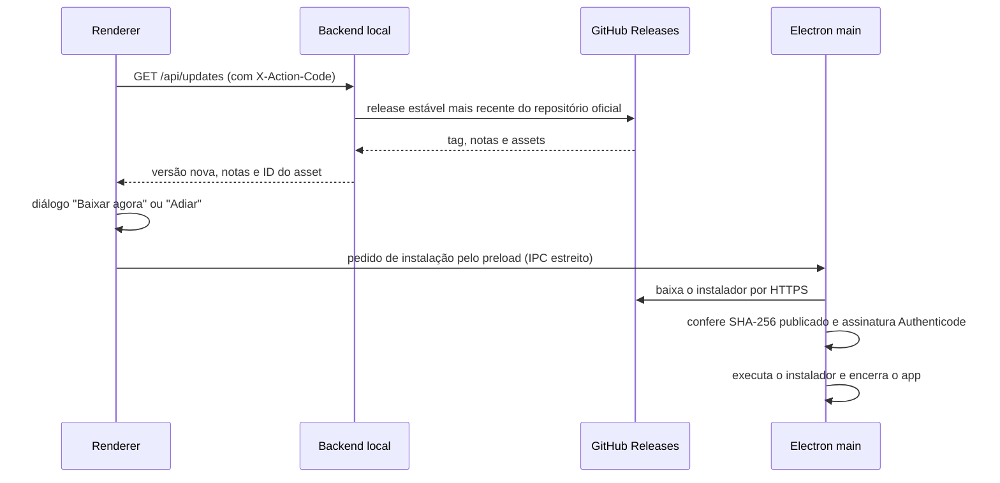

# Aviso de nova versão e atualização do aplicativo

## Status

**Planejado, antes do MVP** (ver "Pré-MVP" em [`ROADMAP.md`](./ROADMAP.md)). Nada deste documento está implementado. A ilustração `nova-versao` já existe em `design/estados-vetor/` e nas variantes de `public/estados/`.

O comportamento só pode operar depois que existirem instaladores assinados publicados em GitHub Releases (MVP 1 e MVP 2). Até lá, o verificador não encontra versão nova e nada aparece.

## O que a pessoa usuária vê

Quando existe no repositório oficial do GitHub uma release estável com versão maior que a do aplicativo em uso, o Talentum abre um diálogo:

- ilustração `nova-versao`, título "Nova versão disponível", versão atual e versão nova, e um resumo curto das notas da release;
- **Baixar agora:** baixa o instalador do Windows, confere integridade e assinatura, fecha o aplicativo e abre o instalador, que substitui a versão instalada pela mais recente;
- **Adiar:** fecha o diálogo e não pergunta de novo pela mesma versão durante 24 horas.

O diálogo nunca aparece durante uma importação ou gravação em andamento; espera a operação terminar.

## Fluxo técnico planejado

1. **Consulta:** ao iniciar e a cada 6 horas, o backend local consulta a API pública de releases do repositório oficial, que é fixo no código e não configurável pelo renderer. Considera apenas releases estáveis (não `draft`, não `prerelease`).
2. **Comparação:** versão em SemVer (`MAJOR.MINOR.PATCH`), comparada numericamente com a versão do pacote em execução. Tag inválida é ignorada.
3. **Contrato:** o renderer nunca fala com o GitHub. Recebe do backend local apenas versão, notas sanitizadas e o identificador do asset.
4. **Download e instalação:** feitos pelo processo principal do Electron, acionado por um método específico do preload. O main baixa só do domínio de releases do GitHub, confere o SHA-256 publicado na release e a assinatura do instalador, e só então executa e encerra o app. Falha em qualquer verificação cancela a instalação e mostra erro, sem executar nada.
5. **Adiar:** a data e a versão adiadas ficam em `UserPreference`, no SQLite local.

## Segurança

- Nenhum dado financeiro, identificador da pessoa ou telemetria é enviado na consulta: ela é anônima e só lê a release pública.
- Instalador sem assinatura válida ou com checksum divergente nunca é executado.
- O repositório e o nome do asset são fixos no build; o renderer não escolhe URL.
- A consulta respeita o limite da API pública do GitHub e falha em silêncio: sem rede, nada é exibido.
- Linux (AppImage) fica para depois da primeira entrega para Windows; até lá, o diálogo leva à página de downloads.

## Critérios de conclusão

- Release nova estável faz o diálogo aparecer uma vez por sessão; release igual, menor, `draft` ou `prerelease` não faz.
- "Adiar" suprime o aviso por 24 horas para aquela versão.
- "Baixar agora" com checksum ou assinatura inválidos não executa o instalador.
- Testes de regressão cobrem a comparação de versões, o filtro de releases e a recusa de instalador não verificado.
- O diálogo é validado nos temas claro e escuro e nas cinco larguras de referência.

## Relação com a Etapa 21

A Etapa 21 do roadmap (atualizações automáticas e canais de release) continua responsável por canais stable/beta, atualização diferencial, rollback e manifestos assinados. Esta funcionalidade é o primeiro passo, com aviso e instalação manual consentida.
