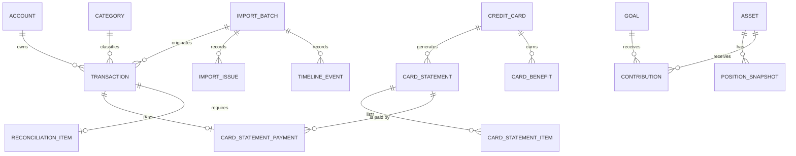
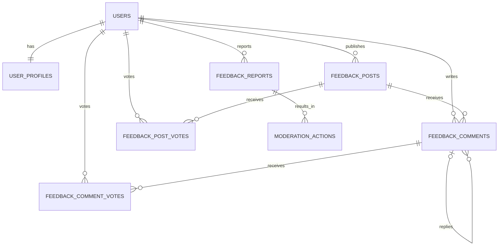

# Database

This document is the single reference for how Talentum stores data: which data may live on the user's device and which may reach the cloud, the modeling rules every table follows, the current local SQLite schema managed by Prisma, the current Cloudflare D1 schema used by the Worker, how migrations are created and applied in each store, and the capacity and approval process for any new persistent structure. Apply it whenever you create or change persistence, migrations, queries, queues, caches, backups or data contracts. Statements carry the status labels defined in [README.md](README.md#status-labels).

## Contents

- [Data placement policy](#data-placement-policy)
- [Modeling principles](#modeling-principles)
- [Local SQLite (Prisma)](#local-sqlite-prisma)
- [Local migrations](#local-migrations)
- [Cloud D1](#cloud-d1)
- [D1 migrations](#d1-migrations)
- [Migration procedure for both stores](#migration-procedure-for-both-stores)
- [Indexes and query rules](#indexes-and-query-rules)
- [Concurrency and idempotency](#concurrency-and-idempotency)
- [Caching, retention, backup and observability](#caching-retention-backup-and-observability)
- [Capacity, scaling and table approval](#capacity-scaling-and-table-approval)
- [Open items](#open-items)
- [References](#references)

## Data placement policy

Talentum has two independent data stores. The local SQLite database on the user's device holds all financial data. The shared Cloudflare D1 database holds only what the cloud backend needs for identity, sessions, release distribution, community and operational protection. Frontends never access either database directly; every read and write goes through a documented backend contract (see [ARCHITECTURE.md](ARCHITECTURE.md)).

### Local only

Status: **Rule**. The following data stays exclusively in the device's SQLite database:

- institutions, accounts and Pix identifiers;
- balances and balance snapshots;
- statements, imported files and import diagnostics;
- transactions, categories and categorization rules;
- income, obligations, credit cards and card statements;
- net worth, assets, goals and contributions;
- financial history and local backups.

Never create one cloud row per financial transaction. One million users must result in one million independent local databases, not one central financial database holding every statement.

### Allowed in D1

Status: **Rule**. D1 may hold only:

- minimal identity and the public profile;
- OAuth provider links and consents;
- sessions and refresh-token families, with tokens stored only as hashes;
- releases, artifacts, checksums and download grants;
- feedback, comments, votes, reports and moderation;
- redacted security and audit events;
- short-lived operational state the Worker needs to enforce its security contract: action codes, OAuth authorization transactions and rate-limit windows (all stored as hashes or ciphertext, never as plain secrets);
- strictly necessary metadata of future features, and only after the feature has been explicitly approved and documented.

Balances, statements, transactions, portfolios, decryption keys and banking identifiers are prohibited in D1. Account identifiers must not include CPF or banking data, and OAuth identity must never be stored as a permanent plain-text token.

### Remote data pending approval

Status: **Planned**, pending approval (**Open**). An earlier version of the data model listed two further remote data classes. Under the policy above they are not allowed until a feature that needs them is approved and documented, and no table for them exists today:

| Data | Purpose | Prohibited content |
| --- | --- | --- |
| Backup metadata | version, checksum and storage location of an encrypted backup | the decryption key |
| Communication preference | consent to receive communication | transactions and balances |

Social ranking or gamification must never reveal net worth, income, spending or habits. Whether XP needs to be synchronized remotely is **Open**.

## Modeling principles

Status: **Rule**. Where the current schema deviates, the deviation is listed in [Open items](#open-items).

### Tables and relations

- Create one table per durable responsibility. Do not accumulate authentication, profile, session, feedback and audit data in one generic table.
- Every table, including join (associative) tables, has an opaque `id` primary key.
- Every persisted relation uses a foreign key that references the other table's `id`. The naming convention differs per store:
  - Prisma (local SQLite): camelCase ending in `Id`, for example `profileId`, `importBatchId`.
  - D1 (cloud SQL): snake_case ending in `_id`, for example `user_id`, `family_id`, `author_user_id`.
- Add `createdAt`/`created_at` and `updatedAt`/`updated_at` when the record has a lifecycle.
- Add `deletedAt`/`deleted_at` only when logical deletion is required.
- Add a `version` column for optimistic concurrency on records subject to concurrent edits.
- Enforce `NOT NULL`, `UNIQUE`, `CHECK` and foreign-key constraints in the database.
- Validate finite states in the backend and restrict them in the database when it is safe to do so.
- Normalize until no duplication can produce inconsistency. Denormalize only when a measurement shows the normalized query violates the SLO and a rebuild process is defined.
- Classify every table as `local`, `cloud-global`, `cloud-user` or `cloud-public`.

### Identifiers

- Generate IDs in the backend. Use an opaque format that is not publicly sequential and does not depend on a provider.
- Exposed IDs are UUIDv7, ULID or an equivalent opaque format; never a predictable sequence. Prefer UUIDv7 or ULID when temporal ordering and index locality are useful. Never expose `ROWID`, a global counter or business meaning in an ID.
- Keep external identifiers in their own columns with a composite constraint, for example `(provider, provider_subject)`. Never replace the internal `id` with a provider's mutable identifier.
- An opaque ID is not authorization. Difficult-to-enumerate IDs are only an additional defense (see Ownership below).

Current generators: Prisma models use `@default(uuid())` and the Worker uses `crypto.randomUUID()`, both random UUIDs (version 4). They are opaque and non-sequential but not time-ordered.

### Money and time

- Monetary values use integer cents (or `Decimal`), never `Float`. Current local models store cents as `BigInt` (`amountCents`, `balanceCents`).
- Financial dates distinguish the civil date (for example the day a transaction occurred), the accounting period (competence) and the technical instant. Store instants in UTC and keep civil dates separate when the domain requires it. D1 stores instants as ISO 8601 UTC text; the Prisma schema stores `DateTime` values.
- Derived percentages are calculated, not persisted without justification. The total of a position is never inferred from stored percentages.

### Traceability and deletion

- Imports and corrections are traceable.
- Adjustments never silently overwrite the original value; they preserve the value before, the value after and the reason.
- A completed reconciliation records author, instant and decision.
- A contribution cannot be negative; withdrawals use their own event.
- Deletions with historical impact are recoverable when possible. Public deletion in the community uses a status or tombstone to preserve relations and moderation history.
- Timeline and audit events never store secrets or the raw content of a statement.

### Ownership and isolation

For every cloud table that belongs to a person:

1. include `user_id` or an equivalent verifiable relation;
2. derive the user from the identity validated on the server;
3. include the user scope in the query;
4. reject IDs that belong to another user;
5. include the scope in cache keys, jobs and rate limits;
6. test negative cross-access cases.

The local app is single-profile per database, but every local query is still scoped by `profileId` so that a second profile cannot turn into a leak later. Status: **Current** (`src/server/profile.ts` resolves the profile and the local API scopes its queries by it).

## Local SQLite (Prisma)

Status: **Current**. Source of truth: `prisma/schema.prisma`, datasource `sqlite`, URL from the `DATABASE_URL` environment variable. Thirty-seven models are implemented, created by 15 migrations. All IDs are `String @id @default(uuid())`. Unless stated otherwise, every model has `createdAt` (default now) and `updatedAt` (auto-updated); append-only records (snapshots, revisions, decisions, adjustments, transfers, events, import files and issues, backups) have only `createdAt`.

Every model except `LocalProfile`, `BalanceSnapshot`, `ImportFile` and `ImportIssue` references `LocalProfile` through `profileId` with `onDelete: Cascade`; those three reach the profile through their account or batch, also with cascade. Deleting the profile deletes all its local data. Status and kind columns are free `String` values; the database does not restrict them with `CHECK` constraints, so the allowed values below are enforced only by application code.

### `LocalProfile`

The local identity that owns all data in the database.

| Field | Notes |
| --- | --- |
| `id` | opaque ID |
| `displayName` | optional |
| `singletonKey` | default `'local'`, unique (migration `profile_singleton_manual_entries`). Two concurrent creations cannot both succeed: the second fails with `P2002` and `ensureLocalProfile` (`src/server/profile.ts`) rereads the winner. Rows created by the earlier race keep their own `id` here, so the migration deletes nothing |

Relations: has many of every profile-scoped model below. The local API reads the oldest profile (`createdAt` ascending) and never creates one on a read; a profile is created only by `POST /api/profile` or by starting onboarding (`POST /api/onboarding`), both through `ensureLocalProfile`. Without a profile, the API reports that there is no financial base and the interface leads to onboarding.

### `UserPreference`

Key/value preferences of a profile. Completing onboarding writes the `currency` and `timezone` keys. Postponing the new-version notice writes `updates.postponed` with the JSON `{ "version": "x.y.z", "until": <epoch ms> }` (**Current**, `POST /api/updates/postpone`).

| Field | Notes |
| --- | --- |
| `profileId` | FK to `LocalProfile`, cascade |
| `key`, `value` | strings |

Constraints: unique `(profileId, key)`; index `(profileId)`.

### `Institution`

A financial institution named by the user.

| Field | Notes |
| --- | --- |
| `profileId` | FK to `LocalProfile`, cascade |
| `name` | string |

Index: `(profileId)`. Relations: has many `Account`, `CsvMappingProfile`. Deleting an institution that still has accounts is refused by the API (`409 INSTITUTION_HAS_ACCOUNTS`), because `SetNull` would orphan them silently.

### `Account`

| Field | Notes |
| --- | --- |
| `profileId` | FK to `LocalProfile`, cascade |
| `institutionId` | optional FK to `Institution`, `SetNull` on delete |
| `name`, `type` | strings |
| `currency` | default `BRL` |
| `isActive` | default `true`; the dashboard reads only active accounts |

Indexes: `(profileId)`, `(institutionId)`. Relations: has many `BalanceSnapshot`, `Transaction`, `ScheduledObligation`, `ImportBatch`, `IncomeSource`, `PixIdentifier`. Because `Transaction.accountId` cascades, the API refuses to delete an account with entries or batches (`409 ACCOUNT_HAS_HISTORY`; deactivate instead) and refuses to change the currency of an account with entries (`409 ACCOUNT_CURRENCY_LOCKED`).

### `BalanceSnapshot`

A balance informed for an account at an instant. It has `createdAt` but no `updatedAt` (append-only by design).

| Field | Notes |
| --- | --- |
| `accountId` | FK to `Account`, cascade |
| `balanceCents` | `BigInt`, integer cents |
| `capturedAt` | instant the balance refers to |
| `importBatchId` | optional FK to `ImportBatch`, `SetNull` on delete; set when the balance came from a statement (migration `balance_snapshot_source`) |

Indexes: `(accountId, capturedAt)`, `(importBatchId)`. The dashboard takes the latest snapshot per account and applies transactions after it. Each balance is a dated fact, never an overwrite. `importBatchId` identifies the origin: undoing an import deletes only the balance that batch wrote, and a balance entered by hand afterwards has no batch and stays. Without this link, reversal could identify the balance only by approximation (its creation instant) and would destroy user data. The API exposes the distinction as `fromImport`. A separate `source`/confidence field (`BANK_REPORTED`/`USER_DECLARED`) is still **Open** (L-3 in [PRODUCT.md](PRODUCT.md)).

### `Category`

| Field | Notes |
| --- | --- |
| `profileId` | FK to `LocalProfile`, cascade |
| `name` | string |
| `kind` | string (category type) |

Constraints: unique `(profileId, name, kind)`; index `(profileId)`. Relations: has many `Transaction`, `ScheduledObligation`, `MerchantRule`, `Budget`. `isEssential` (boolean, default `false`, added by `planning_networth`) marks an expense category as essential for survival mode; it is set only through `PUT /api/survival`. `kind` is `income`, `expense` or `transfer`; entries in a `transfer` category leave income and expense aggregates.

### `ImportBatch`

One import of a statement file.

| Field | Notes |
| --- | --- |
| `profileId` | FK to `LocalProfile`, cascade |
| `accountId` | optional FK to `Account`, `SetNull` on delete; target account of the batch |
| `format` | string (`csv`, `ofx` or `pdf`; see [PRODUCT.md](PRODUCT.md)) |
| `parser` | optional; PDF layout reader and version that read the batch, as `id@version` ([ADR 0006](decisions/0006-pdf-import.md)); `null` for CSV and OFX |
| `fingerprint` | SHA-256 of the decoded text with line breaks normalized, so the same statement re-exported with CRLF is still recognized; for PDF, of the extracted text lines, so the same statement downloaded again with different PDF metadata is still recognized |
| `status` | string; the dashboard counts batches with `completed` |
| `fileName` | optional, sanitized |
| `periodStart`, `periodEnd` | optional; civil interval the file covers, not the import date |
| `rowCount`, `importedCount`, `duplicateCount` | entries read, written and already present (default 0) |
| `importedAt` | default now |

Constraints: unique `(profileId, fingerprint)`, which prevents accidental duplicate imports per profile; indexes `(profileId, importedAt)`, `(accountId)`, `(profileId, periodStart, periodEnd)`. Relations: has many `Transaction`, `ImportFile`, `ImportIssue`, `BalanceSnapshot`, `TimelineEvent`. `periodStart`/`periodEnd` resolve limitation L-2 in [PRODUCT.md](PRODUCT.md): without them the system cannot tell "a month without movement" from "a month without a statement", and the monthly cash-flow chart could not be published honestly.

### `ImportFile`

Metadata of the imported file; the raw content is never retained (the statement is processed in memory and discarded). `createdAt` only.

| Field | Notes |
| --- | --- |
| `importBatchId` | FK to `ImportBatch`, cascade |
| `originalName` | name sent by the browser, sanitized; never used as a path |
| `byteSize`, `mediaType`, `encoding` | size, detected type and encoding |
| `contentHash` | SHA-256 of the normalized text; same basis as the batch fingerprint |

Indexes: `(importBatchId)`, `(contentHash)`.

### `ImportIssue`

A line that could not be converted, declared instead of silently omitted. An unreadable line becomes an issue; it is neither imported nor dropped. `createdAt` only.

| Field | Notes |
| --- | --- |
| `importBatchId` | FK to `ImportBatch`, cascade |
| `transactionId` | optional FK to `Transaction`, `SetNull` |
| `lineNumber` | file line, counted from 1 as the person sees it |
| `severity` | `error` or `warning` |
| `code`, `message` | stable code and safe message |

Indexes: `(importBatchId)`, `(transactionId)`.

### `CsvMappingProfile`

Reusable column mapping, recognized by layout.

| Field | Notes |
| --- | --- |
| `profileId` | FK to `LocalProfile`, cascade |
| `institutionId` | optional FK to `Institution`, `SetNull` |
| `name` | unique per profile |
| `separator`, `hasHeader`, `decimalSeparator` | dialect |
| `roles` | column roles in file order, comma-separated |
| `headerSignature` | optional SHA-256 of the normalized column labels in order |

Constraints: unique `(profileId, name)`; indexes `(profileId)`, `(profileId, headerSignature)`. `headerSignature` identifies the **layout**, not the file, and is null without a usable header, because recognizing a layout by column position would be guesswork. The table stores no value, entry or statement excerpt, only dialect and roles.

### `Transaction`

A normalized financial entry.

| Field | Notes |
| --- | --- |
| `profileId` | FK to `LocalProfile`, cascade |
| `accountId` | FK to `Account`, cascade |
| `importBatchId` | optional FK to `ImportBatch`, `SetNull` on delete |
| `categoryId` | optional FK to `Category`, `SetNull` on delete |
| `occurredOn` | civil date of the entry |
| `description` | string |
| `amountCents` | `BigInt`, integer cents |
| `status` | `pending` or `posted`; default `pending`. Imported entries are written as `posted` because they already happened |
| `externalId` | optional; the entry's identifier at the source bank (`FITID` in OFX, an identifier column in CSV) |
| `idempotencyKey` | optional; client-generated UUID of a manual cash entry (`POST /api/transactions`), `NULL` for imported entries (migration `profile_singleton_manual_entries`) |

Constraints: unique `(accountId, externalId)`; unique `(profileId, idempotencyKey)`, so resending the same manual entry returns the stored row instead of writing a second one. In SQLite `NULL` is distinct from `NULL`, so entries without a source identifier remain allowed; for those, the importer compares civil day, amount and description, consuming one occurrence at a time. Indexes: `(profileId, occurredOn)`, `(accountId, occurredOn)`, `(importBatchId)`, `(categoryId)`. Relations: has many `ImportIssue`, `TransactionRevision`, `FinancialAdjustment`, `TimelineEvent`, outgoing and incoming `OwnAccountTransfer`; has at most one `ReconciliationItem`.

### `ScheduledObligation`

A commitment with an amount and a due date. It is the subtrahend of the risk-free balance (`Saldo Livre de Risco`).

| Field | Notes |
| --- | --- |
| `profileId` | FK to `LocalProfile`, cascade |
| `accountId`, `categoryId` | optional FKs, `SetNull` on delete |
| `creditCardId` | optional FK to `CreditCard`, `SetNull` on delete (migration `obligation_credit_card`); set when the obligation is the bill of that card |
| `description` | local label of the commitment |
| `amountCents` | `BigInt`, integer cents |
| `dueDate` | due date; decides whether the obligation falls in the period |
| `status` | `open`, `paid` or `cancelled`; default `open` |
| `recurrence` | `none`, `weekly`, `monthly` or `yearly`; default `none` |
| `isEstimated` | amount informed as approximate during onboarding; default `false` |
| `idempotencyKey` | UUID sent by the form once per submit (migration `obligation_income_idempotency`); unique with `profileId`, so a repeated `POST` returns the row already created. Older rows keep `null`, which SQLite never treats as a conflict |

Invariant: **only `status = 'open'` is subtracted**. Without this field an obligation already paid would keep being subtracted and the risk-free balance would be permanently pessimistic. The dashboard query filters `profileId`, `status = 'open'` and `dueDate` up to the period end, which is why the main index is `(profileId, status, dueDate)`. Other indexes: `(accountId)`, `(categoryId)`, `(creditCardId)`.

Before Stage 8 an open credit-card statement was represented as a `ScheduledObligation`. Since migration `cards_statements` it has its own model, `CardStatement` (next section), which the dashboard subtracts next to the obligations. **Current:** an obligation with `creditCardId` is left out of the committed total when the same card has a statement that is not cancelled with a due date in the same calendar month, so the same bill is not subtracted twice; an obligation without the link always weighs (rule and reasoning in [PRODUCT.md](PRODUCT.md), V). The API accepts only a card of the same profile (`404 CARD_NOT_FOUND`).

### `OnboardingSession` and `OnboardingAnswer`

Persistent first-access state (migration `mvp_onboarding`).

| Model | Fields | Constraints |
| --- | --- | --- |
| `OnboardingSession` | `profileId` (cascade), `status` (`draft` or `completed`, default `draft`), `currentStep` (`profile`, `accounts`, `position`, `review`; default `profile`), `version` (default 1), `completedAt` | index `(profileId, status, updatedAt)` |
| `OnboardingAnswer` | `onboardingSessionId` (cascade), `profileId` (cascade), `questionKey`, `valueJson` | unique `(onboardingSessionId, questionKey)`; index `(profileId)` |

The unique `(onboardingSessionId, questionKey)` makes answer updates idempotent, and `version` applies optimistic concurrency (`409 ONBOARDING_CHANGED`). Answers are a simple interface draft; consolidated financial data belongs to the typed domain tables, not to this draft.

### `PixIdentifier`

An own Pix key of the person, used only to recognize transfers between their own accounts, which are neither income nor expense (migration `mvp_pix_identifiers`). The name `PixIdentifier` is fixed; the earlier `PixKey` name is retired (L-6 in [PRODUCT.md](PRODUCT.md)).

| Field | Notes |
| --- | --- |
| `profileId`, `accountId` | FKs, cascade |
| `type` | `cpf`, `cnpj`, `phone`, `email` or `random` |
| `label` | optional safe nickname chosen by the person |
| `valueIndex` | HMAC-SHA256 of the normalized value with a device subkey |
| `valueCiphertext` | AES-256-GCM of the normalized value, with version, nonce and tag |
| `maskedValue` | masked form, the only one the interface shows by default |
| `isActive`, `validFrom`, `validUntil` | state and known validity period |
| `source` | `declared` or `detected`; default `declared` |

Constraints: unique `(profileId, valueIndex)`, so the same key does not belong to two accounts of the same person; indexes `(accountId)`, `(profileId, isActive)`. Invariants:

1. **The value is never stored in cleartext**: not in a column, log, timeline, analytics, D1 or error message.
2. `valueIndex` is an HMAC, **not a plain hash**. CPF and phone numbers have a predictable value space (10^11 combinations for a CPF), and a plain hash would fall to brute force. The secret comes from `src/server/local-key.ts` ([ADR 0003](decisions/0003-local-device-key.md)).
3. Normalization precedes the index: the same phone number written with or without punctuation and country code produces the same index. Otherwise the own transfer would not be recognized and would appear as an expense in one account and income in the other (L-5).
4. The value is not editable. Changing it would change the index and the pairing history would lose meaning; the old key is deactivated, not rewritten, because it still explains past statements.

### `IncomeSource`

Expected income, never treated as available balance (migration `mvp_income_merchant_rules`). Fields: `profileId` (cascade), optional `accountId` (`SetNull`), `description`, `amountCents` (`BigInt`), `frequency`, optional `nextExpectedDate`, `isActive`, optional `idempotencyKey` (unique with `profileId`, migration `obligation_income_idempotency`; same replay rule as `ScheduledObligation`). Indexes: `(profileId, isActive)`, `(accountId)`. A forecast income never increases the Saldo Livre de Risco before it exists as an effective transaction.

### `MerchantRule`

Local, deterministic and reviewable categorization rule (migration `mvp_income_merchant_rules`). Fields: `profileId` (cascade), `categoryId` (cascade), `pattern`, `matchType` (default `contains`), `priority` (default 0), `isActive`. Constraints: unique `(profileId, pattern, matchType)`; indexes `(profileId, isActive, priority)`, `(categoryId)`. **Current** as data, list, create, deactivate (`DELETE` sets `isActive: false`) and automatic application: the importer and manual entries apply active rules to uncategorized entries, and `POST /api/merchant-rules/apply` reapplies them to the pending queue (policy in [PRODUCT.md](PRODUCT.md), Feature 6). A rule never changes a category already set.

### `TransactionRevision`

Immutable history of manual edits of a `Transaction` (migration `transaction_revisions`). Fields: `profileId` and `transactionId` (both cascade), `beforeJson`, `afterJson`, optional `reason`; `createdAt` only. Indexes: `(profileId, createdAt)`, `(transactionId, createdAt)`. The history is local, immutable through the API and removed in cascade only with the transaction itself.

### Reconciliation models

Created by migration `mvp_reconciliation`.

| Model | Fields | Constraints |
| --- | --- | --- |
| `ReconciliationItem` | `profileId`, `transactionId` (both cascade), `reason`, `confidence` (`Int`), `status` (default `pending`) | unique `transactionId` (exactly one item per transaction); index `(profileId, status, createdAt)` |
| `ReconciliationDecision` | `profileId`, `reconciliationItemId` (both cascade), `kind`, `beforeJson`, `afterJson`, `revertedAt` | indexes `(profileId, createdAt)`, `(reconciliationItemId, createdAt)` |
| `FinancialAdjustment` | `profileId`, `transactionId`, `decisionId` (all cascade), `kind` (`interest`, `fee`, `discount`, `correction`), `deltaCents` (`BigInt`), `note` | unique `decisionId`; indexes `(profileId, createdAt)`, `(transactionId)` |
| `OwnAccountTransfer` | `profileId`, `outgoingTransactionId`, `incomingTransactionId`, `decisionId` (all cascade) | unique `decisionId`; unique `(outgoingTransactionId, incomingTransactionId)`; indexes `(profileId, createdAt)`, `(incomingTransactionId)` |

Each resolution creates a `ReconciliationDecision` with JSON snapshots of the structured fields before and after. `FinancialAdjustment` records the delta in cents; `OwnAccountTransfer` links the two entries by opaque IDs. Reverting marks the decision (`revertedAt`), restores the snapshots and reopens the item without deleting the audit trail. The importer and manual cash entries create one item for every entry written without a category. `reason` values (**Current**): `category_unknown` (confidence 0), `merchant_rule` (rule applied automatically, item created `resolved` together with a `ReconciliationDecision` of kind `rule`; confidence 100 for `exact`, 90 for `startsWith`), `merchant_rule_suggestion` (a `contains` rule matched; confidence 60, the item stays pending), `merchant_rule_conflict` (two equally ranked rules point to different categories; 0), `own_transfer_candidate` (an opposite entry in another own account within three days; 60 to 100) and `rule_reverted` (a `rule` decision was reverted; 0). Decision `kind` values: `confirm`, `category`, `obligation`, `adjustment`, `transfer` and `rule`.

### Cards, statements and benefits

Created by migration `cards_statements` (**Current**, Stage 8). Every table has an opaque `id`, a `profileId` (cascade) and relates by foreign-key IDs; money is `BigInt` cents.

| Model | Fields | Constraints |
| --- | --- | --- |
| `CreditCard` | `institutionId?` (`SetNull`), `paymentAccountId?` (FK to `Account`, `SetNull`), `name`, `lastFourDigits?`, `closingDay?`, `dueDay`, `limitCents?`, `annualFeeCents?`, `feeWaiverSpendCents?`, `feeWaiverPeriod?` (`statement` or `year`), `isActive` | unique `(profileId, name)`; indexes `(profileId, isActive)`, `(institutionId)`, `(paymentAccountId)` |
| `CardStatement` | `creditCardId` (cascade), `periodStart?`, `closingDate`, `dueDate`, `totalCents`, `isEstimated`, `status` (`open`, `paid`, `cancelled`) | unique `(creditCardId, dueDate)`; index `(profileId, status, dueDate)` |
| `CardStatementItem` | `cardStatementId` (cascade), `occurredOn`, `description`, `amountCents` (positive is a charge, negative a credit), `installmentNumber?`, `installmentCount?`, `source` (`manual`, `import`), `externalId?` | unique `(cardStatementId, externalId)`; indexes `(profileId, occurredOn)`, `(cardStatementId, occurredOn)` |
| `CardStatementPayment` | `cardStatementId` (cascade), `transactionId` (FK to `Transaction`, cascade), `amountCents` | unique `transactionId`; indexes `(profileId, createdAt)`, `(cardStatementId)` |
| `CardBenefit` | `creditCardId` (cascade), `kind` (`cashback`, `points`, `miles`), `programName`, `balance` (cents for cashback, units otherwise), `expiringBalance?`, `expiresOn?` | unique `(creditCardId, kind, programName)`; index `(profileId, expiresOn)` |

Invariants:

- the card never stores a full number, a security code or a password; `lastFourDigits` is optional and validated as exactly four digits;
- each unique constraint is the idempotency of a write that can repeat: the same nickname, the same due date, the same item key (`manual:<form key>` for a typed item, `import:<hash>:<occurrence>` for an imported one), the same bank entry paying two statements, the same benefit program;
- `CardStatement.status` is never set to `paid` by hand: it is recomputed from the sum of `CardStatementPayment` in the same transaction that adds or removes a payment, or changes the total;
- removing a card with statements is refused (`409 CARD_HAS_STATEMENTS`); deactivating keeps everything. Removing a statement removes its items and payment links, never the bank entries.

### `TimelineEvent` and `DatabaseBackup`

Created by migration `mvp_timeline_backup`; both have `createdAt` only.

| Model | Fields | Constraints |
| --- | --- | --- |
| `TimelineEvent` | `profileId` (cascade), `kind` (`import`, `transaction_edit`, `reconciliation`, `planning`, `manual_entry`, `categorization`), `title`, `description`, optional `importBatchId`, `transactionId`, `transactionRevisionId`, `reconciliationDecisionId` (all `SetNull`), `reversible`, `revertedAt` | indexes `(profileId, createdAt)`, `(importBatchId)`, `(transactionId)` |
| `DatabaseBackup` | `profileId` (cascade), `schemaVersion`, `checksum`, `byteSize`, `status`, `verifiedAt`, `kind` (`manual`, `pre_migration`, `pre_restore`, `pre_deletion`; added by `notifications_gamification`) | indexes `(profileId, createdAt)`, `(profileId, status, verifiedAt)` |

A timeline event stores only redacted, structured metadata and opaque IDs: never amounts, entry descriptions, keys, hashes, file content or action codes. Timeline kinds: `import`, `transaction_edit`, `reconciliation` (reversible), and `restore_point`, `restore_scheduled`, `restore_cancelled`, `encrypted_backup`, `month_review` (not reversible). `DatabaseBackup` stores only metadata of a local restore point; the path, key and content never enter it. **Current:** the app writes a row for every restore point it creates while a profile exists, and the open path (`src/server/backup/startup.ts`) writes one for the automatic `pre_migration` point. The manifest files in `talentum-backups/` are the source of truth for the list of restore points; the rows are the in-database index ([ADR 0007](decisions/0007-local-encrypted-backup.md)).

### `NotificationState` and `MonthlyReview`

Created by migration `notifications_gamification`.

| Model | Fields | Constraints |
| --- | --- | --- |
| `NotificationState` | `profileId` (cascade), `key` (`kind:subject:period`), `kind`, `readAt`, `dismissedAt`, `createdAt`, `updatedAt` | unique `(profileId, key)`; index `(profileId, updatedAt)` |
| `MonthlyReview` | `profileId` (cascade), `month` (`AAAA-MM`), `createdAt` | unique `(profileId, month)` |

Notifications are **derived** from local data on each read and are not stored; `NotificationState` keeps only what the person did with one (read, dismissed), keyed by the stable dedupe key. Rows not updated for 180 days are deleted on the next state change. Notification preferences are `UserPreference` rows: `notifications.quiet` (`on`/`off`) and `notifications.kind.<kind>` (`on`/`off`). `MonthlyReview` is the only gamification fact that has no other trace; XP, levels, missions and badges are derived from imports, reconciliation decisions, month reviews and manual restore points, and never from amounts.

### Planning and net worth models

Created by migration `planning_networth` (**Current**, Stages 9, 12, 13 and 14). Every table has an opaque `id`, a `profileId` foreign key with cascade, and money as `BigInt` cents.

| Model | Fields | Constraints |
| --- | --- | --- |
| `Budget` | `categoryId` (cascade), `month` (`AAAA-MM`), `limitCents`, `createdAt`, `updatedAt` | unique `(profileId, categoryId, month)`; indexes `(profileId, month)`, `(categoryId)` |
| `Goal` | `name`, `targetCents`, optional `deadline`, `status` (`active` or `archived`), `createdAt`, `updatedAt` | index `(profileId, status)` |
| `GoalContribution` | `goalId` (cascade), `kind` (`deposit` or `withdrawal`), `amountCents` (always positive), `contributedOn`, `idempotencyKey`, `createdAt` | unique `(profileId, idempotencyKey)`; indexes `(goalId, contributedOn)`, `(profileId)` |
| `Debt` | `name`, `principalCents`, `monthlyRateBps` (integer basis points, 0 to 5,000), `minimumPaymentCents`, `overdueCents` (default 0), optional `dueDay`, `status` (`open` or `paid`), `createdAt`, `updatedAt` | index `(profileId, status)` |
| `Asset` | `name`, `pillar` (`stocks`, `real_estate`, `cash`, `international` or `outside`), `isActive`, `createdAt`, `updatedAt` | index `(profileId, isActive)` |
| `AssetSnapshot` | `assetId` (cascade), `valueCents`, `capturedAt`, `idempotencyKey`, `createdAt` | unique `(profileId, idempotencyKey)`; indexes `(assetId, capturedAt)`, `(profileId)` |

A goal's saved amount is derived from its contributions and never stored. A budget's spending is derived from confirmed transactions and never stored. An asset value is a dated fact: a new value appends a row and the net worth uses the latest per asset. The debt and asset fields hold only what the person knows; no contract, document or credential is stored.

### Local data access

Status: **Current**. The local API (`src/app/api`) reads and writes the database through a single `PrismaClient` (`src/server/db.ts`). Write flows exist for onboarding, profile, institutions, accounts, balances, Pix identifiers, categories, income, obligations, merchant rules (create, deactivate, reapply), import, manual cash entries, transaction edits, reconciliation, timeline reversal and the update-notice postponement. Multi-row changes (writing or undoing a batch, a transaction edit with its revision, a reconciliation decision or its reversal, completing onboarding) run in one SQLite transaction. Every query is scoped by `profileId`.

### Implemented invariants

1. `ImportBatch.fingerprint` is unique per profile and prevents accidental duplication. It is computed over the decoded text with normalized line breaks, so the same statement re-exported with CRLF is still recognized. **Current** (unique constraint).
2. Only open obligations are subtracted from the risk-free balance. **Current** (query filter).
3. Every imported transaction references its source batch, and undoing the batch removes exactly what it created (entries and the balance it recorded). **Current** in the importer and in `DELETE /api/imports/:importBatchId`; **Open** at the database level: `Transaction.importBatchId` is optional with `SetNull`, so a batch row deleted outside the API would leave entries without a batch.
4. `(accountId, externalId)` is unique on `Transaction`, so overlapping statements do not write the same entry twice. **Current**.
5. Adjustments never silently overwrite the original value: transaction edits keep before/after in `TransactionRevision`, and reconciliation decisions keep before/after snapshots and can be reverted. **Current**.
6. A completed reconciliation records the decision and its instant. **Current**; the local author is implicit, because a local database has a single profile.
7. Own Pix identifier values are never stored in cleartext. **Current**.

### Planned local aggregates

Status: **Planned** for the entities not in bold. The conceptual model groups local data into these aggregates. Entities in bold are implemented; the rest are planned.

| Aggregate | Responsibility | Main entities |
| --- | --- | --- |
| Local identity | Preferences, onboarding and optional link to a remote identity | **`LocalProfile`**, **`UserPreference`**, **`OnboardingSession`**, **`OnboardingAnswer`** |
| Accounts | Institutions, accounts, informed balances and own Pix keys | **`Institution`**, **`Account`**, **`BalanceSnapshot`**, **`PixIdentifier`** |
| Import | File, batch, parser, mapping and diagnostics | **`ImportBatch`**, **`ImportFile`**, **`ImportIssue`**, **`CsvMappingProfile`** |
| Transactions | Normalized entries, categories, rules and edit history | **`Transaction`**, **`Category`**, **`MerchantRule`**, **`TransactionRevision`** |
| Cards | Cards, statements, items, payments, benefits and recurring charges | **`CreditCard`**, **`CardStatement`**, **`CardStatementItem`**, **`CardStatementPayment`**, **`CardBenefit`**, `RecurringCharge` |
| Reconciliation | Pending items, decisions, adjustments and own transfers | **`ReconciliationItem`**, **`ReconciliationDecision`**, **`FinancialAdjustment`**, **`OwnAccountTransfer`** |
| Planning | Income, budget, goals, debts and obligations | **`IncomeSource`**, **`Budget`**, **`Goal`**, **`GoalContribution`**, **`Debt`**, **`ScheduledObligation`** |
| Net worth | Assets, dated values and pillars | **`Asset`**, **`AssetSnapshot`** (the earlier `PositionSnapshot` name); a persisted asset `Contribution` is not needed: a contribution is recorded as a new asset value |
| Product | Alerts, missions and history | **`NotificationState`** (notifications themselves are derived), **`MonthlyReview`** (missions and badges are derived), **`TimelineEvent`** |
| Backup | Runs, versions and integrity | **`DatabaseBackup`** (metadata only; files and manifests in `talentum-backups/`) |

Essential relations of the full conceptual model (planned entities included):



### Encryption at rest and the local vault

Status: **Current** ([ADR 0009](decisions/0009-local-vault-and-encrypted-database.md)).

- The whole local database file is encrypted by libSQL (`@libsql/client` with `encryptionKey`) and opened by Prisma through `@prisma/adapter-libsql` (`src/server/vault/database.ts`). The key is the HKDF subkey `database` of a random 256-bit data-encryption key (DEK). The file has no SQLite header and no readable text; `tests/vault-database.test.mjs` asserts both, and that opening it without the key fails with `SQLITE_NOTADB`.
- The DEK is wrapped (AES-256-GCM) under the password and under the recovery code, each through scrypt (`N = 2^17, r = 8, p = 1`), in `talentum-local.vault` next to the database (`TALENTUM_VAULT_FILE` overrides the path). The vault file is written atomically with mode `0600`, is git-ignored (`*.vault`) and excluded from installers. It holds no secret in clear: wrapped keys, the TOTP secret encrypted under the DEK, HMACs of the TOTP backup codes, the auto-lock minutes and the failed-attempt counter.
- The database opens only after unlock; while locked `db` (`src/server/db.ts`) throws `VaultLockedError` and no connection exists.
- Dates are stored as Unix milliseconds (`timestampFormat: 'unixepoch-ms'`), the format the native Prisma engine wrote, so databases created before the vault keep their values. `BigInt` values must stay within ±2^53 through the adapter; the importer ceiling guarantees it.
- **Plaintext databases from earlier versions** are migrated at vault setup: copied table by table into `<db>.encrypting`, verified (row count of every table and `PRAGMA integrity_check`), the original renamed to `<db>.plaintext-pending-removal`, the encrypted copy moved into place, the vault written, and only then the plaintext file and its `-wal`/`-shm`/`-journal` overwritten with random bytes and deleted. An interrupted setup restarts from the plaintext copy. Overwriting is best effort on SSDs, copy-on-write file systems and synced folders.
- `prisma migrate deploy`, `prisma studio` and plaintext SQLite tools cannot open the database. There is no supported way to read it outside the app; losing both the password and the recovery code loses the data.

### Local SQLite operation

- Apply pending migrations when a new version of the local backend starts. **Current**: the backend applies them through the encrypted connection at every unlock and at setup (`src/server/vault/migrations.ts`), the same way in `pnpm dev`, the Docker development image and the packaged Electron app.
- Enable and validate foreign keys. **Current**: Prisma's SQLite connector enforces the declared foreign keys.
- Import a complete batch inside one transaction. **Current** (`src/server/import/persist.ts`); a failure halfway leaves no partial batch. Saving a reusable column mapping runs outside that transaction on purpose: it is a convenience and must not undo a correct import.
- Keep one writer per database and limit write concurrency. **Planned** as an explicit rule for write flows.
- Use WAL only after compatibility testing with packaging, backup and recovery. **Current** in code: the runner sets `PRAGMA journal_mode = WAL` on the encrypted file; backup and recovery with WAL are still **Planned**.
- SQLite database files and their `-wal`, `-shm` and `-journal` companions are git-ignored. **Current**.

## Local migrations

Status: **Current**. The local schema evolves only through versioned Prisma migrations in `prisma/migrations` (provider `sqlite`, recorded in `migration_lock.toml`). Environments never depend on manual changes or on `prisma db push` in production.

| Migration | Creates |
| --- | --- |
| `20260905182000_init` | `LocalProfile`, `UserPreference` |
| `20260905214010_mvp_financial_core` | `Institution`, `Account`, `BalanceSnapshot`, `Category`, `ImportBatch`, `Transaction` and their indexes |
| `20260911000729_mvp_scheduled_obligations` | `ScheduledObligation` and its indexes |
| `20260912120000_mvp_import_details` | `ImportFile`, `ImportIssue`, `CsvMappingProfile`; adds `accountId`, `periodStart`, `periodEnd`, `rowCount`, `importedCount`, `duplicateCount` to `ImportBatch` and `externalId` (unique per account) to `Transaction` |
| `20260912160000_balance_snapshot_source` | adds `importBatchId` to `BalanceSnapshot` |
| `20260912180000_mvp_onboarding` | `OnboardingSession`, `OnboardingAnswer` |
| `20260912200000_mvp_income_merchant_rules` | `IncomeSource`, `MerchantRule` |
| `20260912210000_transaction_revisions` | `TransactionRevision` |
| `20260912220000_mvp_pix_identifiers` | `PixIdentifier`, with unique `(profileId, valueIndex)` |
| `20260912230000_mvp_reconciliation` | `ReconciliationItem`, `ReconciliationDecision`, `FinancialAdjustment`, `OwnAccountTransfer` |
| `20260912240000_mvp_timeline_backup` | `TimelineEvent`, `DatabaseBackup` |
| `20261120120000_profile_singleton_manual_entries` | adds `singletonKey` (unique) to `LocalProfile` and `idempotencyKey` (unique per profile) to `Transaction`; an `UPDATE` gives any extra profile created by the earlier race its own `id` as key before the unique index is built |
| `20261120210000_planning_networth` | `Budget`, `Goal`, `GoalContribution`, `Debt`, `Asset`, `AssetSnapshot`; adds `isEssential` to `Category` |
| `20261120200000_cards_statements` | `CreditCard`, `CardStatement`, `CardStatementItem`, `CardStatementPayment`, `CardBenefit`; adds `parser` to `ImportBatch` |
| `20261120220000_notifications_gamification` | `NotificationState`, `MonthlyReview`; adds `kind` to `DatabaseBackup` |
| `20261120230000_obligation_credit_card` | adds `creditCardId` (optional FK to `CreditCard`, `SetNull`) and its index to `ScheduledObligation` |
| `20261121000000_obligation_income_idempotency` | adds the nullable `idempotencyKey` and the unique `(profileId, idempotencyKey)` to `ScheduledObligation` and `IncomeSource` |

The migrations after `mvp_scheduled_obligations` are **additive**: new columns enter through `ALTER TABLE ... ADD COLUMN` and no already applied table is rebuilt.

How migrations are applied (**Current**, [ADR 0009](decisions/0009-local-vault-and-encrypted-database.md)):

- `pnpm prisma:migrate` (`scripts/migrate-dev.mjs`) runs `prisma migrate dev` against a disposable plaintext scratch database (`temp/migrate-scratch.db`, no data) to generate a new migration folder; extra arguments go to Prisma (`pnpm prisma:migrate --name new_table`). The encrypted database cannot be opened by the Prisma CLI.
- **Opening the database (Current).** Every vault setup and every unlock runs `src/server/backup/startup.ts` before Prisma connects, while the database key is in memory and no connection is open. In order: (1) a scheduled restore (`talentum-backups/pending-restore.*`) is verified — SHA-256 of the copy and of the device key, integrity and schema version checked by opening the copy with the database key, every migration in it known to this app version — the current database is saved as a `pre_restore` restore point, and the files are swapped with an atomic `rename`; a copy that fails any check is discarded and the current database stays in use; (2) when migrations are pending on a database that already has schema, a verified, encrypted `pre_migration` restore point is created and its `DatabaseBackup` row written; (3) the pending migrations are applied. Restore points and the scheduled-restore copy are encrypted with the database key like the database itself; libSQL's `VACUUM INTO` writes a **plaintext** copy of an encrypted database, so copies are made through an encrypted connection instead (`src/server/backup/libsql-file.ts`; `tests/restore-points.test.mjs` pins that behavior). See [ADR 0007](decisions/0007-local-encrypted-backup.md) and [ADR 0009](decisions/0009-local-vault-and-encrypted-database.md).
- The migration runner (`src/server/vault/migrations.ts`) reads every `prisma/migrations/<name>/migration.sql` in name order (`TALENTUM_MIGRATIONS_DIR` overrides the folder; the packaged app sets it), so any future folder is picked up without a list. Each is recorded in `_prisma_migrations` in Prisma's format (SHA-256 checksum of the file, `started_at`, `finished_at`, `applied_steps_count`). An applied migration never runs again (tested twice in a row); a migration that failed halfway is recorded without its error text and blocks later ones (`FAILED_MIGRATION_PENDING`), as `migrate deploy` does with P3009. The SQL runs as written, without a surrounding transaction, because SQLite table redefinitions use `PRAGMA foreign_keys`.
- **Destructive-migration gate**, the same in development, Docker and the packaged app: with schema already applied, pending SQL containing `DROP TABLE`, `DROP COLUMN`, `TRUNCATE TABLE` or `DELETE FROM` requires a verified backup of the current schema version — the `pre_migration` restore point created just before, or, when that point could not be created, `TALENTUM_VERIFIED_BACKUP_ID` pointing to `DatabaseBackup` metadata with status `verified`, a SHA-256 checksum, a size and the current schema version; otherwise unlock fails with `VAULT_DATABASE_UNAVAILABLE` before changing anything. A brand-new database has nothing to lose and is not gated.
- `pnpm dev`, `pnpm test:manual`, the Docker image and the packaged app run neither `prisma migrate deploy` nor a startup script: the CLI would create a plaintext database beside the vault. `scripts/migration-preflight.mjs` and `pnpm prisma:preflight` were removed; their three responsibilities moved to the open path above.
- `pnpm prisma:generate` regenerates the client and `pnpm prisma:validate` validates the schema; `pnpm typecheck` regenerates the client when it is stale.

D1 uses Wrangler (next sections).

## Cloud D1

Status: **Current** for every table listed here: all of them are created by the D1 migrations in `cloudflare/migrations`. Whether a Worker route uses a table is stated separately. The Worker (`cloudflare/src/`) accesses D1 through the `DB` binding with bound prepared statements; there is no adapter layer. All IDs are `TEXT` primary keys filled with `crypto.randomUUID()`, all timestamps are ISO 8601 UTC `TEXT`, and both migrations enable `PRAGMA foreign_keys = ON`. Column names are snake_case.

### Identity and consent (`0001_cloud_core`)

| Table | Keys and relations | Purpose and constraints | Worker use |
| --- | --- | --- | --- |
| `users` | `id` | internal account; `email_normalized` unique; `status` in `ACTIVE`, `BLOCKED`, `DELETED` (default `ACTIVE`); `email_verified_at`, `deleted_at` | **Current** (upserted on OAuth callback; account deletion keeps the row as a tombstone with `status = DELETED` and `email_normalized = 'deleted:' || id`, because community rows reference it with `RESTRICT`) |
| `user_profiles` | `id`, `user_id` unique, FK cascade | public name (`public_name`, first name from Google, editable 2–40 chars) and avatar URL (`avatar_url`, stored but never displayed) | **Current** (created on first login; `profileId` is the only identifier shown in the community) |
| `oauth_identities` | `id`, `user_id` FK cascade | link to issuer and subject; unique `(provider, provider_subject)`; index on `user_id` | **Current** (provider `GOOGLE`) |
| `consents` | `id`, `user_id` FK cascade | accepted version of terms/privacy (`document_type`, `document_version`, `accepted_at`, `revoked_at`); unique `(user_id, document_type, document_version)`; index on `user_id` | **Current**: one row per document (`TERMS`, `PRIVACY`) and version on each login whose start carried the current versions (`ON CONFLICT DO NOTHING`); deleted with the account |

### Sessions (`0001_cloud_core`)

| Table | Keys and relations | Purpose and constraints | Worker use |
| --- | --- | --- | --- |
| `auth_sessions` | `id`, `user_id` FK cascade | session with `token_hash` (unique), `expires_at`, `last_seen_at`, `revoked_at`, `client_kind` in `WEB`/`DESKTOP` (`0003`); index `(user_id, expires_at)` | **Current** (listed and revoked in `/conta`) |
| `refresh_token_families` | `id`, `session_id` FK cascade | rotation and revocation; `revoked_at`, `compromise_detected_at`; index on `session_id` | **Current** (reuse sets `compromise_detected_at` and revokes the family and session) |
| `refresh_tokens` | `id`, `family_id` FK cascade, `successor_token_id` self-FK set null | `token_hash` (unique), `expires_at`, `consumed_at`, `revoked_at`, successor link; index `(family_id, expires_at)` | **Current** |

### Distribution (`0001_cloud_core`)

| Table | Keys and relations | Purpose and constraints | Worker use |
| --- | --- | --- | --- |
| `releases` | `id` | `version`, `channel` in `STABLE`/`BETA`, `status` in `DRAFT`/`PUBLISHED`/`REVOKED`, `published_at`; unique `(version, channel)` | **Current** (read by `/api/releases`; no route creates releases) |
| `release_artifacts` | `id`, `release_id` FK cascade | `platform` in `WINDOWS`/`LINUX`/`MACOS` (`MACOS` added by `0004`, which rebuilds the table), `architecture`, `download_url`, `sha256`, optional `signature`; unique `(release_id, platform, architecture)`; index on `release_id` | **Current** (read) |
| `download_grants` | `id`, `user_id` FK cascade, `artifact_id` FK cascade | short-lived grant: `grant_hash` (unique), `expires_at`, `consumed_at`; index `(user_id, expires_at)` | **Current** (2-minute expiry; `consumed_at` set atomically by the redeem route) |

### Community (`0001_cloud_core`)

**Current**: the Worker community routes read and write these tables ([ARCHITECTURE.md §2.4](ARCHITECTURE.md#24-feedback-community)). Migration `0003` adds unique partial indexes so a person reports a post or comment once, and indexes for author lookups and comment votes.

| Table | Keys and relations | Purpose and constraints |
| --- | --- | --- |
| `feedback_posts` | `id`, `author_user_id` FK restrict | public suggestion: `title`, `body`, `status` in `PUBLISHED`/`HIDDEN`/`DELETED`/`CLOSED`, `deleted_at`; index `(status, created_at)` |
| `feedback_comments` | `id`, `post_id` FK cascade, `author_user_id` FK restrict, `parent_comment_id` self-FK cascade | comments and replies; `status` in `PUBLISHED`/`HIDDEN`/`DELETED`; index `(post_id, created_at)` |
| `feedback_post_votes` | `id`, `post_id`, `user_id` (both FK cascade) | one vote per user per post; unique `(post_id, user_id)` |
| `feedback_comment_votes` | `id`, `comment_id`, `user_id` (both FK cascade) | one vote per user per comment; unique `(comment_id, user_id)` |
| `feedback_reports` | `id`, `reporter_user_id` FK restrict, `post_id`/`comment_id` FK cascade | report of one piece of content; `CHECK` that exactly one of `post_id` or `comment_id` is set; `status` in `OPEN`/`RESOLVED`/`DISMISSED`; index `(status, created_at)` |
| `moderation_actions` | `id`, `moderator_user_id` FK restrict, `report_id`/`post_id`/`comment_id` FK set null | moderation decision with `action` and `reason` |

Public deletion uses `status`/`deleted_at` as a tombstone to preserve relations and audit history. Authors, reporters and moderators use `ON DELETE RESTRICT`, so a user with community content cannot be hard-deleted without handling that content first.



### Security and audit events (`0001_cloud_core`)

| Table | Keys and relations | Purpose and constraints | Worker use |
| --- | --- | --- | --- |
| `security_events` | `id`, `user_id` and `session_id` FK set null | authentication and abuse events without secrets: `event_type`, `outcome`, `risk_level` in `LOW`/`MEDIUM`/`HIGH`/`CRITICAL`, `metadata_json`; index `(user_id, created_at)` | **Current**: login, session creation and revocation, logout, refresh reuse, two-step verification, account deletion and desktop token failures; `metadata_json` limited to an allowlist of keys, never token, e-mail or IP |
| `audit_events` | `id`, `actor_user_id` FK set null | administrative trail: `action`, `resource_type`, `resource_id`, `outcome`, `metadata_json`; index `(resource_type, resource_id, created_at)` | **Current**: download grants created and redeemed, moderation decisions, deletions by authors, account deletion |

Audit events record the outcome of an action by their own `id`, never the action code.

### Operational runtime (`0002_cloud_auth_runtime`)

| Table | Keys | Purpose and constraints | Worker use |
| --- | --- | --- | --- |
| `action_codes` | `id` | backend-issued single-use action codes: `code_hash` (unique), bound `method` and `path`, `context_hash`, `expires_at` (60 seconds after issue), `consumed_at`; index on `expires_at` | **Current** |
| `auth_transactions` | `id` | temporary OAuth state: `state_hash` (unique), `nonce_hash`, `code_verifier_ciphertext` (encrypted PKCE verifier and nonce), `redirect_uri`, `return_to`, `expires_at` (10 minutes), `consumed_at`; index on `expires_at` | **Current** |
| `rate_limit_windows` | `id` | fixed one-minute rate-limit windows: `bucket_hash` (unique), `window_started_at`, `request_count`, `updated_at`; index on `window_started_at` | **Current** (every bucket in `cloudflare/src/lib/limits.ts`) |

Action codes are stored only as hashes with a short TTL and are consumed by setting `consumed_at`; the cron deletes them one day after expiry. Since `0003`, `auth_transactions` also keeps the accepted document versions, the client kind and the desktop request ID. They are operational state: they do not belong to history, audit or analytics, and they carry no user data. The `context_hash` column holds a hash of the BFF shared secret for BFF codes and a fixed public value for public codes, so the two kinds never open each other's routes; it does not bind a code to a session. See [SECURITY.md](SECURITY.md) for the action-code contract and its open issues.

### Completion tables (`0003_cloud_mvp_completion`)

| Table | Keys and relations | Purpose and constraints | Worker use |
| --- | --- | --- | --- |
| `user_roles` | `id`, `user_id` FK cascade | `role` in `MODERATOR`; unique `(user_id, role)`; granted only by the operator | **Current** |
| `idempotency_keys` | `id`, `user_id` FK cascade | peppered `key_hash`, `route`, `request_hash`, stored `status_code` and `response_json`; unique `(user_id, key_hash)` | **Current** (post and comment creation) |
| `news_items` | `id` | public news: `source_key`, `guid_hash` (unique per source), `title`, `url`, `excerpt` (≤ 300 chars), `published_at`, `fetched_at`; index on `published_at` | **Current** |
| `news_summaries` | `id`, `news_item_id` unique FK cascade | `summary` (≤ 700 chars), `method` in `AI`/`EXTRACT`, `model` | **Current** |
| `mfa_totp` | `id`, `user_id` unique FK cascade | `secret_ciphertext` (AES-GCM, never plain), `status` in `PENDING`/`ACTIVE`, `last_used_step`, `failed_attempts`, `locked_until` | **Current** |
| `mfa_recovery_codes` | `id`, `user_id` FK cascade | peppered `code_hash` (unique), `consumed_at` | **Current** |
| `mfa_recovery_reveals` | `id`, `user_id` unique FK cascade | encrypted copy of new recovery codes for one reveal, `expires_at` (10 min) | **Current** |
| `mfa_challenges` | `id`, `user_id` FK cascade | pending login between callback and code: `challenge_hash`, `client_kind`, `desktop_request_id`, `attempts`, `expires_at` (5 min), `consumed_at` | **Current** |
| `desktop_auth_requests` | `id`, `user_id` FK cascade (set after login) | RFC 8252 request: `redirect_uri` (loopback), `code_challenge` (S256), `desktop_state`, single-use `handoff_hash`, single-use `code_hash` with `code_expires_at` (60 s), `expires_at` (10 min), `consumed_at` | **Current** |

`0003` also adds `consent_terms_version`, `consent_privacy_version`, `client_kind` and `desktop_request_id` to `auth_transactions`, `client_kind` to `auth_sessions`, and expiry/creation indexes used by the retention cron. `0004_release_macos` rebuilds `release_artifacts` with `MACOS` in the platform check (with `PRAGMA defer_foreign_keys`); pending download grants are removed by the rebuild.

### D1 retention (`cloudflare/src/maintenance.ts`)

**Current.** The cron (`*/30 * * * *`) deletes, and `/privacidade` publishes, these periods: action codes, auth transactions, rate-limit windows, idempotency keys, MFA challenges and desktop requests 1 day after expiry or creation; recovery reveals at expiry; sessions 30 days after expiry or revocation (families and refresh tokens cascade); download grants 30 days after expiry; news 30 days after publication (summaries cascade); security events 180 days; audit events 365 days. Accounts stay until the person deletes them; deletion is immediate (`DELETE /api/me`). Changing a period requires changing the code, `/privacidade` and this table together.

## D1 migrations

Status: **Current**. D1 DDL lives in sequential, versioned SQL files in `cloudflare/migrations`:

| Migration | Creates |
| --- | --- |
| `0001_cloud_core.sql` | identity, consent, session, distribution, community, security-event and audit-event tables and their indexes |
| `0002_cloud_auth_runtime.sql` | `action_codes`, `auth_transactions`, `rate_limit_windows` and their indexes |
| `0003_cloud_mvp_completion.sql` | consent and client-kind columns, `user_roles`, `idempotency_keys`, report uniqueness, `news_items`, `news_summaries`, the five MFA and desktop tables, retention indexes |
| `0004_release_macos.sql` | `release_artifacts` rebuilt to accept `MACOS` |

They are applied with `wrangler d1 migrations apply` through the package scripts, all using `cloudflare/wrangler.jsonc`:

| Script | Effect |
| --- | --- |
| `pnpm cloudflare:migrations:list:local` | list migrations against the local Wrangler D1 state |
| `pnpm cloudflare:migrations:apply:local` | apply pending migrations to the local Wrangler D1 state |
| `pnpm cloudflare:migrations:list:remote` | list migrations against the remote D1 database |
| `pnpm cloudflare:migrations:apply:remote` | apply pending migrations to the remote D1 database |

Applying remote migrations changes a remote resource and requires explicit authorization (see [BEST_PRACTICES.md](BEST_PRACTICES.md)). Never run `CREATE TABLE`, `ALTER TABLE` or `CREATE INDEX` in the request hot path; D1 schema changes run once, through migrations.

## Migration procedure for both stores

Status: **Rule**.

- Every schema change includes a reviewable migration with a unique name and scope.
- Fixtures and tests use only synthetic data.
- Migration and restore are tested on copies, never on the user's only database.
- Destructive migrations require a local backup and a recovery path. **Current** as a gate in the migration runner for every environment; **Open**: no code creates the required `DatabaseBackup` rows yet.
- The application records the schema version. **Current** through each tool's migration table (Prisma's and Wrangler's).

Apply this order:

1. generate the migration with a unique name and scope;
2. review DDL, constraints, indexes and locking impact;
3. apply it to an empty database;
4. apply it on a representative copy of the previous version;
5. run integrity tests and critical queries;
6. record duration, rows touched and additional space;
7. back up before a destructive migration;
8. apply with the store's deploy path (locally, the migration runner at the next unlock; `wrangler d1 migrations apply` on D1);
9. verify application health and compatibility;
10. keep an operational rollback or restore procedure.

Use expand/contract for incompatible changes:

1. add the new compatible structure;
2. ship code that writes both the old and the new format when needed;
3. migrate data in bounded batches;
4. switch reads to the new structure;
5. confirm metrics and consistency;
6. remove the old structure in a later migration.

## Indexes and query rules

Status: **Rule**.

### Index design

For each endpoint, document before the migration: `WHERE` predicates, join columns, ordering, pagination, estimated cardinality, and expected rows read and returned.

Create indexes for:

- foreign keys used in joins;
- identity lookups;
- business uniqueness;
- frequent `(owner_id, created_at)` queries;
- queues by `(status, created_at)`;
- associative relations in both directions when both are queried.

Order composite indexes by the real predicates and the leftmost-prefix rule. Do not index every column indiscriminately: indexes speed up reads but cost writes and storage. Run `EXPLAIN QUERY PLAN` on SQLite/D1, and `EXPLAIN (ANALYZE, BUFFERS)` if a workload ever moves to PostgreSQL. Block a release when a critical query does a full scan without justification.

### Backend queries

Apply to every query:

1. validate input with a schema;
2. validate identity, ownership and permission;
3. require the temporary action code bound to method and path;
4. select only the needed columns;
5. limit the number of rows;
6. use an opaque cursor, not `OFFSET`, on large collections;
7. use deterministic ordering with `id` as the tie-breaker;
8. enforce a timeout and a maximum response size;
9. run related changes in a transaction;
10. return a DTO, never the full ORM model.

N+1 queries are prohibited; load relations in batches or with controlled joins. Never accept arbitrary filters, column names or ordering sent directly by the client.

## Concurrency and idempotency

Status: **Rule**.

- a unique constraint on the idempotency key in the correct scope;
- short transactions;
- optimistic concurrency by `version` or `updatedAt` where concurrent edits happen;
- a transactional outbox before publishing an asynchronous event;
- idempotent consumers with a processing record;
- retries only for transient errors, with backoff and jitter;
- never keep a transaction open while calling the network, AI, e-mail or external storage.

Idempotency keys: **Current** for goal contributions (`GoalContribution`) and asset values (`AssetSnapshot`), each unique by `(profileId, idempotencyKey)`; budget limits are an upsert on `(profileId, categoryId, month)`. **Planned** for imports, download grants, post creation and other commands that a network failure can repeat. Related controls that exist (**Current**): the batch fingerprint and `(accountId, externalId)` make a repeated import safe, onboarding answers are upserted by `(onboardingSessionId, questionKey)` and onboarding updates use `version` for optimistic concurrency.
Idempotency keys for imports, download grants, post creation and other commands that a network failure can repeat: **Planned** as a general mechanism. **Current:** `POST /api/restore-points` requires an `idempotencyKey` (UUID) stored in the restore-point manifest, so a repeated request returns the same point; notification state, notification preferences (PUT), month reviews (unique per month) and data deletion are idempotent by construction. Related controls that exist (**Current**): the batch fingerprint and `(accountId, externalId)` make a repeated import safe, onboarding answers are upserted by `(onboardingSessionId, questionKey)` and onboarding updates use `version` for optimistic concurrency.

## Caching, retention, backup and observability

### Caching

Status: **Planned** (no cache exists). Create a cache only after measuring the potential hit rate and the query cost. Every key includes the contract version, the user/tenant when the result is private, the resource and ID, normalized filters, and a version or time window. Define TTL, invalidation, maximum size and failure behavior. Never store access tokens, refresh tokens, financial files or sensitive responses in a shared cache.

### Retention, deletion and audit

Status: **Rule**; per-table records are **Open** (not yet written for existing tables). For each table record: purpose; legal basis or consent when applicable; retention period; deletion event; dependencies and cascades; fields allowed in audit; export procedure. Separate operational data from audit events. Never copy a full payload into logs. Use tombstones only when integrity or moderation requires it.

### Backup and restore

Status: **Current** locally ([ADR 0007](decisions/0007-local-encrypted-backup.md), [ARCHITECTURE.md §2.9](ARCHITECTURE.md#29-backup-and-restore)); cloud storage is **Open**.

1. Automatic backup before a pending migration, a restore and a full deletion. **Current.**
2. Checksum (SHA-256 of copy and key) and schema version in a manifest; integrity (`PRAGMA quick_check`) checked when created and before every restore. **Current.**
3. Encryption with a passphrase-derived key kept outside the file (encrypted backup). **Current**; restore points next to the database are not encrypted and protect against mistakes, not theft.
4. Automated restore in an isolated environment: `tests/restore-points.test.mjs` creates, stages and applies restores on temporary SQLite files. **Current** as a test; periodic drills on real data are **Open**.
5. Verification of foreign keys and counts after restore. **Open** (integrity check only).
6. Periodic disaster test and 7. RTO recording. **Open.** RPO is the age of the newest restore point; no RPO/RTO target is defined.

Retention: at most 20 restore points; the oldest automatic ones are removed first, manual ones only by the person.

### Export format

Status: **Current**. `GET /api/exports/json` returns one UTF-8 JSON document (`talentum-dados-AAAA-MM-DD.json`):

```json
{
  "format": "talentum-export",
  "schemaVersion": 1,
  "databaseMigration": "20261120220000_notifications_gamification",
  "exportedAt": "2026-11-20T12:00:00.000Z",
  "profile": { "id": "…", "displayName": "…", "createdAt": "…", "updatedAt": "…" },
  "tables": {
    "userPreferences": [], "onboardingSessions": [], "onboardingAnswers": [],
    "institutions": [], "accounts": [], "balanceSnapshots": [], "pixIdentifiers": [],
    "categories": [], "incomeSources": [], "scheduledObligations": [], "merchantRules": [],
    "csvMappingProfiles": [], "importBatches": [], "importFiles": [], "importIssues": [],
    "transactions": [], "transactionRevisions": [], "reconciliationItems": [],
    "reconciliationDecisions": [], "financialAdjustments": [], "ownAccountTransfers": [],
    "timelineEvents": [], "databaseBackups": [], "notificationStates": [], "monthlyReviews": []
  }
}
```

Each table holds every row of the profile with the model's column names as in the schema above. Money columns (`*Cents`) are integer strings, instants are ISO 8601, IDs are the opaque UUIDs, so relations survive. `pixIdentifiers` carries `maskedValue`, `type`, `label`, validity and status only: `valueIndex` and `valueCiphertext` are omitted because they are useless without the device key. To move everything, Pix keys included, use the encrypted backup. `schemaVersion` changes only when this structure changes incompatibly; `databaseMigration` names the database version that produced it. A table added by another feature must be added to `src/server/export/service.ts` and to this list.

`GET /api/exports/transactions-csv` returns `talentum-lancamentos-AAAA-MM-DD.csv`: UTF-8 with BOM, `;` separator, CRLF, every cell quoted, columns `id`, `data` (`AAAA-MM-DD`), `descricao`, `valor` (decimal comma, sign for outflows), `moeda`, `conta`, `categoria`, `situacao` (`confirmado`/`pendente`), `importacao` (batch ID). Text cells starting with `=`, `+`, `-`, `@` (also full-width), tab or carriage return get a leading apostrophe (`src/server/export/csv.ts`).

### Local data deletion

Status: **Current**. `POST /api/local-data/deletion` requires the typed phrase `APAGAR MEUS DADOS`, creates a `pre_deletion` restore point (unless the person also deletes restore points), deletes the `LocalProfile` row (every local table cascades from it) and runs `VACUUM` so deleted content does not linger in free pages. With `includeRestorePoints: true` it also deletes every restore point and any scheduled restore, and cannot be undone. The device key file is kept.

### Operation and cost metrics

Status: **Planned**. Collect, without financial payloads: p50/p95/p99 latency per route and query; error, timeout, retry and overload rates; rows read, written and returned; table and index sizes; slow queries and plans; queue depth and age; cache hit rate; connections/pool when applicable; migration and backup duration; isolation and authorization failures. If PostgreSQL is adopted, keep autovacuum on and watch dead tuples, since updates and deletes leave old row versions until `VACUUM`.

## Capacity, scaling and table approval

### Load profile before schema

Treat "1,000,000 users" as registration capacity, not as a concurrency estimate. Size infrastructure only after recording active users, peak requests per second, read/write ratio, volume per entity, target latency and retention. Do not adopt sharding, NoSQL, replication, distributed caching or microservices only because of the number of registrations; apply each mechanism only after a measurement shows the matching bottleneck.

Status: **Planned** (**Open** process). Before approving a persistent macro-feature, record a capacity profile in a dated capacity document. No capacity document or `docs/capacity/` directory exists yet, and the existing Prisma and D1 schemas were approved without one. The profile must record:

| Required field | Unit |
| --- | --- |
| registered users | total |
| monthly and daily active users | MAU/DAU |
| peak concurrency | simultaneous requests |
| peak traffic per operation | read and write RPS |
| growth per table | rows/day and bytes/day |
| target latency | p50, p95 and p99 |
| availability and acceptable loss | SLO, RTO and RPO |
| retention | days/years per class |

Use load tests with a realistic distribution. Never extrapolate capacity from a single isolated query.

### D1 limits and domain split

Start with one shared D1 database and normalized tables for identity, releases and feedback (**Current**: one database holds every cloud table). Index every query by user, status and time according to access. Current D1 limits from the official documentation: each database is limited to 10 GB; each database processes queries serially; throughput depends directly on query duration; bulk changes must be split into batches; the service is designed to scale horizontally with smaller databases per tenant or entity. Do not put all high-volume events in a single database without a load test.

Split D1 by domain only when measurement justifies it (**Planned**, not needed today):

- `identity`: users, OAuth, sessions and consents;
- `distribution`: releases, artifacts and grants;
- `community`: feedback, comments, votes and moderation;
- `audit`: redacted events, if volume and retention require separation.

Never join across databases. Duplicate only minimal identifiers and accept documented eventual consistency between domains.

### Scaling order

Scale in this order, never in anticipation:

1. fix the query and reduce columns/rows;
2. create or adjust an index proven by the plan;
3. eliminate N+1 and duplicated work;
4. group compatible writes;
5. enforce pagination and limits;
6. add a cache only for stable, frequent reads;
7. move non-interactive work to a queue;
8. add a read replica when the provider and the consistency model allow it;
9. split the database by domain;
10. partition or shard only with a proven key, routing and operation.

Understand SQL, indexes and the workload first; caches, async jobs and replicas answer concrete bottlenecks, not a starting point. The database choice depends on the problem and the guarantees required. PostgreSQL is a future alternative when the relational cloud workload exceeds D1's operational limits; replication, failover and standby reads carry documented consistency and performance costs, and partitioning applies only to proven large tables with a compatible access key.

### Formal evolution triggers

| Change | Authorize only when |
| --- | --- |
| new index | the plan and telemetry show recurring scan/cost |
| cache | the read is frequent, stable and dominates latency/cost |
| queue | the work accepts asynchronous processing and idempotent retry |
| read replica | reads saturate the primary and tolerate a defined lag |
| separate D1 database | the domain has independent volume, retention or availability |
| PostgreSQL | D1 size, serialization or relational-query limits were demonstrably reached |
| partitioning | the table exceeds practical index/maintenance capacity and queries allow pruning |
| sharding | one writer/database is still insufficient after optimization and a stable shard key exists |
| NoSQL | the aggregate and access pattern need guarantees relational storage cannot sustainably provide |

### Table approval checklist

Do not approve a new migration without confirming:

- [ ] ownership: `local`, `cloud-global`, `cloud-user` or `cloud-public`;
- [ ] purpose and retention documented;
- [ ] `id` and foreign keys defined, following the store's naming convention;
- [ ] integrity constraints in the database;
- [ ] consuming queries and endpoints known;
- [ ] indexes derived from those queries;
- [ ] authorization and isolation tested;
- [ ] pagination and limits defined;
- [ ] deletion and cascade strategy reviewed;
- [ ] migration tested on an empty database and on the previous version;
- [ ] backup/rollback defined when there is destructive risk;
- [ ] logs and audit free of prohibited data;
- [ ] this document and its diagrams updated.

### Readiness for one million users

Status: **Planned**. Never declare readiness just because the schema accepts a million rows. Require:

1. an approved load profile;
2. progressive tests with 10 thousand, 100 thousand and 1 million synthetic identities;
3. a peak test with the minimum margin defined in the capacity plan;
4. p95 and p99 within the SLO;
5. no full scans on critical routes;
6. isolation between users proven by negative tests;
7. migrations within the operational window;
8. backup and restore within RPO/RTO;
9. rate limits and queues preventing one user from exhausting shared resources;
10. an exercised runbook for overload, unavailability, corruption and rollback.

## Open items

1. **Imported transaction to batch link.** The API removes a batch's entries when it undoes the batch, but the database does not enforce the invariant: `Transaction.importBatchId` is optional with `onDelete: SetNull`. Decide whether to require it for imported rows (for example with a source/kind column) or to forbid batch deletion while transactions reference it.
2. **ID format.** Policy prefers UUIDv7 or ULID; Prisma (`uuid()`) and the Worker (`crypto.randomUUID()`) generate random UUIDv4. They satisfy opacity but not time ordering. Decide whether to migrate generators.
3. **Unconstrained local states.** Local `status`, `kind`, `type`, `format`, `recurrence`, `severity`, `source`, `matchType` and `frequency` columns are free strings without `CHECK` constraints, contrary to the rule of restricting finite states in the database when safe.
4. **Closed** — operational rows are purged by the cron (see D1 retention).
5. **Closed** — download grants are consumed by the redeem route.
6. **Closed** — security and audit events are written.
7. **Closed** — consents are recorded at login.
8. **Closed** — community routes exist; a published community policy and appeal channel are Open ([SECURITY.md](SECURITY.md#open-items), item 26).
9. **Remote backup metadata and communication preference.** Not allowed in D1 until a feature requiring them is approved and documented.
10. **Remote XP synchronization.** Whether gamification XP needs remote storage is undecided. Locally, XP is derived and never leaves the device (**Current**).
11. **Capacity documents.** The dated capacity-profile process has no directory or template yet, and existing schemas were approved without one. Decide whether to keep the requirement and create the location, or relax it for small changes.
12. **Per-table retention records.** D1 retention periods are documented (D1 retention); purpose, legal basis and export procedure per table are still missing for both stores, and the local store has no retention record.
13. **Migration gate outside development.** Closed in code: setup and every unlock, in development, Docker and the packaged app, create a verified, encrypted `pre_migration` restore point and its `DatabaseBackup` row before pending migrations (`src/server/backup/startup.ts`). Remaining: a packaged build has not exercised it end to end.
14. **Balance origin and confidence.** `BalanceSnapshot.importBatchId` distinguishes a statement balance from a hand-entered one, but there is no `source`/confidence column (`BANK_REPORTED`/`USER_DECLARED`); see L-3 in [PRODUCT.md](PRODUCT.md).

## References

- [Cloudflare D1: Best practices](https://developers.cloudflare.com/d1/best-practices/)
- [Cloudflare D1: Use indexes](https://developers.cloudflare.com/d1/best-practices/use-indexes/)
- [Cloudflare D1: FAQ and limits](https://developers.cloudflare.com/d1/reference/faq/)
- [Cloudflare D1: Migrations](https://developers.cloudflare.com/d1/reference/migrations/)
- [PostgreSQL: Indexes](https://www.postgresql.org/docs/current/indexes.html)
- [PostgreSQL: Table partitioning](https://www.postgresql.org/docs/current/ddl-partitioning.html)
- [PostgreSQL: High availability, load balancing and replication](https://www.postgresql.org/docs/current/high-availability.html)
- [PostgreSQL: VACUUM](https://www.postgresql.org/docs/current/sql-vacuum.html)
- [OWASP: Multi-Tenant Application Security](https://cheatsheetseries.owasp.org/cheatsheets/Multi_Tenant_Security_Cheat_Sheet.html)
- [AWS: Scaling beyond one million users](https://aws.amazon.com/blogs/startups/scaling-on-aws-part-4-one-million-users/)
- [AWS: Relational database scaling patterns for SaaS](https://aws.amazon.com/blogs/database/scale-your-relational-database-for-saas-part-1-common-scaling-patterns/)
- [Fábio Akita: Akitando #118 — Understanding databases](https://master--akitaonrails-official.netlify.app/2022/05/09/akitando-118-fiz-um-servidor-de-sql-entendendo-banco-de-dados/)
- [Fábio Akita: Akitando #133 — Making your web app faster](https://akitaonrails.com/2022/12/12/akitando-133-tornando-sua-app-web-mais-rapida-4-tecnicas-de-otimizacao/)
- [Fábio Akita: Akitando #143 — Databases to Big Data](https://akitaonrails.com/2023/07/22/akitando-143-discutindo-sobre-banco-de-dados-dos-primordios-a-big-data)
