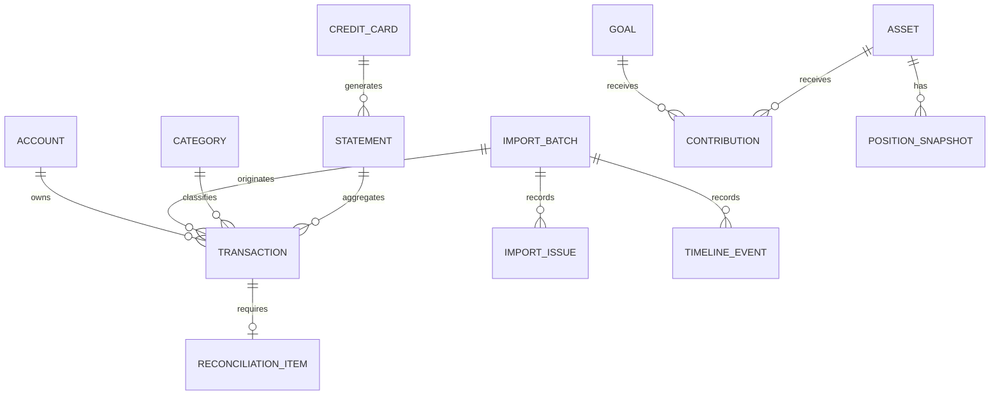
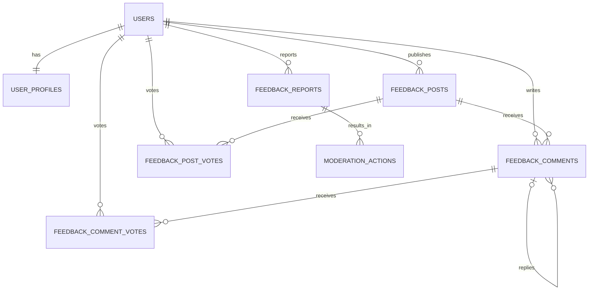

# Database

This document is the single reference for how Talentum stores data: which data may live on the user's device and which may reach the cloud, the modeling rules every table follows, the current local SQLite schema managed by Prisma, the current Cloudflare D1 schema used by the Worker, how migrations are created and applied in each store, and the capacity and approval process for any new persistent structure. Apply it whenever you create or change persistence, migrations, queries, queues, caches, backups or data contracts. Statements are labelled **Current** (implemented in the repository), **Planned** (agreed direction, not implemented) or **Open** (undecided or in conflict).

## Contents

- [Data placement policy](#data-placement-policy)
- [Modeling principles](#modeling-principles)
- [Local SQLite (Prisma)](#local-sqlite-prisma)
- [Local migrations](#local-migrations)
- [Cloud D1](#cloud-d1)
- [D1 migrations](#d1-migrations)
- [Migration procedure for both stores](#migration-procedure-for-both-stores)
- [Indexes and query rules](#indexes-and-query-rules)
- [Concurrency and idempotency](#concurrency-and-idempotency)
- [Caching, retention, backup and observability](#caching-retention-backup-and-observability)
- [Capacity, scaling and table approval](#capacity-scaling-and-table-approval)
- [Open items](#open-items)
- [References](#references)

## Data placement policy

Talentum has two independent data stores. The local SQLite database on the user's device holds all financial data. The shared Cloudflare D1 database holds only what the cloud backend needs for identity, sessions, release distribution, community and operational protection. Frontends never access either database directly; every read and write goes through a documented backend contract (see [ARCHITECTURE.md](ARCHITECTURE.md)).

### Local only

Status: **Current** as policy. The following data stays exclusively in the device's SQLite database:

- institutions, accounts and Pix identifiers;
- balances and balance snapshots;
- statements, imported files and import diagnostics;
- transactions, categories and categorization rules;
- income, obligations, credit cards and card statements;
- net worth, assets, goals and contributions;
- financial history and local backups.

Never create one cloud row per financial transaction. One million users must result in one million independent local databases, not one central financial database holding every statement.

### Allowed in D1

Status: **Current** as policy. D1 may hold only:

- minimal identity and the public profile;
- OAuth provider links and consents;
- sessions and refresh-token families, with tokens stored only as hashes;
- releases, artifacts, checksums and download grants;
- feedback, comments, votes, reports and moderation;
- redacted security and audit events;
- short-lived operational state the Worker needs to enforce its security contract: action codes, OAuth authorization transactions and rate-limit windows (all stored as hashes or ciphertext, never as plain secrets);
- strictly necessary metadata of future features, and only after the feature has been explicitly approved and documented.

Balances, statements, transactions, portfolios, decryption keys and banking identifiers are prohibited in D1. Account identifiers must not include CPF or banking data, and OAuth identity must never be stored as a permanent plain-text token.

### Remote data pending approval

Status: **Planned**, pending approval (**Open**). An earlier version of the data model listed two further remote data classes. Under the policy above they are not allowed until a feature that needs them is approved and documented, and no table for them exists today:

| Data | Purpose | Prohibited content |
| --- | --- | --- |
| Backup metadata | version, checksum and storage location of an encrypted backup | the decryption key |
| Communication preference | consent to receive communication | transactions and balances |

Social ranking or gamification must never reveal net worth, income, spending or habits. Whether XP needs to be synchronized remotely is **Open**.

## Modeling principles

Status: **Current** as rules. Where the current schema deviates, the deviation is listed in [Open items](#open-items).

### Tables and relations

- Create one table per durable responsibility. Do not accumulate authentication, profile, session, feedback and audit data in one generic table.
- Every table, including join (associative) tables, has an opaque `id` primary key.
- Every persisted relation uses a foreign key that references the other table's `id`. The naming convention differs per store:
  - Prisma (local SQLite): camelCase ending in `Id`, for example `profileId`, `importBatchId`.
  - D1 (cloud SQL): snake_case ending in `_id`, for example `user_id`, `family_id`, `author_user_id`.
- Add `createdAt`/`created_at` and `updatedAt`/`updated_at` when the record has a lifecycle.
- Add `deletedAt`/`deleted_at` only when logical deletion is required.
- Add a `version` column for optimistic concurrency on records subject to concurrent edits.
- Enforce `NOT NULL`, `UNIQUE`, `CHECK` and foreign-key constraints in the database.
- Validate finite states in the backend and restrict them in the database when it is safe to do so.
- Normalize until no duplication can produce inconsistency. Denormalize only when a measurement shows the normalized query violates the SLO and a rebuild process is defined.
- Classify every table as `local`, `cloud-global`, `cloud-user` or `cloud-public`.

### Identifiers

- Generate IDs in the backend. Use an opaque format that is not publicly sequential and does not depend on a provider.
- Exposed IDs are UUIDv7, ULID or an equivalent opaque format; never a predictable sequence. Prefer UUIDv7 or ULID when temporal ordering and index locality are useful. Never expose `ROWID`, a global counter or business meaning in an ID.
- Keep external identifiers in their own columns with a composite constraint, for example `(provider, provider_subject)`. Never replace the internal `id` with a provider's mutable identifier.
- An opaque ID is not authorization. Difficult-to-enumerate IDs are only an additional defense (see Ownership below).

Current generators: Prisma models use `@default(uuid())` and the Worker uses `crypto.randomUUID()`, both random UUIDs (version 4). They are opaque and non-sequential but not time-ordered.

### Money and time

- Monetary values use integer cents (or `Decimal`), never `Float`. Current local models store cents as `BigInt` (`amountCents`, `balanceCents`).
- Financial dates distinguish the civil date (for example the day a transaction occurred), the accounting period (competence) and the technical instant. Store instants in UTC and keep civil dates separate when the domain requires it. D1 stores instants as ISO 8601 UTC text; the Prisma schema stores `DateTime` values.
- Derived percentages are calculated, not persisted without justification. The total of a position is never inferred from stored percentages.

### Traceability and deletion

- Imports and corrections are traceable.
- Adjustments never silently overwrite the original value; they preserve the value before, the value after and the reason.
- A completed reconciliation records author, instant and decision.
- A contribution cannot be negative; withdrawals use their own event.
- Deletions with historical impact are recoverable when possible. Public deletion in the community uses a status or tombstone to preserve relations and moderation history.
- Timeline and audit events never store secrets or the raw content of a statement.

### Ownership and isolation

For every cloud table that belongs to a person:

1. include `user_id` or an equivalent verifiable relation;
2. derive the user from the identity validated on the server;
3. include the user scope in the query;
4. reject IDs that belong to another user;
5. include the scope in cache keys, jobs and rate limits;
6. test negative cross-access cases.

The local app is single-profile per database, but every local query is still scoped by `profileId` so that a second profile cannot turn into a leak later. Status: **Current** (`src/server/profile.ts` resolves the profile and the local API scopes its queries by it).

## Local SQLite (Prisma)

Status: **Current**. Source of truth: `prisma/schema.prisma`, datasource `sqlite`, URL from the `DATABASE_URL` environment variable. Nine models are implemented. All IDs are `String @id @default(uuid())`. Unless stated otherwise, every model has `createdAt` (default now) and `updatedAt` (auto-updated).

Every model except `LocalProfile` and `BalanceSnapshot` references `LocalProfile` through `profileId` with `onDelete: Cascade`: deleting the profile deletes all its local data. Status and kind columns are free `String` values; the database does not restrict them with `CHECK` constraints, so the allowed values below are enforced only by application code.

### `LocalProfile`

The local identity that owns all data in the database.

| Field | Notes |
| --- | --- |
| `id` | opaque ID |
| `displayName` | optional |

Relations: has many `UserPreference`, `Institution`, `Account`, `Category`, `ImportBatch`, `Transaction`, `ScheduledObligation`. The local API reads the oldest profile (`createdAt` ascending) and never creates one on a read; without a profile, the API reports that there is no financial base and the interface leads to onboarding.

### `UserPreference`

Key/value preferences of a profile.

| Field | Notes |
| --- | --- |
| `profileId` | FK to `LocalProfile`, cascade |
| `key`, `value` | strings |

Constraints: unique `(profileId, key)`; index `(profileId)`.

### `Institution`

A financial institution named by the user.

| Field | Notes |
| --- | --- |
| `profileId` | FK to `LocalProfile`, cascade |
| `name` | string |

Index: `(profileId)`. Relations: has many `Account`.

### `Account`

| Field | Notes |
| --- | --- |
| `profileId` | FK to `LocalProfile`, cascade |
| `institutionId` | optional FK to `Institution`, `SetNull` on delete |
| `name`, `type` | strings |
| `currency` | default `BRL` |
| `isActive` | default `true`; the dashboard reads only active accounts |

Indexes: `(profileId)`, `(institutionId)`. Relations: has many `BalanceSnapshot`, `Transaction`, `ScheduledObligation`.

### `BalanceSnapshot`

A balance informed for an account at an instant. It has `createdAt` but no `updatedAt` (append-only by design).

| Field | Notes |
| --- | --- |
| `accountId` | FK to `Account`, cascade |
| `balanceCents` | `BigInt`, integer cents |
| `capturedAt` | instant the balance refers to |

Index: `(accountId, capturedAt)`. The dashboard takes the latest snapshot per account and applies transactions after it.

### `Category`

| Field | Notes |
| --- | --- |
| `profileId` | FK to `LocalProfile`, cascade |
| `name` | string |
| `kind` | string (category type) |

Constraints: unique `(profileId, name, kind)`; index `(profileId)`. Relations: has many `Transaction`, `ScheduledObligation`.

### `ImportBatch`

One import of a statement file.

| Field | Notes |
| --- | --- |
| `profileId` | FK to `LocalProfile`, cascade |
| `format` | string (MVP formats are CSV and OFX; see [PRODUCT.md](PRODUCT.md)) |
| `fingerprint` | file fingerprint |
| `status` | string; the dashboard counts batches with `completed` |
| `fileName` | optional |
| `importedAt` | default now |

Constraints: unique `(profileId, fingerprint)`, which prevents accidental duplicate imports per profile; index `(profileId, importedAt)`. Relations: has many `Transaction`.

### `Transaction`

A normalized financial entry.

| Field | Notes |
| --- | --- |
| `profileId` | FK to `LocalProfile`, cascade |
| `accountId` | FK to `Account`, cascade |
| `importBatchId` | optional FK to `ImportBatch`, `SetNull` on delete |
| `categoryId` | optional FK to `Category`, `SetNull` on delete |
| `occurredOn` | civil date of the entry |
| `description` | string |
| `amountCents` | `BigInt`, integer cents |
| `status` | default `pending`; the dashboard counts `pending` entries |

Indexes: `(profileId, occurredOn)`, `(accountId, occurredOn)`, `(importBatchId)`, `(categoryId)`.

### `ScheduledObligation`

A commitment with an amount and a due date. It is the subtrahend of the risk-free balance (`Saldo Livre de Risco`).

| Field | Notes |
| --- | --- |
| `profileId` | FK to `LocalProfile`, cascade |
| `accountId`, `categoryId` | optional FKs, `SetNull` on delete |
| `description` | local label of the commitment |
| `amountCents` | `BigInt`, integer cents |
| `dueDate` | due date; decides whether the obligation falls in the period |
| `status` | `open`, `paid` or `cancelled`; default `open` |
| `recurrence` | `none`, `weekly`, `monthly` or `yearly`; default `none` |
| `isEstimated` | amount informed as approximate during onboarding; default `false` |

Invariant: **only `status = 'open'` is subtracted**. Without this field an obligation already paid would keep being subtracted and the risk-free balance would be permanently pessimistic. The dashboard query filters `profileId`, `status = 'open'` and `dueDate` up to the period end, which is why the main index is `(profileId, status, dueDate)`. Other indexes: `(accountId)`, `(categoryId)`.

In the MVP an open credit-card statement is represented as a `ScheduledObligation`; `CreditCard` and `Statement` belong to stage 8 of the roadmap (see [ROADMAP.md](ROADMAP.md)).

### Local data access

Status: **Current**. The local API (`src/app/api`) reads the database through a single `PrismaClient` (`src/server/db.ts`). The dashboard, dashboard categories and local summary routes only read; no current route writes financial data. Write flows (onboarding, import, reconciliation) are **Planned**.

### Implemented invariants

1. `ImportBatch.fingerprint` is unique per profile and prevents accidental duplication. **Current** (unique constraint).
2. Only open obligations are subtracted from the risk-free balance. **Current** (query filter).
3. Every imported transaction references its source batch. **Open**: `Transaction.importBatchId` is optional and becomes `NULL` when the batch is deleted, so the database does not enforce this invariant.

### Planned local aggregates

Status: **Planned**. Beyond the nine implemented models, the conceptual model groups local data into these aggregates. Entities in bold are implemented; the rest are planned.

| Aggregate | Responsibility | Main entities |
| --- | --- | --- |
| Local identity | Preferences and optional link to a remote identity | **`LocalProfile`**, **`UserPreference`** |
| Accounts | Institutions, accounts and informed balances | **`Institution`**, **`Account`**, **`BalanceSnapshot`** |
| Import | File, batch, parser and diagnostics | **`ImportBatch`**, `ImportFile`, `ImportIssue` |
| Transactions | Normalized entries and categories | **`Transaction`**, **`Category`**, `MerchantRule` |
| Cards | Cards, statements, benefits and recurring charges | `CreditCard`, `Statement`, `CardBenefit`, `RecurringCharge` |
| Reconciliation | Pending items, decisions and adjustments | `ReconciliationItem`, `FinancialAdjustment` |
| Planning | Budget, goals and obligations | `Budget`, `Goal`, **`ScheduledObligation`** |
| Net worth | Assets, positions, pillars and contributions | `Asset`, `PositionSnapshot`, `Contribution` |
| Product | Alerts, missions and history | `Notification`, `Mission`, `Achievement`, `TimelineEvent` |
| Backup | Runs, versions and integrity | `BackupRecord` |

Essential relations of the full conceptual model (planned entities included):

### Local SQLite operation

- Apply pending migrations when a new version of the local backend starts. **Current** for `pnpm dev` and the local Docker image (see below); **Planned** for the packaged Electron app, which does not run migrations itself today.
- Enable and validate foreign keys. **Current**: Prisma's SQLite connector enforces the declared foreign keys.
- Import a complete batch inside one transaction. **Planned** (no import writer exists yet).
- Keep one writer per database and limit write concurrency. **Planned** as an explicit rule for write flows.
- Use WAL only after compatibility testing with packaging, backup and recovery. **Planned**; WAL is not enabled explicitly today.
- SQLite database files and their `-wal`, `-shm` and `-journal` companions are git-ignored. **Current**.

## Local migrations

Status: **Current**. The local schema evolves only through versioned Prisma migrations in `prisma/migrations` (provider `sqlite`, recorded in `migration_lock.toml`). Environments never depend on manual changes or on `prisma db push` in production.

| Migration | Creates |
| --- | --- |
| `20260905182000_init` | `LocalProfile`, `UserPreference` |
| `20260905214010_mvp_financial_core` | `Institution`, `Account`, `BalanceSnapshot`, `Category`, `ImportBatch`, `Transaction` and their indexes |
| `20260911000729_mvp_scheduled_obligations` | `ScheduledObligation` and its indexes |

How migrations are applied:

- `pnpm prisma:migrate` runs `prisma migrate dev` to create a new migration during development.
- `pnpm dev` (`scripts/dev.mjs`) runs `prisma migrate deploy` before starting the local app, using `DATABASE_URL` or, when it is unset, a default git-ignored local database file.
- The local Docker image runs `prisma migrate deploy` before starting the server.
- `pnpm prisma:generate` regenerates the client and `pnpm prisma:validate` validates the schema; `pnpm typecheck` regenerates the client when it is stale.

`prisma migrate deploy` is Prisma-only; D1 uses Wrangler (next sections).

## Cloud D1

Status: **Current** for every table listed here: all of them are created by the D1 migrations in `cloudflare/migrations`. Whether a Worker route uses a table is stated separately. The Worker (`cloudflare/src/index.ts`) accesses D1 inline through the `DB` binding with prepared statements; there is no adapter layer. All IDs are `TEXT` primary keys filled with `crypto.randomUUID()`, all timestamps are ISO 8601 UTC `TEXT`, and both migrations enable `PRAGMA foreign_keys = ON`. Column names are snake_case.

### Identity and consent (`0001_cloud_core`)

| Table | Keys and relations | Purpose and constraints | Worker use |
| --- | --- | --- | --- |
| `users` | `id` | internal account; `email_normalized` unique; `status` in `ACTIVE`, `BLOCKED`, `DELETED` (default `ACTIVE`); `email_verified_at`, `deleted_at` | **Current** (upserted on OAuth callback) |
| `user_profiles` | `id`, `user_id` unique, FK cascade | approved public name (`public_name`) and avatar (`avatar_url`) | **Current** (created on first login, read by `/api/me`) |
| `oauth_identities` | `id`, `user_id` FK cascade | link to issuer and subject; unique `(provider, provider_subject)`; index on `user_id` | **Current** (provider `GOOGLE`) |
| `consents` | `id`, `user_id` FK cascade | accepted version of terms/privacy (`document_type`, `document_version`, `accepted_at`, `revoked_at`); unique `(user_id, document_type, document_version)`; index on `user_id` | **Planned** (no route writes it) |

### Sessions (`0001_cloud_core`)

| Table | Keys and relations | Purpose and constraints | Worker use |
| --- | --- | --- | --- |
| `auth_sessions` | `id`, `user_id` FK cascade | session with `token_hash` (unique), `expires_at`, `last_seen_at`, `revoked_at`; index `(user_id, expires_at)` | **Current** |
| `refresh_token_families` | `id`, `session_id` FK cascade | rotation and revocation; `revoked_at`, `compromise_detected_at`; index on `session_id` | **Current** (reuse sets `compromise_detected_at` and revokes the family and session) |
| `refresh_tokens` | `id`, `family_id` FK cascade, `successor_token_id` self-FK set null | `token_hash` (unique), `expires_at`, `consumed_at`, `revoked_at`, successor link; index `(family_id, expires_at)` | **Current** |

### Distribution (`0001_cloud_core`)

| Table | Keys and relations | Purpose and constraints | Worker use |
| --- | --- | --- | --- |
| `releases` | `id` | `version`, `channel` in `STABLE`/`BETA`, `status` in `DRAFT`/`PUBLISHED`/`REVOKED`, `published_at`; unique `(version, channel)` | **Current** (read by `/api/releases`; no route creates releases) |
| `release_artifacts` | `id`, `release_id` FK cascade | `platform` in `WINDOWS`/`LINUX`, `architecture`, `download_url`, `sha256`, optional `signature`; unique `(release_id, platform, architecture)`; index on `release_id` | **Current** (read) |
| `download_grants` | `id`, `user_id` FK cascade, `artifact_id` FK cascade | short-lived grant: `grant_hash` (unique), `expires_at`, `consumed_at`; index `(user_id, expires_at)` | **Current** (inserted with a 5-minute expiry; see Open items on consumption) |

### Community (`0001_cloud_core`)

All community tables exist, but **no Worker route reads or writes them**. Feedback and community routes are **Planned**.

| Table | Keys and relations | Purpose and constraints |
| --- | --- | --- |
| `feedback_posts` | `id`, `author_user_id` FK restrict | public suggestion: `title`, `body`, `status` in `PUBLISHED`/`HIDDEN`/`DELETED`/`CLOSED`, `deleted_at`; index `(status, created_at)` |
| `feedback_comments` | `id`, `post_id` FK cascade, `author_user_id` FK restrict, `parent_comment_id` self-FK cascade | comments and replies; `status` in `PUBLISHED`/`HIDDEN`/`DELETED`; index `(post_id, created_at)` |
| `feedback_post_votes` | `id`, `post_id`, `user_id` (both FK cascade) | one vote per user per post; unique `(post_id, user_id)` |
| `feedback_comment_votes` | `id`, `comment_id`, `user_id` (both FK cascade) | one vote per user per comment; unique `(comment_id, user_id)` |
| `feedback_reports` | `id`, `reporter_user_id` FK restrict, `post_id`/`comment_id` FK cascade | report of one piece of content; `CHECK` that exactly one of `post_id` or `comment_id` is set; `status` in `OPEN`/`RESOLVED`/`DISMISSED`; index `(status, created_at)` |
| `moderation_actions` | `id`, `moderator_user_id` FK restrict, `report_id`/`post_id`/`comment_id` FK set null | moderation decision with `action` and `reason` |

Public deletion uses `status`/`deleted_at` as a tombstone to preserve relations and audit history. Authors, reporters and moderators use `ON DELETE RESTRICT`, so a user with community content cannot be hard-deleted without handling that content first.

### Security and audit events (`0001_cloud_core`)

| Table | Keys and relations | Purpose and constraints | Worker use |
| --- | --- | --- | --- |
| `security_events` | `id`, `user_id` and `session_id` FK set null | authentication and abuse events without secrets: `event_type`, `outcome`, `risk_level` in `LOW`/`MEDIUM`/`HIGH`/`CRITICAL`, `metadata_json`; index `(user_id, created_at)` | **Planned** (nothing writes it; refresh-token reuse is not recorded here) |
| `audit_events` | `id`, `actor_user_id` FK set null | administrative trail: `action`, `resource_type`, `resource_id`, `outcome`, `metadata_json`; index `(resource_type, resource_id, created_at)` | **Planned** (nothing writes it) |

Audit events record the outcome of an action by their own `id`, never the action code.

### Operational runtime (`0002_cloud_auth_runtime`)

| Table | Keys | Purpose and constraints | Worker use |
| --- | --- | --- | --- |
| `action_codes` | `id` | backend-issued single-use action codes: `code_hash` (unique), bound `method` and `path`, `context_hash`, `expires_at` (60 seconds after issue), `consumed_at`; index on `expires_at` | **Current** |
| `auth_transactions` | `id` | temporary OAuth state: `state_hash` (unique), `nonce_hash`, `code_verifier_ciphertext` (encrypted PKCE verifier and nonce), `redirect_uri`, `return_to`, `expires_at` (10 minutes), `consumed_at`; index on `expires_at` | **Current** |
| `rate_limit_windows` | `id` | fixed one-minute rate-limit windows: `bucket_hash` (unique), `window_started_at`, `request_count`, `updated_at`; index on `window_started_at` | **Current** (buckets `codes` and `login`) |

Action codes are stored only as hashes with a short TTL and are consumed by setting `consumed_at`; consumed and expired rows are **not deleted** today. They are operational state: they do not belong to history, audit or analytics, and they carry no user data. The `context_hash` column currently holds a hash of the BFF shared secret, so it is the same for every caller and does not bind a code to a session or origin. See [SECURITY.md](SECURITY.md) for the action-code contract and its open issues.

## D1 migrations

Status: **Current**. D1 DDL lives in sequential, versioned SQL files in `cloudflare/migrations`:

| Migration | Creates |
| --- | --- |
| `0001_cloud_core.sql` | identity, consent, session, distribution, community, security-event and audit-event tables and their indexes |
| `0002_cloud_auth_runtime.sql` | `action_codes`, `auth_transactions`, `rate_limit_windows` and their indexes |

They are applied with `wrangler d1 migrations apply` through the package scripts, all using `cloudflare/wrangler.jsonc`:

| Script | Effect |
| --- | --- |
| `pnpm cloudflare:migrations:list:local` | list migrations against the local Wrangler D1 state |
| `pnpm cloudflare:migrations:apply:local` | apply pending migrations to the local Wrangler D1 state |
| `pnpm cloudflare:migrations:list:remote` | list migrations against the remote D1 database |
| `pnpm cloudflare:migrations:apply:remote` | apply pending migrations to the remote D1 database |

Applying remote migrations changes a remote resource and requires explicit authorization (see [BEST_PRACTICES.md](BEST_PRACTICES.md)). Never run `CREATE TABLE`, `ALTER TABLE` or `CREATE INDEX` in the request hot path; D1 schema changes run once, through migrations.

## Migration procedure for both stores

Status: **Current** as rules.

- Every schema change includes a reviewable migration with a unique name and scope.
- Fixtures and tests use only synthetic data.
- Migration and restore are tested on copies, never on the user's only database.
- Destructive migrations require a local backup and a recovery path.
- The application records the schema version. **Current** through each tool's migration table (Prisma's and Wrangler's).

Apply this order:

1. generate the migration with a unique name and scope;
2. review DDL, constraints, indexes and locking impact;
3. apply it to an empty database;
4. apply it on a representative copy of the previous version;
5. run integrity tests and critical queries;
6. record duration, rows touched and additional space;
7. back up before a destructive migration;
8. apply with the store's deploy command (`prisma migrate deploy` locally, `wrangler d1 migrations apply` on D1);
9. verify application health and compatibility;
10. keep an operational rollback or restore procedure.

Use expand/contract for incompatible changes:

1. add the new compatible structure;
2. ship code that writes both the old and the new format when needed;
3. migrate data in bounded batches;
4. switch reads to the new structure;
5. confirm metrics and consistency;
6. remove the old structure in a later migration.

## Indexes and query rules

Status: **Current** as rules.

### Index design

For each endpoint, document before the migration: `WHERE` predicates, join columns, ordering, pagination, estimated cardinality, and expected rows read and returned.

Create indexes for:

- foreign keys used in joins;
- identity lookups;
- business uniqueness;
- frequent `(owner_id, created_at)` queries;
- queues by `(status, created_at)`;
- associative relations in both directions when both are queried.

Order composite indexes by the real predicates and the leftmost-prefix rule. Do not index every column indiscriminately: indexes speed up reads but cost writes and storage. Run `EXPLAIN QUERY PLAN` on SQLite/D1, and `EXPLAIN (ANALYZE, BUFFERS)` if a workload ever moves to PostgreSQL. Block a release when a critical query does a full scan without justification.

### Backend queries

Apply to every query:

1. validate input with a schema;
2. validate identity, ownership and permission;
3. require the temporary action code bound to method and path;
4. select only the needed columns;
5. limit the number of rows;
6. use an opaque cursor, not `OFFSET`, on large collections;
7. use deterministic ordering with `id` as the tie-breaker;
8. enforce a timeout and a maximum response size;
9. run related changes in a transaction;
10. return a DTO, never the full ORM model.

N+1 queries are prohibited; load relations in batches or with controlled joins. Never accept arbitrary filters, column names or ordering sent directly by the client.

## Concurrency and idempotency

Rules (**Current** as policy):

- a unique constraint on the idempotency key in the correct scope;
- short transactions;
- optimistic concurrency by `version` or `updatedAt` where concurrent edits happen;
- a transactional outbox before publishing an asynchronous event;
- idempotent consumers with a processing record;
- retries only for transient errors, with backoff and jitter;
- never keep a transaction open while calling the network, AI, e-mail or external storage.

Idempotency keys for imports, download grants, post creation and other commands that a network failure can repeat: **Planned**. No current endpoint or table implements an idempotency key.

## Caching, retention, backup and observability

### Caching

Status: **Planned** (no cache exists). Create a cache only after measuring the potential hit rate and the query cost. Every key includes the contract version, the user/tenant when the result is private, the resource and ID, normalized filters, and a version or time window. Define TTL, invalidation, maximum size and failure behavior. Never store access tokens, refresh tokens, financial files or sensitive responses in a shared cache.

### Retention, deletion and audit

Status: **Current** as a rule; per-table records are **Open** (not yet written for existing tables). For each table record: purpose; legal basis or consent when applicable; retention period; deletion event; dependencies and cascades; fields allowed in audit; export procedure. Separate operational data from audit events. Never copy a full payload into logs. Use tombstones only when integrity or moderation requires it.

### Backup and restore

Status: **Planned**. Define RPO and RTO per data class. A backup without a restore test does not count as a control. Execute:

1. automatic backup before a destructive migration;
2. checksum and schema version;
3. encryption with the key kept outside the file;
4. automated restore in an isolated environment;
5. verification of foreign keys and counts;
6. periodic disaster test;
7. recording duration against RTO.

### Operation and cost metrics

Status: **Planned**. Collect, without financial payloads: p50/p95/p99 latency per route and query; error, timeout, retry and overload rates; rows read, written and returned; table and index sizes; slow queries and plans; queue depth and age; cache hit rate; connections/pool when applicable; migration and backup duration; isolation and authorization failures. If PostgreSQL is adopted, keep autovacuum on and watch dead tuples, since updates and deletes leave old row versions until `VACUUM`.

## Capacity, scaling and table approval

### Load profile before schema

Treat "1,000,000 users" as registration capacity, not as a concurrency estimate. Size infrastructure only after recording active users, peak requests per second, read/write ratio, volume per entity, target latency and retention. Do not adopt sharding, NoSQL, replication, distributed caching or microservices only because of the number of registrations; apply each mechanism only after a measurement shows the matching bottleneck.

Status: **Planned** (**Open** process). Before approving a persistent macro-feature, record a capacity profile in a dated capacity document. No capacity document or `docs/capacity/` directory exists yet, and the existing Prisma and D1 schemas were approved without one. The profile must record:

| Required field | Unit |
| --- | --- |
| registered users | total |
| monthly and daily active users | MAU/DAU |
| peak concurrency | simultaneous requests |
| peak traffic per operation | read and write RPS |
| growth per table | rows/day and bytes/day |
| target latency | p50, p95 and p99 |
| availability and acceptable loss | SLO, RTO and RPO |
| retention | days/years per class |

Use load tests with a realistic distribution. Never extrapolate capacity from a single isolated query.

### D1 limits and domain split

Start with one shared D1 database and normalized tables for identity, releases and feedback (**Current**: one database holds every cloud table). Index every query by user, status and time according to access. Current D1 limits from the official documentation: each database is limited to 10 GB; each database processes queries serially; throughput depends directly on query duration; bulk changes must be split into batches; the service is designed to scale horizontally with smaller databases per tenant or entity. Do not put all high-volume events in a single database without a load test.

Split D1 by domain only when measurement justifies it (**Planned**, not needed today):

- `identity`: users, OAuth, sessions and consents;
- `distribution`: releases, artifacts and grants;
- `community`: feedback, comments, votes and moderation;
- `audit`: redacted events, if volume and retention require separation.

Never join across databases. Duplicate only minimal identifiers and accept documented eventual consistency between domains.

### Scaling order

Scale in this order, never in anticipation:

1. fix the query and reduce columns/rows;
2. create or adjust an index proven by the plan;
3. eliminate N+1 and duplicated work;
4. group compatible writes;
5. enforce pagination and limits;
6. add a cache only for stable, frequent reads;
7. move non-interactive work to a queue;
8. add a read replica when the provider and the consistency model allow it;
9. split the database by domain;
10. partition or shard only with a proven key, routing and operation.

Understand SQL, indexes and the workload first; caches, async jobs and replicas answer concrete bottlenecks, not a starting point. The database choice depends on the problem and the guarantees required. PostgreSQL is a future alternative when the relational cloud workload exceeds D1's operational limits; replication, failover and standby reads carry documented consistency and performance costs, and partitioning applies only to proven large tables with a compatible access key.

### Formal evolution triggers

| Change | Authorize only when |
| --- | --- |
| new index | the plan and telemetry show recurring scan/cost |
| cache | the read is frequent, stable and dominates latency/cost |
| queue | the work accepts asynchronous processing and idempotent retry |
| read replica | reads saturate the primary and tolerate a defined lag |
| separate D1 database | the domain has independent volume, retention or availability |
| PostgreSQL | D1 size, serialization or relational-query limits were demonstrably reached |
| partitioning | the table exceeds practical index/maintenance capacity and queries allow pruning |
| sharding | one writer/database is still insufficient after optimization and a stable shard key exists |
| NoSQL | the aggregate and access pattern need guarantees relational storage cannot sustainably provide |

### Table approval checklist

Do not approve a new migration without confirming:

- [ ] ownership: `local`, `cloud-global`, `cloud-user` or `cloud-public`;
- [ ] purpose and retention documented;
- [ ] `id` and foreign keys defined, following the store's naming convention;
- [ ] integrity constraints in the database;
- [ ] consuming queries and endpoints known;
- [ ] indexes derived from those queries;
- [ ] authorization and isolation tested;
- [ ] pagination and limits defined;
- [ ] deletion and cascade strategy reviewed;
- [ ] migration tested on an empty database and on the previous version;
- [ ] backup/rollback defined when there is destructive risk;
- [ ] logs and audit free of prohibited data;
- [ ] this document and its diagrams updated.

### Readiness for one million users

Status: **Planned**. Never declare readiness just because the schema accepts a million rows. Require:

1. an approved load profile;
2. progressive tests with 10 thousand, 100 thousand and 1 million synthetic identities;
3. a peak test with the minimum margin defined in the capacity plan;
4. p95 and p99 within the SLO;
5. no full scans on critical routes;
6. isolation between users proven by negative tests;
7. migrations within the operational window;
8. backup and restore within RPO/RTO;
9. rate limits and queues preventing one user from exhausting shared resources;
10. an exercised runbook for overload, unavailability, corruption and rollback.

## Open items

1. **Imported transaction to batch link.** The invariant "every imported transaction references its source batch" is not enforced: `Transaction.importBatchId` is optional with `onDelete: SetNull`. Decide whether to require it for imported rows (for example with a source/kind column) or to forbid batch deletion while transactions reference it.
2. **ID format.** Policy prefers UUIDv7 or ULID; Prisma (`uuid()`) and the Worker (`crypto.randomUUID()`) generate random UUIDv4. They satisfy opacity but not time ordering. Decide whether to migrate generators.
3. **Unconstrained local states.** Local `status`, `kind`, `type`, `format` and `recurrence` columns are free strings without `CHECK` constraints, contrary to the rule of restricting finite states in the database when safe.
4. **Action-code rows are never purged.** Consumed and expired `action_codes`, `auth_transactions` and stale `rate_limit_windows` rows remain in D1; no cleanup job exists. Define retention and a purge mechanism.
5. **Download grant consumption.** The Worker inserts `download_grants` rows and returns the artifact URL directly; nothing marks `consumed_at`, so the grant is not enforced as single-use.
6. **Unused security and audit tables.** `security_events` and `audit_events` exist but nothing writes them; refresh-token reuse is not recorded as a security event.
7. **Unused consents table.** `consents` exists but no flow records acceptance of terms or privacy.
8. **Community routes.** Feedback and community tables exist without any Worker route; their API contract is Planned.
9. **Remote backup metadata and communication preference.** Not allowed in D1 until a feature requiring them is approved and documented.
10. **Remote XP synchronization.** Whether gamification XP needs remote storage is undecided.
11. **Capacity documents.** The dated capacity-profile process has no directory or template yet, and existing schemas were approved without one. Decide whether to keep the requirement and create the location, or relax it for small changes.
12. **Per-table retention records.** Purpose, retention, deletion event and export procedure are not yet documented per table for either store.
13. **Migrations in the packaged desktop app.** Electron does not apply Prisma migrations on startup; the mechanism for the packaged app is undefined.

## References

- [Cloudflare D1: Best practices](https://developers.cloudflare.com/d1/best-practices/)
- [Cloudflare D1: Use indexes](https://developers.cloudflare.com/d1/best-practices/use-indexes/)
- [Cloudflare D1: FAQ and limits](https://developers.cloudflare.com/d1/reference/faq/)
- [Cloudflare D1: Migrations](https://developers.cloudflare.com/d1/reference/migrations/)
- [PostgreSQL: Indexes](https://www.postgresql.org/docs/current/indexes.html)
- [PostgreSQL: Table partitioning](https://www.postgresql.org/docs/current/ddl-partitioning.html)
- [PostgreSQL: High availability, load balancing and replication](https://www.postgresql.org/docs/current/high-availability.html)
- [PostgreSQL: VACUUM](https://www.postgresql.org/docs/current/sql-vacuum.html)
- [OWASP: Multi-Tenant Application Security](https://cheatsheetseries.owasp.org/cheatsheets/Multi_Tenant_Security_Cheat_Sheet.html)
- [AWS: Scaling beyond one million users](https://aws.amazon.com/blogs/startups/scaling-on-aws-part-4-one-million-users/)
- [AWS: Relational database scaling patterns for SaaS](https://aws.amazon.com/blogs/database/scale-your-relational-database-for-saas-part-1-common-scaling-patterns/)
- [Fábio Akita: Akitando #118 — Understanding databases](https://master--akitaonrails-official.netlify.app/2022/05/09/akitando-118-fiz-um-servidor-de-sql-entendendo-banco-de-dados/)
- [Fábio Akita: Akitando #133 — Making your web app faster](https://akitaonrails.com/2022/12/12/akitando-133-tornando-sua-app-web-mais-rapida-4-tecnicas-de-otimizacao/)
- [Fábio Akita: Akitando #143 — Databases to Big Data](https://akitaonrails.com/2023/07/22/akitando-143-discutindo-sobre-banco-de-dados-dos-primordios-a-big-data)
