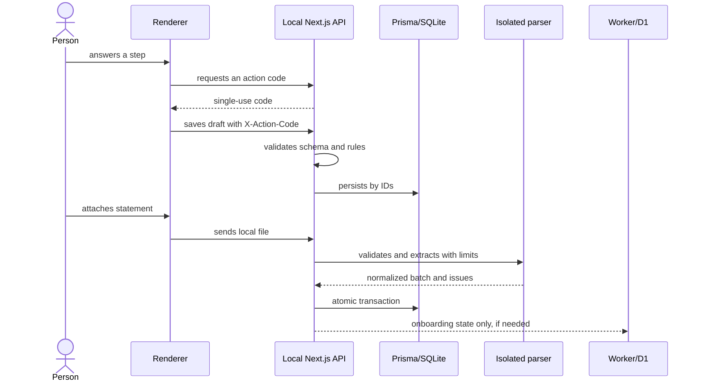
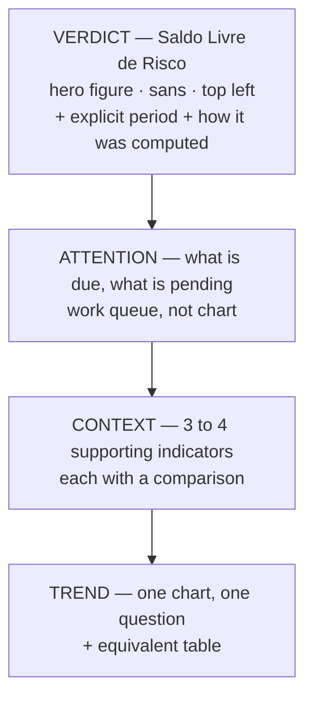
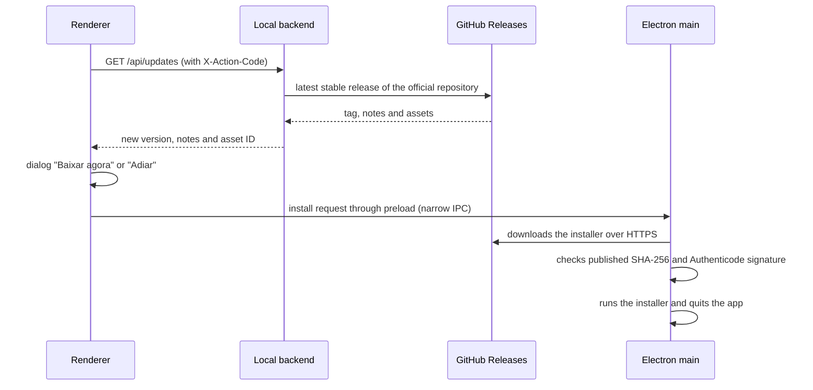
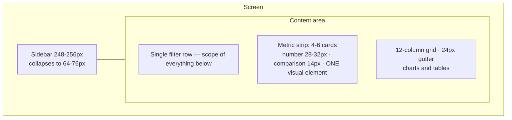

# Product

This document is the product specification of Talentum: what the product is for, which features the MVP delivers, which routes and local APIs each feature owns, how onboarding and the Dashboard must behave, how the new-version notice works, and which product rules every feature shares. It is the executable plan for finishing the MVP. Architecture, persistence, security and visual identity are specified in [ARCHITECTURE.md](ARCHITECTURE.md), [DATABASE.md](DATABASE.md), [SECURITY.md](SECURITY.md) and [DESIGN-SYSTEM.md](DESIGN-SYSTEM.md); the delivery order lives in [ROADMAP.md](ROADMAP.md).

## Contents

- [Status vocabulary](#status-vocabulary)
- [Product vision and scope](#product-vision-and-scope)
- [Product rules shared across features](#product-rules-shared-across-features)
- [How to execute this plan without prior context](#how-to-execute-this-plan-without-prior-context)
- [Route map](#route-map)
- [Cloud track: sign-up, session and downloads](#cloud-track-sign-up-session-and-downloads)
- [MVP features](#mvp-features)
- [Planning and net worth features](#planning-and-net-worth-features)
- [Onboarding and initial financial snapshot](#onboarding-and-initial-financial-snapshot)
- [Dashboard specification](#dashboard-specification)
- [New-version notice and application update](#new-version-notice-and-application-update)
- [MVP migration order, feature order and Definition of Done](#mvp-migration-order-feature-order-and-definition-of-done)
- [Open items](#open-items)
- [References](#references)
- [Appendix: Original vision (historical, non-normative)](#appendix-original-vision-historical-non-normative)

## Status vocabulary

Statements carry the status labels defined in [README.md](README.md#status-labels): Current, Partial, Planned, Open, Rule and Historical. Partial is used mainly inside feature tables.

When code and this document disagree, verifiable code wins; fix the outdated documentation in the same change set.

## Product vision and scope

Status: **Rule** (product statement); individual capabilities carry their own status below.

Talentum is a **local-first**, **open-source** personal finance application for people with busy routines. It reduces the friction of financial organization by reading bank statements instead of requiring manual entry, categorizing transactions, tracking goals and guiding new contributions to investments. It turns financial data into practical decisions without asking the person to type every expense or to be an investment specialist.

The central concept is a pipeline:

```text
[ READER ] -> [ TRIAGE ] -> [ REAL BALANCE ] -> [ DECISION ]
  Reads        Confirms      Deducts the         Points where
  statements   doubts with   month's future      to contribute
  without      one tap       obligations         next
  typing
```

The product's core promise is the **Saldo Livre de Risco** (risk-free balance): the confirmed balances minus every obligation due within the period. It replaces the false sense of availability created by balances that will still be consumed by card bills, rent, recurring bills and automatic debits. Uncertain future income never increases it.

### Principles

- **Zero friction.** Passive automation comes first; manual forms exist only for exceptions such as cash expenses or transactions that need reconciliation.
- **Local-first privacy.** Real financial data (statements, transactions, merchants, balances, accounts, Pix keys, debts, investments) stays on the person's device in the local SQLite database. The cloud (Cloudflare Worker and D1) stores only minimal identity, sessions, consents, releases and download grants; it receives no financial values. See [SECURITY.md](SECURITY.md).
- **Guided decisions.** The application translates financial information into simple guidance: how much can be spent, which account needs checking, which goal is late, where the next contribution should go.
- **Open source.** The code is auditable, the product favors transparency, and data is exportable in open formats (export is **Planned**).

### Audience and problems solved

People who have little time to manage their finances; accumulate accounts, cards and institutions; do not want to type every transaction; need to find waste and forgotten subscriptions; want to reach purchase goals without losing control of the budget; want to start or organize an investment portfolio; and need privacy for sensitive financial data.

### Navigation areas

The local application is organized in six areas plus global actions. Status: **Current** as navigation; Dashboard, Extratos, Conciliação, Histórico, accounts (`/contas`) and settings are functional, while Patrimônio, Invest, cards and profile remain empty-state screens (see the [Route map](#route-map)).

1. **Início** (`/`): entry point without financial numbers.
2. **Dashboard** (`/dashboard`): verdict and supporting indicators.
3. **Extratos, cartões e recorrências** (`/extratos`): import, transactions, cards, recurring obligations.
4. **Conciliação** (`/conciliacao`): manual confirmation, adjustments, bill checking.
5. **Patrimônio e metas** (`/patrimonio`): portfolio, contributions, goals.
6. **Invest** (`/invest`): market news related to the portfolio.
7. **Histórico, perfil e configurações** (`/historico`, `/perfil`, `/configuracoes`): timeline, privacy, preferences.

Global actions: import a file (**Current**, leads to the CSV/OFX import at `/extratos/importar`), notifications and express cash entry (Planned).

### MVP scope

The MVP is complete when a person can sign up on the landing page, securely obtain the correct installer, create their local financial base, import CSV or OFX, review the entries and consult a reliable Dashboard, with all financial data kept in the local SQLite database.

The MVP **does not include** AI, the ARCA allocation methodology, cloud backup, gamification, community features, card ROI, budgets or the notification center. These belong to later roadmap stages (see [ROADMAP.md](ROADMAP.md)); PDF import (Stage 7) and cards, statements and benefits (Stage 8) were delivered after the MVP and are documented in Feature 4 and in [Cards, statements and benefits](#cards-statements-and-benefits-stage-8); the original vision for them is preserved only as the [historical appendix](#appendix-original-vision-historical-non-normative).

| Outside the MVP Dashboard | Roadmap stage that enables it |
| --- | --- |
| ARCA matrix, four pillars, portfolio status | Stage 14 |
| XP, levels, missions, achievements | Stage 17 |
| News and summaries | Stages 15 and 16 |
| Card ROI, annual-fee exemption thermometer, cashback and miles | Stage 8 |
| Budget per category and planned vs. actual comparison | Stage 9 |
| Actionable notification center | Stage 10 |

The roadmap and this executable plan prevail over the original vision when they conflict.

### Main MVP flow


## Product rules shared across features

These rules are mandatory for every feature. Status: **Rule**; compliance is tracked per feature.

1. The frontend never accesses SQLite, Prisma or financial files directly.
2. The frontend requests a temporary, opaque, single-use action code before every functional call to the backend (`POST /api/action-codes`, then the call with `X-Action-Code`).
3. The backend validates the code, input, authorization and context before reading or changing data. The action code never replaces authentication, authorization, CSRF protection, idempotency or rate limiting.
4. Every table has an `id`; every relation uses a foreign key to that `id` (`profileId` style in Prisma, `user_id` style in D1; see [DATABASE.md](DATABASE.md#tables-and-relations)).
5. Persistent structures exist only in versioned migrations. No table is created manually at runtime.
6. Prisma represents the schema applied by the migrations; production and Docker use `prisma migrate deploy`.
7. Applied migrations are never rewritten. Changes produce a later migration.
8. No fictitious financial data lives in the frontend. Without records in the database, the interface shows an empty state.
9. Monetary values use integer cents (`BigInt`), never `Float`.
10. Real CSV and OFX test files stay in `temp/`, outside Git. Tests use synthetic files only.
11. The landing page and the renderer never access D1 directly; every cloud action goes through the BFF and the Worker.
12. The desktop system, its local backend and SQLite are never part of the artifact published to Vercel.
13. **Zero is a claim.** A financial value (including `R$ 0,00`) is rendered only after the backend confirms it. While loading or after a failure, the interface says it does not know.
14. **Every financial screen has four states:** loading, empty, error and with data.
15. **Distinguish confirmed, approximate and inferred values,** and show the reference date of any value derived from a declared balance or position.
16. **Own-account transfers are neither income nor expense** and leave every aggregate.
17. **Uncertain future income never increases the Saldo Livre de Risco.**
18. **No financial value** in logs, telemetry, analytics, error messages or requests to the cloud.
19. **Corrections never destroy the original value;** relevant decisions are auditable and reversible.

## How to execute this plan without prior context

1. Read [docs/README.md](README.md) for the hierarchy of sources of truth.
2. Read [ARCHITECTURE.md](ARCHITECTURE.md): the web layer for landing page and Cloudflare work, the Electron and local app layer for the desktop application.
3. Before changing persistence, read [DATABASE.md](DATABASE.md); before changing contracts or login, read the API section of [ARCHITECTURE.md](ARCHITECTURE.md) and [SECURITY.md](SECURITY.md).
4. Compare the state declared here with code, migrations and tests. Verifiable code prevails; fix outdated documentation in the same change set.
5. Execute one vertical slice at a time, including backend, migration, contract, interface, UX states, tests and applicable documentation.
6. Do not advance while the current step's "Done when" criterion cannot be demonstrated.
7. Record decisions with relevant alternatives in `docs/decisions/`; do not invent infrastructure, credentials or missing requirements.
8. Before commit or push, follow the [security gate](SECURITY.md#mandatory-pre-commit-and-pre-push-security-gate) and the offensive security review in SECURITY.md.

## Route map

This is the single authoritative list of product routes. Paths and Portuguese route segments are exactly as in code.

### Local application UI routes (`src/app`)

"Placeholder" means the screen exists but renders only an empty state or a backend-confirmed count; the functional feature behind it is still Planned. Every functional screen has the four states (loading, empty, error, data) and talks only to the local API.

**Lock and first-run screens (Current, [ADR 0009](decisions/0009-local-vault-and-encrypted-database.md)).** They have no route of their own: `VaultGate` (`src/components/vault-gate.tsx`) wraps every route except `/lp` and, until the local vault is unlocked, renders only these screens, with no sidebar, header or data request, so no financial value can flash before unlock. "Proteja seus dados" (create the password, then "Guarde o código de recuperação" with a required confirmation) appears when no vault exists; "Desbloquear o Talentum" (password, plus the authenticator code when enabled, and "Esqueci a senha") otherwise; "Recuperar acesso" takes the recovery code and a new password and then shows a new recovery code. Unlocking with a recovery code that was never confirmed shows a fresh one before entering. The header has "Bloquear agora"; the app also locks after the idle time set in Security, and in the desktop app when the system sleeps or the screen locks. The local app is reachable only on loopback; there is no mobile app, and the screens work on phone widths only so a browser window of any size stays usable.

| Route | Status | Feature | Notes |
| --- | --- | --- | --- |
| `/` | **Current** | Início | Product presentation, local privacy notice, import/register action and shortcuts. Shows no financial value. No sidebar item of its own; reached through the brand at the top of the sidebar. |
| `/dashboard` | **Current** | 7 | Real data from the four `/api/dashboard*` routes. |
| `/onboarding` | **Current** | 1 | Redirects to `/onboarding/perfil`. |
| `/onboarding/perfil` | **Current** | 1 | Step 1 of 4: name, currency (BRL only), time zone and privacy confirmation. |
| `/onboarding/contas` | **Current** | 1 | Step 2: links to `/contas/nova`; may be skipped. |
| `/onboarding/posicao-atual` | **Current** | 1 | Step 3: links to `/extratos/importar`; may be skipped. |
| `/onboarding/revisao` | **Current** | 1 | Step 4: review and explicit completion. |
| `/contas` | **Current** | 2 | Accounts with their known balance; the sidebar account selector lists active accounts. |
| `/contas/nova` | **Current** | 2 | Register institution and account with an optional informed balance. |
| `/contas/[accountId]` | **Current** | 2 | Edit, deactivate, balance history and own Pix keys (masked). |
| `/configuracoes` | **Current** | — / Stage 10 | Theme selector (`Claro`, `Escuro`, `Sistema`), notification preferences (quiet mode and each kind on/off, `#notificacoes`) and "About". |
| `/notificacoes` | **Current** | Stage 10 | Full notification center: all/unread filter, follow, mark read/unread, dismiss with undo, mark all read. The header bell opens the same list in a side panel (first 20) with the unread count. |
| `/configuracoes/categorias` | **Current** | 3, 6 | Category CRUD and the merchant-rule list: create, deactivate and apply to pending entries. |
| `/configuracoes/seguranca` | **Current** | Local vault | Change password, generate a new recovery code, enable or disable the authenticator app (QR drawn locally, 10 backup codes), auto-lock time (1 to 60 minutes) and the Talentum account status with "Entrar com Google" (desktop app only). The three settings pages share the tabs Preferências, Categorias and Segurança. |
| `/planejamento` | **Current** | Stages 9, 13 | Redirects to `/planejamento/orcamento`; sidebar item `Planejamento` with the tabs Orçamento, Dívidas, Modo sobrevivência and Rendas previstas. |
| `/planejamento/orcamento` | **Current** | Stage 9 | Monthly budget: limit per expense category, confirmed spending, projection, 3-month average, surplus and the review of a closed month. See [Budget and monthly planning](#budget-and-monthly-planning-stage-9). |
| `/planejamento/dividas` | **Current** | Stage 13 | Debts, payment order (highest rate first or smallest balance first) and payoff simulation. See [Survival mode and debts](#survival-mode-and-debts-stage-13). |
| `/planejamento/sobrevivencia` | **Current** | Stage 13 | Survival mode: Saldo Livre de Risco, overdue debts and spending split into essential and non-essential categories. |
| `/planejamento/rendas` | **Current** | 3 | Expected income sources; never added to the balance. Before Stage 9 this route had no header entry and showed "Página não encontrada" as its title. |
| `/extratos` | **Current** | 5 | Transaction listing with validated filters and cursor pagination; each row links to its `Transaction.id`. |
| `/extratos/[transactionId]` | **Current** | 5 | Detail, edit (description, category, status) and read-only revision history. |
| `/extratos/recorrencias` | **Current** | 3 | Scheduled obligation CRUD. |
| `/extratos/importar` | **Current** | 4 | Import wizard for CSV, OFX and PDF: select, inspect and preview (with per-row reading confidence for PDF), adjust the CSV mapping, confirm; lists previous imports. |
| `/extratos/importar/[loteId]` | **Current** | 4 | Batch detail with counts, issues and undo. |
| `/extratos/cartoes` | **Current** | Stage 8 | Cards with the outstanding amount and due date of the nearest open statement; register a card. Empty state with `sem-cartoes`. |
| `/extratos/cartoes/[cartaoId]` | **Current** | Stage 8 | Card detail: edit, deactivate, fee-waiver thermometer, statements, items (typed or imported from CSV, OFX or PDF), payment link and benefits. Renders "Cartão não encontrado" for an unknown ID. |
| `/conciliacao` | **Current** | 6 | Persistent pending queue (`ReconciliationItem`). |
| `/conciliacao/[reconciliationItemId]` | **Current** | 6 | Confirm, categorize (optionally creating a rule for similar entries), link an obligation, adjust or pair a transfer; shows the rule suggestion and the probable own-transfer pair; revert a decision. |
| `/patrimonio` | **Current** | Stage 14 | Net worth, the four pillars against the 22.5%–27.5% band, assets with dated values. See [Net worth and the ARCA methodology](#net-worth-and-the-arca-methodology-stage-14). |
| `/patrimonio/aportes` | **Current** | Stage 14 | Next-contribution simulation: new money only, never a sale; paused while survival mode is active. |
| `/patrimonio/metas` | **Current** | Stage 12 | Goals with progress, required monthly deposit and feasibility; arithmetic split of a surplus (`?sobra=<cents>` pre-fills it from the budget review). See [Goals and savings pots](#goals-and-savings-pots-stage-12). |
| `/patrimonio/metas/[metaId]` | **Current** | Stage 12 | Goal detail, dated contributions (deposit or withdrawal), edit, archive and delete; "goal not found" only on a 404. |
| `/conciliacao/faturas` | **Current** | Stage 8 | Statement check: each open statement against the bank entries that can be its payment; confirm or undo the link. Empty state with `sem-faturas`. |
| `/invest` | **Current** (placeholder) | Stages 15–16 | No fictitious news. |
| `/invest` | **Current** | Stages 15–16 | Public economic news read through the local backend from the Worker, with source credit, date and excerpt; local-only source filter; states for not configured (`TALENTUM_CLOUD_API_URL` unset), offline, confirmed empty and loading. No portfolio data leaves the device. |
| `/invest/[noticiaId]` | **Current** | Stages 15–16 | Title, source, date, excerpt, `Resumir notícia` (AI summary or the article's first sentences, labelled), `Ler na fonte` (external) and credit; not-found state. |
| `/perfil` | **Current** | Stage 17 | Level, XP and progress to the next level, missions with progress and actions, badges (locked and unlocked) and the XP history. Without a profile, the `perfil-vazio` state linking to `/onboarding`. |
| `/perfil/privacidade` | **Current** | Stages 11, 18, 19 | "Dados e backup": restore points (create, restore with confirmation, delete, scheduled-restore banner with cancel), encrypted backup (generate with passphrase, restore from file), JSON and CSV export, and "Apagar todos os dados locais" with typed confirmation. |
| Quick cash entry (dialog, every screen) | **Current** | 5 | The `Lançar dinheiro` button in the top bar opens a sheet: expense or income, amount, description, date and optional category; it creates a `cash` account when none exists and offers `Desfazer` after saving. |
| New-version notice (dialog in the app shell) | **Current** (installation gated) | Update notice | See [New-version notice](#new-version-notice-and-application-update). |
| `/lp` | **Current** (development bridge) | — | Renders the landing page at the local origin during development only; must be removed before the first deploy (see [ARCHITECTURE.md](ARCHITECTURE.md)). |
| `/layout-guide` | **Current** (development only) | — | Internal design reference; returns not found outside development. |

The batch route parameter is `[loteId]` in code. The earlier sub-routes `/extratos/importar/[loteId]/mapeamento` and `/extratos/importar/[loteId]/revisao` were **not created**: mapping and preview happen inside the import wizard before any batch exists (see Feature 4).

### Local API routes (`src/app/api`)

| Route | Status | Feature | Notes |
| --- | --- | --- | --- |
| `POST /api/action-codes` | **Current** | all | Bootstrap; issues a 60-second single-use code bound to method and path. |
| `GET /api/health/live` | **Current** | — | Liveness probe; a documented exception to the action-code rule (`CLAUDE.md`, Architecture rules): no application data, never called by the interface. |
| `GET /api/system/status` | **Current** | — | Requires `X-Action-Code` and a local session. |
| `GET /api/vault/status`, `POST /api/vault/setup`, `POST /api/vault/unlock`, `POST /api/vault/recover` | **Current** | Local vault | The only routes that work without a session; contract in [ARCHITECTURE.md §4.8](ARCHITECTURE.md#48-local-api-contract). |
| `POST /api/vault/lock`, `POST /api/vault/activity`, `GET`/`PATCH /api/vault/settings`, `POST /api/vault/password`, `POST /api/vault/recovery-code`, `POST /api/vault/recovery-code/confirm`, `POST /api/vault/totp`, `POST /api/vault/totp/confirm`, `POST /api/vault/totp/disable` | **Current** | Local vault | Require a session; factor changes also require the current password. |
| `GET /api/local-summary` | **Current** | area screens | Counts of active accounts, transactions, pending transactions, open obligations and import batches; lets area screens decide between empty and existing state. |
| `GET /api/dashboard` | **Current** | 7 | Includes the Saldo Livre de Risco, consolidated balance, month spending, daily average, committed total and reconciliation count. |
| `GET /api/dashboard/categories` | **Current** | 7 | Spending by category. |
| `GET /api/dashboard/risk-free-balance` | **Current** | 7 | Verdict breakdown and daily cash projection (G-1). |
| `GET /api/dashboard/cash-flow` | **Current** | 7 | Monthly income and outflow, only months with statement coverage (G-3). |
| `GET\|POST /api/profile` | **Current** | 1 | Read or create the local profile. |
| `GET /api/onboarding`, `POST /api/onboarding` | **Current** | 1 | |
| `PATCH /api/onboarding/[onboardingId]` | **Current** | 1 | Optimistic concurrency by `version`. |
| `POST /api/onboarding/[onboardingId]/complete` | **Current** | 1 | Requires privacy, currency and time zone. |
| `GET\|POST /api/institutions` | **Current** | 2 | |
| `GET\|PATCH\|DELETE /api/institutions/[institutionId]` | **Current** | 2 | Deleting with accounts is refused. |
| `GET\|POST /api/accounts` | **Current** | 2 | |
| `GET\|PATCH\|DELETE /api/accounts/[accountId]` | **Current** | 2 | Deleting with history is refused; deactivate instead. |
| `GET\|POST /api/accounts/[accountId]/balance-snapshots` | **Current** | 2 | Balance as a dated fact; `fromImport` distinguishes origin. |
| `GET\|POST /api/accounts/[accountId]/pix-identifiers` | **Current** | 2 | Masked values only. |
| `GET\|PATCH\|DELETE /api/accounts/[accountId]/pix-identifiers/[pixIdentifierId]` | **Current** | 2 | Cleartext only with `?reveal=1`. |
| `GET\|POST /api/categories` | **Current** | 3 | |
| `PATCH\|DELETE /api/categories/[categoryId]` | **Current** | 3 | No item `GET`. |
| `GET\|POST /api/incomes` | **Current** | 3 | |
| `GET\|POST /api/obligations` | **Current** | 3 | |
| `PATCH\|DELETE /api/obligations/[obligationId]` | **Current** | 3 | No item `GET`. |
| `GET\|POST /api/merchant-rules` | **Current** | 3, 6 | The importer and manual entries apply active rules (Feature 6). |
| `POST /api/merchant-rules/apply` | **Current** | 6 | Reapplies active rules to pending, uncategorized items. |
| `DELETE /api/merchant-rules/[ruleId]` | **Current** | 6 | Deactivates a rule. |
| `POST /api/imports/inspect` | **Current** | 4 | Writes nothing. |
| `GET\|POST /api/imports` | **Current** | 4 | |
| `GET\|DELETE /api/imports/[importBatchId]` | **Current** | 4 | |
| `GET /api/csv-mappings` | **Current** | 4 | |
| `DELETE /api/csv-mappings/[mappingId]` | **Current** | 4 | |
| `PATCH /api/imports/[importBatchId]/mapping`, `POST /api/imports/[importBatchId]/confirm` | Superseded | 4 | Replaced by the two-step flow (see Feature 4). |
| `GET /api/transactions` | **Current** | 5 | Validated filters, cursor, deterministic order with `id` tie-breaker. |
| `POST /api/transactions` | **Current** | 5 | Quick manual cash entry with idempotency key; only `cash` accounts. |
| `GET\|PATCH /api/transactions/[transactionId]` | **Current** | 5 | |
| `GET /api/transactions/[transactionId]/history` | **Current** | 5 | |
| `GET /api/reconciliation-items` | **Current** | 6 | Up to 100 pending items. |
| `GET /api/reconciliation-items/[reconciliationItemId]` | **Current** | 6 | |
| `POST /api/reconciliation-items/[reconciliationItemId]/decisions` | **Current** | 6 | |
| `POST /api/reconciliation-decisions/[decisionId]/revert` | **Current** | 6 | |
| `GET\|PUT /api/budgets` | **Current** | Stage 9 | `GET ?month=AAAA-MM` returns the budget summary; `PUT` upserts one limit (idempotent by `(profileId, categoryId, month)`). |
| `DELETE /api/budgets/[budgetId]` | **Current** | Stage 9 | Removes a limit. |
| `POST /api/budgets/copy` | **Current** | Stage 9 | Copies limits between months without overwriting; repeating it copies nothing. |
| `GET\|POST /api/goals` | **Current** | Stage 12 | List with the plan of each goal and the measured surplus; create. |
| `GET\|PATCH\|DELETE /api/goals/[goalId]` | **Current** | Stage 12 | |
| `POST /api/goals/[goalId]/contributions` | **Current** | Stage 12 | Requires `idempotencyKey`; a repeat answers `replayed: true`; a withdrawal above the saved amount answers `409 GOAL_OVERDRAWN`. |
| `DELETE /api/goals/[goalId]/contributions/[contributionId]` | **Current** | Stage 12 | |
| `POST /api/goals/surplus-allocation` | **Current** | Stage 12 | Simulation only; writes nothing. |
| `GET\|POST /api/debts` | **Current** | Stage 13 | List, both payment orders, totals and survival status; create. |
| `PATCH\|DELETE /api/debts/[debtId]` | **Current** | Stage 13 | |
| `POST /api/debts/payoff-plan` | **Current** | Stage 13 | Simulation only; writes nothing. |
| `GET\|PUT /api/survival` | **Current** | Stage 13 | Survival status and essential split; `PUT` sets the essential categories. |
| `GET\|POST /api/assets` | **Current** | Stage 14 | `POST` creates the asset with its first dated value; requires `idempotencyKey`. |
| `PATCH\|DELETE /api/assets/[assetId]` | **Current** | Stage 14 | Rename, change pillar, deactivate or delete. |
| `GET\|POST /api/assets/[assetId]/snapshots` | **Current** | Stage 14 | Dated values; requires `idempotencyKey`. |
| `GET /api/portfolio` | **Current** | Stage 14 | Net worth, pillar shares, band and survival status. |
| `POST /api/portfolio/contribution-simulation` | **Current** | Stage 14 | Simulation only; answers `status: "survival"` while survival mode is active. |
| `GET\|POST /api/cards` | **Current** | Stage 8 | Nickname unique per profile; never a card number. |
| `GET\|PATCH\|DELETE /api/cards/[cardId]` | **Current** | Stage 8 | Deleting with statements is refused; deactivate instead. |
| `POST /api/cards/[cardId]/statements` | **Current** | Stage 8 | One statement per due date. |
| `POST /api/cards/[cardId]/benefits` | **Current** | Stage 8 | One record per program. |
| `PATCH\|DELETE /api/card-benefits/[benefitId]` | **Current** | Stage 8 | |
| `GET\|PATCH\|DELETE /api/card-statements/[statementId]` | **Current** | Stage 8 | Items, payments and payment candidates. |
| `POST /api/card-statements/[statementId]/items` | **Current** | Stage 8 | Idempotent by `clientKey`. |
| `DELETE /api/card-statements/[statementId]/items/[itemId]` | **Current** | Stage 8 | |
| `POST /api/card-statements/[statementId]/items/import` | **Current** | Stage 8 | CSV, OFX or PDF; re-importing writes nothing new. |
| `POST /api/card-statements/[statementId]/payments` | **Current** | Stage 8 | Links a bank outflow as payment. |
| `DELETE /api/card-statements/[statementId]/payments/[paymentId]` | **Current** | Stage 8 | Undoes the link only. |
| `GET /api/card-statement-checks` | **Current** | Stage 8 | Data of `/conciliacao/faturas`. |
| `GET /api/timeline-events` | **Current** | 8, Stage 11 | Filters `domain`, `kind`, `from`, `to`, `cursor`. |
| `GET\|PATCH /api/notifications` | **Current** | Stage 10 | Derived notifications; state by stable key. |
| `GET\|PUT /api/notification-preferences` | **Current** | Stage 10 | Quiet mode and per-kind switches. |
| `GET\|POST /api/restore-points` | **Current** | Stage 11 | Device-level; `idempotencyKey` on POST. |
| `DELETE /api/restore-points/[restorePointId]` | **Current** | Stage 11 | |
| `POST /api/restore-points/[restorePointId]/restore` | **Current** | Stage 11 | Schedules the restore for the next unlock (lock and unlock, or restart). |
| `GET\|DELETE /api/pending-restore` | **Current** | Stage 11 | |
| `POST /api/encrypted-backups` | **Current** | Stage 18 | Download; local only. |
| `POST /api/encrypted-backups/restore` | **Current** | Stage 18 | Multipart; schedules the restore. |
| `GET /api/exports/json`, `GET /api/exports/transactions-csv` | **Current** | Stage 19 | Downloads. |
| `POST /api/local-data/deletion` | **Current** | Stage 19 | Typed confirmation. |
| `GET /api/gamification`, `POST /api/gamification/month-reviews` | **Current** | Stage 17 | |
| `POST /api/timeline-events/[timelineEventId]/revert` | **Current** | 8 | |
| `GET /api/updates` | **Current** | Update notice | Backend query to GitHub Releases of the official repository. |
| `POST /api/updates/postpone` | **Current** | Update notice | 24-hour postponement per version. |
| `GET /api/news` | **Current** | Stage 15 | Public news from the Worker; `status: ok \| unconfigured \| offline`. |
| `GET /api/news/[newsId]` | **Current** | Stage 15 | One item; `404 NEWS_NOT_FOUND`. |
| `POST /api/news/[newsId]/summary` | **Current** | Stage 16 | Summary of the public article; `method: AI \| EXTRACT`. |

The Saldo Livre de Risco value itself is served inside `GET /api/dashboard`; `GET /api/dashboard/risk-free-balance` adds its breakdown and the daily projection, reading the consolidated balance through `src/server/dashboard-queries.ts` (both read the same consolidated balance in the reference currency; see L-4).

### Cloud routes

Landing page and BFF (`apps/web`, published to Vercel). Pages:

| Route | Status | Notes |
| --- | --- | --- |
| `/` | **Current** | Public landing page; platforms Windows, Linux and macOS (macOS "Em breve" until a signed, notarized build exists). |
| `/entrar` | **Current** | Sign-in: what the account stores, Turnstile, `Continuar com Google`, clickwrap acceptance of the current Terms and Privacy; resumes a session with a refresh cookie. Not indexed. |
| `/entrar/verificacao` | **Current** | Two-step verification code or recovery code after Google. |
| `/downloads` | **Current** | Protected; one card per system (Windows, Linux, macOS) with version, architecture, SHA-256 and `Baixar para …`; macOS shows "Em breve" while no artifact is published. |
| `/conta` | **Current** | Protected: public name, two-step verification, sessions, sign out, account deletion (typed `EXCLUIR`). |
| `/conta/mfa`, `/conta/mfa/codigos` | **Current** | Authenticator enrollment (server-rendered QR) and one-time display of recovery codes. |
| `/comunidade` | **Current** | Public list of suggestions, recent or most supported, with pagination. |
| `/comunidade/[postId]` | **Current** | Post, comments with one reply level, support, report, author edit/delete, moderator actions. |
| `/comunidade/nova` | **Current** | Protected form to write a suggestion (Turnstile). |
| `/comunidade/pessoa/[profileId]` | **Current** | Minimal public profile: name, month of joining, posts. |
| `/comunidade/moderacao` | **Current** | Moderators only: report queue. |
| `/termos`, `/privacidade` | **Current** | Draft documents pending legal review, versioned (`LEGAL_VERSIONS`). |

BFF route handlers (`/api/auth/*`, `/api/releases/*`, `/api/conta/*`, `/api/comunidade/*`) and every Worker route, with their contracts and protections, are specified in [ARCHITECTURE.md §3.5](ARCHITECTURE.md#35-cloud-api-contract-worker-and-bff) and [SECURITY.md](SECURITY.md); that is the single list.

## Cloud track: sign-up, session and downloads

### What it does

Delivers only the cloud API, the public landing page and the authenticated downloads page. D1 persists minimal identity, sessions, consents, releases and grants; it never receives statements, accounts, balances, transactions, portfolio or Pix keys.

### Current state

**Current (in the repository, November 2026 cloud completion):**

- Worker with D1 binding `DB`; migrations `0001` to `0004`; a 30-minute cron for retention and news.
- Google OAuth with PKCE for the LP and for the desktop app (RFC 8252 loopback contract), consent recorded at sign-up, optional two-step verification with an authenticator app and recovery codes, short sessions with rotating refresh tokens, logout that also works with an expired access token, session list and revocation, account deletion with tombstones.
- Turnstile on login and content creation, exact CORS, per-route and per-user rate limits, security and audit events without personal data, enforced single-use download grants, `no-store` on every BFF response, refresh by `POST`, origin required on every mutation.
- Feedback community, public economic news and on-demand summaries.
- `/termos` and `/privacidade` as drafts pending legal review.
- CI with gitleaks, dependency review, CodeQL, Dependabot and a build check proving the LP bundle reaches no desktop code.
- macOS as a release platform in D1 and on the pages, with no build yet.

**Not verifiable from the repository / pending provider changes:** Worker secrets (`TURNSTILE_SECRET_KEY`, `MFA_ENCRYPTION_KEY`), the Turnstile widget, remote migrations `0003`/`0004`, the cron and Workers AI activation, Vercel settings, GitHub security settings (checklist in [ARCHITECTURE.md §3.8](ARCHITECTURE.md#38-cloudflare-setup-and-deployment), step 11).

### Remaining work, in mandatory order

1. **Planned (operational):** apply the provider checklist above after authorization, then validate login, two-step verification, community and downloads end to end in the published environment.
2. **Planned:** signed Windows and Linux installers and a signed, notarized macOS build produced outside Vercel, with published checksum, signature and metadata.
3. **Planned:** Electron side of desktop sign-in (loopback listener, system browser, keychain).
4. **Open:** production domain (§3.4 of ARCHITECTURE), rate-limit calibration with telemetry, community policy and appeal channel, legal review of the documents.

### Done when

- An unauthenticated person reaches the landing page but not the protected downloads page.
- Sign-up/login, refresh, logout and revocation pass the security tests.
- Windows, Linux and macOS are offered only after backend authorization (macOS once a signed, notarized build exists).
- The artifact deployed to Vercel contains no Electron, Prisma, SQLite, parsers or financial modules.
- No secret appears in the bundle, repository, logs or HTTP responses.
- The frontend never accesses D1, OAuth or GitHub Releases directly.

## MVP features

Tables and fields referenced here are specified in [DATABASE.md](DATABASE.md). All thirty-seven Prisma models exist today (15 migrations). Features 1 to 8 have a vertical implementation (migration, API, screen, tests); each section states what remains.

### Feature 1 — Financial onboarding

Status: **Current** for the four-step persistent flow. The fuller question map in [Onboarding and initial financial snapshot](#onboarding-and-initial-financial-snapshot) remains a proposal.

**What it does.** Creates the initial financial snapshot without forcing the person to fill everything at once. Allows registering profile, banks, accounts, balances, income, obligations and investments, or starting with the available statement import.

**Flow.**

1. Explain that financial data stays only on the device.
2. Create or resume an onboarding draft.
3. Set currency and time zone.
4. Register institutions and accounts.
5. Enter the current balance or attach a statement.
6. Register income and essential obligations, when known.
7. Review the summary and complete.

**UI routes:** `/onboarding`, `/onboarding/perfil`, `/onboarding/contas`, `/onboarding/posicao-atual`, `/onboarding/revisao`.

**Local APIs:** `GET /api/onboarding`, `POST /api/onboarding`, `PATCH /api/onboarding/[onboardingId]`, `POST /api/onboarding/[onboardingId]/complete`.

| Table | IDs and relations | Responsibility | Status |
| --- | --- | --- | --- |
| `LocalProfile` | `id` | local identity without sensitive bank data | **Current** |
| `UserPreference` | `id`, `profileId` | theme, currency, language and time zone | **Current** |
| `OnboardingSession` | `id`, `profileId` | current step, status, version and completion | **Current** |
| `OnboardingAnswer` | `id`, `onboardingSessionId`, `profileId` | validated answer per question | **Current** |

**Migration:** `mvp_onboarding` (**Current**).

**Done when:** onboarding can be interrupted and resumed, and the Dashboard stays empty until the backend confirms that financial data exists.

**Met.** The session and its answers are persisted in SQLite, each step is saved through the local API with optimistic concurrency, and the review explicitly completes the flow and writes currency and time zone to `UserPreference`. Without an account, balance or import, the Dashboard stays in the empty state. The flow does not require a statement or an account to complete. Contracts are checked in `tests/onboarding-contracts.test.mjs` (relational migration, action code, profile scoping, optimistic concurrency and the four steps).

### Feature 2 — Institutions, accounts and balances

Status: **Current**.

**What it does.** Represents where the person holds money. Does not require branch or account number. Own Pix keys are optional, encrypted, and used only to recognize transfers between the person's own accounts.

**Flow.**

1. Register the institution by name.
2. Create one or more accounts linked by `institutionId`.
3. Set account type and currency.
4. Record the known balance with a reference date.
5. Optionally register encrypted local Pix identifiers.

**UI routes:** `/contas`, `/contas/nova`, `/contas/[accountId]`.

**Local APIs (all Current):** `GET|POST /api/institutions`, `GET|PATCH|DELETE /api/institutions/[institutionId]`, `GET|POST /api/accounts`, `GET|PATCH|DELETE /api/accounts/[accountId]`, `GET|POST /api/accounts/[accountId]/balance-snapshots`, `GET|POST /api/accounts/[accountId]/pix-identifiers`, `GET|PATCH|DELETE /api/accounts/[accountId]/pix-identifiers/[pixIdentifierId]`.

| Table | IDs and relations | Responsibility | Status |
| --- | --- | --- | --- |
| `Institution` | `id`, `profileId` | financial institution | **Current** (`mvp_financial_core`) |
| `Account` | `id`, `profileId`, `institutionId` | account, type, currency and state | **Current** (`mvp_financial_core`) |
| `BalanceSnapshot` | `id`, `accountId` | known balance at a date | **Current** (`mvp_financial_core`) |
| `PixIdentifier` | `id`, `profileId`, `accountId` | HMAC for comparison and locally encrypted value | **Current** (`mvp_pix_identifiers`, unique `(profileId, valueIndex)`) |

**Done when:** creating, editing or deactivating an account updates the selector and the consolidated balance through a backend query.

**Met.** Verifiable state:

- `/contas`, `/contas/nova` and `/contas/[accountId]` consume the backend and have the four states;
- the sidebar account selector lists active accounts with each one's known balance and reflects creation, editing and deactivation;
- a balance is a **dated fact**, not an overwrite: recording a new one keeps the previous one, and the origin (entered by hand or from a statement) stays distinguishable;
- a missing balance is declared, never converted to zero;
- a deletion that would destroy history is **refused** and points to deactivation, because the foreign key of `Transaction` is `CASCADE`; deleting an institution with accounts is also refused, because `SET NULL` would silently orphan them;
- changing the currency of an account with entries is refused: the stored cents would start meaning something else;
- own Pix keys are encrypted on the device, indexed by HMAC and shown masked, with the cleartext only on explicit request ([ADR 0003](decisions/0003-local-device-key.md));
- coverage in `tests/pix.test.mjs` (unit, synthetic values) and `tests/accounts-e2e.test.mjs` (real HTTP flow, isolation and validation; skipped without a running backend).

Pending and outside this feature: automatic pairing of transfers between own accounts during import. It belongs to Feature 6; the identifiers registered here are its missing input. **Planned.**

### Feature 3 — Categories, income and obligations

Status: **Current** (CRUD, screens and persistence); applying merchant rules automatically is **Planned**.

**What it does.** Creates the structure used to interpret income, expenses, transfers and amounts committed in the month.

**UI routes:** `/configuracoes/categorias`, `/planejamento/rendas`, `/extratos/recorrencias`.

**Local APIs (all Current):** `GET|POST /api/categories`, `PATCH|DELETE /api/categories/[categoryId]`, `GET|POST /api/incomes`, `GET|POST /api/obligations`, `PATCH|DELETE /api/obligations/[obligationId]`, `GET|POST /api/merchant-rules`. Every route requires an action code and a local profile; money travels as integer cents in a `string`.

| Table | IDs and relations | Responsibility | Status |
| --- | --- | --- | --- |
| `Category` | `id`, `profileId` | classification as income, expense or transfer (`kind`) | **Current** (`mvp_financial_core`) |
| `IncomeSource` | `id`, `profileId`, `accountId?` | expected or recurring income | **Current** (`mvp_income_merchant_rules`) |
| `ScheduledObligation` | `id`, `profileId`, `accountId?`, `categoryId?` | commitment with `amountCents`, `dueDate`, `status`, `recurrence`, `isEstimated` | **Current** (`mvp_scheduled_obligations`), consumed by the Dashboard |
| `MerchantRule` | `id`, `profileId`, `categoryId` | deterministic categorization rule | **Current** as data and API; not yet applied by the importer |

**Migrations:** `mvp_financial_core` creates `Category`; `mvp_scheduled_obligations` creates `ScheduledObligation`; `mvp_income_merchant_rules` creates `IncomeSource` and `MerchantRule` (all Current).

**Done when:** the frontend lists only categories and obligations returned by the backend, and the committed total has a unit test (the committed-total unit test is **Current** in `tests/dashboard-metrics.test.mjs`).

**Met.** Categories, income sources, commitments and merchant rules have persistence and protected local APIs. The categories, income and recurrences screens consult only these contracts; future income stays out of the Saldo Livre de Risco. Contract tests: `tests/financial-planning-contracts.test.mjs`.

### Feature 4 — CSV, OFX and PDF import

Status: **Current** for CSV and OFX (MVP) and for PDF (Stage 7 of [ROADMAP.md](ROADMAP.md), [ADR 0006](decisions/0006-pdf-import.md)). `ofx-data-extractor` was replaced by an own bounded reader ([ADR 0002](decisions/0002-own-ofx-parser.md)).

**What it does.** Turns a bank file into a traceable batch of local transactions. CSV requires column mapping because banks use different headers, separators, dates and signs.

**Flow.**

1. Select a `.csv` or `.ofx` file.
2. The backend validates size, real type, encoding and content.
3. Compute the fingerprint before importing.
4. For CSV, detect the separator and request column mapping.
5. Show a preview without writing transactions.
6. Confirm account, dates, debit/credit sign and balance.
7. Write the batch and its transactions in one SQLite transaction.
8. Send uncertain items to reconciliation.

**UI routes:** `/extratos/importar` (wizard with mapping and preview) and `/extratos/importar/[loteId]` (batch detail and undo).

**Local APIs (all Current):** `POST /api/imports/inspect`, `GET /api/imports`, `POST /api/imports`, `GET /api/imports/[importBatchId]`, `DELETE /api/imports/[importBatchId]`, `GET /api/csv-mappings`, `DELETE /api/csv-mappings/[mappingId]`. Contracts in [ARCHITECTURE.md](ARCHITECTURE.md).

**Deviation from the original design: writing in one step.** The routes `PATCH /api/imports/[importBatchId]/mapping` and `POST /api/imports/[importBatchId]/confirm` were **not implemented**, and the plan was changed deliberately. The three-step design assumed a server-side draft area: create the batch, adjust the mapping, confirm. That would require retaining the statement content between requests, exactly what the import requirements forbid, or creating a table of rows in preparation that would be orphaned whenever someone abandoned the flow. The implemented flow keeps the same steps for the person and removes the intermediate state: `inspect` is idempotent and may be called on every mapping adjustment, and `POST /api/imports` writes everything in one SQLite transaction. The file stays in the client between the two steps and is sent again on confirmation, so the statement exists only on the device and only while a request is processed. Accepted consequence: the file crosses the local API twice, over loopback, under a size ceiling and with no network cost.

| Table | IDs and relations | Responsibility | Status |
| --- | --- | --- | --- |
| `ImportBatch` | `id`, `profileId`, `accountId?` | format, fingerprint, state, covered period and batch totals | **Current** |
| `ImportFile` | `id`, `importBatchId` | minimal metadata; raw content never retained | **Current** |
| `CsvMappingProfile` | `id`, `profileId`, `institutionId?` | reusable column mapping, recognized by header signature | **Current** |
| `ImportIssue` | `id`, `importBatchId`, `transactionId?` | error or warning per line/field | **Current** |
| `Transaction` | `id`, `profileId`, `accountId`, `importBatchId?`, `categoryId?` | normalized entry | **Current** |

**Migrations:** `mvp_financial_core` creates `ImportBatch` and `Transaction`; `mvp_import_details` creates `ImportFile`, `CsvMappingProfile` and `ImportIssue`, adds `periodStart`/`periodEnd`/`accountId` and the counts to `ImportBatch`, and creates `Transaction.externalId` with uniqueness per account; `balance_snapshot_source` links a statement balance to its batch (all Current).

**Done when:** synthetic CSV and OFX import correctly; re-sending the same file does not duplicate data; an error in one line does not produce a partially confirmed batch.

**Met.** Verifiable state:

- CSV and OFX are read by pure modules in `src/server/import/`, with separator detection, partial mojibake repair, Windows-1252 support, and inference and checking of each column's role;
- the format comes from the content, never from the extension or the declared `Content-Type`;
- re-sending the same file answers `409 DUPLICATE_BATCH`; an overlapping period writes only what is new and reports `duplicateCount`;
- writing is one SQLite transaction, so an error halfway leaves no partial batch;
- an unreadable line becomes an `ImportIssue`, never a silent omission;
- `DELETE` undoes the batch without touching others;
- coverage in `tests/import-values`, `import-csv`, `import-ofx`, `import-inspect` (unit, synthetic fixtures) and `tests/import-e2e` (end to end against the running backend, including the security controls; skipped without a running backend).

A checked column mapping can be **saved and reused**: inspection computes a header signature (the labels normalized without accents, case or punctuation) and, when it matches a `CsvMappingProfile` of the profile, the saved mapping is reapplied and the screen declares the reuse. Three decisions the implementation fixes:

1. **Saving requires an explicit request.** A mapping saved without consent would be reapplied silently on the next import.
2. **Recognition only with a header.** Without one, identifying the layout by column position would be guesswork, and a wrong mapping applied silently would invert the sign of the entries.
3. **The informed mapping beats the saved one.** The person's choice on screen always prevails, and a layout that changed since the last statement makes the system fall back to inference instead of refusing the file.

Deleting a saved mapping does not affect an import already written; it only influences the next file reading. `/extratos/importar` lists previous imports, which is the path to the batch detail and to undo.

**PDF (Stage 7, Current).** A PDF goes through the same two steps and the same routes. Text is extracted locally under limits of pages, characters and time, with nothing executed or fetched; a layout reader (generic card statement or generic tabular statement, versioned) turns lines into entries, each with the confidence of date, amount and description. The preview shows, per row, "Lida com certeza" or which field to check. A row below the confidence threshold is **not imported**: it becomes an issue that names the field and the page. A password-protected PDF is refused with instructions to export a copy without a password; a scanned PDF without a text layer is refused as having no rows. A PDF that looks like a card statement gets a warning in the account import wizard pointing to the card page, where its lines become statement items. How the readers work and how to add one: [ARCHITECTURE.md](ARCHITECTURE.md), §2.5. Done when met: synthetic and hostile PDFs (scripts, attachments, automatic actions, forged page count, more pages than the limit, encrypted, truncated, absurd amounts) are covered by `tests/import-pdf.test.mjs`.

Since Feature 6, every imported entry without a category opens a reconciliation item, and active merchant rules and own-transfer detection run while the batch is written (Feature 6); an entry still without a category appears in the dashboard's `Sem categoria` slice.

### Feature 5 — Statements and transactions

Status: **Current**.

**What it does.** Shows persisted entries with pagination, filters, source batch and reconciliation state.

**UI routes:** `/extratos`, `/extratos/[transactionId]`.

**Local APIs (all Current):** `GET /api/transactions` (validated filters, cursor pagination and deterministic ordering with `id` as the tie-breaker), `GET|PATCH /api/transactions/[transactionId]`, `GET /api/transactions/[transactionId]/history`.

**Query rules.** Filters and ordering are validated in the backend. The API returns opaque IDs and minimal DTOs. The frontend never computes balances or reclassifies data on its own.

**Done when:** without transactions the route shows an empty state; with records, each row corresponds to a `Transaction.id` returned by the backend.

**Met.** `/extratos` consumes `GET /api/transactions`, has the four states and links each row to its detail by `Transaction.id`. Editing validates ownership and category in the backend and records before/after in `TransactionRevision`; the per-entry history is read-only. Invariants in `tests/transaction-detail-contracts.test.mjs`. The detail links to the entry's reconciliation item, where a category applied by a rule can be undone.

**Quick cash entry (Current, MVP 5).** Money spent or received in cash appears in no statement, so the person records it by hand from `Lançar dinheiro` in the top bar (the pattern of banking and budgeting apps: an always-visible button opening a short sheet with the amount first). Decisions the implementation fixes:

1. **Only into a `cash` account.** A hand-written entry in a bank account would be duplicated when that account's statement is imported. Without a cash account, the sheet creates one (`Dinheiro`), optionally with the amount on hand today, so its balance is known.
2. **Idempotent.** The sheet generates one UUID per form; resending returns the stored entry, and the same key with other content is refused (`409 IDEMPOTENCY_KEY_REUSED`).
3. **Backend-validated.** Non-zero integer cents, description up to 120 characters, a civil date that is today or at most one year back; an entry dated today stores the instant it was sent, so it falls after a balance informed earlier the same day.
4. **Reversible and reconciled like any entry.** A `manual_entry` timeline event undoes it (`Desfazer` in the sheet or `/historico`); an entry already paired as a transfer must have the pairing reverted first. Without a category it follows the same path as an imported entry: own-transfer candidate, merchant rule or the queue.

Coverage: `tests/manual-entries-contracts.test.mjs`.

### Feature 6 — Reconciliation

Status: **Current** (completed in the local MVP).

**What it does.** Lets the person confirm or correct uncertain transactions without deleting the original data. Recognizes category, transfer between own accounts, obligation and financial adjustment.

**Flow.**

1. The backend creates a pending item with reason and confidence.
2. The frontend requests the next item.
3. The person confirms or corrects.
4. The backend records the decision, before/after and local author.
5. Calculations and Dashboard are updated.
6. The decision can be reverted.

**UI routes:** `/conciliacao`, `/conciliacao/[reconciliationItemId]`.

**Local APIs:** `GET /api/reconciliation-items`, `GET /api/reconciliation-items/[reconciliationItemId]`, `POST /api/reconciliation-items/[reconciliationItemId]/decisions`, `POST /api/reconciliation-decisions/[decisionId]/revert`.

| Table | IDs and relations | Responsibility | Status |
| --- | --- | --- | --- |
| `ReconciliationItem` | `id`, `profileId`, `transactionId` | pending item, reason and confidence | **Current** |
| `ReconciliationDecision` | `id`, `reconciliationItemId`, `profileId` | decision and before/after | **Current** |
| `FinancialAdjustment` | `id`, `transactionId`, `decisionId` | interest, fee, discount or correction | **Current** |
| `OwnAccountTransfer` | `id`, `outgoingTransactionId`, `incomingTransactionId`, `decisionId` | pairing between own accounts | **Current** |

**Migration:** `mvp_reconciliation` (**Current**).

**Done when:** no correction destroys the original value and every relevant decision can be audited and reverted.

**Met.** Import creates a pending item for each entry without a category. Confirming, categorizing, linking an obligation, adjusting or pairing a transfer writes an atomic decision with before/after snapshots in cents; reverting restores the snapshots and reopens the item. The person picks obligations and counterpart entries from readable lists and never types an ID (`tests/reconciliation-contracts.test.mjs`). **Automatic categorization and own-transfer detection (Current, MVP 3 and 5).** Feature 4 sends *uncertain* items to reconciliation, so certainty decides whether an entry skips the queue. While a batch or a manual entry is written, each new uncategorized entry goes through two deterministic checks, in this order (`src/server/reconciliation-plan.ts`):

1. **Own transfer first.** An entry with the same amount and the opposite sign in another of the person's accounts, within 3 days, makes the item `own_transfer_candidate` (confidence 60, plus 20 on the same day or 10 one day apart, plus 20 when either description contains one of the person's own Pix keys, compared through the HMAC index; at most 100). Both items stay **pending**: the person confirms with one button and the existing `transfer` decision does the write. A rule is not applied to such an entry, because categorizing a transfer as spending is exactly the L-5 error.
2. **Merchant rule next.** `exact` (confidence 100) and `startsWith` (90) rules describe the merchant without ambiguity and are **applied immediately**: the entry receives the category, its item is created `resolved` with reason `merchant_rule`, and a `rule` decision keeps before and after, so it can be undone from the item (reached from the entry's detail). `contains` (60) matches fragments other merchants may share, so it becomes a **suggestion** in the queue (`merchant_rule_suggestion`). Two equally ranked rules pointing to different categories are a conflict and apply nothing. Ranking: priority, then specificity (`exact`, `startsWith`, `contains`), then pattern length; text is compared without accents, case or repeated spaces.

A rule **never overwrites a category already set**, by hand or otherwise: only uncategorized entries are planned, and reapplying writes with `categoryId: null` in the update condition. A rule the person undid on an entry does not return to it. Rules are created on `/configuracoes/categorias` or while categorizing in the queue (`Aplicar também aos lançamentos cuja descrição começa com …`, the pattern mail apps use for "filter messages like these"), and `Aplicar regras aos lançamentos pendentes` reapplies them. Coverage: `tests/categorization.test.mjs` and `tests/transfer-detection.test.mjs`.

### Feature 7 — Dashboard

Status: **Current** for all nine elements; see the [Dashboard specification](#dashboard-specification).

**What it does.** Summarizes the current position using only backend queries. The Dashboard lives at `/dashboard`; the root `/` is Início, an entry point with no financial number, because a zero without backend confirmation is a false statement.

**MVP indicators (Current):**

- **Saldo Livre de Risco**, the screen's verdict, with visible period and breakdown;
- consolidated balance: the latest snapshot of each active account **plus the entries after it**, with accounts without a declared balance counted separately;
- month spending, compared with the same day range of the previous month;
- daily average, with the same comparison base;
- total committed in the period and number of obligations;
- reconciliation queue as an attention strip;
- spending by category.

The monthly income/outflow chart and the cash projection are **Current**. Temporal coverage is shown on the chart itself: a month with a partial statement appears faded and labeled, and a month without a statement is not rendered.

**Local APIs (all Current):** `GET /api/dashboard`, `GET /api/dashboard/categories`, `GET /api/dashboard/risk-free-balance`, `GET /api/dashboard/cash-flow`.

**Tables queried:** `Account`, `BalanceSnapshot`, `Transaction`, `Category`, `ImportBatch`, `ScheduledObligation` and `ReconciliationItem` (the attention queue counts pending items).

**Current state.** The Dashboard routes query SQLite through the backend, require `X-Action-Code` and are scoped by `profileId`. Formulas live in a pure module (`src/server/dashboard-metrics.ts`) with unit tests; the screen is `src/components/dashboard.tsx`. The interface has the four states: skeleton while loading, error strip with retry, empty state and data state. No value is rendered without backend confirmation.

**Done when:** no indicator comes from a frontend constant; changing a transaction or obligation changes the Dashboard; formulas have unit tests.

**Met, including the end-to-end test** (the earlier caveat depended on the Feature 4 import flow, which is complete). Verifiable state:

- the nine elements of the [Dashboard specification](#dashboard-specification) are live;
- the four routes exist, require `X-Action-Code`, are scoped by `profileId` and return integer cents, never formatted text;
- the G-1 and G-3 formulas live in the pure module `src/server/dashboard-metrics.ts`, with unit tests in `tests/dashboard-charts.test.mjs`, and `tests/import-e2e.test.mjs` exercises both routes against a running backend;
- the palette validation required by R-20 is no longer pending: `scripts/validate-palette.mjs` is versioned and `tests/palette.test.mjs` locks the reproduction of the recorded verdicts;
- the gain and loss tokens were ratified with measurement in both themes, closing Dashboard decision 2.

**Resolved (2026-11-20):** the verdict and the projection read the same `loadConsolidatedBalance` in the reference currency, and the verdict says how many accounts in another currency were left out (L-4).

**Local alerts (Current, MVP 6).** The attention band shows, above the reconciliation queue, alerts computed by the backend from stored data (`src/server/alerts.ts`): overdue obligations, obligations due today or in the next 3 days, and accounts with no new data (balance, statement or entry) for more than 30 days. Each alert names the items with amount and written-out date and offers the next step (`Abrir obrigações`, `Importar extrato`, `Informar saldo em Contas`). No alert leaves the device. Coverage: `tests/alerts.test.mjs`.

Outside Feature 7: comparing the daily average against a budget depends on `Budget`, Stage 9 of [ROADMAP.md](ROADMAP.md).

### Feature 8 — History, reversal and local safety

Status: **Current** (completed in the local MVP scope; cloud E2EE backup stays outside the MVP).

**What it does.** Records imports and relevant changes without storing the action code, secrets or raw statement content.

**Routes:** `/historico`, `GET /api/timeline-events`, `POST /api/timeline-events/[timelineEventId]/revert`.

| Table | IDs and relations | Responsibility | Status |
| --- | --- | --- | --- |
| `TimelineEvent` | `id`, `profileId`, `importBatchId?`, `transactionId?`, `transactionRevisionId?`, `reconciliationDecisionId?` | redacted, reversible event | **Current** |
| `DatabaseBackup` | `id`, `profileId` | metadata of a local restore point (manual or automatic) | **Current**; written by the app and by the database open path at unlock (Stage 11) |

**Migration:** `mvp_timeline_backup` (**Current**).

**Done when:** events can be queried without exposing secrets, and destructive migrations require a validated local backup.

**Met in the local MVP scope.** Imports, transaction edits and reconciliation decisions create redacted, reversible events; reverting goes through the original use case. The migration runner blocks pending destructive SQL without a verified backup for the current version (`tests/timeline-contracts.test.mjs`). Stage 11 extended this: at vault setup and every unlock, in `pnpm dev`, Docker and the packaged app, the open path creates a verified, encrypted `pre_migration` restore point before migrating (`tests/restore-points.test.mjs`, ADR 0007 amendment); see [Stages 10, 11, 17, 18 and 19](#stages-10-11-17-18-and-19--notifications-restoration-progress-backup-and-portability).

### Stages 10, 11, 17, 18 and 19 — notifications, restoration, progress, backup and portability

Status: **Current** (local). Cloud backup storage and remote push stay **Open**.

**Notification center (Stage 10).** Notifications are derived from local data on each read and never sent anywhere: open obligations overdue (`obligation_overdue`, urgent) or due in the next 3 days (`obligation_due`), pending reconciliation (`reconciliation_pending`, once per ISO week), an account whose newest statement covers more than 30 days ago (`import_stale`, once per account per month), recent imports with unread lines (`import_issues`) and no restore point in 30 days while data exists (`backup_stale`). The dedupe key is `kind:subject:period`. The person can follow, mark read or unread, dismiss (with undo) and mark all read; preferences turn each kind off and enable a quiet mode that hides the bell count while keeping the list. Another feature adds a kind by implementing `NotificationSource` (`load` scoped by profile, pure `derive`) and registering it in `src/server/notifications/registry.ts`. Pattern: the header bell with a count and a side panel follows GitHub and Gmail on the web and the macOS Notification Center; dismiss with undo follows Gmail's archive; quiet mode follows macOS/iOS Focus. Remote push needs its own ADR.

**History and restoration (Stage 11).** The timeline filters by subject and period with cursor pagination. Restore points are verified local copies of the database, created on demand and automatically before migrations, restores and full deletion; restoring is verified, keeps the current data as a new restore point and is applied when Talentum is opened again ([ARCHITECTURE.md §2.9](ARCHITECTURE.md#29-backup-and-restore)). Undo of individual changes stays with the timeline reversal.

**Gamification (Stage 17).** XP only for habits that keep data useful: 50 XP per account per ISO week with an imported statement, 5 XP per reconciliation decision (at most 10 per day), 100 XP per month in which every active account received a statement, 100 XP per reviewed month and 30 XP per month with a restore point created by the person. Never for spending, contributing or any amount; no ranking or comparison with other people. Levels: 1 `Primeiros passos` (0), 2 `Rotina em construção` (500), 3 `Dados em dia` (1,500), 4 `Controle consistente` (3,500), 5 `Hábito consolidado` (7,000). XP is derived from facts that still exist, so undoing an import also removes its XP. Only the month review is stored (`MonthlyReview`), for the current or previous month and only when it has entries. The original level titles in [ARCA-VISION.md](ARCA-VISION.md) referred to investing and rebalancing and were replaced for that reason.

**Encrypted backup (Stage 18).** Local only, passphrase-derived key, no key recovery ([ADR 0007](decisions/0007-local-encrypted-backup.md)). The screen states before generating the file that losing the passphrase loses the backup. Not presented as "zero knowledge".

**Export, portability and deletion (Stage 19).** JSON export of every local table with a documented, versioned format and CSV export of entries with formula neutralization ([DATABASE.md](DATABASE.md#export-format)); "Apagar todos os dados locais" with the typed phrase `APAGAR MEUS DADOS`, preceded by a restore point unless the person also deletes the restore points. Cloud deletion and session revocation belong to the cloud track and are **Open**.

**Done when** (met): each behavior above has unit tests (`tests/notifications.test.mjs`, `tests/restore-points.test.mjs`, `tests/encrypted-backup.test.mjs`, `tests/csv-export.test.mjs`, `tests/gamification.test.mjs`, `tests/timeline-filter.test.mjs`), every route uses an action code and strict validation, and the screens have loading, empty, error and data states in both themes.

## Planning and net worth features

These four sections describe Stages 9, 12, 13 and 14 of [ROADMAP.md](ROADMAP.md), implemented after the MVP. Formulas live in pure modules under `src/server/` with unit tests in `tests/planning-metrics.test.mjs`; route and screen contracts are locked by `tests/planning-contracts.test.mjs`. None of these screens gives a personalized financial recommendation, and each one ends with a notice that says so. Every write records a redacted `TimelineEvent` with `kind: "planning"` (no amount, no typed name, not reversible); the `/historico` filter does not list that kind yet (**Open**).

### Budget and monthly planning (Stage 9)

Status: **Current**.

**What it does.** For each month (`AAAA-MM`) the person sets a limit per expense category (`Budget`). The screen compares the limit with confirmed spending, projects the month end, shows the 3-month average and the month's surplus, and reviews a closed month.

| Number | Rule | Module |
| --- | --- | --- |
| Spending | Settled entries only (`status != 'pending'`), negative amounts, own transfers excluded; uncategorized spending is its own line, and spending under a non-expense category joins it, so no money disappears | `spendingByCategory` in `src/server/budget-metrics.ts` |
| Observed days | Last day of the month covered by an imported statement, capped at today; `null` without coverage | `observedThrough` |
| Projection | `actual × daysInMonth ÷ observedDays`, half-up in cents; only for the current month and only with observed days. The screen calls it the pace of the covered days, not a forecast | `projectToMonthEnd` |
| 3-month average | The three previous months, **only those fully covered by statements**, divided by the number of covered months; `null` when none is covered. A month without a statement never counts as zero | `threeMonthAverage` |
| Status | `over` (spending above limit), `at_risk` (projection above limit), `within`, `no_limit` | `budgetStatus` |
| Surplus | Confirmed income minus confirmed spending in the month | `monthResult` |

**Review.** A past month shows how many limited categories stayed within the limit, the total planned against spent in limited categories, and the surplus; a positive surplus links to the goal split simulation (`/patrimonio/metas?sobra=<cents>`). **Planned:** a prompt when the month turns ([ARCA-VISION.md](ARCA-VISION.md) 14.2) belongs to the notification center (Stage 10).

### Goals and savings pots (Stage 12)

Status: **Current**.

**What it does.** A `Goal` has a name, a target and an optional deadline. The saved amount is always the sum of dated `GoalContribution` rows (deposits minus withdrawals), never an editable field. Recording a contribution only notes money the person set aside; Talentum moves no money.

| Number | Rule | Module |
| --- | --- | --- |
| Months left | Calendar months until the deadline, counting the current one; 0 when the deadline passed | `monthsUntil` in `src/server/goal-metrics.ts` |
| Required monthly deposit | Remaining ÷ months left, **rounded up** to the cent | `goalPlan` |
| Measured surplus | Average of income minus spending over the last (up to 3) months fully covered by statements, among the last 12 | `measuredMonthlySurplus` in `src/server/budget-metrics.ts` |
| Feasibility | `achieved`, `no_deadline`, `deadline_passed`, `no_data` (no fully covered month), `feasible` (required ≤ measured surplus) or `not_feasible` | `goalPlan` |
| Surplus split | Arithmetic only. `deadline` mode weights by the required monthly deposit, then spreads the rest by what is missing; `proportional` weights by what is missing. No goal gets more than it needs; cents go by largest remainder, so the parts add up exactly | `allocateSurplus` |

Contributions are idempotent (client-generated `idempotencyKey`, unique per profile). A withdrawal or a deletion that would leave the goal negative is refused (`409 GOAL_OVERDRAWN`); the check runs after the write inside the same SQLite transaction, so two concurrent withdrawals cannot both pass.

### Survival mode and debts (Stage 13)

Status: **Current**. Copy is financial education, and every screen shows a notice that it is not legal or individual financial advice; the simulation leaves out fines, IOF, late charges and agreements. **Open:** the roadmap asks for a legal review of this copy before a public release.

**What it does.** A `Debt` holds what the person knows: name, outstanding balance, monthly rate in basis points (1,250 = 12.5% a month), minimum payment, overdue amount and due day. No contract, document or credential is asked for ([Block 5](#block-5--bills-commitments-and-debts)).

| Number | Rule | Module |
| --- | --- | --- |
| Order | `avalanche`: highest rate first; `snowball`: smallest balance first; ties fall to the other criterion, then the name | `orderDebts` in `src/server/debt-metrics.ts` |
| Monthly interest | Balance × rate ÷ 10,000, half-up in cents; annual equivalent `(1+i)^12 − 1` for display only | `monthlyInterestCents`, `annualEquivalentBps` |
| Payoff plan | Each month: interest accrues, every minimum is paid, the rest of the fixed monthly budget goes to the first debt in order; a paid-off debt's payment rolls to the next. Refused (`insufficient`) below the sum of minimums; stops at 360 months (`too_long`) | `payoffPlan` |
| Survival mode | Active when the known Saldo Livre de Risco until month end is negative or any open debt has an overdue amount. An unknown balance (no account with an informed balance) never activates it | `survivalStatus` |
| Essential split | Spending split into the categories the person marked essential (`Category.isEssential`), the rest, and uncategorized (never assumed non-essential) | `essentialSplit` |

While survival mode is active the next-contribution simulation is paused ([ARCHITECTURE.md](ARCHITECTURE.md#27-net-worth-and-contributions), step 1).

### Net worth and the ARCA methodology (Stage 14)

Status: **Current**. The four equal pillars and the 22.5%–27.5% band come from the ARCA methodology created by Thiago Nigro ([ARCA-VISION.md](ARCA-VISION.md), section 5). The screens credit the methodology and state that they recommend no product, purchase or sale.

**What it does.** Each `Asset` belongs to one pillar (`stocks`, `real_estate`, `cash`, `international`) or to `outside` (counts in net worth, not in the split, for example a vehicle). Each value is a dated `AssetSnapshot`; a new value never overwrites the old one. Net worth sums the latest value of each active asset and shows the date of the oldest value used (R-26).

| Number | Rule | Module |
| --- | --- | --- |
| Share | Pillar ÷ sum of the four pillars, in basis points, half-up | `shareBps` in `src/server/arca-metrics.ts` |
| Status | `balanced` from 2,250 to 2,750 bps inclusive; `lagging` below; `overweight` above | `pillarStatus` |
| Next contribution | New money only. Water-filling: the lowest pillar rises to the next one, then both together, never above 25% of the new total, so an overweight pillar receives nothing and nothing is sold; leftover cents go one by one in the fixed order A, R, C, A | `simulateContribution` |

The simulation names no ticker or product (the source's ETF suggestion is superseded, see [ARCA-VISION.md](ARCA-VISION.md) 5.4). **Planned:** importing positions from onboarding Block 7 and linking assets to accounts.

### Cards, statements and benefits (Stage 8)

Status: **Current**. Not part of the MVP scope; delivered as Stage 8 of [ROADMAP.md](ROADMAP.md).

**What it does.** Tracks credit cards without ever asking for a card number: a nickname, optional last four digits, closing and due days, limit, annual fee and an optional fee-waiver rule. Each card has statements (closing date, due date, total, estimated or not), statement items (typed, or imported from CSV, OFX or PDF), the link between a statement and the bank entry that paid it, and benefit programs (cashback, points or miles, with the next expiration).

**Flow.**

1. Register the card at `/extratos/cartoes`; the next closing and due dates are computed from the days (short months use their last day; without a closing day the cycle is an approximation and the screen says so).
2. Register the current statement with its total, marked as estimated when it has not closed yet. From then on its outstanding amount is subtracted from the Saldo Livre de Risco until the due date (see V and I-4).
3. Add items by hand or import the statement file; the preview shows each line and, for PDF, its reading confidence. Re-importing the same file adds nothing. When the items do not add up to the total, the screen says by how much.
4. After paying, import the bank statement. `/conciliacao/faturas` lists, for each open statement, the outflows from 15 days before to 7 days after the due date, from the card's payment account when set, that equal (`Valor igual ao que falta`) or are below (`Pagamento parcial`) what is still owed. The person confirms; the statement becomes `paid` when the linked payments cover the total, and the link can be undone.
5. The **fee-waiver thermometer** shows how much spending is still needed to waive the annual fee: per statement (the open statement closest to its due date) or per calendar year (statements due in the year). Spending is the sum of charges; refunds and payments do not count; a statement without items counts its total. Without a rule there is no thermometer.
6. **Benefits** show the balance and, when informed, how much expires and when; a program expiring within 60 days is flagged.

**UI routes:** `/extratos/cartoes`, `/extratos/cartoes/[cartaoId]`, `/conciliacao/faturas`. **Local APIs:** see the route map; contracts in [ARCHITECTURE.md](ARCHITECTURE.md), §4.8. **Tables:** `CreditCard`, `CardStatement`, `CardStatementItem`, `CardStatementPayment`, `CardBenefit` ([DATABASE.md](DATABASE.md)). **Migration:** `cards_statements`.

**Done when:** a card and its statement change the committed total of the dashboard; linking the payment removes it; no write duplicates on a repeated click, a repeated file or concurrent requests; every route requires an action code and scopes by profile. **Met:** `tests/cards.test.mjs` (cycle, thermometer, candidates, item keys, dashboard term), `tests/cards-contracts.test.mjs` (migration, routes, screens) and `tests/import-pdf.test.mjs`.

**Planned:** card statements in the onboarding (Block 4 still records answers only), instalment projection into future statements, available limit, statement events in the timeline, earning rules for benefits, and a warning when the same bill also exists as a `ScheduledObligation` (**Open**, it would be subtracted twice).

## Onboarding and initial financial snapshot

Status: **Planned** as a whole. This section is normative for financial onboarding. **Current:** the minimal four-step flow of Feature 1 (profile with currency, time zone and privacy; accounts; current position through import; review), persisted in `OnboardingSession`/`OnboardingAnswer`. The block-by-block question map below remains a proposal until each block is implemented and tested.

### Problem

A new person must represent their current situation faithfully even without a complete history. Onboarding creates a **financial snapshot with a reference date**, records the origin and confidence of every value, and imports at least the statement the person can obtain.

The system must never pretend that a partial statement represents the whole past. It separates:

- current position, declared or confirmed;
- history actually imported;
- inferred values;
- periods without data coverage.

### Minimum expected result

On completion the system can answer:

1. how much comes in monthly and how regularly;
2. which institutions, accounts and cards exist;
3. what the current balance of each account is;
4. which bills, card statements, instalments and debts will still consume the balance;
5. how much is invested and at which institution;
6. which asset positions exist, with quantity, average price and reference value;
7. which period is covered by the attached statements;
8. what the confidence level of the initial snapshot is.

### Mandatory privacy message

Before the first financial question, show in plain language (Portuguese UI copy to be written from this meaning):

> Your financial data is saved only on this device. Salaries, banks, balances, bills, Pix keys, statements, transactions, debts and investments are not sent to Talentum, to Vercel or to Cloudflare D1. They are processed locally to build your plan. You can review, correct, export and delete this data.

Interface complements:

- a "How we protect your data" link with a short, verifiable explanation;
- a **Saved only on this device** indicator on financial steps;
- a specific notice before attaching a file: **Your statement will be processed locally and will not be sent to the cloud**;
- consent never uses a pre-checked box;
- never promise absolute protection: unauthorized access to the device itself remains a risk;
- explain that login, session and technical account state are separate data kept in the backend, without financial values.

### Complete question map

The questions below are the catalog. The interface presents them progressively, hiding conditional questions that do not apply.

#### Block 0 — Privacy and start

| Question | Type | Purpose | Destination |
| --- | --- | --- | --- |
| "Do you understand that financial data stays only on this device?" | required | confirm awareness of the local-first model | local; the cloud receives at most the accepted notice version, no financial data |
| "Do you want to set up your financial snapshot now?" | required | start or postpone with partial state | local |
| "Which currency do you mainly use?" | required | interpret values correctly | local |
| "What is the reference date of the values entered?" | required, default today | keep the snapshot temporally correct | local |

#### Block 1 — Income

Opening question: **"Do you have any recurring income?"** If yes, repeat for each source:

| Question | Type | Note |
| --- | --- | --- |
| "What is the name or nickname of this income?" | required | e.g. salary, pension, service provision |
| "What net amount do you usually receive?" | required for projection | accept approximate and mark as estimate |
| "How often do you receive it?" | required | monthly, fortnightly, weekly, yearly, variable or other |
| "On which day or range do you usually receive it?" | optional for variable income | never treat as a guarantee |
| "Into which account does it usually go?" | optional until accounts exist | link later by `accountId` |
| "Is this amount fixed or variable?" | required | changes how it is projected |
| "Do you want to add another income source?" | conditional | multiple sources |

Never ask for employer, profession, payer's CNPJ or documents without an approved need.

#### Block 2 — Institutions and accounts

Opening question: **"Where do you keep money or make payments?"** For each account:

| Question | Type | Note |
| --- | --- | --- |
| "Which institution?" | required | searchable list + "Other" |
| "What type of account is it?" | required | checking, payment, savings, brokerage, wallet or cash |
| "How do you want to identify this account?" | optional | local nickname such as "Main account" |
| "What is the current balance?" | required | allow negative and "approximate value" |
| "When was this balance checked?" | required, default now | reference date/time |
| "Did the balance come from the bank or is it estimated?" | required | `BANK_REPORTED` or `USER_DECLARED` |
| "Does this account receive any registered income?" | conditional | link by IDs |
| "Does this account pay recurring expenses?" | optional | helps order the next block |
| "Is this account also used for investments?" | required | opens the investment block for this account |
| "Do you want to add another account?" | conditional | supports several banks |

Never ask for branch, account number, password or bank credential.

#### Block 3 — Own Pix keys

Per account: **"Do you want to register a Pix key of this account so we can identify transfers between your own accounts?"** If yes:

| Question | Type | Note |
| --- | --- | --- |
| "What type of key?" | required | CPF, CNPJ, phone, e-mail or random |
| "What is the key?" | required | mask in the interface after saving |
| "Is this key currently active?" | required | active or historical/inactive |
| "Since when or until when was it used?" | optional | helps old statements |
| "Do you want to add another key for this account?" | conditional | several keys per account |

Before the field, repeat: **The key will be encrypted and saved only on this device.**

#### Block 4 — Cards and card statements

Opening question: **"Do you have a credit card with an open statement or instalment purchases?"** For each card:

| Question | Type | Note |
| --- | --- | --- |
| "Which institution issued the card?" | required | reuse an existing institution |
| "Which nickname do you want to use?" | optional | never ask for the full number |
| "What are the last four digits?" | optional | only to distinguish cards |
| "What is the closing day?" | optional at first | improves projection |
| "What is the due day?" | required | needed for the risk-free balance |
| "What is the current statement amount?" | required when known | accept estimate and date |
| "From which account is the statement paid?" | optional | link by `accountId` |
| "Are there future instalment purchases?" | conditional | amount per instalment and remaining count |

#### Block 5 — Bills, commitments and debts

Opening question: **"Which amounts still need to be paid?"** For each commitment: name/nickname; amount or estimate; due date; recurrence; category; optional paying account; automatic debit yes/no/don't know; remaining instalments, if any.

Separate question: **"Do you have debt with interest or an overdue payment?"** If yes, ask only approximate balance, instalment, due date and rate/cost when known. Never ask for the contract, documents or credentials.

#### Block 6 — Reserves and committed amounts

| Question | Type | Purpose |
| --- | --- | --- |
| "Is any part of the balances already reserved and unavailable?" | required | do not inflate the free balance |
| "How much is reserved?" | conditional | record per account/goal |
| "For what purpose?" | conditional | emergency reserve, tax, travel or other |
| "Is this amount in an account already registered?" | conditional | avoid double counting |

#### Block 7 — Investments

Opening question: **"Do you currently have investments?"** For each account marked as investment:

| Question | Type | Note |
| --- | --- | --- |
| "At which institution is the investment?" | pre-filled | relation to an existing account |
| "Which asset or fund?" | required | local search + manual entry |
| "Is there a ticker/code?" | optional | an asset may have no ticker |
| "Which class?" | required | stock, REIT (FII), fixed income, cash, international, crypto or other |
| "What quantity do you hold?" | optional when only the total is known | use Decimal |
| "What was the average price?" | optional | never block on its absence |
| "What is the approximate current value?" | required for the snapshot | do not confuse with cost |
| "When was this value checked?" | required | show staleness |
| "In which currency is it valued?" | required | no silent conversion |
| "Do you want to add another asset?" | conditional | batch entry |

For fixed income, adapt the questions to amount invested, current value, maturity, liquidity and optional index. Never force quantity/average price where these concepts do not apply.

#### Block 8 — Available statements

1. "From which accounts can you attach a statement now?"
2. "Which format do you have?" — CSV and OFX in the MVP; PDF since Stage 7.
3. "Which period do you believe the file covers?" — optional, because the parser must verify it.
4. "Do you want to attach another statement?"
5. "May we discard the original file after confirming the import?" — explicit retention decision.

The system detects institution, account, period, currency, balance when available, and duplicates. Every detection must be confirmable; never ask again for data already proven by the file.

#### Block 9 — Review of the initial snapshot

Confirmation questions:

- "Are these all the accounts you want to consider now?"
- "Do the displayed balances roughly match what you have today?"
- "Are the nearest card statements, debts and bills represented?"
- "Were investments not counted twice inside the account balance?"
- "Do you want to correct any divergence found?"
- "Do you confirm this financial snapshot at the indicated date?"

After confirmation, show clearly: confirmed values; approximate values; inferred values; accounts without statements; known history period; pending items that affect confidence.

### Required versus deferrable

**Needed for a reliable initial Dashboard:** currency and reference date; at least one account/institution; current balance and date of each included account; existing recurring income or confirmation that there is none; near obligations/card statements or confirmation that there are none; reserved amounts or confirmation that there are none; final review.

**Needed to complete the full onboarding:** at least one imported statement, if the mandatory-statement decision is kept; relevant accounts registered; existing investments represented at least by current value; critical divergences reviewed.

**Can be left for later:** average price; ticker; historical Pix key dates; card closing day; exact debt rate; index and yield details; custom categories; goals and the ARCA methodology.

### Questions that must not exist

- bank password or token;
- authentication code/OTP;
- full card number and CVV;
- branch and account number without an indispensable case;
- CPF, address or employer to "complete the registration";
- private key, seed phrase or brokerage/crypto password;
- permission to send statements or financial data to the cloud;
- marketing questions mixed with required steps.

### Proposed quick flow

**Step 1 — Essential context.** Currency and reference date; approximate net monthly income; frequency (monthly, fortnightly, variable or no recurring income); receiving day or range; "I'd rather tell you later" for non-essential fields. Never ask for profession, employer, CPF, address or gross income without an approved use case.

**Step 2 — Institutions and accounts.** Fast repeat interface: select institution, choose account type and enter the current balance; an "Add another account" button allows multiple banks. Per account: institution; type (checking, payment, savings, brokerage, wallet or cash); optional nickname; current balance; balance date/time; origin (bank, user or import); main account for inflows/outflows, without forcing a single account. Never request branch, account number, password, access code or bank credential. To recognize movements between the person's own accounts, allow one or more Pix keys per account.

**Pix keys and own transfers.** A Pix key can be CPF, CNPJ, phone, e-mail or random key. Even without branch/account, these values are personal data and some are strong identifiers; they stay only on the device. Per key: key type; owning local account by `accountId`; safe display nickname; locally encrypted normalized value; HMAC of the normalized value for lookup/comparison; masked last characters when safe to show; active/inactive state and known validity period; origin (declared by the user, or detected in a statement and confirmed).

The key is never stored in plain text in logs, timeline, analytics, D1 or error messages. A plain hash is not enough for CPF, phone and e-mail because the value space is predictable: use an HMAC with a device secret key for the equality index, and authenticated encryption for any recovery/display.

When importing a Pix transaction, the local backend normalizes the key found and compares its HMAC with the registered own keys. If origin and destination belong to the profile:

- classify as `OWN_ACCOUNT_TRANSFER`;
- link both entries through a transfer-pair `id` when both exist;
- do not count it as income, expense or savings;
- keep real fees as a separate entry;
- ask for confirmation when only one side exists, the key is incomplete or confidence is low.

Payee name, description, amount and time proximity can help reconciliation but never confirm an own transfer on their own. The exact confirmed Pix key is the main signal.

**Step 3 — Immediate commitments.** Cards and open statements; recurring bills and due dates; instalments and debts; amounts already reserved and not free to spend. This step is indispensable so the bank balance is never presented as the Saldo Livre de Risco.

**Step 4 — Investments.** First select which institution/account is used for investing, then add positions in a quick grid. Per position: asset/fund and ticker when it exists; class and currency; quantity; average price, optional when unknown; declared current value; reference date; origin and confidence. Average price never blocks onboarding: it is useful for cost/result, but current value is enough for the wealth snapshot. Do not fetch external quotes in the MVP without an approved source, license and update rule.

**Step 5 — Import statement.** Explain that the file is processed locally and does not go to the cloud; accept CSV and OFX in the MVP and PDF since Stage 7; allow multiple files and report which periods were detected; show progress, duplicates and lines needing review; never trust extension, MIME type or file name; never execute embedded content.

Decision under discussion (**Open**): require at least one statement to mark onboarding as `COMPLETED`, but allow `PARTIAL` when the person cannot obtain it at that moment. Blocking the whole application tends to increase abandonment without improving fidelity; a partial Dashboard can clearly display "data not yet checked".

**Step 6 — Review and initial reconciliation.** One screen with: total in accounts; open obligations; invested wealth; history coverage per account; divergences between declared and inferred balance; missing fields that reduce confidence. The person can go back, correct and confirm. Consolidation creates snapshots; it never silently overwrites original values.

### Proposed architecture



Boundaries:

- the renderer never calls Prisma, the file system or the parser directly;
- every action uses the local API and an action code;
- files and finances stay on the device;
- D1 never receives salary, balances, banks, assets, average price or statements;
- the cloud may receive only `onboardingStatus`, version and timestamp, if there is a real need (**Open**, decision 7 below);
- drafts are local and recoverable after closing the application.

### Candidate local model

Every table has an `id`; relations use IDs. Names below are aligned with the implemented schema where an entity already exists.

| Table | Main relations | Role | Status |
| --- | --- | --- | --- |
| `OnboardingSession` | `profileId` | state, current step, version and reference date | **Current** (no reference date) |
| `OnboardingAnswer` | `onboardingSessionId`, `profileId` | simple answer per question key | **Current** (chosen by `mvp_onboarding` instead of `OnboardingStepState`) |
| `OnboardingStepState` | `onboardingSessionId` | progress/validation of each step | Not adopted |
| `FinancialBaseline` | `profileId`, `onboardingSessionId` | consolidated snapshot and confidence | Planned |
| `IncomeSource` | `profileId`, `accountId?` | income, frequency and next expected date | **Current** |
| `Institution` | `profileId` | locally registered institution | **Current** |
| `Account` | `profileId`, `institutionId` | account, wallet or brokerage | **Current** |
| `PixIdentifier` | `profileId`, `accountId` | encrypted own key, HMAC index, type and validity | **Current** (name fixed, L-6) |
| `BalanceSnapshot` | `accountId`, `baselineId?` | balance, date, origin and confidence | **Current** for balance, date and statement origin (`importBatchId`); `baselineId`, declared origin and confidence Planned (L-3) |
| `CreditCard` | `profileId`, `institutionId`, `paymentAccountId?` | card and due dates | Planned (Stage 8) |
| `Statement` | `creditCardId` | open/closed card statement | Planned (Stage 8) |
| `ScheduledObligation` | `profileId`, `accountId?`, `categoryId?` | recurring bill or instalment | **Current** |
| `Liability` | `profileId`, `institutionId?` | debt, balance and declared cost | Planned |
| `Asset` | — | local identity of the asset/fund | Planned |
| `Holding` | `accountId`, `assetId` | position held in the investment account | Planned |
| `PositionSnapshot` | `holdingId`, `baselineId?` | quantity, average price, value and date | Planned |
| `ImportBatch` | `profileId`, `accountId?` | batch, fingerprint and covered period | **Current**; session link Planned |
| `ImportFile` | `importBatchId` | file metadata, type and hash (content never retained) | **Current** |
| `ImportIssue` | `importBatchId`, `transactionId?` | divergence or warning | **Current** |
| `Transaction` | `profileId`, `accountId`, `importBatchId?`, `categoryId?` | normalized entry | **Current** |
| `OwnAccountTransfer` | `outgoingTransactionId`, `incomingTransactionId` | pairing of a transfer between own accounts | **Current** (Feature 6) |

Avoid a generic answers table as the final financial source. It eases prototyping but loses types, constraints and relations. UI state can be flexible; consolidated data must go into domain tables.

### Efficiency and abandonment reduction

- one main decision per screen, with progress estimate;
- save automatically without a button per field, but confirm the final consolidation;
- reuse institutions and accounts already entered, avoiding redundant input;
- accept approximate values and mark precision/origin;
- offer "don't know" for average price, frequency or non-essential dates;
- import first and pre-fill what the file can prove;
- allow adding accounts/assets in batches with the keyboard;
- ask for details only when they change the Saldo Livre de Risco;
- show an immediate benefit after each step, not an abstract sequence;
- allow resuming exactly at the interrupted step.

A faster alternative is to start with the statement, detect institution/account/balance, and then ask only what could not be extracted. Both orders must be tested:

1. **Snapshot first:** more predictable, but more manual.
2. **Import first:** less typing, but depends on file quality.

Initial recommendation: ask currency/reference date, offer import first, and use the form as intelligent completion.

### Gaps and possible failures

| Risk | Consequence | Candidate mitigation |
| --- | --- | --- |
| long form | abandonment | progressive, draft, import first and "don't know" |
| mandatory salary | excessive/inaccurate data | range or approximate net amount; explain the purpose |
| duplicated balance | inflated wealth | IDs, single account per context and consolidated review |
| overlapping statements | duplicated transactions | file fingerprint and stable entry key |
| declared balance diverges | false Dashboard | reconciliation, origin, reference date and confidence |
| outdated quote | wrong wealth | visible reference date; never pretend real time |
| missing average price | needless blocking | optional field and explicit pending item |
| malicious file | execution, DoS or unauthorized read | allowlist, signature/content, limit, timeout and isolated parser |
| path traversal/hostile name | local overwrite/read | ignore the original name; internal ID and directory outside the webroot |
| compromised renderer | finance read | authenticated local API, sandbox, CSP and minimal payload |
| detailed log | finance leak | redact values, names and content; use technical IDs |
| accidental send to cloud | local-first broken | separate contracts and tests that block forbidden fields |
| exposed Pix key | fraud, phishing and identification | encrypt locally, index by HMAC, forbid logs/cloud |
| predictable hash of CPF/phone | re-identification by brute force | HMAC with a device-protected key, not a plain hash |
| false Pix pairing | omitted income/expense | require a confirmed own key or review on low confidence |
| deletion during onboarding | lost work | transactions, recoverable draft and confirmation/reversal |
| action code treated as the only security | bypass | keep authentication, authorization, CSRF, rate limiting and validation |

### Financial validations

- money in integer cents (or Decimal for quantities), never `Float`;
- explicit currency per account/position;
- civil date separate from technical instant;
- negative balances allowed;
- variable income never becomes a guaranteed monthly commitment;
- an asset can exist without ticker and without average price;
- quantity and average price never silently produce a "current value" without date/source;
- derived totals are not persisted without justification;
- every inference appears as inferred and can be corrected.

### Accessibility and error prevention

- persistent labels, contextual help and messages bound to the field;
- full keyboard support, predictable focus and announcement of progress/errors;
- visual masks never change the value without confirmation;
- reviewable summary before consolidating financial data (WCAG 2.2, 3.3.4);
- destructive actions can be canceled or reverted;
- never ask again for information already given in the same session (WCAG 2.2, 3.3.7).

### Local quality metrics

Without identifiable analytics, measure locally and show to the person: percentage of accounts with an updated balance; temporal coverage per account; transactions pending reconciliation; obligations without due date/amount; positions without date or current value; overall confidence (low, medium or high) with an explanation. Never create an opaque score; confidence derives from documented criteria.

### Onboarding open decisions

All **Open**:

1. Will the statement be mandatory to complete, or only strongly recommended?
2. Do we start by importing a statement or by registering accounts/balances?
3. Will salary be an exact value, a range or both? Will it always be optional?
4. Should cards/debts be asked in the first flow or right after the first Dashboard?
5. Does a missing average price generate only a warning or a mandatory pending item?
6. ~~Is the original statement file discarded after confirming the import, or kept locally?~~ **Resolved by the importer:** the content is never retained; only entries and file metadata are stored.
7. Does the onboarding completion state really need to go to D1?
8. Does the first version accept multiple currencies? (Also blocks L-4; the current onboarding screen offers only BRL.)
9. Will the Pix key be typed, detected in the statement and confirmed, or both?
10. ~~Can the person register an old/inactive key to recognize history?~~ **Resolved:** `PixIdentifier` accepts `isActive`, `validFrom` and `validUntil`.

### Criteria to promote this proposal to official

- decide the ten questions above;
- prototype both flows and measure time/errors with synthetic data;
- update the Electron architecture, API, data model, security, flows and roadmap;
- create a specific threat model for import/onboarding;
- define REST schemas and contract tests;
- guarantee migration, reversal and deletion of drafts.

## Dashboard specification

Status: **Current** for the rules applied in `src/components/dashboard.tsx` and `src/server/dashboard-metrics.ts` and for all nine elements (see the [feasibility matrix](#feasibility-matrix)); individual items are marked where they remain Planned or Open.

This specification is normative for the design of any panel, indicator, chart or financial table in Talentum. It is built on three sources, kept in the [appendix](#appendix-dashboard-research-and-audit-history): patterns observed in the ten best-rated system dashboards of 2026; the method of *Storytelling with Data* by Cole Nussbaumer Knaflic, adopted as the theoretical basis; and a measured audit of the original repository dashboard (now historical). [DESIGN-SYSTEM.md](DESIGN-SYSTEM.md) is the source of truth for visual identity and prevails in any unresolved conflict of color, typography or spacing.

### The Talentum standard

Status: **Rule**; rules implemented in the current Dashboard are applied in `src/components/dashboard.tsx`. Rules that depend on non-existent features (multi-series charts, density toggle, palette validator) are marked.

#### Screen structure



The order is narrative (Lesson 6, starting with the end): the answer first, then what threatens it, then support, then evolution.

#### Normative rules

- **R-1. One verdict.** The Saldo Livre de Risco is the Dashboard's hero figure, top left, in the largest type on the screen. The raw bank balance is a **secondary** indicator and never appears larger than the Saldo Livre de Risco. While the verdict does not exist, no other number may be promoted to hero; a panel without a verdict is preferable to one promoting the wrong metric.
- **R-2. The verdict is explainable.** Next to the number: the covered period and a path to the breakdown (confirmed balance − open card statements − recurring bills − scheduled debits). The formula and criteria must be explainable on screen, not hidden.
- **R-3. Ceiling of six.** At most six metric elements above the fold, one of them the verdict. Indicators that measure the software (count of batches, of accounts) never occupy the metric strip; they belong to their domain route or the status footer.
- **R-4. Every number has a comparison.** No indicator is published without at least one of: change against the previous period, progress against a goal, or sparkline. A number without reference does not go on screen.
- **R-5. One visual element per card.** Sparkline **or** minimal bar **or** trend arrow. Never all three.
- **R-6. Form follows the job.** One current value → metric card, not a one-bar chart. A few headline numbers → card strip. A ratio against a limit → gauge, not a two-slice pie. More than seven meaningful classes → table.
- **R-7. Forbidden forms.** Pie, donut, 3D and **second Y axis**. For two measures on different scales: two charts, small multiples, or indexing to a common base on one axis.
- **R-8. Bars start at zero.** No exceptions.
- **R-9. A chart answers one question, and the title states it.** "September spending exceeded the average by 18%", not "Spending".
- **R-10. Emphasis before category.** When the story is "this series matters", highlight one in amber and send the rest to grey — do not paint eight series.
- **R-11. Equivalent table always available.** Every chart has an accessible tabular twin; it is the accessibility channel and the source of truth for values.
- **R-12. Selective direct labels.** Label the extreme, the end point, the series that matters; never a number on every point. With two or more series, a legend is always present; with one series, the title names it — no legend box.

#### Color in visualization

- **R-13. The brand stays in the chrome.** Talentum's institutional palette is warm and almost monochrome: excellent for interface, unsuitable as a categorical palette (the original two-brown chart pair failed luminance, chroma and normal-vision separation, ΔE 9.7 in dark mode). Amber (`#B8773D`, 3.60:1 light / 4.11:1 dark) is the **emphasis color** — one highlighted series against grey — not a categorical slot.
- **R-14. Semantic tokens are never series colors.** `--ok`, `--warn`, `--err` and `--info` mean state. They pass as text in both themes (measured: `--ok` 6.25:1 / 6.34:1, `--warn` 4.82:1 / 6.93:1, `--err` 8.97:1 / 5.93:1, `--info` 6.89:1 / 6.85:1 on `#FFFDF8` / `#2A2622`) but fail against each other as fills (`--err` ↔ `--ok` ΔE 6.0 under deuteranopia; `--info` ↔ `--ok` ΔE 10.1 with normal vision, below the floor of 15). Every semantic use comes with **icon and label**, never color alone.
- **R-15. Validated categorical palette.** Slot 1, the de-emphasis grey and the gain/loss pair are **ratified** in [DESIGN-SYSTEM.md](DESIGN-SYSTEM.md) as `--data-1`, `--data-recessive`, `--data-gain` and `--data-loss`, and are the ones the Dashboard uses (**Current**). The eight slots below remain **Open** until a multi-series categorical chart exists; none of the three current charts is of that kind:

| Slot | Hue | Light | Dark |
| --- | --- | --- | --- |
| 1 | blue | `#2a78d6` | `#3987e5` |
| 2 | orange | `#eb6834` | `#d95926` |
| 3 | teal | `#1baf7a` | `#199e70` |
| 4 | yellow | `#eda100` | `#c98500` |
| 5 | magenta | `#e87ba4` | `#d55181` |
| 6 | green | `#008300` | `#008300` |
| 7 | violet | `#4a3aa7` | `#9085e9` |
| 8 | red | `#e34948` | `#e66767` |

```text
light (#FFFDF8): range PASS · chroma PASS · CVD PASS (worst ΔE 9.1 protan)
                 normal vision PASS (19.6) · contrast WARN on 3 slots
dark  (#2A2622): all five tests PASS
```

The light-theme contrast `WARN` (teal 2.77:1, yellow 2.13:1, magenta 2.65:1) is not dismissible: it requires a relief channel — visible direct label or equivalent table, which R-11 already demands.

- **R-16. Fixed order, never cycled.** Slots are assigned in sequence. A ninth series is never a generated hue: it becomes "Others", small multiples, or composite encoding.
- **R-17. Color follows the entity, not the position.** A filter that reduces the number of series must not repaint the survivors.
- **R-18. Sequential is one hue; diverging is two plus grey.** Magnitude → one hue, light to dark. Polarity (above/below zero) → two opposite hues with a **neutral grey** in the middle. Never rainbow; never a hue at the midpoint.
- **R-19. Gain and loss.** Green and red carry profit and loss, always with sign, arrow or label — never color alone (about 1 in 12 men has a color-vision deficiency). The tokens are `--data-gain` (`#157f52` light / `#4fbf85` dark) and `--data-loss` (`#b32d22` light / `#dd5d50` dark), distinct from the semantic tokens as R-14 requires (**Current**).
- **R-20. Validate, do not estimate.** No palette enters the product without passing the validator in both themes (see [Palette validation](#palette-validation); the validator is **Current** and its verdicts are locked by `tests/palette.test.mjs`, which CI runs through `pnpm test`).

#### Numerals and money

- **R-21. Sans for numbers.** Hero figure and card values use Montserrat. Playfair Display stays in page and section titles.
- **R-22. Tabular only where it aligns.** `tabular-nums` in table rows, numeric columns and axis ticks; **proportional** figures in the hero figure and card values.
- **R-23. Financial values align right** in any tabular context, with consistent decimals.
- **R-24. The currency symbol is lighter** than the value.
- **R-25. Integer cents up to the presentation edge.** `BigInt` cents in the domain and transport; formatting only at render. See [DATABASE.md](DATABASE.md).
- **R-26. Visible reference date.** Every value derived from a declared balance or position shows the reference date; the Dashboard keeps confirmed, approximate and inferred visible instead of flattening them. **Current** for the account balance (shows the date of the oldest declared balance used in the sum).
- **R-27. Design the pending.** Money in transit, unreconciled statement and batch in processing have their own explicit visual treatment.

#### States

- **R-28. Four states per component**, each designed:

| State | Treatment |
| --- | --- |
| **Loading** | Skeleton shaped like the final content. **Never a formatted zero.** |
| **Empty** | One-sentence explanation + one action. It is an onboarding surface. |
| **Error** | Strip inside the component, with retry. Never a page modal. **Never a value.** |
| **With data** | The normal state. |

- **R-29. Zero is a claim.** `R$ 0,00` may be rendered only when the backend confirmed the value is zero. Area screens query `GET /api/local-summary` before claiming they are empty (**Current**). Completion condition of Feature 7.
- **R-30. No flash on refetch.** Keep the previous render at reduced opacity instead of returning to the skeleton. No layout shift.

#### Interaction and accessibility

- **R-31. One filter row above everything it affects.** Never a filter per card or inside the card; all charts re-render against the same slice.
- **R-32. Tooltip enriches, never the only path.** Every value is reachable by direct label or table; keyboard focus shows the same as hover.
- **R-33. Touch target.** Minimum **24×24 px** (WCAG 2.2, 2.5.8, AA). **44×44 px** is the reinforced recommendation (2.5.5, AAA) and the preferred target for chart controls. The hit area exceeds the visual mark.
- **R-34. Contrast.** 4.5:1 for normal text, 3:1 for large text and interface components, in **both** themes. Measure, do not assume.
- **R-35. Never meaning in hue alone.** Every state comes with icon, label, position or shape besides color.
- **R-36. No rotated text.** Long labels call for a horizontal bar.
- **R-37. Contained motion.** Micro-interactions 120–200 ms; panel transitions 200–300 ms. Respect `prefers-reduced-motion`. No ambient animation. Motion is not an encoding channel.

#### Marks and chrome

- **R-38.** Thin marks; grid and axes as hairlines one tone above the surface; **solid, never dashed**.
- **R-39.** A 2 px gap in the surface color between adjacent and stacked fills, instead of a border around the mark.
- **R-40.** Data ends rounded at 4 px, anchored to the baseline; 2 px lines; markers at least 8 px.
- **R-41.** Hierarchy by weight, size and white space — not nested boxes. No card inside a card.
- **R-42.** The chart container accommodates the axis band. No tiny vertical scrolling inside a card.
- **R-43.** Label inside a mark only when it fits with breathing room; otherwise outside the bar or in the table.

### Dashboard elements and formulas

No element enters the screen without a closed formula and a confirmed data origin. Nine elements in four bands; five metric elements above the fold, within R-3. Three charts, no more ([BP-4](#cross-cutting-good-practices)).

| ID | Element | Band | Form | Question it answers | Status |
| --- | --- | --- | --- | --- | --- |
| **V** | Saldo Livre de Risco | Verdict | Hero figure | *How much can I spend without breaking a commitment?* | **Current** |
| **I-1** | Consolidated balance | Context | Value + reference date | *How much is really in the accounts today?* | **Current** |
| **I-2** | Month spending | Context | Value + delta | *Am I spending more than last month?* | **Current** |
| **I-3** | Daily average | Context | Value + delta + sparkline | *Has my spending pace accelerated?* | **Current** (pace comparison, not budget) |
| **I-4** | Committed until end of period | Context | Value + count | *How much of the balance already has an owner?* | **Current** |
| **A** | Reconciliation queue | Attention | Work queue | *What needs my decision now?* | **Current** |
| **G-1** | Period cash projection | Trend | Step line | *Does the money last until the end of the period?* | **Current** |
| **G-2** | Spending by category | Trend | Horizontal bar | *Where did the money go?* | **Current** |
| **G-3** | Income and outflow per month | Trend | Diverging bar at zero | *Do I spend more than I earn?* | **Current** |

#### Formula conventions

- money in **integer cents** (`BigInt`), per R-25; formatting only at render;
- every query is **scoped by `profileId`**, without exception (see [DATABASE.md](DATABASE.md));
- expense is `amountCents < 0`; income is `amountCents > 0`;
- transfers between own accounts are **neither expense nor income** and leave every aggregate;
- the default `period` is the current calendar month; the final decision is **Open** (open item 4 of the Dashboard);
- `BigInt` division truncates, so rounding must be an explicit decision: the implementation uses **half-up rounding** (`divideRoundHalfUp` in `src/server/dashboard-metrics.ts`, **Current**).

#### V — Saldo Livre de Risco

The product's central metric: confirmed balances minus obligations within the period; uncertain future income never increases it.

```text
SaldoLivreDeRisco = ConsolidatedBalance
                  − Σ ScheduledObligation.amountCents
                      where status = 'open'
                        and dueDate ≤ endOfPeriod
                        and profileId = profile
```

Expected future income (`IncomeSource`) **does not enter**, deliberately: an inflow forecast is not available money.

| Input | Origin | Status |
| --- | --- | --- |
| Consolidated balance | I-1 | **Current** |
| Open obligations in the period | `ScheduledObligation` | **Current** (`mvp_scheduled_obligations`) |
| Open card statements | `CardStatement` minus linked `CardStatementPayment` | **Current** (Stage 8, `cards_statements`) |

**Card statements: the second term (Current, Stage 8).** In the MVP an open card statement was represented as a `ScheduledObligation`. Stage 8 added `CardStatement`, and the formula gained the second term recorded here before it existed:

```text
SaldoLivreDeRisco = ConsolidatedBalance
                  − Σ ScheduledObligation.amountCents   (as above)
                  − Σ max(0, CardStatement.totalCents − Σ CardStatementPayment.amountCents)
                      where CardStatement.status = 'open'
                        and dueDate ≤ endOfPeriod
                        and profileId = profile
```

A statement weighs by **what is still owed**: a partial payment already left the bank account and is in the consolidated balance, so subtracting the full total would count it twice. A paid or cancelled statement does not weigh. An overdue, unpaid statement keeps weighing (on the first day of the projection, like an overdue obligation). An estimated statement (`isEstimated`) is counted in `committedEstimatedCount`, so the verdict warns about it. Both dashboard routes use the same pure function (`cardStatementObligations` in `src/server/dashboard-metrics.ts`, unit-tested in `tests/cards.test.mjs`). **Open:** a bill registered both as an obligation and as a card statement is subtracted twice.

#### I-1 — Consolidated balance

"Latest snapshot of each active account" is correct only when there are no entries after the snapshot. The correct formula, which degenerates to that wording when there are none:

```text
For each active Account of the profile, in the reference currency:
  s  = most recent BalanceSnapshot (greatest capturedAt)
  accountBalance = s.balanceCents
                 + Σ Transaction.amountCents
                     where accountId = account
                       and occurredOn > s.capturedAt
                       and status ≠ 'pending'

ConsolidatedBalance = Σ accountBalance
```

An account without any snapshot **does not contribute zero**: it contributes "unknown" and forces the indicator into a partial state (**Current**: accounts without a balance are flagged and counted separately). Summing zero would claim the account is empty.

| Input | Origin | Status |
| --- | --- | --- |
| Active accounts | `Account.isActive` | **Current** |
| Latest balance per account | `BalanceSnapshot` | **Current** |
| Later entries | `Transaction` | **Current** |
| Reference currency | `Account.currency` | **Current** field; `GET /api/dashboard` does not filter by currency, the projection route keeps only `BRL` (L-4, Open) |
| Balance origin and confidence | `BalanceSnapshot.importBatchId` | statement vs. hand-entered origin **Current**; confidence Planned (L-3) |

#### I-2 — Month spending

```text
MonthSpending = Σ (−Transaction.amountCents)
                where amountCents < 0
                  and occurredOn within the current month
                  and profileId = profile
                  and category.kind ≠ 'transfer'
                  and the transaction does not belong to an own-transfer pair
```

Mandatory comparison (R-4): the same day range of the previous month (day 1 up to today), not the whole previous month. Comparing 12 days against 30 produces a false drop at every month start. Own-transfer pairs leave the aggregate because reconciliation pairs them under a `transfer`-kind category (**Current**, manual pairing); automatic detection is Planned (L-5).

#### I-3 — Daily average

```text
DailyAverage = MonthSpending ÷ elapsedDays
```

The original vision asked for comparison with "the ideal limit planned for the period". That requires `Budget`, which exists in no MVP migration (Stage 9), so budget comparison is **Planned for Stage 9**. The honest, computable substitute (**Current**): compare against the previous month's daily average at the same point; it measures pace acceleration without inventing a goal. `elapsedDays` counts calendar days, not days with entries — otherwise a weekend without spending would inflate the average.

#### I-4 — Committed until end of period

```text
Committed = Σ ScheduledObligation.amountCents
            where status = 'open' and dueDate ≤ endOfPeriod
          + Σ outstanding of CardStatement
            where status = 'open' and dueDate ≤ endOfPeriod
```

The subtrahend of V (the card term is defined under V), exposed as its own number so the verdict is explainable without a click (R-2). Shows the count of obligations and how many are estimated.

#### A — Reconciliation queue

A work queue, not a chart ([BP-11](#cross-cutting-good-practices)): count and list of open `ReconciliationItem`s. **Current:** `GET /api/dashboard` counts `ReconciliationItem.status = 'pending'`, and the queue screen lists up to 100 items oldest first; ordering by decreasing financial impact is Planned. Entries imported from statements are `posted`, so the former approximation by `Transaction.status = 'pending'` no longer applies; each uncategorized imported entry has its own item instead.

#### G-1 — Period cash projection

Status: **Current** (`GET /api/dashboard/risk-free-balance`, implemented on 12 September 2026). The chart that carries the Big Idea and the only element showing the **future**.

```text
For each day d from today to endOfPeriod:
  projectedBalance(d) = ConsolidatedBalance
                      − Σ ScheduledObligation.amountCents
                          where status = 'open' and dueDate ≤ d
```

Form: **step line**, single series, area below filled. Each step is an obligation falling due. Emphasis (R-10) on the zero-crossing point when it exists; direct labels only there and on the final value. Honesty rule: the line **never** incorporates expected income — otherwise it is a forecast, which needs another name on screen. An obligation already overdue before the window weighs on the first day instead of disappearing: it is still owed. `shortfallDay` marks the first day the projected balance goes negative.

#### G-2 — Spending by category

```text
For the period:
  Σ (−amountCents) grouped by categoryId
  where amountCents < 0
    and profileId = profile
    and category.kind = 'expense'
  ordered desc, top 7 + "Outros"
  transactions with null categoryId → group "Sem categoria"
```

**`Sem categoria` is never discarded.** Omitting the unclassified makes the bar sum diverge from total spending without the person noticing. It appears as its own group, in the de-emphasis grey, as an invitation to reconcile. Form: **horizontal bar** (long names; R-36 forbids rotated text), ordered by value; seven groups plus `Outros` respects R-6. Bars measure the share of the total — the same quantity as the label — not the proportion of the largest group (**Current**). The only chart that needed no new migration. Transfer caveat in L-5.

#### G-3 — Income and outflow per month

Status: **Current** (`GET /api/dashboard/cash-flow`, implemented on 12 September 2026, after `mvp_import_details` persisted the covered period).

```text
Per month of the covered interval:
  income  = Σ amountCents   where amountCents > 0 and kind = 'income'
  outflow = Σ |amountCents| where amountCents < 0 and kind = 'expense'
  result  = income − outflow
```

Form: **diverging bar anchored at zero** — income above, outflow below, neutral grey at the zero line (R-18). Two opposite hues, never two neighboring warm ones. **Hard constraint: render only months with confirmed data coverage.** A month without an imported statement has zero income and outflow in the database, but that means "unknown", not "no movement"; rendering it as an empty bar repeats the "zero is a claim" error across the time axis. The route therefore **does not return** a month without statement coverage; a covered month without entries returns zeros, because there the zero is a fact; a month with a partial statement returns `coverage: "partial"` and is drawn faded and labeled, because half a month of statement looks like a month of low spending and nobody notices on their own.

#### Feasibility matrix

| ID | Element | Status | Note |
| --- | --- | --- | --- |
| **V** | Saldo Livre de Risco | **Current** | `ScheduledObligation` with the L-1 fields; warns on estimated obligations |
| **I-1** | Consolidated balance | **Current** | includes entries after the snapshot; accounts without balance flagged; shows reference date |
| **I-2** | Month spending | **Current** | compared with the same range of the previous month |
| **I-3** | Daily average | **Current** | pace comparison, not budget |
| **I-4** | Committed in the period | **Current** | own number, makes V explainable |
| **A** | Reconciliation queue | **Current** | counts pending `ReconciliationItem`s |
| **G-2** | Spending by category | **Current** | error strip with retry instead of disappearing; L-5 caveat remains |
| **G-1** | Cash projection | **Current** | `GET /api/dashboard/risk-free-balance`; step line with emphasis on the zero crossing |
| **G-3** | Income and outflow per month | **Current** | `GET /api/dashboard/cash-flow`; only covered months, `partial` declared on screen |
| — | Daily average vs. budget | Planned, blocked | `Budget` is Stage 9 |
| — | ARCA, XP, news, cards | Outside the MVP | Stages 8, 14, 15, 16, 17 |

**All nine elements are live.** G-1 and G-3 were implemented on 12 September 2026, after the obligation CRUD (Feature 3) and the temporal coverage of `ImportBatch` (L-2) removed both blockers. G-2 still carries the L-5 caveat for transfers that were not reconciled.

### Model limitations

- **L-1 — Resolved (11 September 2026).** `ScheduledObligation` needed fields no document defined. Migration `mvp_scheduled_obligations` created it with `amountCents` (`BigInt`; no subtraction without a value), `dueDate` (civil date; no period or step without it), `status` (`open` / `paid` / `cancelled`; without it a paid obligation would keep being deducted and the verdict would be permanently pessimistic — the most critical field), `recurrence` (a monthly bill generates the period's occurrences) and `isEstimated` (onboarding accepts approximate values; the verdict signals estimates). See [DATABASE.md](DATABASE.md).
- **L-2 — Resolved (12 September 2026).** Migration `mvp_import_details` added `periodStart` and `periodEnd` to `ImportBatch`, and the Feature 4 importer writes them from the interval detected in the file. Temporal coverage per account can now be queried, and G-3 shows it on the chart. Original record: the schema had only format, fingerprint, status, file name and `importedAt` — the import date, not the statement interval — so the system could not distinguish "month without movement" from "month without statement".
- **L-3 — Partially resolved.** Migration `balance_snapshot_source` added `BalanceSnapshot.importBatchId`, so a balance from a statement is distinguishable from one entered by hand (`fromImport` in the API). **Open:** onboarding asks "Did the balance come from the bank or is it estimated?" (`BANK_REPORTED` or `USER_DECLARED`), and there is still no explicit origin/confidence field for hand-entered values. Without a `source` field the Dashboard cannot fully satisfy R-26 nor separate confirmed from declared values.
- **L-4 — Resolved for the verdict and projection (20 November 2026); multi-currency itself stays Open.** `Account.currency` exists with default `BRL`. `GET /api/dashboard` still sums cents from all active accounts without checking currency (verified in `src/app/api/dashboard/route.ts`), while `loadConsolidatedBalance` in `src/server/dashboard-queries.ts`, used by the projection route, keeps only `BRL` accounts, so verdict and projection can diverge. Onboarding offers only BRL. Until onboarding decision 8 (multiple currencies) is made, both routes should filter by the same reference currency and state on screen how many accounts were left out. **Done:** both routes now use `loadConsolidatedBalance` with `REFERENCE_CURRENCY = 'BRL'` and return `accountsInOtherCurrency`, which the Dashboard states (`tests/regression/dashboard-currency-divergence.test.mjs`). Month spending, categories and cash flow still sum every account and are revisited with decision 8.
- **L-5 — Partially resolved.** `OwnAccountTransfer` exists (`mvp_reconciliation`) and reconciliation can pair two entries as an own transfer under a `transfer`-kind category, which removes them from I-2, G-2 and G-3 (**Current**). **Current (20 November 2026):** probable pairs are detected automatically when entries are written (amount, sign, other account, 3-day window and own `PixIdentifier` values through the HMAC index) and offered in the queue; the person confirms. **Open:** until the person confirms, the two entries still count as expense and income.
- **L-6 — Resolved (12 September 2026).** `ScheduledObligation` was fixed by migration `mvp_scheduled_obligations` and `PixIdentifier` by migration `mvp_pix_identifiers`; `RecurringObligation` and `PixKey` are retired names.

### Review checklist

Apply before approving any screen with numbers. A failed item blocks delivery.

**Narrative**

- [ ] The screen has a Big Idea expressible in one sentence.
- [ ] There is **one** verdict, dominant and top left.
- [ ] A person without context identifies the main state in ~5 seconds.
- [ ] Titles assert something; read in sequence, they tell the story.

**Content**

- [ ] At most six metric elements above the fold.
- [ ] Every number has a comparison, goal or trend.
- [ ] No indicator measures the software instead of finances.
- [ ] Each chart answers a question stated in its title.
- [ ] Each number has a closed formula and a data origin confirmed in the schema.
- [ ] No period without data coverage is rendered as zero.
- [ ] Missing data is distinguishable from zero in every aggregate.

**Form**

- [ ] No pie, donut, 3D or second Y axis.
- [ ] Bars start at zero.
- [ ] The form matches the reader's job (R-6).
- [ ] Emphasis was considered before a categorical palette.

**Color**

- [ ] Palette validated by the script, in both themes, against the real surfaces.
- [ ] No semantic token used as a series color.
- [ ] Amber restricted to chrome and emphasis.
- [ ] Color is never the only carrier of meaning.
- [ ] Filtering does not repaint surviving series.

**Numbers**

- [ ] Sans in the hero figure; `tabular-nums` only where it aligns vertically.
- [ ] Financial values right-aligned, consistent decimals, lighter currency.
- [ ] Reference date visible where the value is declared or inferred.

**States**

- [ ] Loading, empty, error and data states exist and were seen in the light and dark themes.
- [ ] No zero is rendered without backend confirmation.
- [ ] The empty state works as onboarding.

**Accessibility**

- [ ] Contrast measured in both themes.
- [ ] Targets ≥ 24×24 px; visible focus; logical tab order.
- [ ] Every visualization has an equivalent table.
- [ ] `prefers-reduced-motion` respected.

**Privacy**

- [ ] No financial value in logs, telemetry or cloud requests.
- [ ] No synthetic data presented as the person's data.

### Palette validation

Status: **Current** (versioned on 12 September 2026). Color checking is computable — so compute it; never estimate whether a pair is color-blind safe. Invocation:

```bash
node scripts/validate-palette.mjs "<hex,hex,...>" --mode light --surface "#FFFDF8"
node scripts/validate-palette.mjs "<hex,hex,...>" --mode dark  --surface "#2A2622"
```

Add `--pairs all` for scatter, bubbles, maps and small multiples, where any two marks may sit side by side. Five computed checks: luminance range; chroma floor; separation under protanopia and deuteranopia (ΔE ≥ 8; floor 6–8 only with secondary encoding); normal-vision floor (ΔE ≥ 15, **hard gate**); contrast against the surface (≥ 3:1; below that a relief channel is required).

The validator is versioned at `scripts/validate-palette.mjs` and covered by `tests/palette.test.mjs`, which runs in `pnpm test` and therefore in CI. The test does not only check that the validator runs: it requires the **verdicts to reproduce** those recorded in this document (the D-5 failures and the R-15 passes in both themes). If the validator disagrees with the document, one of them is wrong and the test fails.

The script uses CIEDE2000 for perceptual difference, OKLCh for lightness and chroma, and the Viénot, Brettel & Mollon (1999) simulation for protanopia and deuteranopia. **The original research did not record which metrics it used**, so the ΔE values here do not match the annotated numbers digit for digit; the *verdicts* do. The OKLCh and contrast values match exactly (`#5C4033 L=0.399 C=0.045`; 2.77:1, 2.13:1 and 2.65:1), which confirms the color pipeline. From now on the metrics are fixed and comparable.

The chroma floor applies only to **categorical** marks. The de-emphasis grey is achromatic on purpose and must be declared with `--neutral`, by explicit choice of whoever runs the check: inferring it from low chroma would let defect D-5, in which Walnut read as grey by accident, pass unnoticed.

### Dashboard open decisions

1. **Open:** ratify the **full** categorical palette of R-15. The four tokens used today (`--data-1`, `--data-recessive`, `--data-gain`, `--data-loss`) are ratified with measurement in [DESIGN-SYSTEM.md](DESIGN-SYSTEM.md); the eight slots stay open until a chart with multiple categorical series exists.
2. **Resolved (12 September 2026):** gain and loss tokens `--data-gain` (`#157f52` light / `#4fbf85` dark) and `--data-loss` (`#b32d22` light / `#dd5d50` dark), distinct from the four semantic tokens as R-14 requires. Ratified with the validator in both themes and in `--pairs all` mode: all five checks pass, with a worst color-vision-deficiency ΔE of 13.6 in light and 12.2 in dark, above the target of 8. In G-3 color is never the only channel: income sits above and outflow below the zero line, and every value carries a sign.
3. **Open:** whether density (comfortable/compact) is configurable in the MVP or later.
4. **Open:** the default period of the Saldo Livre de Risco on screen: calendar month (current behavior), next 30 days, or the person's choice.
5. **Resolved:** the palette validator is versioned (`scripts/validate-palette.mjs`) and `tests/palette.test.mjs` locks the reproduction of the recorded verdicts; CI runs it through `pnpm test`.
6. **Resolved:** `ScheduledObligation` fields (migration `mvp_scheduled_obligations`); the CRUD and recurrences screen are Current (Feature 3).
7. **Resolved:** `periodStart` and `periodEnd` added by `mvp_import_details` (L-2); coverage is displayed on G-3 (partial months faded and labeled, uncovered months omitted).
8. **Open:** add an explicit origin/confidence to `BalanceSnapshot` (L-3), aligned with `BANK_REPORTED` / `USER_DECLARED`; statement origin is already distinguishable through `importBatchId`.
9. **Open:** resolve onboarding decision 8 (multiple currencies in the MVP), which blocks the L-4 fix.
10. **Resolved (12 September 2026):** the names are `ScheduledObligation` and `PixIdentifier`, fixed by their migrations (L-6).

## New-version notice and application update

Status: **Partial** (20 November 2026). **Current:** the backend query, the dialog with `Baixar agora` and `Adiar`, the 24-hour postponement and, in the Electron main process, the download with checksum and signature verification for Windows and macOS. **Planned:** the release signing key; until it exists the main process refuses to install (`SIGNING_KEY_MISSING`) and the dialog leads to the release page instead, so nothing unsigned is ever executed. Contracts in [ARCHITECTURE.md](ARCHITECTURE.md) (4.5 and 4.8); tests in `tests/updates.test.mjs`. The `nova-versao` illustration is rendered in both themes.

The behavior can only operate once signed installers are published on GitHub Releases (MVP 1 and MVP 2). Until then the checker finds no new version and nothing appears.

### What the person sees

When the official GitHub repository has a stable release with a version greater than the running application, Talentum opens a dialog:

- `nova-versao` illustration, title `Nova versão disponível`, current and new version, and a short summary of the release notes;
- **Download now** (`Baixar agora`): downloads the installer of the running platform (`.exe` on Windows, `.dmg` for the Mac's architecture on macOS), checks integrity and signature, closes the application and opens the installer (Windows) or the disk image (macOS), which replaces the installed version;
- **Postpone** (`Adiar`): closes the dialog and does not ask again for the same version for 24 hours.

The dialog never appears during an import or a write in progress; it waits for the operation to finish.

### Technical flow



1. **Query:** at start-up and every 6 hours, the local backend queries the public releases API of the official repository, which is fixed in code and not configurable by the renderer. Only stable releases count (not `draft`, not `prerelease`).
2. **Comparison:** SemVer (`MAJOR.MINOR.PATCH`), compared numerically with the running package version. Invalid tags are ignored.
3. **Contract:** the renderer never talks to GitHub. It receives from the local backend only version, sanitized notes and the asset identifier.
4. **Download and install:** done by the Electron main process, triggered by a specific preload method. Main downloads only from the GitHub releases domain, checks the SHA-256 published in the release and the installer signature, and only then runs it and quits the app. Failure in any check cancels the installation and shows an error, executing nothing.
5. **Postpone:** the postponed date and version are stored in `UserPreference`, in local SQLite.

### Security

- No financial data, person identifier or telemetry is sent in the query: it is anonymous and only reads the public release.
- An installer without a valid signature or with a divergent checksum is never executed.
- Repository and asset name are fixed at build time; the renderer never chooses a URL.
- The query respects the public GitHub API limit and fails silently: without network, nothing is shown.
- Linux (AppImage) comes after the first Windows delivery; until then the dialog leads to the release page. macOS (DMG for Apple silicon and Intel) is a target too; installing on macOS also requires the build to be signed with an Apple Developer ID and notarized (Planned).
- **Current:** in the browser (without Electron), and whenever the main process refuses, the dialog offers `Abrir a página da versão`, a link to the release on github.com; the person downloads and checks the published SHA-256 by hand.

### Done when

- A new stable release makes the dialog appear once per session; an equal, lower, `draft` or `prerelease` release does not.
- Postpone suppresses the notice for 24 hours for that version.
- Download now with an invalid checksum or signature does not run the installer.
- Regression tests cover version comparison, release filtering and refusal of an unverified installer.
- The dialog is validated at the twelve viewport classes in the light and dark themes ([DESIGN-SYSTEM.md](DESIGN-SYSTEM.md#the-twelve-viewport-classes)).

### Relation to Stage 21

Roadmap Stage 21 (automatic updates and release channels) remains responsible for stable/beta channels, differential updates, rollback and signed manifests. This feature is the first step: notice and consented manual installation.

## MVP migration order, feature order and Definition of Done

### Local migration order

| Order | Migration | Main tables | Status |
| --- | --- | --- | --- |
| 1 | `init` | `LocalProfile`, `UserPreference` | **Current** |
| 2 | `mvp_financial_core` | `Institution`, `Account`, `BalanceSnapshot`, `Category`, `ImportBatch`, `Transaction` | **Current** |
| 3 | `mvp_onboarding` | `OnboardingSession`, `OnboardingAnswer` | **Current** |
| 4 | `mvp_scheduled_obligations` | `ScheduledObligation` | **Current** |
| 4b | `mvp_income_merchant_rules` | `IncomeSource`, `MerchantRule` | **Current** |
| 4c | `mvp_pix_identifiers` | `PixIdentifier`, with unique `(profileId, valueIndex)` | **Current** |
| 5 | `mvp_import_details` | `ImportFile`, `CsvMappingProfile`, `ImportIssue`, period columns on `ImportBatch` and `Transaction.externalId` | **Current** |
| 5b | `balance_snapshot_source` | `BalanceSnapshot.importBatchId`, so undoing an import does not delete a hand-entered balance | **Current** |
| 5c | `transaction_revisions` | `TransactionRevision` | **Current** |
| 6 | `mvp_reconciliation` | `ReconciliationItem`, `ReconciliationDecision`, `FinancialAdjustment`, `OwnAccountTransfer` | **Current** |
| 7 | `mvp_timeline_backup` | `TimelineEvent`, `DatabaseBackup` | **Current** |

The planned `mvp_financial_planning` migration was split into `mvp_income_merchant_rules` and `mvp_pix_identifiers`. The order column is the logical plan order; the timestamps in `prisma/migrations` give the applied order (see [DATABASE.md](DATABASE.md)).

### Feature implementation order

1. Finish the cloud track for sign-up, session and download authorization (core flow **Current**; remaining items Planned).
2. ~~Implement persistent onboarding.~~ **Done.**
3. ~~Finish institutions, accounts and snapshots.~~ **Done**, including editing, deactivation, balance history and own Pix keys.
4. ~~Implement categories, income and obligations.~~ **Done.**
5. ~~Implement CSV inspection and mapping.~~ **Done.**
6. ~~Implement the CSV/OFX parser and transactional import.~~ **Done.**
7. ~~Implement the real statement listing.~~ **Done.**
8. ~~Implement reconciliation and reversal.~~ **Done**, with a persistent queue, auditable decisions and atomic reversal.
9. ~~Finish the Dashboard and Saldo Livre de Risco.~~ **Done:** the nine elements are live, including the cash projection and monthly flow.
10. ~~Implement history, migration backup gate and end-to-end tests.~~ **Done in the local MVP scope**, with timeline, reversal by use case, the migration gate and automated coverage. Cloud E2EE backup stays outside the MVP; the gate's coverage gaps are Open (Feature 8).
11. Package, sign, publish and validate Windows and Linux. **Partial:** `electron-builder` packaging is configured ([ADR 0004](decisions/0004-electron-packaging.md)) and CI validates builds; signing, publication and validation of a packaged build are **Planned**.

### MVP Definition of Done

- All features above meet their completion criteria.
- All tables exist through migrations and have documented IDs and foreign keys.
- All financial screens query the backend and have empty, loading, error and data states.
- No fictitious value, transaction, account, category or person remains in the frontend.
- Every functional call uses a single-use action code with replay protection.
- Synthetic CSV and OFX pass the tests; real files stay outside Git.
- SQLite is created and updated with `prisma migrate deploy` in development, Docker and the packaged application.
- Windows and Linux builds are reproducible, signed and verifiable.
- Landing page, BFF, Worker, D1 and the download flow meet the cloud track and its security tests.
- The context published to Vercel contains only the landing page and BFF, proven by inspecting the artifact.

## Open items

Product-level items that need a decision. Onboarding decisions 1–10 and Dashboard decisions are listed in their sections; this list collects the remaining ones and cross-document conflicts.

1. **Onboarding statement requirement:** the proposal is that `COMPLETED` requires at least one statement, with `PARTIAL` allowed otherwise (onboarding decision 1 and Step 5). The implemented flow completes without a statement or account and has only `draft` and `completed`; confirm that behavior or add the partial state.
2. ~~**Onboarding persistence model.**~~ **Resolved:** `mvp_onboarding` chose `OnboardingSession` + `OnboardingAnswer`. Answers hold only the interface draft; consolidated financial data goes to the typed domain tables. `FinancialBaseline` remains a Planned candidate.
3. ~~**Pix entity name.**~~ **Resolved:** `PixIdentifier` (L-6).
4. ~~**Covered period of `ImportBatch`.**~~ **Resolved:** L-2; G-3 and `GET /api/dashboard/cash-flow` are Current.
5. **Balance origin:** L-3 (partially resolved through `importBatchId`).
6. **Multi-currency:** onboarding decision 8. The verdict and projection now agree on the BRL reference currency and state the accounts left out (L-4); spending aggregates still sum every currency.
7. **Default Dashboard period:** calendar month today (Dashboard decision 4).
8. **Cloud-track operational state:** Worker publication and remote D1 migration status were reported in the original plan but cannot be verified from the repository.
9. ~~**Import formats in onboarding copy.**~~ **Resolved:** Feature 4, the implemented onboarding step and [ROADMAP.md](ROADMAP.md) MVP 4 all use CSV and OFX.
10. **Packaged-app smoke test:** the per-run bootstrap secret (Current in code, delivered to the window over trusted IPC) and the migration startup of the packaged app have not been exercised end to end on a packaged build; the security side is owned by [SECURITY.md — Open items](SECURITY.md#open-items).
11. **Card bill counted twice:** a bill registered as a `ScheduledObligation` (the MVP representation) and also as a `CardStatement` is subtracted twice from the Saldo Livre de Risco. Decide between a link from the obligation to the statement, a warning on the card screen, or migrating card obligations into statements.

## References

**Dashboard patterns**

- [10 Best SaaS Dashboard Design Examples & Trends (2026)](https://adminlte.io/blog/saas-dashboard-design-examples/)
- [Fintech Dashboard Design: 9 Real Products, Analyzed (2026)](https://adminlte.io/blog/fintech-dashboard-design-examples/)
- [Admin Dashboard Design: Principles, Layouts & Examples (2026)](https://adminlte.io/blog/admin-dashboard-design/)
- [Best Dashboard Design Patterns 2026: 4 Layouts to Steal](https://artofstyleframe.com/blog/dashboard-design-patterns-web-apps/)
- [35 SaaS Dashboard Design Examples, Trends and Patterns (2026)](https://www.925studios.co/blog/saas-dashboard-design-examples-2026)
- [I Reviewed the 10 Best Free Dashboard Software for 2026 — G2](https://learn.g2.com/best-free-dashboard-software)
- [Highest-Rated Analytics Platforms for Enterprises — G2](https://learn.g2.com/analytics-platforms-for-enterprises)

**Theoretical basis**

- Cole Nussbaumer Knaflic, *Storytelling with Data: A Data Visualization Guide for Business Professionals*, Wiley — [publisher page](https://www.wiley.com/en-us/Storytelling+with+Data:+A+Data+Visualization+Guide+for+Business+Professionals-p-9781119002253)
- [storytellingwithdata.com — book materials](https://www.storytellingwithdata.com/book/downloads)
- [Structured summary of the six lessons — Readingraphics](https://readingraphics.com/book-summary-storytelling-with-data/)
- [Detailed summary: pre-attentive attributes, memory and narrative arc](https://howtoes.blog/2025/06/07/storytelling-with-data-a-book-summary/)
- [Storytelling with Data, Part 1 — University of San Diego](https://onlinedegrees.sandiego.edu/storytelling-with-data-part-1/)

**Accessibility and file handling**

- WCAG 2.2 — criteria 1.4.3 (minimum contrast), 1.4.11 (non-text contrast), 2.5.5 (enhanced target, AAA), 2.5.8 (minimum target size, AA), 3.3.4 (error prevention) and 3.3.7 (redundant entry).
- OWASP File Upload Cheat Sheet: defense in depth, allowlist, real type, signature, safe name, limits, storage outside the webroot and up-to-date parser.

## Appendix: Dashboard research and audit history

Status: research basis and historical record. The normative rules derived from this material are in [The Talentum standard](#the-talentum-standard); where they differ, the standard prevails. The product survey cites industry roundups (see [References](#references)), which are secondary sources: recheck a product before citing it in a review.

### Reference: the ten best-rated dashboards

The 2026 sample covers system dashboards with consolidated public user ratings. The "characteristic decision" column records what each product does distinctively.

| # | Product | Domain | Characteristic decision |
| --- | --- | --- | --- |
| 1 | **Linear** | work management | Almost monochrome surfaces, **one** accent color. High density without crowding because everything non-essential is simply absent. |
| 2 | **Stripe** | payments | Table as the primary interface; chart as summary. Right-aligned tabular numerals, soft gridlines. One visualized hero metric. |
| 3 | **Vercel** | observability | Black-and-white system: hierarchy comes entirely from spacing and type weight. Status colors gain semantic weight because nothing else competes. |
| 4 | **Attio** | CRM | AI output as a designed component integrated into the record, not a chat bubble overlay. |
| 5 | **PostHog** | product analytics | *Insight cards*: each visualization answers one question and states it in the title. |
| 6 | **Hex** | notebooks and data apps | Notebook published as an app: clean cells, contained charts, generous white space. |
| 7 | **Retool** | internal tools | Deliberate flatness. Strict component grid; familiarity beats novelty. |
| 8 | **Mercury** | fintech | Editorial typography and disciplined color applied to financial data. Visual calm as trust building. |
| 9 | **Plausible** | web analytics | Radical simplicity: one page, one chart, a few ranked lists, zero mandatory configuration. |
| 10 | **Supabase** | platform console | A single page template (header, tabs, table) reused across many tools; disciplined sidebar. |

Financial dashboards of **Ramp**, **Brex**, **Wise Business**, **Revolut Business** and **Plaid** were also examined for proximity to Talentum's domain.

#### Cross-cutting good practices

What appears in almost all ten. These are the practices Talentum adopts.

- **BP-1. One verdict per screen.** There is **one** metric the person opened the Dashboard to see. It gets the largest type and the top-left position; everything else is subordinate. No screen presents twelve widgets of equal weight. Operational test: the **five-second test** — a person identifies the main state in about five seconds.
- **BP-2. Indicator ceiling.** One primary indicator per view plus a handful of secondary ones: **4 to 6 cards** in the metric strip, with an upper limit around **5 to 7** elements above the fold — the working-memory limit (Miller's 7±2). Plausible and Mercury win by refusing to show everything.
- **BP-3. Progressive disclosure.** Show the minimum needed for the next decision. Summary first, detail on demand.
- **BP-4. Chart restraint.** One meaningful trend beats five decorative ones. Well-composed numbers in a table communicate faster than charts; "tables have retaken the throne". Invest where the person spends time.
- **BP-5. Color is a signal channel, not decoration.** Color means **state** and nothing else ("color only means state: approved, refunded, failed" in Stripe). Brand color belongs to the interface chrome, not to data visualization. Green and red are reserved for gain and loss.
- **BP-6. Numerals are a system.** Tabular figures, consistent decimals, right alignment for financial values. The currency symbol is lighter than the value. Proportional figures that "jitter from column to column" read as amateur. In dark interfaces: **dark financial UIs live or die by numeral legibility**.
- **BP-7. States are components, not leftovers.** Loading (skeleton shaped like the content), empty (one-sentence explanation + action) and error (strip inside the component, with retry — never a full-page modal) are mandatory per component. The empty state is an onboarding surface.
- **BP-8. Quiet chrome, high density.** Borders, shadows and decoration shrink; information density rises. Hierarchy comes from **weight, size and white space**, not boxes. In light mode, a slightly warm background for large surfaces and pure white reserved for content cards.
- **BP-9. Density is a setting, not a philosophy.** Offer a comfortable/compact toggle. Table row: **36–40 px** compact, **48–52 px** comfortable.
- **BP-10. Dark theme is a theme, not an inversion.** Built on tokens; chart palettes require redesign, not CSS inversion — contrast math differs and lighter surfaces mean higher elevation.
- **BP-11. Work queue before analytics.** Fintech-specific and the most relevant for Talentum: Ramp puts bill and expense inboxes, automation status and close progress in prime space; Brex shows what needs attention and hides what is fine. **Financial dashboards are to-do lists dressed as charts.**
- **BP-12. Transparency is a design decision.** Wise exposes fees before asking for money. Design the **pending state**: money in transit with ambiguous UI breeds distrust. Exact timestamps, explicit breakdowns, declared fees.

#### Consolidated layout



| Element | Value |
| --- | --- |
| Sidebar expanded / collapsed | 256 px / 64 px in references; Talentum uses **248 px / 76 px** (within range, kept) |
| Navigation item | 36 px high, 12 px side padding, 8 px radius |
| Metric card | 200–280 px wide, `auto-fill, minmax(200px, 1fr)` |
| Card primary number | 28–32 px, high contrast |
| Secondary comparison | 14 px, secondary color |
| Content grid | 12 columns, 24 px gutter, row `minmax(200px, auto)` |
| Common spans | full table `1 / -1`; chart + table `span 7` + `span 5`; three cards `span 4` |
| Primary breakpoint | 1366 px (Talentum targets 1440×900, minimum 1024×700) |

### Theoretical basis: *Storytelling with Data*

Cole Nussbaumer Knaflic, *Storytelling with Data: A Data Visualization Guide for Business Professionals* (Wiley). Its six lessons are the theoretical basis of the Talentum standard and apply to every screen that presents numbers.

**Lesson 1 — Understand the context.** Investing before designing reduces rework. Before choosing any visual, answer: **who** is the audience; **what** they need to know or do; **how** the data supports it. Exploratory analysis (looking for what is there) differs from explanatory communication (showing what matters); a dashboard is explanatory. Tools: the **three-minute story**; the **Big Idea** — one complete sentence, with a point of view, stating what is at stake; the **storyboard** — structure and flow before pixels.

> **Application to Talentum.** The Dashboard's Big Idea: *"After deducting everything already committed until the end of the period, this is what is left — and only this can be spent."* Every element on the screen either serves this sentence or leaves the screen.

**Lesson 2 — Choose an effective visual.** Recommended: simple text (one or two numbers), table (multiple units, mixed audiences), heatmap, scatter plot, line (continuous data, especially time series), slopegraph (two periods), vertical and horizontal bars (categorical; **zero baseline mandatory**; horizontal when labels are long), stacked bars (total and components) and waterfall.

| Form | Why avoid it |
| --- | --- |
| Pie | The eye does not compare angles precisely; the book's canonical example of the error. |
| Donut | Same flaw as pie, worse: compares arcs instead of angles. |
| 3D | Distorts magnitude. Admissible only with a real third dimension in the data. |
| Second Y axis | Imposes cognitive effort and suggests a correlation the data does not contain. |

The second Y axis is the number-one error in production dashboards: the alignment between the two scales is arbitrary, so the chart **invents** a relationship. Correct alternatives: two charts, small multiples, or index both series to a common base (=100 at t₀) on **one** axis.

**Lesson 3 — Eliminate clutter.** Cognitive capacity is finite; every element that takes space without increasing understanding is unnecessary cognitive load and must go. Gestalt principles identify what is superfluous:

| Principle | Meaning | Practical use |
| --- | --- | --- |
| **Proximity** | Close objects are perceived as a group | Group by spacing, not boxes |
| **Similarity** | Same color, shape or size suggests relation | Consistent color per entity across the screen |
| **Enclosure** | A subtle background separates more than a border | Light shading instead of an outline |
| **Closure** | The mind completes incomplete shapes | Chart borders are removable |
| **Continuity** | The eye follows implied lines | Aligned bars do not need a drawn baseline |
| **Connection** | Physically linked elements associate strongly | A chart line connects more than color |

Tactics: remove chart borders; thin and lighten gridlines; push axes and labels to the background in grey; drop unnecessary markers; label data directly; left-align text forming clean vertical lines; **never use diagonal or rotated text**. White space is active: preserve margins, size the visual instead of stretching it, use emptiness for emphasis.

**Lesson 4 — Focus attention.**

| Memory | Duration and capacity | Design consequence |
| --- | --- | --- |
| **Iconic** | milliseconds, unconscious | Where pre-attentive attributes act |
| **Short-term** | about **four "chunks"** of visual information | More than four groups at once saturates |
| **Long-term** | lifetime | Images help retrieve verbal information |

Pre-attentive attributes: **form** (orientation, shape, length, width, size), **color** (hue, intensity/saturation), **position** (2D location), **motion** (flicker, direction — not recommended in explanatory communication). Length, position, size and intensity encode **numeric value**; hue and shape distinguish **category**. Derived rules: design in **greys** first, then introduce **one** accent; highlight **at most about 10%** of elements; use color sparingly, consistently and with sufficient contrast; design for color blindness (avoid red/green as the only distinction; blue and orange are the safe pair); the **top-left** corner is the most valuable real estate; direct labels reduce legend lookups; vary text size (larger title, smaller footnote).

**Lesson 5 — Think like a designer.** Form follows function: decide what the audience must do with the data, then design what enables it. Concepts: **affordances** (highlight the important, eliminate distraction, explicit hierarchy); **accessibility** (usable by people with different abilities; use text generously and carefully); **aesthetics** (what is perceived as beautiful is perceived as more usable and tolerated longer — adherence, not decoration); **acceptance** (show before/after, articulate the advantage, offer alternatives, involve users).

**Lesson 6 — Tell a story.** Data alone is not remembered; narrative is. Three acts: **setup** (context, main character — the audience — and the inciting incident), **conflict** (what is at stake), **resolution** (climax and call to action). Two flows: chronological (builds credibility) or **start with the end** (immediate clarity) — in product, start with the end. **Horizontal logic:** titles read in sequence tell the whole story, so titles must assert something. **Vertical logic:** within one surface, title, text and visual reinforce each other. Checks: **reverse storyboard** and **fresh perspective** (someone without context describes what they see).

> **Direct application.** Horizontal logic condemns labels such as "Financial base" or "Statements processed". A card title must assert: "You have R$ X free until the 30th" communicates; "Balance" does not.

### Historical note: audit of the original dashboard (10–11 September 2026)

Status: historical, non-normative.

On 10 September 2026 the original `DashboardPage` (then in `src/components/demo-pages.tsx`, with `src/hooks/use-dashboard-data.ts` and `src/app/api/dashboard/route.ts`) was audited. It showed six equal-weight cards in two rows of three (registered balance as hero, daily average, month spending, financial base count, processed statements count, reconciliation queue count). It used no fictitious data, but it was not a dashboard: it showed installation telemetry instead of answering the financial question, and its error state made a false statement about money. Defects found:

- **D-1 (critical):** the hero was the raw registered balance — the false sense of availability the product exists to discredit — and the Saldo Livre de Risco was absent. Led to R-1.
- **D-2 (critical):** on query failure or while loading, the screen showed `R$ 0,00` with "no account or transaction registered", because the error flag was never read. Led to R-28 and R-29.
- **D-3 (serious):** six widgets of equal weight, three of them measuring the software rather than finances. Led to R-3.
- **D-4 (serious):** zero comparative context; no delta, period, goal or sparkline. Led to R-4.
- **D-5 (serious):** no chart in the product; the only precedent (a decorative bar chart in the layout guide) used a brown/amber pair that failed palette validation in both themes. Led to R-13 and R-15.
- **D-6 (medium):** Playfair Display used for numbers. Led to R-21.
- **D-7 (medium):** `tabular-nums` on the large hero figure. Led to R-22.
- **D-8 (medium):** two primary amber buttons and action links inside metric cards, mixing the action layer with the fact layer.
- **D-9 (medium):** the same chip token used for two meanings, carrying no state. Led to R-35.
- **D-10 (medium):** the Dashboard was the only route without a designed empty state.
- **D-11:** no Dashboard query was scoped by `profileId`.
- **D-12:** the balance ignored entries after the snapshot (I-1 formula).
- **D-13:** an account without a snapshot counted as zero.
- **D-14:** month spending included transfers and pending entries.
- **D-15:** truncating division without a declared rule.

All fifteen were fixed on 11 September 2026: the panel was rewritten in `src/components/dashboard.tsx`, formulas isolated in `src/server/dashboard-metrics.ts` with unit tests (including explicit half-up rounding for D-15), and the API contract rebuilt with `profileId` scoping. The planned enablement order (fix D-11..D-15 → migration with L-1 fields → resolve L-2 → reconciliation migration → Stage 9 budget) has been completed up to the obligations migration; the remaining steps are L-2 (G-3), `mvp_reconciliation` (correct A, resolve L-5) and Stage 9 (budget in the daily average).

The 26 October 2026 update added: reference date of the oldest declared balance (R-26), estimated-obligation warning on the verdict (L-1), category bars measuring share of total, an error strip with retry on the chart (R-28), and the `GET /api/local-summary` check on area screens (R-29).

## Appendix: Original vision (historical, non-normative)

Status: **Historical**. Before the MVP plan, the product was described in the PDF `App de Gestão Financeira ARCA.pdf` in `docs/`. Its full content is rewritten, illustrated and annotated in [ARCA-VISION.md](ARCA-VISION.md): the six-tab vision, the ARCA methodology and tolerance band, gamification, onboarding, the original technical ideas and a table of what each idea was superseded by. Read that document instead of the PDF.

Nothing in the original vision is a requirement or describes implemented behavior. Every section above **supersedes** it wherever they differ. Its one-sentence summary still holds as the product's intent: Talentum should work as a financial autopilot that reads data with minimal effort, asks for confirmation only when necessary, anticipates obligations, shows the balance actually available and guides the next financial step clearly.
