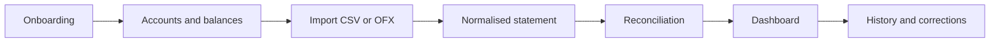
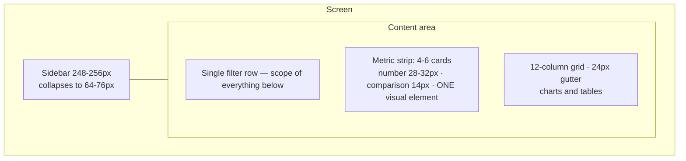
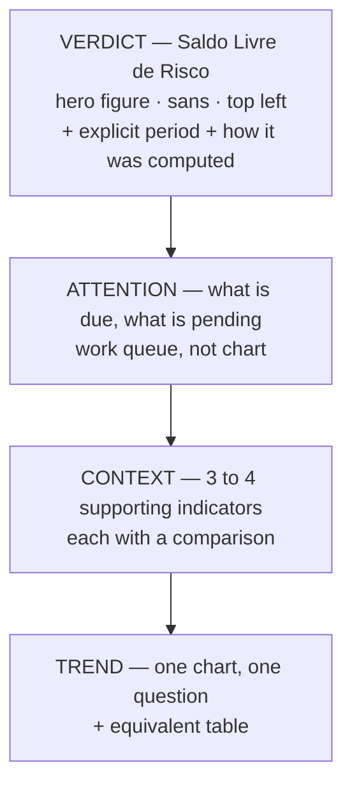
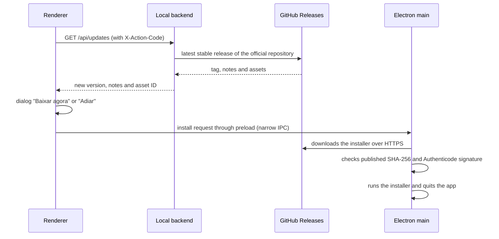

# Product

This document is the product specification of Talentum: what the product is for, which features the MVP delivers, which routes and local APIs each feature owns, how onboarding and the Dashboard must behave, how the new-version notice works, and which product rules every feature shares. It is the executable plan for finishing the MVP. Architecture, persistence, security and visual identity are specified in [ARCHITECTURE.md](ARCHITECTURE.md), [DATABASE.md](DATABASE.md), [SECURITY.md](SECURITY.md) and [DESIGN-SYSTEM.md](DESIGN-SYSTEM.md); the delivery order lives in [ROADMAP.md](ROADMAP.md).

## Contents

- [Status vocabulary](#status-vocabulary)
- [Product vision and scope](#product-vision-and-scope)
- [Product rules shared across features](#product-rules-shared-across-features)
- [How to execute this plan without prior context](#how-to-execute-this-plan-without-prior-context)
- [Route map](#route-map)
- [Cloud track: sign-up, session and downloads](#cloud-track-sign-up-session-and-downloads)
- [MVP features](#mvp-features)
- [Onboarding and initial financial snapshot](#onboarding-and-initial-financial-snapshot)
- [Dashboard specification](#dashboard-specification)
- [New-version notice and application update](#new-version-notice-and-application-update)
- [MVP migration order, feature order and Definition of Done](#mvp-migration-order-feature-order-and-definition-of-done)
- [Open items](#open-items)
- [References](#references)
- [Appendix: Original vision (historical, non-normative)](#appendix-original-vision-historical-non-normative)

## Status vocabulary

Every statement of state in this document carries one of these labels:

- **Current:** exists and was verified in the repository (code, migrations or tests).
- **Partial:** exists only as a scaffold or as part of the flow, without meeting the completion criterion. Used inside feature tables; a Partial item is Current for what exists and Planned for the rest.
- **Planned:** accepted, still to be implemented in the order given here.
- **Open:** requires a documented decision or the maintainer's ratification before implementation.

When code and this document disagree, verifiable code wins; fix the outdated documentation in the same change set.

## Product vision and scope

Status: **Current** as the product statement; individual capabilities carry their own status below.

Talentum is a **local-first**, **open-source** personal finance application for people with busy routines. It reduces the friction of financial organisation by reading bank statements instead of requiring manual entry, categorising transactions, tracking goals and guiding new contributions to investments. It turns financial data into practical decisions without asking the person to type every expense or to be an investment specialist.

The central concept is a pipeline:

```text
[ READER ] -> [ TRIAGE ] -> [ REAL BALANCE ] -> [ DECISION ]
  Reads        Confirms      Deducts the         Points where
  statements   doubts with   month's future      to contribute
  without      one tap       obligations         next
  typing
```

The product's core promise is the **Saldo Livre de Risco** (risk-free balance): the confirmed balances minus every obligation due within the period. It replaces the false sense of availability created by balances that will still be consumed by card bills, rent, recurring bills and automatic debits. Uncertain future income never increases it.

### Principles

- **Zero friction.** Passive automation comes first; manual forms exist only for exceptions such as cash expenses or transactions that need reconciliation.
- **Local-first privacy.** Real financial data (statements, transactions, merchants, balances, accounts, Pix keys, debts, investments) stays on the person's device in the local SQLite database. The cloud (Cloudflare Worker and D1) stores only minimal identity, sessions, consents, releases and download grants; it receives no financial values. See [SECURITY.md](SECURITY.md).
- **Guided decisions.** The application translates financial information into simple guidance: how much can be spent, which account needs checking, which goal is late, where the next contribution should go.
- **Open source.** The code is auditable, the product favours transparency, and data is exportable in open formats (export is **Planned**).

### Audience and problems solved

People who have little time to manage their finances; accumulate accounts, cards and institutions; do not want to type every transaction; need to find waste and forgotten subscriptions; want to reach purchase goals without losing control of the budget; want to start or organise an investment portfolio; and need privacy for sensitive financial data.

### Navigation areas

The local application is organised in six areas plus global actions. Status: **Current** as navigation and placeholder screens; the functionality behind each area is mostly **Planned** (see the [Route map](#route-map)).

1. **Início** (`/`): entry point without financial numbers.
2. **Dashboard** (`/dashboard`): verdict and supporting indicators.
3. **Extratos, cartões e recorrências** (`/extratos`): import, transactions, cards, recurring obligations.
4. **Conciliação** (`/conciliacao`): manual confirmation, adjustments, bill checking.
5. **Patrimônio e metas** (`/patrimonio`): portfolio, contributions, goals.
6. **Invest** (`/invest`): market news related to the portfolio.
7. **Histórico, perfil e configurações** (`/historico`, `/perfil`, `/configuracoes`): timeline, privacy, preferences.

Global actions: import a file (Current as a dialog trigger; the parser is Planned), notifications and express cash entry (Planned).

### MVP scope

The MVP is complete when a person can sign up on the landing page, securely obtain the correct installer, create their local financial base, import CSV or OFX, review the entries and consult a reliable Dashboard, with all financial data kept in the local SQLite database.

The MVP **does not include** PDF import, AI, the ARCA allocation methodology, cloud backup, gamification, community features, card ROI, budgets or the notification centre. These belong to later roadmap stages (see [ROADMAP.md](ROADMAP.md)); the original vision for them is preserved only as the [historical appendix](#appendix-original-vision-historical-non-normative).

| Outside the MVP Dashboard | Roadmap stage that enables it |
| --- | --- |
| ARCA matrix, four pillars, portfolio status | Stage 14 |
| XP, levels, missions, achievements | Stage 17 |
| News and summaries | Stages 15 and 16 |
| Card ROI, annual-fee exemption thermometer, cashback and miles | Stage 8 |
| Budget per category and planned vs. actual comparison | Stage 9 |
| Actionable notification centre | Stage 10 |

The roadmap and this executable plan prevail over the original vision when they conflict.

### Main MVP flow



## Product rules shared across features

These rules are mandatory for every feature. Status: **Current** as rules; compliance is tracked per feature.

1. The frontend never accesses SQLite, Prisma or financial files directly.
2. The frontend requests a temporary, opaque, single-use action code before every functional call to the backend (`POST /api/action-codes`, then the call with `X-Action-Code`).
3. The backend validates the code, input, authorisation and context before reading or changing data. The action code never replaces authentication, authorisation, CSRF protection, idempotency or rate limiting.
4. Every table has an `id`; every relation uses a foreign key ending in `Id`.
5. Persistent structures exist only in versioned migrations. No table is created manually at runtime.
6. Prisma represents the schema applied by the migrations; production and Docker use `prisma migrate deploy`.
7. Applied migrations are never rewritten. Changes produce a later migration.
8. No fictitious financial data lives in the frontend. Without records in the database, the interface shows an empty state.
9. Monetary values use integer cents (`BigInt`), never `Float`.
10. Real CSV and OFX test files stay in `temp/`, outside Git. Tests use synthetic files only.
11. The landing page and the renderer never access D1 directly; every cloud action goes through the BFF and the Worker.
12. The desktop system, its local backend and SQLite are never part of the artefact published to Vercel.
13. **Zero is a claim.** A financial value (including `R$ 0,00`) is rendered only after the backend confirms it. While loading or after a failure, the interface says it does not know.
14. **Every financial screen has four states:** loading, empty, error and with data.
15. **Distinguish confirmed, approximate and inferred values,** and show the reference date of any value derived from a declared balance or position.
16. **Own-account transfers are neither income nor expense** and leave every aggregate.
17. **Uncertain future income never increases the Saldo Livre de Risco.**
18. **No financial value** in logs, telemetry, analytics, error messages or requests to the cloud.
19. **Corrections never destroy the original value;** relevant decisions are auditable and reversible.

## How to execute this plan without prior context

1. Read [docs/README.md](README.md) for the hierarchy of sources of truth.
2. Read [ARCHITECTURE.md](ARCHITECTURE.md): the web layer for landing page and Cloudflare work, the Electron and local app layer for the desktop application.
3. Before changing persistence, read [DATABASE.md](DATABASE.md); before changing contracts or login, read the API section of [ARCHITECTURE.md](ARCHITECTURE.md) and [SECURITY.md](SECURITY.md).
4. Compare the state declared here with code, migrations and tests. Verifiable code prevails; fix outdated documentation in the same change set.
5. Execute one vertical slice at a time, including backend, migration, contract, interface, UX states, tests and applicable documentation.
6. Do not advance while the current step's "Done when" criterion cannot be demonstrated.
7. Record decisions with relevant alternatives in `docs/decisions/`; do not invent infrastructure, credentials or missing requirements.
8. Before commit or push, follow the full security gate in `CLAUDE.md` or `AGENTS.md`.

## Route map

This is the single authoritative list of product routes. Paths and Portuguese route segments are exactly as in code.

### Local application UI routes (`src/app`)

"Placeholder" means the screen exists but renders only an empty state or a backend-confirmed count; the functional feature behind it is still Planned.

| Route | Status | Feature | Notes |
| --- | --- | --- | --- |
| `/` | **Current** | Início | Product presentation, local privacy notice, import/register action and shortcuts. Shows no financial value. No sidebar item of its own; reached through the brand at the top of the sidebar. |
| `/dashboard` | **Current** | 7 | Real data from `GET /api/dashboard` and `GET /api/dashboard/categories`. |
| `/onboarding` | **Current** (placeholder) | 1 | Single card with the local privacy callout and an `Importar primeiro extrato` action. The step flow is Planned. |
| `/onboarding/perfil` | Planned | 1 | |
| `/onboarding/contas` | Planned | 1 | |
| `/onboarding/posicao-atual` | Planned | 1 | |
| `/onboarding/revisao` | Planned | 1 | |
| `/contas` | Planned | 2 | |
| `/contas/nova` | Planned | 2 | |
| `/contas/[accountId]` | Planned | 2 | |
| `/configuracoes` | **Current** | — | Theme selector (`Claro`, `Escuro`, `Sistema`) and "About". |
| `/configuracoes/categorias` | Planned | 3 | |
| `/planejamento/rendas` | Planned | 3 | |
| `/extratos` | **Current** (placeholder) | 5 | Empty state, or the backend-confirmed transaction count from `/api/local-summary`; the listing is Planned. |
| `/extratos/[transactionId]` | Planned | 5 | |
| `/extratos/recorrencias` | **Current** (placeholder) | 3 | Empty state, or the count of open obligations; CRUD is Planned. |
| `/extratos/importar` | **Current** (placeholder) | 4 | Empty state with `Selecionar arquivo`; parsing is Planned. |
| `/extratos/importar/[loteId]` | **Current** (placeholder) | 4 | Renders "batch not found"; real batch detail is Planned. |
| `/extratos/importar/[loteId]/mapeamento` | Planned | 4 | CSV column mapping. |
| `/extratos/importar/[loteId]/revisao` | Planned | 4 | Preview before confirming. |
| `/extratos/cartoes` | **Current** (placeholder) | Stage 8 | Empty state; cards are outside the MVP. |
| `/extratos/cartoes/[cartaoId]` | **Current** (placeholder) | Stage 8 | Renders "card not found". |
| `/conciliacao` | **Current** (placeholder) | 6 | Empty state, or the count of pending transactions; triage is Planned. |
| `/conciliacao/[reconciliationItemId]` | Planned | 6 | |
| `/conciliacao/faturas` | **Current** (placeholder) | Stage 8 | Bill check; enabled when bills exist. |
| `/patrimonio` | **Current** (placeholder) | Stage 14 | Empty state linking to `/onboarding`. |
| `/patrimonio/aportes` | **Current** (placeholder) | Stage 14 | |
| `/patrimonio/metas` | **Current** (placeholder) | Stage 9+ | |
| `/patrimonio/metas/[metaId]` | **Current** (placeholder) | Stage 9+ | Renders "goal not found". |
| `/invest` | **Current** (placeholder) | Stages 15–16 | No fictitious news. |
| `/invest/[noticiaId]` | **Current** (placeholder) | Stages 15–16 | Renders "content not found". |
| `/historico` | **Current** (placeholder) | 8 | Empty state; events are Planned. |
| `/perfil` | **Current** (placeholder) | 1 | Empty state linking to `/onboarding`. |
| `/perfil/privacidade` | **Current** (placeholder) | 8 | States that data stays in local SQLite; encrypted backup shown as Planned. |
| `/lp` | **Current** (development bridge) | — | Renders the landing page at the local origin during development only; must be removed before the first deploy (see [ARCHITECTURE.md](ARCHITECTURE.md)). |
| `/layout-guide` | **Current** (development only) | — | Internal design reference; returns not found outside development. |

The batch route parameter is `[loteId]` in code. Planned sub-routes under it keep that name.

### Local API routes (`src/app/api`)

| Route | Status | Feature | Notes |
| --- | --- | --- | --- |
| `POST /api/action-codes` | **Current** | all | Bootstrap; issues a 60-second single-use code bound to method and path. |
| `GET /api/health/live` | **Current** | — | Liveness probe; requires no action code (see Open items). |
| `GET /api/system/status` | **Current** | — | Requires `X-Action-Code`. |
| `GET /api/local-summary` | **Current** | area screens | Counts of active accounts, transactions, pending transactions, open obligations and import batches; lets area screens decide between empty and existing state. |
| `GET /api/dashboard` | **Current** | 7 | Includes the Saldo Livre de Risco, consolidated balance, month spending, daily average, committed total and reconciliation count. |
| `GET /api/dashboard/categories` | **Current** | 7 | Spending by category. |
| `GET /api/dashboard/cash-flow` | Planned, blocked by L-2 | 7 | Monthly income and outflow (G-3). |
| `GET /api/onboarding`, `POST /api/onboarding` | Planned | 1 | |
| `PATCH /api/onboarding/[onboardingId]` | Planned | 1 | |
| `POST /api/onboarding/[onboardingId]/complete` | Planned | 1 | |
| `GET\|POST /api/institutions` | Planned | 2 | |
| `GET\|PATCH\|DELETE /api/institutions/[institutionId]` | Planned | 2 | |
| `GET\|POST /api/accounts` | Planned | 2 | |
| `GET\|PATCH\|DELETE /api/accounts/[accountId]` | Planned | 2 | |
| `POST /api/accounts/[accountId]/balance-snapshots` | Planned | 2 | |
| `GET\|POST /api/accounts/[accountId]/pix-identifiers` | Planned | 2 | |
| `GET\|POST /api/categories` | Planned | 3 | |
| `GET\|PATCH\|DELETE /api/categories/[categoryId]` | Planned | 3 | |
| `GET\|POST /api/incomes` | Planned | 3 | |
| `GET\|POST /api/obligations` | Planned | 3 | |
| `GET\|PATCH\|DELETE /api/obligations/[obligationId]` | Planned | 3 | |
| `POST /api/imports/inspect` | Planned | 4 | |
| `POST /api/imports` | Planned | 4 | |
| `GET /api/imports/[importBatchId]` | Planned | 4 | |
| `PATCH /api/imports/[importBatchId]/mapping` | Planned | 4 | |
| `POST /api/imports/[importBatchId]/confirm` | Planned | 4 | |
| `DELETE /api/imports/[importBatchId]` | Planned | 4 | |
| `GET /api/transactions` | Planned | 5 | |
| `GET\|PATCH /api/transactions/[transactionId]` | Planned | 5 | |
| `GET /api/transactions/[transactionId]/history` | Planned | 5 | |
| `GET /api/reconciliation-items` | Planned | 6 | |
| `GET /api/reconciliation-items/[reconciliationItemId]` | Planned | 6 | |
| `POST /api/reconciliation-items/[reconciliationItemId]/decisions` | Planned | 6 | |
| `POST /api/reconciliation-decisions/[decisionId]/revert` | Planned | 6 | |
| `GET /api/timeline-events` | Planned | 8 | |
| `POST /api/timeline-events/[timelineEventId]/revert` | Planned | 8 | |
| `GET /api/updates` | Planned | Update notice | |

The Saldo Livre de Risco is served inside `GET /api/dashboard`; a separate `/api/dashboard/risk-free-balance` endpoint, listed in an earlier plan, is not needed and is not planned.

### Cloud routes

Landing page and BFF (`apps/web`, published to Vercel):

| Route | Status | Notes |
| --- | --- | --- |
| `/` | **Current** | Public landing page. |
| `/downloads` | **Current** | Protected; calls the Worker `/api/me` and `/api/releases` server-side. |
| `GET /api/auth/start` | **Current** | Starts OAuth through the Worker. |
| `GET /api/auth/callback` | **Current** | Completes OAuth; sets `HttpOnly` cookies. |
| `GET /api/auth/refresh` | **Current** | Rotates cookies. |
| `/api/auth/logout` | **Current** | |
| `POST /api/releases/[releaseId]/download-grants` | **Current** | Form post; answers with a 303 redirect. |

Worker (`cloudflare/src/index.ts`):

| Route | Status |
| --- | --- |
| `GET /health` | **Current** |
| `POST /api/action-codes` | **Current** |
| `POST /api/auth/start` | **Current** |
| `POST /api/auth/callback` | **Current** |
| `POST /api/auth/refresh` | **Current** |
| `POST /api/auth/logout` | **Current** |
| `GET /api/me` | **Current** |
| `GET /api/releases` | **Current** |
| `POST /api/releases/:releaseId/download-grants` | **Current** |

Contracts, error codes and protections of every cloud route are specified in [ARCHITECTURE.md](ARCHITECTURE.md) and [SECURITY.md](SECURITY.md).

## Cloud track: sign-up, session and downloads

### What it does

Delivers only the cloud API, the public landing page and the authenticated downloads page. D1 persists minimal identity, sessions, consents, releases and grants; it never receives statements, accounts, balances, transactions, portfolio or Pix keys.

### Current state

**Current (verified in the repository):**

- Worker with D1 binding `DB`; migrations `0001_cloud_core.sql` and `0002_cloud_auth_runtime.sql` (ephemeral state and rate limiting).
- `GET /health` queries the binding and answers without exposing internal data; `workers.dev` is enabled explicitly in `wrangler.jsonc`.
- Action codes persisted in D1, OAuth Google with Authorization Code + PKCE, cryptographic ID-token validation, short session, rotating refresh token with reuse detection and revocation, logout, profile, releases and download grants.
- Landing page BFF with `HttpOnly` cookies, callback, refresh, protected `/downloads` and origin validation on mutations.
- CSP, HSTS and `no-store` on the landing page; a test checks that the web package is isolated from the desktop and financial code.

**Reported, not verifiable from the repository:** the original plan (10 September 2026) recorded the Worker as published and migration `0002` as applied to local and remote D1. Registering secrets, configuring OAuth, producing signed artefacts and running end-to-end tests in the published environment remain mandatory operational actions.

The health endpoint and the schema alone never mean that feedback or community features exist; those D1 tables exist but have no routes.

### Remaining work, in mandatory order

1. **Planned (operational):** set the Cloudflare Git deployment commands to `pnpm run cloudflare:build` and `pnpm run cloudflare:deploy`, keeping `main` as the production branch.
2. **Planned (operational):** per-environment configuration with secrets registered as Worker Secrets; real values never enter `wrangler.jsonc`, `.env.example` or Git.
3. **Planned:** exact CORS. `ALLOWED_ORIGIN` is declared but unused; the Worker sends no CORS headers.
4. **Planned:** separate rate limits for login, callback, refresh, action code and download; adaptive Turnstile against abuse. Today only two IP-keyed buckets exist (`codes` and `login`) and there is no Turnstile.
5. **Planned:** redacted logs and metrics, alerts and security events without tokens, public e-mails, raw IPs or financial data. Refresh-token reuse currently revokes the family but writes nothing to `security_events`.
6. **Planned:** consent, privacy, session revocation, account deletion and minimal retention.
7. **Planned:** signed Windows and Linux installers produced outside Vercel, with published checksum, signature and verifiable metadata.
8. **Planned:** authentication, replay, rotation, authorisation, rate-limit, deploy-leak and end-to-end download tests.

### Done when

- An unauthenticated person reaches the landing page but not the protected downloads page.
- Sign-up/login, refresh, logout and revocation pass the security tests.
- Windows and Linux are offered only after backend authorisation.
- The artefact deployed to Vercel contains no Electron, Prisma, SQLite, parsers or financial modules.
- No secret appears in the bundle, repository, logs or HTTP responses.
- The frontend never accesses D1, OAuth or GitHub Releases directly.

## MVP features

Tables and fields referenced here are specified in [DATABASE.md](DATABASE.md). The nine Prisma models that exist today are `LocalProfile`, `UserPreference`, `Institution`, `Account`, `BalanceSnapshot`, `Category`, `ImportBatch`, `Transaction` and `ScheduledObligation`.

### Feature 1 — Financial onboarding

Status: **Planned** (the `/onboarding` screen is a placeholder). Full specification in [Onboarding and initial financial snapshot](#onboarding-and-initial-financial-snapshot).

**What it does.** Creates the initial financial snapshot without forcing the person to fill everything at once. Allows registering profile, banks, accounts, balances, income, obligations and investments, or starting with the available statement import.

**Flow.**

1. Explain that financial data stays only on the device.
2. Create or resume an onboarding draft.
3. Set currency and time zone.
4. Register institutions and accounts.
5. Enter the current balance or attach a statement.
6. Register income and essential obligations, when known.
7. Review the summary and complete.

**UI routes:** `/onboarding`, `/onboarding/perfil`, `/onboarding/contas`, `/onboarding/posicao-atual`, `/onboarding/revisao`.

**Local APIs:** `GET /api/onboarding`, `POST /api/onboarding`, `PATCH /api/onboarding/[onboardingId]`, `POST /api/onboarding/[onboardingId]/complete`.

| Table | IDs and relations | Responsibility | Status |
| --- | --- | --- | --- |
| `LocalProfile` | `id` | local identity without sensitive bank data | **Current** |
| `UserPreference` | `id`, `profileId` | theme, currency, language and time zone | **Current** |
| `OnboardingSession` | `id`, `profileId` | current step, status and resumption | Planned |
| `OnboardingAnswer` | `id`, `onboardingSessionId` | validated answer per question | Planned |

**Migration:** create `OnboardingSession` and `OnboardingAnswer` in their own migration (`mvp_onboarding`, Planned).

**Done when:** onboarding can be interrupted and resumed, and the Dashboard stays empty until the backend confirms that financial data exists.

### Feature 2 — Institutions, accounts and balances

Status: **Partial** (tables Current; routes, APIs and screens Planned).

**What it does.** Represents where the person holds money. Does not require branch or account number. Own Pix keys are optional, encrypted, and used only to recognise transfers between the person's own accounts.

**Flow.**

1. Register the institution by name.
2. Create one or more accounts linked by `institutionId`.
3. Set account type and currency.
4. Record the known balance with a reference date.
5. Optionally register encrypted local Pix identifiers.

**UI routes:** `/contas`, `/contas/nova`, `/contas/[accountId]`.

**Local APIs:** `GET|POST /api/institutions`, `GET|PATCH|DELETE /api/institutions/[institutionId]`, `GET|POST /api/accounts`, `GET|PATCH|DELETE /api/accounts/[accountId]`, `POST /api/accounts/[accountId]/balance-snapshots`, `GET|POST /api/accounts/[accountId]/pix-identifiers`.

| Table | IDs and relations | Responsibility | Status |
| --- | --- | --- | --- |
| `Institution` | `id`, `profileId` | financial institution | **Current** (`mvp_financial_core`) |
| `Account` | `id`, `profileId`, `institutionId` | account, type, currency and state | **Current** (`mvp_financial_core`) |
| `BalanceSnapshot` | `id`, `accountId` | known balance at a date | **Current** (`mvp_financial_core`) |
| `PixIdentifier` | `id`, `accountId` | HMAC for comparison and locally encrypted value | Planned (`mvp_financial_planning`) |

**Done when:** creating, editing or deactivating an account updates the selector and the consolidated balance through a backend query.

### Feature 3 — Categories, income and obligations

Status: **Partial** (`Category` and `ScheduledObligation` Current; CRUD, screens, income and merchant rules Planned).

**What it does.** Creates the structure used to interpret income, expenses, transfers and amounts committed in the month.

**UI routes:** `/configuracoes/categorias`, `/planejamento/rendas`, `/extratos/recorrencias`.

**Local APIs:** `GET|POST /api/categories`, `GET|PATCH|DELETE /api/categories/[categoryId]`, `GET|POST /api/incomes`, `GET|POST /api/obligations`, `GET|PATCH|DELETE /api/obligations/[obligationId]`.

| Table | IDs and relations | Responsibility | Status |
| --- | --- | --- | --- |
| `Category` | `id`, `profileId` | classification as income, expense or transfer (`kind`) | **Current** (`mvp_financial_core`) |
| `IncomeSource` | `id`, `profileId`, `accountId?` | expected or recurring income | Planned |
| `ScheduledObligation` | `id`, `profileId`, `accountId?`, `categoryId?` | commitment with `amountCents`, `dueDate`, `status`, `recurrence`, `isEstimated` | **Current** (`mvp_scheduled_obligations`), consumed by the Dashboard |
| `MerchantRule` | `id`, `profileId`, `categoryId` | deterministic categorisation rule | Planned |

**Migrations:** `mvp_financial_core` creates `Category` (Current); `mvp_scheduled_obligations` creates `ScheduledObligation` (Current); a later migration creates income and merchant rules (Planned). The obligation CRUD and the recurrences screen still belong to this feature.

**Done when:** the frontend lists only categories and obligations returned by the backend, and the committed total has a unit test (the committed-total unit test is **Current** in `tests/dashboard-metrics.test.mjs`).

### Feature 4 — CSV and OFX import

Status: **Partial** (`ImportBatch` and `Transaction` Current; parser, APIs and screens Planned). No parser code exists yet; `pdfjs-dist` and `ofx-data-extractor` are installed but unused.

**What it does.** Turns a bank file into a traceable batch of local transactions. CSV requires column mapping because banks use different headers, separators, dates and signs.

**Flow.**

1. Select a `.csv` or `.ofx` file.
2. The backend validates size, real type, encoding and content.
3. Compute the fingerprint before importing.
4. For CSV, detect the separator and request column mapping.
5. Show a preview without writing transactions.
6. Confirm account, dates, debit/credit sign and balance.
7. Write the batch and its transactions in one SQLite transaction.
8. Send uncertain items to reconciliation.

**UI routes:** `/extratos/importar`, `/extratos/importar/[loteId]`, `/extratos/importar/[loteId]/mapeamento`, `/extratos/importar/[loteId]/revisao`.

**Local APIs:** `POST /api/imports/inspect`, `POST /api/imports`, `GET /api/imports/[importBatchId]`, `PATCH /api/imports/[importBatchId]/mapping`, `POST /api/imports/[importBatchId]/confirm`, `DELETE /api/imports/[importBatchId]`.

| Table | IDs and relations | Responsibility | Status |
| --- | --- | --- | --- |
| `ImportBatch` | `id`, `profileId` | format, fingerprint, state and batch totals | **Current** |
| `ImportFile` | `id`, `importBatchId` | minimal metadata; raw content not retained by default | Planned |
| `CsvMappingProfile` | `id`, `profileId`, `institutionId?` | reusable column mapping | Planned |
| `ImportIssue` | `id`, `importBatchId`, `transactionId?` | error or warning per line/field | Planned |
| `Transaction` | `id`, `profileId`, `accountId`, `importBatchId?`, `categoryId?` | normalised entry | **Current** |

**Migrations:** `mvp_financial_core` creates `ImportBatch` and `Transaction` (Current); `mvp_import_details` creates `ImportFile`, `CsvMappingProfile` and `ImportIssue` (Planned). The batch must also persist the covered period (see L-2).

**Done when:** synthetic CSV and OFX import correctly; re-sending the same file does not duplicate data; an error in one line does not produce a partially confirmed batch.

### Feature 5 — Statements and transactions

Status: **Planned** (`/extratos` shows only a backend-confirmed count).

**What it does.** Shows persisted entries with pagination, filters, source batch and reconciliation state.

**UI routes:** `/extratos`, `/extratos/[transactionId]`.

**Local APIs:** `GET /api/transactions`, `GET|PATCH /api/transactions/[transactionId]`, `GET /api/transactions/[transactionId]/history`.

**Query rules.** Filters and ordering are validated in the backend. The API returns opaque IDs and minimal DTOs. The frontend never computes balances or reclassifies data on its own.

**Done when:** without transactions the route shows an empty state; with records, each row corresponds to a `Transaction.id` returned by the backend.

### Feature 6 — Reconciliation

Status: **Planned** (`/conciliacao` shows only the count of `Transaction.status = 'pending'`).

**What it does.** Lets the person confirm or correct uncertain transactions without deleting the original data. Recognises category, transfer between own accounts, obligation and financial adjustment.

**Flow.**

1. The backend creates a pending item with reason and confidence.
2. The frontend requests the next item.
3. The person confirms or corrects.
4. The backend records the decision, before/after and local author.
5. Calculations and Dashboard are updated.
6. The decision can be reverted.

**UI routes:** `/conciliacao`, `/conciliacao/[reconciliationItemId]`.

**Local APIs:** `GET /api/reconciliation-items`, `GET /api/reconciliation-items/[reconciliationItemId]`, `POST /api/reconciliation-items/[reconciliationItemId]/decisions`, `POST /api/reconciliation-decisions/[decisionId]/revert`.

| Table | IDs and relations | Responsibility | Status |
| --- | --- | --- | --- |
| `ReconciliationItem` | `id`, `transactionId` | pending item, reason and confidence | Planned |
| `ReconciliationDecision` | `id`, `reconciliationItemId`, `profileId` | decision and before/after | Planned |
| `FinancialAdjustment` | `id`, `transactionId`, `decisionId?` | interest, fine, discount or correction | Planned |
| `OwnAccountTransfer` | `id`, `outgoingTransactionId`, `incomingTransactionId` | pairing between own accounts | Planned |

**Done when:** no correction destroys the original value and every relevant decision can be audited and reverted.

### Feature 7 — Dashboard

Status: **Current** for seven of nine elements; see the [Dashboard specification](#dashboard-specification).

**What it does.** Summarises the current position using only backend queries. The Dashboard lives at `/dashboard`; the root `/` is Início, an entry point with no financial number, because a zero without backend confirmation is a false statement.

**MVP indicators (Current):**

- **Saldo Livre de Risco**, the screen's verdict, with visible period and breakdown;
- consolidated balance: the latest snapshot of each active account **plus the entries after it**, with accounts without a declared balance counted separately;
- month spending, compared with the same day range of the previous month;
- daily average, with the same comparison base;
- total committed in the period and number of obligations;
- reconciliation queue as an attention strip;
- spending by category.

The monthly income/outflow chart remains **blocked**: `ImportBatch` does not record the covered period, so a month without a statement would render as a month without movement (L-2).

**Local APIs:** `GET /api/dashboard` and `GET /api/dashboard/categories` (**Current**); `GET /api/dashboard/cash-flow` (Planned, blocked by L-2).

**Tables queried:** `Account`, `BalanceSnapshot`, `Transaction`, `Category`, `ImportBatch` and `ScheduledObligation`. `ReconciliationItem` does not exist yet: the queue uses `Transaction.status = 'pending'` as a declared approximation until the reconciliation migration.

**Current state.** Both Dashboard routes query SQLite through the backend, require `X-Action-Code` and are scoped by `profileId`. Formulas live in a pure module (`src/server/dashboard-metrics.ts`) with unit tests; the screen is `src/components/dashboard.tsx`. The interface has the four states: skeleton while loading, error strip with retry, empty state and data state. No value is rendered without backend confirmation.

**Done when:** no indicator comes from a frontend constant; changing a transaction or obligation changes the Dashboard; formulas have unit tests. **Met (Current)**, except the automated end-to-end test, which depends on the Feature 4 import flow (Planned).

### Feature 8 — History, reversal and local safety

Status: **Planned** (`/historico` is a placeholder).

**What it does.** Records imports and relevant changes without storing the action code, secrets or raw statement content.

**Routes:** `/historico`, `GET /api/timeline-events`, `POST /api/timeline-events/[timelineEventId]/revert`.

| Table | IDs and relations | Responsibility | Status |
| --- | --- | --- | --- |
| `TimelineEvent` | `id`, `profileId`, `importBatchId?`, `transactionId?` | redacted, reversible event | Planned |
| `DatabaseBackup` | `id`, `profileId` | metadata of the local backup taken before a destructive migration | Planned |

**Done when:** events can be queried without exposing secrets, and destructive migrations require a validated local backup.

## Onboarding and initial financial snapshot

Status: **Planned.** This section is normative for financial onboarding; the flow stays Planned until its routes, tables and screens are implemented and tested. Only the `/onboarding` placeholder is Current.

### Problem

A new person must represent their current situation faithfully even without a complete history. Onboarding creates a **financial snapshot with a reference date**, records the origin and confidence of every value, and imports at least the statement the person can obtain.

The system must never pretend that a partial statement represents the whole past. It separates:

- current position, declared or confirmed;
- history actually imported;
- inferred values;
- periods without data coverage.

### Minimum expected result

On completion the system can answer:

1. how much comes in monthly and how regularly;
2. which institutions, accounts and cards exist;
3. what the current balance of each account is;
4. which bills, card statements, instalments and debts will still consume the balance;
5. how much is invested and at which institution;
6. which asset positions exist, with quantity, average price and reference value;
7. which period is covered by the attached statements;
8. what the confidence level of the initial snapshot is.

### Mandatory privacy message

Before the first financial question, show in plain language (Portuguese UI copy to be written from this meaning):

> Your financial data is saved only on this device. Salaries, banks, balances, bills, Pix keys, statements, transactions, debts and investments are not sent to Talentum, to Vercel or to Cloudflare D1. They are processed locally to build your plan. You can review, correct, export and delete this data.

Interface complements:

- a "How we protect your data" link with a short, verifiable explanation;
- a **Saved only on this device** indicator on financial steps;
- a specific notice before attaching a file: **Your statement will be processed locally and will not be sent to the cloud**;
- consent never uses a pre-checked box;
- never promise absolute protection: unauthorised access to the device itself remains a risk;
- explain that login, session and technical account state are separate data kept in the backend, without financial values.

### Complete question map

The questions below are the catalogue. The interface presents them progressively, hiding conditional questions that do not apply.

#### Block 0 — Privacy and start

| Question | Type | Purpose | Destination |
| --- | --- | --- | --- |
| "Do you understand that financial data stays only on this device?" | required | confirm awareness of the local-first model | local; the cloud receives at most the accepted notice version, no financial data |
| "Do you want to set up your financial snapshot now?" | required | start or postpone with partial state | local |
| "Which currency do you mainly use?" | required | interpret values correctly | local |
| "What is the reference date of the values entered?" | required, default today | keep the snapshot temporally correct | local |

#### Block 1 — Income

Opening question: **"Do you have any recurring income?"** If yes, repeat for each source:

| Question | Type | Note |
| --- | --- | --- |
| "What is the name or nickname of this income?" | required | e.g. salary, pension, service provision |
| "What net amount do you usually receive?" | required for projection | accept approximate and mark as estimate |
| "How often do you receive it?" | required | monthly, fortnightly, weekly, yearly, variable or other |
| "On which day or range do you usually receive it?" | optional for variable income | never treat as a guarantee |
| "Into which account does it usually go?" | optional until accounts exist | link later by `accountId` |
| "Is this amount fixed or variable?" | required | changes how it is projected |
| "Do you want to add another income source?" | conditional | multiple sources |

Never ask for employer, profession, payer's CNPJ or documents without an approved need.

#### Block 2 — Institutions and accounts

Opening question: **"Where do you keep money or make payments?"** For each account:

| Question | Type | Note |
| --- | --- | --- |
| "Which institution?" | required | searchable list + "Other" |
| "What type of account is it?" | required | checking, payment, savings, brokerage, wallet or cash |
| "How do you want to identify this account?" | optional | local nickname such as "Main account" |
| "What is the current balance?" | required | allow negative and "approximate value" |
| "When was this balance checked?" | required, default now | reference date/time |
| "Did the balance come from the bank or is it estimated?" | required | `BANK_REPORTED` or `USER_DECLARED` |
| "Does this account receive any registered income?" | conditional | link by IDs |
| "Does this account pay recurring expenses?" | optional | helps order the next block |
| "Is this account also used for investments?" | required | opens the investment block for this account |
| "Do you want to add another account?" | conditional | supports several banks |

Never ask for branch, account number, password or bank credential.

#### Block 3 — Own Pix keys

Per account: **"Do you want to register a Pix key of this account so we can identify transfers between your own accounts?"** If yes:

| Question | Type | Note |
| --- | --- | --- |
| "What type of key?" | required | CPF, CNPJ, phone, e-mail or random |
| "What is the key?" | required | mask in the interface after saving |
| "Is this key currently active?" | required | active or historical/inactive |
| "Since when or until when was it used?" | optional | helps old statements |
| "Do you want to add another key for this account?" | conditional | several keys per account |

Before the field, repeat: **The key will be encrypted and saved only on this device.**

#### Block 4 — Cards and card statements

Opening question: **"Do you have a credit card with an open statement or instalment purchases?"** For each card:

| Question | Type | Note |
| --- | --- | --- |
| "Which institution issued the card?" | required | reuse an existing institution |
| "Which nickname do you want to use?" | optional | never ask for the full number |
| "What are the last four digits?" | optional | only to distinguish cards |
| "What is the closing day?" | optional at first | improves projection |
| "What is the due day?" | required | needed for the risk-free balance |
| "What is the current statement amount?" | required when known | accept estimate and date |
| "From which account is the statement paid?" | optional | link by `accountId` |
| "Are there future instalment purchases?" | conditional | amount per instalment and remaining count |

#### Block 5 — Bills, commitments and debts

Opening question: **"Which amounts still need to be paid?"** For each commitment: name/nickname; amount or estimate; due date; recurrence; category; optional paying account; automatic debit yes/no/don't know; remaining instalments, if any.

Separate question: **"Do you have debt with interest or an overdue payment?"** If yes, ask only approximate balance, instalment, due date and rate/cost when known. Never ask for the contract, documents or credentials.

#### Block 6 — Reserves and committed amounts

| Question | Type | Purpose |
| --- | --- | --- |
| "Is any part of the balances already reserved and unavailable?" | required | do not inflate the free balance |
| "How much is reserved?" | conditional | record per account/goal |
| "For what purpose?" | conditional | emergency reserve, tax, travel or other |
| "Is this amount in an account already registered?" | conditional | avoid double counting |

#### Block 7 — Investments

Opening question: **"Do you currently have investments?"** For each account marked as investment:

| Question | Type | Note |
| --- | --- | --- |
| "At which institution is the investment?" | pre-filled | relation to an existing account |
| "Which asset or fund?" | required | local search + manual entry |
| "Is there a ticker/code?" | optional | an asset may have no ticker |
| "Which class?" | required | stock, REIT (FII), fixed income, cash, international, crypto or other |
| "What quantity do you hold?" | optional when only the total is known | use Decimal |
| "What was the average price?" | optional | never block on its absence |
| "What is the approximate current value?" | required for the snapshot | do not confuse with cost |
| "When was this value checked?" | required | show staleness |
| "In which currency is it valued?" | required | no silent conversion |
| "Do you want to add another asset?" | conditional | batch entry |

For fixed income, adapt the questions to amount invested, current value, maturity, liquidity and optional index. Never force quantity/average price where these concepts do not apply.

#### Block 8 — Available statements

1. "From which accounts can you attach a statement now?"
2. "Which format do you have?" — CSV and OFX in the MVP; PDF later (roadmap).
3. "Which period do you believe the file covers?" — optional, because the parser must verify it.
4. "Do you want to attach another statement?"
5. "May we discard the original file after confirming the import?" — explicit retention decision.

The system detects institution, account, period, currency, balance when available, and duplicates. Every detection must be confirmable; never ask again for data already proven by the file.

#### Block 9 — Review of the initial snapshot

Confirmation questions:

- "Are these all the accounts you want to consider now?"
- "Do the displayed balances roughly match what you have today?"
- "Are the nearest card statements, debts and bills represented?"
- "Were investments not counted twice inside the account balance?"
- "Do you want to correct any divergence found?"
- "Do you confirm this financial snapshot at the indicated date?"

After confirmation, show clearly: confirmed values; approximate values; inferred values; accounts without statements; known history period; pending items that affect confidence.

### Required versus deferrable

**Needed for a reliable initial Dashboard:** currency and reference date; at least one account/institution; current balance and date of each included account; existing recurring income or confirmation that there is none; near obligations/card statements or confirmation that there are none; reserved amounts or confirmation that there are none; final review.

**Needed to complete the full onboarding:** at least one imported statement, if the mandatory-statement decision is kept; relevant accounts registered; existing investments represented at least by current value; critical divergences reviewed.

**Can be left for later:** average price; ticker; historical Pix key dates; card closing day; exact debt rate; index and yield details; custom categories; goals and the ARCA methodology.

### Questions that must not exist

- bank password or token;
- authentication code/OTP;
- full card number and CVV;
- branch and account number without an indispensable case;
- CPF, address or employer to "complete the registration";
- private key, seed phrase or brokerage/crypto password;
- permission to send statements or financial data to the cloud;
- marketing questions mixed with required steps.

### Proposed quick flow

**Step 1 — Essential context.** Currency and reference date; approximate net monthly income; frequency (monthly, fortnightly, variable or no recurring income); receiving day or range; "I'd rather tell you later" for non-essential fields. Never ask for profession, employer, CPF, address or gross income without an approved use case.

**Step 2 — Institutions and accounts.** Fast repeat interface: select institution, choose account type and enter the current balance; an "Add another account" button allows multiple banks. Per account: institution; type (checking, payment, savings, brokerage, wallet or cash); optional nickname; current balance; balance date/time; origin (bank, user or import); main account for inflows/outflows, without forcing a single account. Never request branch, account number, password, access code or bank credential. To recognise movements between the person's own accounts, allow one or more Pix keys per account.

**Pix keys and own transfers.** A Pix key can be CPF, CNPJ, phone, e-mail or random key. Even without branch/account, these values are personal data and some are strong identifiers; they stay only on the device. Per key: key type; owning local account by `accountId`; safe display nickname; locally encrypted normalised value; HMAC of the normalised value for lookup/comparison; masked last characters when safe to show; active/inactive state and known validity period; origin (declared by the user, or detected in a statement and confirmed).

The key is never stored in plain text in logs, timeline, analytics, D1 or error messages. A plain hash is not enough for CPF, phone and e-mail because the value space is predictable: use an HMAC with a device secret key for the equality index, and authenticated encryption for any recovery/display.

When importing a Pix transaction, the local backend normalises the key found and compares its HMAC with the registered own keys. If origin and destination belong to the profile:

- classify as `OWN_ACCOUNT_TRANSFER`;
- link both entries through a transfer-pair `id` when both exist;
- do not count it as income, expense or savings;
- keep real fees as a separate entry;
- ask for confirmation when only one side exists, the key is incomplete or confidence is low.

Payee name, description, amount and time proximity can help reconciliation but never confirm an own transfer on their own. The exact confirmed Pix key is the main signal.

**Step 3 — Immediate commitments.** Cards and open statements; recurring bills and due dates; instalments and debts; amounts already reserved and not free to spend. This step is indispensable so the bank balance is never presented as the Saldo Livre de Risco.

**Step 4 — Investments.** First select which institution/account is used for investing, then add positions in a quick grid. Per position: asset/fund and ticker when it exists; class and currency; quantity; average price, optional when unknown; declared current value; reference date; origin and confidence. Average price never blocks onboarding: it is useful for cost/result, but current value is enough for the wealth snapshot. Do not fetch external quotes in the MVP without an approved source, licence and update rule.

**Step 5 — Import statement.** Explain that the file is processed locally and does not go to the cloud; accept CSV and OFX in the MVP, PDF in its own roadmap stage; allow multiple files and report which periods were detected; show progress, duplicates and lines needing review; never trust extension, MIME type or file name; never execute embedded content.

Decision under discussion (**Open**): require at least one statement to mark onboarding as `COMPLETED`, but allow `PARTIAL` when the person cannot obtain it at that moment. Blocking the whole application tends to increase abandonment without improving fidelity; a partial Dashboard can clearly display "data not yet checked".

**Step 6 — Review and initial reconciliation.** One screen with: total in accounts; open obligations; invested wealth; history coverage per account; divergences between declared and inferred balance; missing fields that reduce confidence. The person can go back, correct and confirm. Consolidation creates snapshots; it never silently overwrites original values.

### Proposed architecture


Boundaries:

- the renderer never calls Prisma, the file system or the parser directly;
- every action uses the local API and an action code;
- files and finances stay on the device;
- D1 never receives salary, balances, banks, assets, average price or statements;
- the cloud may receive only `onboardingStatus`, version and timestamp, if there is a real need (**Open**, decision 7 below);
- drafts are local and recoverable after closing the application.

### Candidate local model

Every table has an `id`; relations use IDs. Names below are aligned with the implemented schema where an entity already exists.

| Table | Main relations | Role | Status |
| --- | --- | --- | --- |
| `OnboardingSession` | `profileId` | state, current step, version and reference date | Planned |
| `OnboardingStepState` | `onboardingSessionId` | progress/validation of each step | Planned (candidate; Feature 1 lists `OnboardingAnswer`) |
| `FinancialBaseline` | `profileId`, `onboardingSessionId` | consolidated snapshot and confidence | Planned |
| `IncomeSource` | `profileId`, `accountId?` | income, frequency and date range | Planned |
| `Institution` | `profileId` | locally registered institution | **Current** |
| `Account` | `profileId`, `institutionId` | account, wallet or brokerage | **Current** |
| `PixIdentifier` | `accountId` | encrypted own key, HMAC index, type and validity | Planned (name Open, L-6) |
| `BalanceSnapshot` | `accountId`, `baselineId?` | balance, date, origin and confidence | **Current** for balance and date; `baselineId`, origin and confidence Planned (L-3) |
| `CreditCard` | `profileId`, `institutionId`, `paymentAccountId?` | card and due dates | Planned (Stage 8) |
| `Statement` | `creditCardId` | open/closed card statement | Planned (Stage 8) |
| `ScheduledObligation` | `profileId`, `accountId?`, `categoryId?` | recurring bill or instalment | **Current** |
| `Liability` | `profileId`, `institutionId?` | debt, balance and declared cost | Planned |
| `Asset` | — | local identity of the asset/fund | Planned |
| `Holding` | `accountId`, `assetId` | position held in the investment account | Planned |
| `PositionSnapshot` | `holdingId`, `baselineId?` | quantity, average price, value and date | Planned |
| `ImportBatch` | `profileId` | batch and fingerprint | **Current**; account/session links and covered period Planned (L-2) |
| `ImportFile` | `importBatchId` | temporary file, type and hash | Planned |
| `ImportIssue` | `importBatchId`, `transactionId?` | divergence or warning | Planned |
| `Transaction` | `profileId`, `accountId`, `importBatchId?`, `categoryId?` | normalised entry | **Current** |
| `OwnAccountTransfer` | `outgoingTransactionId`, `incomingTransactionId` | pairing of a transfer between own accounts | Planned (Feature 6) |

Avoid a generic answers table as the final financial source. It eases prototyping but loses types, constraints and relations. UI state can be flexible; consolidated data must go into domain tables.

### Efficiency and abandonment reduction

- one main decision per screen, with progress estimate;
- save automatically without a button per field, but confirm the final consolidation;
- reuse institutions and accounts already entered, avoiding redundant input;
- accept approximate values and mark precision/origin;
- offer "don't know" for average price, frequency or non-essential dates;
- import first and pre-fill what the file can prove;
- allow adding accounts/assets in batches with the keyboard;
- ask for details only when they change the Saldo Livre de Risco;
- show an immediate benefit after each step, not an abstract sequence;
- allow resuming exactly at the interrupted step.

A faster alternative is to start with the statement, detect institution/account/balance, and then ask only what could not be extracted. Both orders must be tested:

1. **Snapshot first:** more predictable, but more manual.
2. **Import first:** less typing, but depends on file quality.

Initial recommendation: ask currency/reference date, offer import first, and use the form as intelligent completion.

### Gaps and possible failures

| Risk | Consequence | Candidate mitigation |
| --- | --- | --- |
| long form | abandonment | progressive, draft, import first and "don't know" |
| mandatory salary | excessive/inaccurate data | range or approximate net amount; explain the purpose |
| duplicated balance | inflated wealth | IDs, single account per context and consolidated review |
| overlapping statements | duplicated transactions | file fingerprint and stable entry key |
| declared balance diverges | false Dashboard | reconciliation, origin, reference date and confidence |
| outdated quote | wrong wealth | visible reference date; never pretend real time |
| missing average price | needless blocking | optional field and explicit pending item |
| malicious file | execution, DoS or unauthorised read | allowlist, signature/content, limit, timeout and isolated parser |
| path traversal/hostile name | local overwrite/read | ignore the original name; internal ID and directory outside the webroot |
| compromised renderer | finance read | authenticated local API, sandbox, CSP and minimal payload |
| detailed log | finance leak | redact values, names and content; use technical IDs |
| accidental send to cloud | local-first broken | separate contracts and tests that block forbidden fields |
| exposed Pix key | fraud, phishing and identification | encrypt locally, index by HMAC, forbid logs/cloud |
| predictable hash of CPF/phone | re-identification by brute force | HMAC with a device-protected key, not a plain hash |
| false Pix pairing | omitted income/expense | require a confirmed own key or review on low confidence |
| deletion during onboarding | lost work | transactions, recoverable draft and confirmation/reversal |
| action code treated as the only security | bypass | keep authentication, authorisation, CSRF, rate limiting and validation |

### Financial validations

- money in integer cents (or Decimal for quantities), never `Float`;
- explicit currency per account/position;
- civil date separate from technical instant;
- negative balances allowed;
- variable income never becomes a guaranteed monthly commitment;
- an asset can exist without ticker and without average price;
- quantity and average price never silently produce a "current value" without date/source;
- derived totals are not persisted without justification;
- every inference appears as inferred and can be corrected.

### Accessibility and error prevention

- persistent labels, contextual help and messages bound to the field;
- full keyboard support, predictable focus and announcement of progress/errors;
- visual masks never change the value without confirmation;
- reviewable summary before consolidating financial data (WCAG 2.2, 3.3.4);
- destructive actions can be cancelled or reverted;
- never ask again for information already given in the same session (WCAG 2.2, 3.3.7).

### Local quality metrics

Without identifiable analytics, measure locally and show to the person: percentage of accounts with an updated balance; temporal coverage per account; transactions pending reconciliation; obligations without due date/amount; positions without date or current value; overall confidence (low, medium or high) with an explanation. Never create an opaque score; confidence derives from documented criteria.

### Onboarding open decisions

All **Open**:

1. Will the statement be mandatory to complete, or only strongly recommended?
2. Do we start by importing a statement or by registering accounts/balances?
3. Will salary be an exact value, a range or both? Will it always be optional?
4. Should cards/debts be asked in the first flow or right after the first Dashboard?
5. Does a missing average price generate only a warning or a mandatory pending item?
6. Is the original statement file discarded after confirming the import, or kept locally?
7. Does the onboarding completion state really need to go to D1?
8. Does the first version accept multiple currencies? (Also blocks L-4.)
9. Will the Pix key be typed, detected in the statement and confirmed, or both?
10. Can the person register an old/inactive key to recognise history?

### Criteria to promote this proposal to official

- decide the ten questions above;
- prototype both flows and measure time/errors with synthetic data;
- update the Electron architecture, API, data model, security, flows and roadmap;
- create a specific threat model for import/onboarding;
- define REST schemas and contract tests;
- guarantee migration, reversal and deletion of drafts.

## Dashboard specification

Status: **Current** for the rules applied in `src/components/dashboard.tsx` and `src/server/dashboard-metrics.ts` and for seven of nine elements (see the [feasibility matrix](#feasibility-matrix)); individual items are marked where they remain Planned or Open.

This specification is normative for the design of any panel, indicator, chart or financial table in Talentum. It crosses three sources deliberately: patterns observed in the ten best-rated system dashboards of 2026; the method of *Storytelling with Data* by Cole Nussbaumer Knaflic, adopted as the theoretical basis; and a measured audit of the original repository dashboard (now historical). [DESIGN-SYSTEM.md](DESIGN-SYSTEM.md) is the source of truth for visual identity and prevails in any unresolved conflict of colour, typography or spacing.

### Reference: the ten best-rated dashboards

The 2026 sample covers system dashboards with consolidated public user ratings. The "characteristic decision" column records what each product does distinctively.

| # | Product | Domain | Characteristic decision |
| --- | --- | --- | --- |
| 1 | **Linear** | work management | Almost monochrome surfaces, **one** accent colour. High density without crowding because everything non-essential is simply absent. |
| 2 | **Stripe** | payments | Table as the primary interface; chart as summary. Right-aligned tabular numerals, soft gridlines. One visualised hero metric. |
| 3 | **Vercel** | observability | Black-and-white system: hierarchy comes entirely from spacing and type weight. Status colours gain semantic weight because nothing else competes. |
| 4 | **Attio** | CRM | AI output as a designed component integrated into the record, not a chat bubble overlay. |
| 5 | **PostHog** | product analytics | *Insight cards*: each visualisation answers one question and states it in the title. |
| 6 | **Hex** | notebooks and data apps | Notebook published as an app: clean cells, contained charts, generous white space. |
| 7 | **Retool** | internal tools | Deliberate flatness. Strict component grid; familiarity beats novelty. |
| 8 | **Mercury** | fintech | Editorial typography and disciplined colour applied to financial data. Visual calm as trust building. |
| 9 | **Plausible** | web analytics | Radical simplicity: one page, one chart, a few ranked lists, zero mandatory configuration. |
| 10 | **Supabase** | platform console | A single page template (header, tabs, table) reused across many tools; disciplined sidebar. |

Financial dashboards of **Ramp**, **Brex**, **Wise Business**, **Revolut Business** and **Plaid** were also examined for proximity to Talentum's domain.

#### Cross-cutting good practices

What appears in almost all ten. These are the practices Talentum adopts.

- **BP-1. One verdict per screen.** There is **one** metric the person opened the Dashboard to see. It gets the largest type and the top-left position; everything else is subordinate. No screen presents twelve widgets of equal weight. Operational test: the **five-second test** — a person identifies the main state in about five seconds.
- **BP-2. Indicator ceiling.** One primary indicator per view plus a handful of secondary ones: **4 to 6 cards** in the metric strip, with an upper limit around **5 to 7** elements above the fold — the working-memory limit (Miller's 7±2). Plausible and Mercury win by refusing to show everything.
- **BP-3. Progressive disclosure.** Show the minimum needed for the next decision. Summary first, detail on demand.
- **BP-4. Chart restraint.** One meaningful trend beats five decorative ones. Well-composed numbers in a table communicate faster than charts; "tables have retaken the throne". Invest where the person spends time.
- **BP-5. Colour is a signal channel, not decoration.** Colour means **state** and nothing else ("colour only means state: approved, refunded, failed" in Stripe). Brand colour belongs to the interface chrome, not to data visualisation. Green and red are reserved for gain and loss.
- **BP-6. Numerals are a system.** Tabular figures, consistent decimals, right alignment for financial values. The currency symbol is lighter than the value. Proportional figures that "jitter from column to column" read as amateur. In dark interfaces: **dark financial UIs live or die by numeral legibility**.
- **BP-7. States are components, not leftovers.** Loading (skeleton shaped like the content), empty (one-sentence explanation + action) and error (strip inside the component, with retry — never a full-page modal) are mandatory per component. The empty state is an onboarding surface.
- **BP-8. Quiet chrome, high density.** Borders, shadows and decoration shrink; information density rises. Hierarchy comes from **weight, size and white space**, not boxes. In light mode, a slightly warm background for large surfaces and pure white reserved for content cards.
- **BP-9. Density is a setting, not a philosophy.** Offer a comfortable/compact toggle. Table row: **36–40 px** compact, **48–52 px** comfortable.
- **BP-10. Dark theme is a theme, not an inversion.** Built on tokens; chart palettes require redesign, not CSS inversion — contrast maths differs and lighter surfaces mean higher elevation.
- **BP-11. Work queue before analytics.** Fintech-specific and the most relevant for Talentum: Ramp puts bill and expense inboxes, automation status and close progress in prime space; Brex shows what needs attention and hides what is fine. **Financial dashboards are to-do lists dressed as charts.**
- **BP-12. Transparency is a design decision.** Wise exposes fees before asking for money. Design the **pending state**: money in transit with ambiguous UI breeds distrust. Exact timestamps, explicit breakdowns, declared fees.

#### Consolidated layout



| Element | Value |
| --- | --- |
| Sidebar expanded / collapsed | 256 px / 64 px in references; Talentum uses **248 px / 76 px** (within range, kept) |
| Navigation item | 36 px high, 12 px side padding, 8 px radius |
| Metric card | 200–280 px wide, `auto-fill, minmax(200px, 1fr)` |
| Card primary number | 28–32 px, high contrast |
| Secondary comparison | 14 px, secondary colour |
| Content grid | 12 columns, 24 px gutter, row `minmax(200px, auto)` |
| Common spans | full table `1 / -1`; chart + table `span 7` + `span 5`; three cards `span 4` |
| Primary breakpoint | 1366 px (Talentum targets 1440×900, minimum 1024×700) |

### Theoretical basis: *Storytelling with Data*

Cole Nussbaumer Knaflic, *Storytelling with Data: A Data Visualization Guide for Business Professionals* (Wiley). Its six lessons are the theoretical basis of the Talentum standard and apply to every screen that presents numbers.

**Lesson 1 — Understand the context.** Investing before designing reduces rework. Before choosing any visual, answer: **who** is the audience; **what** they need to know or do; **how** the data supports it. Exploratory analysis (looking for what is there) differs from explanatory communication (showing what matters); a dashboard is explanatory. Tools: the **three-minute story**; the **Big Idea** — one complete sentence, with a point of view, stating what is at stake; the **storyboard** — structure and flow before pixels.

> **Application to Talentum.** The Dashboard's Big Idea: *"After deducting everything already committed until the end of the period, this is what is left — and only this can be spent."* Every element on the screen either serves this sentence or leaves the screen.

**Lesson 2 — Choose an effective visual.** Recommended: simple text (one or two numbers), table (multiple units, mixed audiences), heatmap, scatter plot, line (continuous data, especially time series), slopegraph (two periods), vertical and horizontal bars (categorical; **zero baseline mandatory**; horizontal when labels are long), stacked bars (total and components) and waterfall.

| Form | Why avoid it |
| --- | --- |
| Pie | The eye does not compare angles precisely; the book's canonical example of the error. |
| Donut | Same flaw as pie, worse: compares arcs instead of angles. |
| 3D | Distorts magnitude. Admissible only with a real third dimension in the data. |
| Second Y axis | Imposes cognitive effort and suggests a correlation the data does not contain. |

The second Y axis is the number-one error in production dashboards: the alignment between the two scales is arbitrary, so the chart **invents** a relationship. Correct alternatives: two charts, small multiples, or index both series to a common base (=100 at t₀) on **one** axis.

**Lesson 3 — Eliminate clutter.** Cognitive capacity is finite; every element that takes space without increasing understanding is unnecessary cognitive load and must go. Gestalt principles identify what is superfluous:

| Principle | Meaning | Practical use |
| --- | --- | --- |
| **Proximity** | Close objects are perceived as a group | Group by spacing, not boxes |
| **Similarity** | Same colour, shape or size suggests relation | Consistent colour per entity across the screen |
| **Enclosure** | A subtle background separates more than a border | Light shading instead of an outline |
| **Closure** | The mind completes incomplete shapes | Chart borders are removable |
| **Continuity** | The eye follows implied lines | Aligned bars do not need a drawn baseline |
| **Connection** | Physically linked elements associate strongly | A chart line connects more than colour |

Tactics: remove chart borders; thin and lighten gridlines; push axes and labels to the background in grey; drop unnecessary markers; label data directly; left-align text forming clean vertical lines; **never use diagonal or rotated text**. White space is active: preserve margins, size the visual instead of stretching it, use emptiness for emphasis.

**Lesson 4 — Focus attention.**

| Memory | Duration and capacity | Design consequence |
| --- | --- | --- |
| **Iconic** | milliseconds, unconscious | Where pre-attentive attributes act |
| **Short-term** | about **four "chunks"** of visual information | More than four groups at once saturates |
| **Long-term** | lifetime | Images help retrieve verbal information |

Pre-attentive attributes: **form** (orientation, shape, length, width, size), **colour** (hue, intensity/saturation), **position** (2D location), **motion** (flicker, direction — not recommended in explanatory communication). Length, position, size and intensity encode **numeric value**; hue and shape distinguish **category**. Derived rules: design in **greys** first, then introduce **one** accent; highlight **at most about 10%** of elements; use colour sparingly, consistently and with sufficient contrast; design for colour blindness (avoid red/green as the only distinction; blue and orange are the safe pair); the **top-left** corner is the most valuable real estate; direct labels reduce legend lookups; vary text size (larger title, smaller footnote).

**Lesson 5 — Think like a designer.** Form follows function: decide what the audience must do with the data, then design what enables it. Concepts: **affordances** (highlight the important, eliminate distraction, explicit hierarchy); **accessibility** (usable by people with different abilities; use text generously and carefully); **aesthetics** (what is perceived as beautiful is perceived as more usable and tolerated longer — adherence, not decoration); **acceptance** (show before/after, articulate the advantage, offer alternatives, involve users).

**Lesson 6 — Tell a story.** Data alone is not remembered; narrative is. Three acts: **setup** (context, main character — the audience — and the inciting incident), **conflict** (what is at stake), **resolution** (climax and call to action). Two flows: chronological (builds credibility) or **start with the end** (immediate clarity) — in product, start with the end. **Horizontal logic:** titles read in sequence tell the whole story, so titles must assert something. **Vertical logic:** within one surface, title, text and visual reinforce each other. Checks: **reverse storyboard** and **fresh perspective** (someone without context describes what they see).

> **Direct application.** Horizontal logic condemns labels such as "Financial base" or "Statements processed". A card title must assert: "You have R$ X free until the 30th" communicates; "Balance" does not.

### The Talentum standard

Status: **Current** as normative rules; rules implemented in the current Dashboard are applied in `src/components/dashboard.tsx`. Rules that depend on non-existent features (multi-series charts, density toggle, palette validator) are marked.

#### Screen structure



The order is narrative (Lesson 6, starting with the end): the answer first, then what threatens it, then support, then evolution.

#### Normative rules

- **R-1. One verdict.** The Saldo Livre de Risco is the Dashboard's hero figure, top left, in the largest type on the screen. The raw bank balance is a **secondary** indicator and never appears larger than the Saldo Livre de Risco. While the verdict does not exist, no other number may be promoted to hero; a panel without a verdict is preferable to one promoting the wrong metric.
- **R-2. The verdict is explainable.** Next to the number: the covered period and a path to the breakdown (confirmed balance − open card statements − recurring bills − scheduled debits). The formula and criteria must be explainable on screen, not hidden.
- **R-3. Ceiling of six.** At most six metric elements above the fold, one of them the verdict. Indicators that measure the software (count of batches, of accounts) never occupy the metric strip; they belong to their domain route or the status footer.
- **R-4. Every number has a comparison.** No indicator is published without at least one of: change against the previous period, progress against a goal, or sparkline. A number without reference does not go on screen.
- **R-5. One visual element per card.** Sparkline **or** minimal bar **or** trend arrow. Never all three.
- **R-6. Form follows the job.** One current value → metric card, not a one-bar chart. A few headline numbers → card strip. A ratio against a limit → gauge, not a two-slice pie. More than seven meaningful classes → table.
- **R-7. Forbidden forms.** Pie, donut, 3D and **second Y axis**. For two measures on different scales: two charts, small multiples, or indexing to a common base on one axis.
- **R-8. Bars start at zero.** No exceptions.
- **R-9. A chart answers one question, and the title states it.** "September spending exceeded the average by 18%", not "Spending".
- **R-10. Emphasis before category.** When the story is "this series matters", highlight one in amber and send the rest to grey — do not paint eight series.
- **R-11. Equivalent table always available.** Every chart has an accessible tabular twin; it is the accessibility channel and the source of truth for values.
- **R-12. Selective direct labels.** Label the extreme, the end point, the series that matters; never a number on every point. With two or more series, a legend is always present; with one series, the title names it — no legend box.

#### Colour in visualisation

- **R-13. The brand stays in the chrome.** Talentum's institutional palette is warm and almost monochrome: excellent for interface, unsuitable as a categorical palette (the original two-brown chart pair failed luminance, chroma and normal-vision separation, ΔE 9.7 in dark mode). Amber (`#B8773D`, 3.60:1 light / 4.11:1 dark) is the **emphasis colour** — one highlighted series against grey — not a categorical slot.
- **R-14. Semantic tokens are never series colours.** `--ok`, `--warn`, `--err` and `--info` mean state. They pass as text in both themes (measured: `--ok` 6.25:1 / 6.34:1, `--warn` 4.82:1 / 6.93:1, `--err` 8.97:1 / 5.93:1, `--info` 6.89:1 / 6.85:1 on `#FFFDF8` / `#2A2622`) but fail against each other as fills (`--err` ↔ `--ok` ΔE 6.0 under deuteranopia; `--info` ↔ `--ok` ΔE 10.1 with normal vision, below the floor of 15). Every semantic use comes with **icon and label**, never colour alone.
- **R-15. Validated categorical palette.** Slot 1 and the de-emphasis grey are **ratified** in [DESIGN-SYSTEM.md](DESIGN-SYSTEM.md) as `--data-1` and `--data-recessive` and are the ones the Dashboard uses (**Current**). The eight slots below remain **Open** until a multi-series chart exists:

| Slot | Hue | Light | Dark |
| --- | --- | --- | --- |
| 1 | blue | `#2a78d6` | `#3987e5` |
| 2 | orange | `#eb6834` | `#d95926` |
| 3 | teal | `#1baf7a` | `#199e70` |
| 4 | yellow | `#eda100` | `#c98500` |
| 5 | magenta | `#e87ba4` | `#d55181` |
| 6 | green | `#008300` | `#008300` |
| 7 | violet | `#4a3aa7` | `#9085e9` |
| 8 | red | `#e34948` | `#e66767` |

```text
light (#FFFDF8): range PASS · chroma PASS · CVD PASS (worst ΔE 9.1 protan)
                 normal vision PASS (19.6) · contrast WARN on 3 slots
dark  (#2A2622): all five tests PASS
```

The light-theme contrast `WARN` (teal 2.77:1, yellow 2.13:1, magenta 2.65:1) is not dismissible: it requires a relief channel — visible direct label or equivalent table, which R-11 already demands.

- **R-16. Fixed order, never cycled.** Slots are assigned in sequence. A ninth series is never a generated hue: it becomes "Others", small multiples, or composite encoding.
- **R-17. Colour follows the entity, not the position.** A filter that reduces the number of series must not repaint the survivors.
- **R-18. Sequential is one hue; diverging is two plus grey.** Magnitude → one hue, light to dark. Polarity (above/below zero) → two opposite hues with a **neutral grey** in the middle. Never rainbow; never a hue at the midpoint.
- **R-19. Gain and loss.** Green and red carry profit and loss, always with sign, arrow or label — never colour alone (about 1 in 12 men has a colour-vision deficiency).
- **R-20. Validate, do not estimate.** No palette enters the product without passing the validator in both themes (see [Palette validation](#palette-validation); the validator is **Planned**).

#### Numerals and money

- **R-21. Sans for numbers.** Hero figure and card values use Montserrat. Playfair Display stays in page and section titles.
- **R-22. Tabular only where it aligns.** `tabular-nums` in table rows, numeric columns and axis ticks; **proportional** figures in the hero figure and card values.
- **R-23. Financial values align right** in any tabular context, with consistent decimals.
- **R-24. The currency symbol is lighter** than the value.
- **R-25. Integer cents up to the presentation edge.** `BigInt` cents in the domain and transport; formatting only at render. See [DATABASE.md](DATABASE.md).
- **R-26. Visible reference date.** Every value derived from a declared balance or position shows the reference date; the Dashboard keeps confirmed, approximate and inferred visible instead of flattening them. **Current** for the account balance (shows the date of the oldest declared balance used in the sum).
- **R-27. Design the pending.** Money in transit, unreconciled statement and batch in processing have their own explicit visual treatment.

#### States

- **R-28. Four states per component**, each designed:

| State | Treatment |
| --- | --- |
| **Loading** | Skeleton shaped like the final content. **Never a formatted zero.** |
| **Empty** | One-sentence explanation + one action. It is an onboarding surface. |
| **Error** | Strip inside the component, with retry. Never a page modal. **Never a value.** |
| **With data** | The normal state. |

- **R-29. Zero is a claim.** `R$ 0,00` may be rendered only when the backend confirmed the value is zero. Area screens query `GET /api/local-summary` before claiming they are empty (**Current**). Completion condition of Feature 7.
- **R-30. No flash on refetch.** Keep the previous render at reduced opacity instead of returning to the skeleton. No layout shift.

#### Interaction and accessibility

- **R-31. One filter row above everything it affects.** Never a filter per card or inside the card; all charts re-render against the same slice.
- **R-32. Tooltip enriches, never the only path.** Every value is reachable by direct label or table; keyboard focus shows the same as hover.
- **R-33. Touch target.** Minimum **24×24 px** (WCAG 2.2, 2.5.8, AA). **44×44 px** is the reinforced recommendation (2.5.5, AAA) and the preferred target for chart controls. The hit area exceeds the visual mark.
- **R-34. Contrast.** 4.5:1 for normal text, 3:1 for large text and interface components, in **both** themes. Measure, do not assume.
- **R-35. Never meaning in hue alone.** Every state comes with icon, label, position or shape besides colour.
- **R-36. No rotated text.** Long labels call for a horizontal bar.
- **R-37. Contained motion.** Micro-interactions 120–200 ms; panel transitions 200–300 ms. Respect `prefers-reduced-motion`. No ambient animation. Motion is not an encoding channel.

#### Marks and chrome

- **R-38.** Thin marks; grid and axes as hairlines one tone above the surface; **solid, never dashed**.
- **R-39.** A 2 px gap in the surface colour between adjacent and stacked fills, instead of a border around the mark.
- **R-40.** Data ends rounded at 4 px, anchored to the baseline; 2 px lines; markers at least 8 px.
- **R-41.** Hierarchy by weight, size and white space — not nested boxes. No card inside a card.
- **R-42.** The chart container accommodates the axis band. No tiny vertical scrolling inside a card.
- **R-43.** Label inside a mark only when it fits with breathing room; otherwise outside the bar or in the table.

### Dashboard elements and formulas

No element enters the screen without a closed formula and a confirmed data origin. Nine elements in four bands; five metric elements above the fold, within R-3. Three charts, no more (BP-4).

| ID | Element | Band | Form | Question it answers | Status |
| --- | --- | --- | --- | --- | --- |
| **V** | Saldo Livre de Risco | Verdict | Hero figure | *How much can I spend without breaking a commitment?* | **Current** |
| **I-1** | Consolidated balance | Context | Value + reference date | *How much is really in the accounts today?* | **Current** |
| **I-2** | Month spending | Context | Value + delta | *Am I spending more than last month?* | **Current** |
| **I-3** | Daily average | Context | Value + delta + sparkline | *Has my spending pace accelerated?* | **Current** (pace comparison, not budget) |
| **I-4** | Committed until end of period | Context | Value + count | *How much of the balance already has an owner?* | **Current** |
| **A** | Reconciliation queue | Attention | Work queue | *What needs my decision now?* | **Current** as approximation |
| **G-1** | Period cash projection | Trend | Step line | *Does the money last until the end of the period?* | Planned |
| **G-2** | Spending by category | Trend | Horizontal bar | *Where did the money go?* | **Current** |
| **G-3** | Income and outflow per month | Trend | Diverging bar at zero | *Do I spend more than I earn?* | Planned, blocked by L-2 |

#### Formula conventions

- money in **integer cents** (`BigInt`), per R-25; formatting only at render;
- every query is **scoped by `profileId`**, without exception (see [DATABASE.md](DATABASE.md));
- expense is `amountCents < 0`; income is `amountCents > 0`;
- transfers between own accounts are **neither expense nor income** and leave every aggregate;
- the default `period` is the current calendar month; the final decision is **Open** (open item 4 of the Dashboard);
- `BigInt` division truncates, so rounding must be an explicit decision: the implementation uses **half-up rounding** (`divideRoundHalfUp` in `src/server/dashboard-metrics.ts`, **Current**).

#### V — Saldo Livre de Risco

The product's central metric: confirmed balances minus obligations within the period; uncertain future income never increases it.

```text
SaldoLivreDeRisco = ConsolidatedBalance
                  − Σ ScheduledObligation.amountCents
                      where status = 'open'
                        and dueDate ≤ endOfPeriod
                        and profileId = profile
```

Expected future income (`IncomeSource`) **does not enter**, deliberately: an inflow forecast is not available money.

| Input | Origin | Status |
| --- | --- | --- |
| Consolidated balance | I-1 | **Current** |
| Open obligations in the period | `ScheduledObligation` | **Current** (`mvp_scheduled_obligations`) |
| Open card statements | `ScheduledObligation` | see note |

**Note on card statements (decision recorded).** `CreditCard` and `Statement` do not exist in any MVP migration; cards are Stage 8. In the MVP an open card statement is represented as a `ScheduledObligation` with due date and amount. In Stage 8, `Statement` takes this role and the formula gains a second term. The verdict warns when obligations enter with an estimated amount (`isEstimated`, **Current**).

#### I-1 — Consolidated balance

"Latest snapshot of each active account" is correct only when there are no entries after the snapshot. The correct formula, which degenerates to that wording when there are none:

```text
For each active Account of the profile, in the reference currency:
  s  = most recent BalanceSnapshot (greatest capturedAt)
  accountBalance = s.balanceCents
                 + Σ Transaction.amountCents
                     where accountId = account
                       and occurredOn > s.capturedAt
                       and status ≠ 'pending'

ConsolidatedBalance = Σ accountBalance
```

An account without any snapshot **does not contribute zero**: it contributes "unknown" and forces the indicator into a partial state (**Current**: accounts without a balance are flagged and counted separately). Summing zero would claim the account is empty.

| Input | Origin | Status |
| --- | --- | --- |
| Active accounts | `Account.isActive` | **Current** |
| Latest balance per account | `BalanceSnapshot` | **Current** |
| Later entries | `Transaction` | **Current** |
| Reference currency | `Account.currency` | **Current** field; consolidation does not filter by currency (L-4, Open) |
| Balance origin and confidence | — | Planned (L-3) |

#### I-2 — Month spending

```text
MonthSpending = Σ (−Transaction.amountCents)
                where amountCents < 0
                  and occurredOn within the current month
                  and profileId = profile
                  and category.kind ≠ 'transfer'
                  and the transaction does not belong to an own-transfer pair
```

Mandatory comparison (R-4): the same day range of the previous month (day 1 up to today), not the whole previous month. Comparing 12 days against 30 produces a false drop at every month start. The own-transfer-pair filter is Planned until the reconciliation migration (L-5).

#### I-3 — Daily average

```text
DailyAverage = MonthSpending ÷ elapsedDays
```

The original vision asked for comparison with "the ideal limit planned for the period". That requires `Budget`, which exists in no MVP migration (Stage 9), so budget comparison is **Planned for Stage 9**. The honest, computable substitute (**Current**): compare against the previous month's daily average at the same point; it measures pace acceleration without inventing a goal. `elapsedDays` counts calendar days, not days with entries — otherwise a weekend without spending would inflate the average.

#### I-4 — Committed until end of period

```text
Committed = Σ ScheduledObligation.amountCents
            where status = 'open' and dueDate ≤ endOfPeriod
```

The subtrahend of V, exposed as its own number so the verdict is explainable without a click (R-2). Shows the count of obligations and how many are estimated.

#### A — Reconciliation queue

A work queue, not a chart (BP-11): count and list of open `ReconciliationItem`s ordered by decreasing financial impact. Until the reconciliation migration exists, the substitute is `Transaction.status = 'pending'` (**Current** approximation): `status` marks the entry, not a pending item with reason and confidence.

#### G-1 — Period cash projection

Status: **Planned.** The chart that carries the Big Idea and the only element showing the **future**.

```text
For each day d from today to endOfPeriod:
  projectedBalance(d) = ConsolidatedBalance
                      − Σ ScheduledObligation.amountCents
                          where status = 'open' and dueDate ≤ d
```

Form: **step line**, single series, area below filled. Each step is an obligation falling due. Emphasis (R-10) on the zero-crossing point when it exists; direct labels only there and on the final value. Honesty rule: the line **never** incorporates expected income — otherwise it is a forecast, which needs another name on screen. All inputs exist; it waits for the obligation CRUD of Feature 3, because there is not yet an interface to register enough obligations.

#### G-2 — Spending by category

```text
For the period:
  Σ (−amountCents) grouped by categoryId
  where amountCents < 0
    and profileId = profile
    and category.kind = 'expense'
  ordered desc, top 7 + "Outros"
  transactions with null categoryId → group "Sem categoria"
```

**`Sem categoria` is never discarded.** Omitting the unclassified makes the bar sum diverge from total spending without the person noticing. It appears as its own group, in the de-emphasis grey, as an invitation to reconcile. Form: **horizontal bar** (long names; R-36 forbids rotated text), ordered by value; seven groups plus `Outros` respects R-6. Bars measure the share of the total — the same quantity as the label — not the proportion of the largest group (**Current**). The only chart that needed no new migration. Transfer caveat in L-5.

#### G-3 — Income and outflow per month

Status: **Planned, blocked by L-2.**

```text
Per month of the covered interval:
  income  = Σ amountCents   where amountCents > 0 and kind = 'income'
  outflow = Σ |amountCents| where amountCents < 0 and kind = 'expense'
  result  = income − outflow
```

Form: **diverging bar anchored at zero** — income above, outflow below, neutral grey at the zero line (R-18). Two opposite hues, never two neighbouring warm ones. **Hard constraint: render only months with confirmed data coverage.** A month without an imported statement has zero income and outflow in the database, but that means "unknown", not "no movement"; rendering it as an empty bar repeats the "zero is a claim" error across the time axis. The values are computable today; the chart cannot be published honestly until the covered period is persisted.

#### Feasibility matrix

| ID | Element | Status | Note |
| --- | --- | --- | --- |
| **V** | Saldo Livre de Risco | **Current** | `ScheduledObligation` with the L-1 fields; warns on estimated obligations |
| **I-1** | Consolidated balance | **Current** | includes entries after the snapshot; accounts without balance flagged; shows reference date |
| **I-2** | Month spending | **Current** | compared with the same range of the previous month |
| **I-3** | Daily average | **Current** | pace comparison, not budget |
| **I-4** | Committed in the period | **Current** | own number, makes V explainable |
| **A** | Reconciliation queue | **Current** as approximation | uses `Transaction.status = 'pending'`; correct form waits for `ReconciliationItem` |
| **G-2** | Spending by category | **Current** | error strip with retry instead of disappearing; L-5 caveat remains |
| **G-1** | Cash projection | Planned | waits for the obligation CRUD of Feature 3 |
| **G-3** | Income and outflow per month | Planned, blocked | L-2 |
| — | Daily average vs. budget | Planned, blocked | `Budget` is Stage 9 |
| — | ARCA, XP, news, cards | Outside the MVP | Stages 8, 14, 15, 16, 17 |

Seven of nine elements are live (as of the 26 October 2026 update).

### Model limitations

- **L-1 — Resolved (11 September 2026).** `ScheduledObligation` needed fields no document defined. Migration `mvp_scheduled_obligations` created it with `amountCents` (`BigInt`; no subtraction without a value), `dueDate` (civil date; no period or step without it), `status` (`open` / `paid` / `cancelled`; without it a paid obligation would keep being deducted and the verdict would be permanently pessimistic — the most critical field), `recurrence` (a monthly bill generates the period's occurrences) and `isEstimated` (onboarding accepts approximate values; the verdict signals estimates). See [DATABASE.md](DATABASE.md).
- **L-2 — Open. `ImportBatch` does not record the covered period.** The schema has format, fingerprint, status, file name and `importedAt` — the import date, not the statement interval. Without `periodStart` and `periodEnd`, the system cannot distinguish "month without movement" from "month without statement". Blocks G-3 and the coverage metric onboarding requires. Feature 4 already expects the parser to detect the period; it must be persisted.
- **L-3 — Open. `BalanceSnapshot` records neither origin nor confidence.** Onboarding asks "Did the balance come from the bank or is it estimated?" (`BANK_REPORTED` or `USER_DECLARED`). The model stores only value and instant. Without a `source` field the Dashboard cannot fully satisfy R-26 nor separate confirmed from declared values.
- **L-4 — Open. Cross-currency consolidation is unresolved.** `Account.currency` exists with default `BRL`, but the consolidated balance sums cents from all active accounts without checking currency (verified in `src/app/api/dashboard/route.ts`). With an account in another currency the result is meaningless. Until onboarding decision 8 (multiple currencies) is made, the formula should filter by a reference currency and state on screen how many accounts were left out.
- **L-5 — Open. Own-account transfers inflate spending until the reconciliation migration.** `OwnAccountTransfer` arrives with `mvp_reconciliation`. Before it, moving money between own accounts appears as expense in one and income in another, inflating I-2, G-2 and G-3. Available mitigation (**Current**): `Category.kind = 'transfer'`, applied manually. It is a palliative and must be stated in the interface, not hidden.
- **L-6 — Partially resolved.** The obligation entity was called `ScheduledObligation` in some documents and `RecurringObligation` in others; the implemented schema fixed `ScheduledObligation`, used throughout this document. **Open:** `PixIdentifier` versus `PixKey` — no migration has fixed the name yet; the Pix migration must choose one and update every document in the same change set. This document uses `PixIdentifier` provisionally.

### Historical note: audit of the original dashboard (10–11 September 2026)

Status: historical, non-normative.

On 10 September 2026 the original `DashboardPage` (then in `src/components/demo-pages.tsx`, with `src/hooks/use-dashboard-data.ts` and `src/app/api/dashboard/route.ts`) was audited. It showed six equal-weight cards in two rows of three (registered balance as hero, daily average, month spending, financial base count, processed statements count, reconciliation queue count). It used no fictitious data, but it was not a dashboard: it showed installation telemetry instead of answering the financial question, and its error state made a false statement about money. Defects found:

- **D-1 (critical):** the hero was the raw registered balance — the false sense of availability the product exists to discredit — and the Saldo Livre de Risco was absent. Led to R-1.
- **D-2 (critical):** on query failure or while loading, the screen showed `R$ 0,00` with "no account or transaction registered", because the error flag was never read. Led to R-28 and R-29.
- **D-3 (serious):** six widgets of equal weight, three of them measuring the software rather than finances. Led to R-3.
- **D-4 (serious):** zero comparative context; no delta, period, goal or sparkline. Led to R-4.
- **D-5 (serious):** no chart in the product; the only precedent (a decorative bar chart in the layout guide) used a brown/amber pair that failed palette validation in both themes. Led to R-13 and R-15.
- **D-6 (medium):** Playfair Display used for numbers. Led to R-21.
- **D-7 (medium):** `tabular-nums` on the large hero figure. Led to R-22.
- **D-8 (medium):** two primary amber buttons and action links inside metric cards, mixing the action layer with the fact layer.
- **D-9 (medium):** the same chip token used for two meanings, carrying no state. Led to R-35.
- **D-10 (medium):** the Dashboard was the only route without a designed empty state.
- **D-11:** no Dashboard query was scoped by `profileId`.
- **D-12:** the balance ignored entries after the snapshot (I-1 formula).
- **D-13:** an account without a snapshot counted as zero.
- **D-14:** month spending included transfers and pending entries.
- **D-15:** truncating division without a declared rule.

All fifteen were fixed on 11 September 2026: the panel was rewritten in `src/components/dashboard.tsx`, formulas isolated in `src/server/dashboard-metrics.ts` with unit tests (including explicit half-up rounding for D-15), and the API contract rebuilt with `profileId` scoping. The planned enablement order (fix D-11..D-15 → migration with L-1 fields → resolve L-2 → reconciliation migration → Stage 9 budget) has been completed up to the obligations migration; the remaining steps are L-2 (G-3), `mvp_reconciliation` (correct A, resolve L-5) and Stage 9 (budget in the daily average).

The 26 October 2026 update added: reference date of the oldest declared balance (R-26), estimated-obligation warning on the verdict (L-1), category bars measuring share of total, an error strip with retry on the chart (R-28), and the `GET /api/local-summary` check on area screens (R-29).

### Review checklist

Apply before approving any screen with numbers. A failed item blocks delivery.

**Narrative**

- [ ] The screen has a Big Idea expressible in one sentence.
- [ ] There is **one** verdict, dominant and top left.
- [ ] A person without context identifies the main state in ~5 seconds.
- [ ] Titles assert something; read in sequence, they tell the story.

**Content**

- [ ] At most six metric elements above the fold.
- [ ] Every number has a comparison, goal or trend.
- [ ] No indicator measures the software instead of finances.
- [ ] Each chart answers a question stated in its title.
- [ ] Each number has a closed formula and a data origin confirmed in the schema.
- [ ] No period without data coverage is rendered as zero.
- [ ] Missing data is distinguishable from zero in every aggregate.

**Form**

- [ ] No pie, donut, 3D or second Y axis.
- [ ] Bars start at zero.
- [ ] The form matches the reader's job (R-6).
- [ ] Emphasis was considered before a categorical palette.

**Colour**

- [ ] Palette validated by the script, in both themes, against the real surfaces.
- [ ] No semantic token used as a series colour.
- [ ] Amber restricted to chrome and emphasis.
- [ ] Colour is never the only carrier of meaning.
- [ ] Filtering does not repaint surviving series.

**Numbers**

- [ ] Sans in the hero figure; `tabular-nums` only where it aligns vertically.
- [ ] Financial values right-aligned, consistent decimals, lighter currency.
- [ ] Reference date visible where the value is declared or inferred.

**States**

- [ ] Loading, empty, error and data states exist and were seen in the light and dark themes.
- [ ] No zero is rendered without backend confirmation.
- [ ] The empty state works as onboarding.

**Accessibility**

- [ ] Contrast measured in both themes.
- [ ] Targets ≥ 24×24 px; visible focus; logical tab order.
- [ ] Every visualisation has an equivalent table.
- [ ] `prefers-reduced-motion` respected.

**Privacy**

- [ ] No financial value in logs, telemetry or cloud requests.
- [ ] No synthetic data presented as the person's data.

### Palette validation

Status: **Planned.** Colour checking is computable — so compute it; never estimate whether a pair is colour-blind safe. The intended invocation:

```bash
node scripts/validate_palette.js "<hex,hex,...>" --mode light --surface "#FFFDF8"
node scripts/validate_palette.js "<hex,hex,...>" --mode dark  --surface "#2A2622"
```

Add `--pairs all` for scatter, bubbles, maps and small multiples, where any two marks may sit side by side. Five computed checks: luminance range; chroma floor; separation under protanopia and deuteranopia (ΔE ≥ 8; floor 6–8 only with secondary encoding); normal-vision floor (ΔE ≥ 15, **hard gate**); contrast against the surface (≥ 3:1; below that a relief channel is required).

The script used during the original research is **not versioned** in the repository (`scripts/` has no validator), and the repository has no CI. Versioning it, or an equivalent, and running it as an automated check is a prerequisite of R-20.

### Dashboard open decisions

1. **Open:** ratify the **full** categorical palette of R-15 (only `--data-1` and `--data-recessive` are ratified).
2. **Open:** define the exact financial gain and loss tokens, distinct from the four semantic tokens.
3. **Open:** whether density (comfortable/compact) is configurable in the MVP or later.
4. **Open:** the default period of the Saldo Livre de Risco on screen: calendar month (current behaviour), next 30 days, or the person's choice.
5. **Planned:** version the palette validator and run it automatically.
6. **Resolved:** `ScheduledObligation` fields (migration `mvp_scheduled_obligations`). The CRUD and recurrences screen remain in Feature 3.
7. **Open:** add `periodStart` and `periodEnd` to `ImportBatch` (L-2) and define how temporal coverage is displayed.
8. **Open:** add `source` to `BalanceSnapshot` (L-3), aligned with `BANK_REPORTED` / `USER_DECLARED`.
9. **Open:** resolve onboarding decision 8 (multiple currencies in the MVP), which blocks the L-4 fix.
10. **Open:** fix the `PixIdentifier` / `PixKey` name (L-6) and update every divergent document in the same change set.

## New-version notice and application update

Status: **Planned, before the MVP** (see "Pre-MVP" in [ROADMAP.md](ROADMAP.md)). Nothing in this section is implemented. The `nova-versao` illustration already exists (**Current**) in `design/estados-vetor/` and in the theme variants under `public/estados/` (`claro` and `escuro`).

The behaviour can only operate once signed installers are published on GitHub Releases (MVP 1 and MVP 2). Until then the checker finds no new version and nothing appears.

### What the person sees

When the official GitHub repository has a stable release with a version greater than the running application, Talentum opens a dialog:

- `nova-versao` illustration, title `Nova versão disponível`, current and new version, and a short summary of the release notes;
- **Download now** (`Baixar agora`): downloads the Windows installer, checks integrity and signature, closes the application and opens the installer, which replaces the installed version;
- **Postpone** (`Adiar`): closes the dialog and does not ask again for the same version for 24 hours.

The dialog never appears during an import or a write in progress; it waits for the operation to finish.

### Planned technical flow



1. **Query:** at start-up and every 6 hours, the local backend queries the public releases API of the official repository, which is fixed in code and not configurable by the renderer. Only stable releases count (not `draft`, not `prerelease`).
2. **Comparison:** SemVer (`MAJOR.MINOR.PATCH`), compared numerically with the running package version. Invalid tags are ignored.
3. **Contract:** the renderer never talks to GitHub. It receives from the local backend only version, sanitised notes and the asset identifier.
4. **Download and install:** done by the Electron main process, triggered by a specific preload method. Main downloads only from the GitHub releases domain, checks the SHA-256 published in the release and the installer signature, and only then runs it and quits the app. Failure in any check cancels the installation and shows an error, executing nothing.
5. **Postpone:** the postponed date and version are stored in `UserPreference`, in local SQLite.

### Security

- No financial data, person identifier or telemetry is sent in the query: it is anonymous and only reads the public release.
- An installer without a valid signature or with a divergent checksum is never executed.
- Repository and asset name are fixed at build time; the renderer never chooses a URL.
- The query respects the public GitHub API limit and fails silently: without network, nothing is shown.
- Linux (AppImage) comes after the first Windows delivery; until then the dialog leads to the downloads page.

### Done when

- A new stable release makes the dialog appear once per session; an equal, lower, `draft` or `prerelease` release does not.
- Postpone suppresses the notice for 24 hours for that version.
- Download now with an invalid checksum or signature does not run the installer.
- Regression tests cover version comparison, release filtering and refusal of an unverified installer.
- The dialog is validated in the light and dark themes and at the five reference widths.

### Relation to Stage 21

Roadmap Stage 21 (automatic updates and release channels) remains responsible for stable/beta channels, differential updates, rollback and signed manifests. This feature is the first step: notice and consented manual installation.

## MVP migration order, feature order and Definition of Done

### Local migration order

| Order | Migration | Main tables | Status |
| --- | --- | --- | --- |
| 1 | `init` | `LocalProfile`, `UserPreference` | **Current** |
| 2 | `mvp_financial_core` | `Institution`, `Account`, `BalanceSnapshot`, `Category`, `ImportBatch`, `Transaction` | **Current** |
| 3 | `mvp_onboarding` | `OnboardingSession`, `OnboardingAnswer` | Planned |
| 4 | `mvp_scheduled_obligations` | `ScheduledObligation` | **Current** |
| 4b | `mvp_financial_planning` | `IncomeSource`, `MerchantRule`, `PixIdentifier` | Planned |
| 5 | `mvp_import_details` | `ImportFile`, `CsvMappingProfile`, `ImportIssue` (and the covered period of `ImportBatch`, L-2) | Planned |
| 6 | `mvp_reconciliation` | `ReconciliationItem`, `ReconciliationDecision`, `FinancialAdjustment`, `OwnAccountTransfer` | Planned |
| 7 | `mvp_timeline_backup` | `TimelineEvent`, `DatabaseBackup` | Planned |

### Feature implementation order

1. Finish the cloud track for sign-up, session and download authorisation (core flow **Current**; remaining items Planned).
2. Implement persistent onboarding.
3. Finish institutions, accounts and snapshots.
4. Implement categories, income and obligations.
5. Implement CSV inspection and mapping.
6. Implement the CSV/OFX parser and transactional import.
7. Implement the real statement listing.
8. Implement reconciliation and reversal.
9. Finish the Dashboard and Saldo Livre de Risco (core **Current**; G-1, G-3 and the end-to-end test Planned).
10. Implement history, migration backup and end-to-end tests.
11. Package, sign, publish and validate Windows and Linux.

### MVP Definition of Done

- All features above meet their completion criteria.
- All tables exist through migrations and have documented IDs and foreign keys.
- All financial screens query the backend and have empty, loading, error and data states.
- No fictitious value, transaction, account, category or person remains in the frontend.
- Every functional call uses a single-use action code with replay protection.
- Synthetic CSV and OFX pass the tests; real files stay outside Git.
- SQLite is created and updated with `prisma migrate deploy` in development, Docker and the packaged application.
- Windows and Linux builds are reproducible, signed and verifiable.
- Landing page, BFF, Worker, D1 and the download flow meet the cloud track and its security tests.
- The context published to Vercel contains only the landing page and BFF, proven by inspecting the artefact.

## Open items

Product-level items that need a decision. Onboarding decisions 1–10 and Dashboard decisions are listed in their sections; this list collects the remaining ones and cross-document conflicts.

1. **Onboarding statement requirement:** `COMPLETED` requires at least one statement, with `PARTIAL` allowed otherwise (onboarding decision 1 and Step 5).
2. **Onboarding persistence model:** Feature 1 plans `OnboardingSession` + `OnboardingAnswer`, while the candidate model uses `OnboardingSession` + `OnboardingStepState` + `FinancialBaseline` and warns against a generic answers table as the final financial source. The `mvp_onboarding` migration must choose and update this document.
3. **Pix entity name:** `PixIdentifier` vs. `PixKey` (L-6).
4. **Covered period of `ImportBatch`:** L-2, blocks G-3 and `GET /api/dashboard/cash-flow`.
5. **Balance origin:** L-3.
6. **Multi-currency:** L-4 and onboarding decision 8; the current consolidated balance sums all currencies.
7. **Default Dashboard period:** calendar month today (Dashboard decision 4).
8. **`GET /api/health/live` without action code:** the project rule says every frontend-to-backend request except the bootstrap uses an action code. The liveness probe is used by the Docker Compose health check and returns no data, so it is an exception candidate; confirm and record it in [ARCHITECTURE.md](ARCHITECTURE.md) and [SECURITY.md](SECURITY.md), or change it.
9. **Cloud-track operational state:** Worker publication and remote D1 migration status were reported in the original plan but cannot be verified from the repository.
10. **Import formats in onboarding copy:** this document uses CSV and OFX for the MVP (Feature 4); the earlier onboarding draft mentioned OFX only. Confirm CSV and OFX for the onboarding flow.

## References

**Dashboard patterns**

- [10 Best SaaS Dashboard Design Examples & Trends (2026)](https://adminlte.io/blog/saas-dashboard-design-examples/)
- [Fintech Dashboard Design: 9 Real Products, Analyzed (2026)](https://adminlte.io/blog/fintech-dashboard-design-examples/)
- [Admin Dashboard Design: Principles, Layouts & Examples (2026)](https://adminlte.io/blog/admin-dashboard-design/)
- [Best Dashboard Design Patterns 2026: 4 Layouts to Steal](https://artofstyleframe.com/blog/dashboard-design-patterns-web-apps/)
- [35 SaaS Dashboard Design Examples, Trends and Patterns (2026)](https://www.925studios.co/blog/saas-dashboard-design-examples-2026)
- [I Reviewed the 10 Best Free Dashboard Software for 2026 — G2](https://learn.g2.com/best-free-dashboard-software)
- [Highest-Rated Analytics Platforms for Enterprises — G2](https://learn.g2.com/analytics-platforms-for-enterprises)

**Theoretical basis**

- Cole Nussbaumer Knaflic, *Storytelling with Data: A Data Visualization Guide for Business Professionals*, Wiley — [publisher page](https://www.wiley.com/en-us/Storytelling+with+Data:+A+Data+Visualization+Guide+for+Business+Professionals-p-9781119002253)
- [storytellingwithdata.com — book materials](https://www.storytellingwithdata.com/book/downloads)
- [Structured summary of the six lessons — Readingraphics](https://readingraphics.com/book-summary-storytelling-with-data/)
- [Detailed summary: pre-attentive attributes, memory and narrative arc](https://howtoes.blog/2025/06/07/storytelling-with-data-a-book-summary/)
- [Storytelling with Data, Part 1 — University of San Diego](https://onlinedegrees.sandiego.edu/storytelling-with-data-part-1/)

**Accessibility and file handling**

- WCAG 2.2 — criteria 1.4.3 (minimum contrast), 1.4.11 (non-text contrast), 2.5.5 (enhanced target, AAA), 2.5.8 (minimum target size, AA), 3.3.4 (error prevention) and 3.3.7 (redundant entry).
- OWASP File Upload Cheat Sheet: defence in depth, allowlist, real type, signature, safe name, limits, storage outside the webroot and up-to-date parser.

## Appendix: Original vision (historical, non-normative)

Status: historical. This appendix condenses the original product vision written before the MVP plan. It is **superseded** by every section above wherever they differ, and nothing here is a requirement or describes implemented behaviour. The source document is the PDF `App de Gestão Financeira ARCA.pdf` in `docs/`.

### What the original vision described

**Areas.** Six tabs: Início (executive dashboard), Extratos/Cartões/Benefícios, Conciliação, Patrimônio e Metas, Invest (news), Histórico/Perfil/Gamificação, plus global modals for notifications, file import and express cash entry.

**Executive dashboard.** A "Saldo Real Drenado" (drained real balance) — the bank balance minus open card statements, recurring bills and mapped debits due by month end — which became the **Saldo Livre de Risco**; daily average against a planned budget limit (now Stage 9); financial evolution (moving average of spending, contributions and budget consumed); active notifications (statements due, today's automatic debits, recurring bills, asset dividends, statements not yet imported, pillars needing attention, achievements); gamification summary; portfolio status.

**Statements, cards and benefits.** Drag-and-drop import of PDF and OFX statements (the MVP uses CSV and OFX; PDF is a later stage), future Open Finance connection; three-step import (selection, processing with automatic categorisation, triage of only low-confidence entries) with visible progress; smart transaction list with search and filters by period, category, bank/account, keyword, institution and type, grouped by day; registration of recurring bills and automatic debits (card statement, rent, utilities, streaming, tuition) feeding the drained balance; card ROI (benefits vs. annual fee, e.g. benefits R$ 120,00 − fee R$ 45,00 = R$ 75,00 net benefit), annual-fee exemption thermometer, miles/points/cashback estimates and expiry warnings (Stage 8).

**Reconciliation.** Smart Triage cards to confirm or adjust uncertain transactions with one tap; financial adjustments (late interest, fines, early-payment discounts, value corrections, notes); express cash entry with three fields (amount, category, note — e.g. `R$ 15,00 - Café - Dinheiro`) reachable from any screen; marking a card statement as `Conciliada` after checking it against the bank debit.

**Wealth and goals (ARCA, Stage 14).** The ARCA methodology, credited to Thiago Nigro, splits wealth into four pillars with a 25% target each: Ações (B3 stocks), Real Estate (FIIs and real-estate assets), Caixa (liquid fixed income and reserves such as Tesouro Selic and daily-liquidity CDBs) and Ativos Internacionais (ETFs, BDRs, dollar assets). The product credits the methodology and author without repeating the brand everywhere. A ±10% relative tolerance band makes each pillar balanced between **22.5% and 27.5%**: below is lagging (priority for contributions), above is overweight (avoid new contributions); the band avoids excessive recommendations from daily market swings. A next-contribution calculator directs new money to the pillar furthest below target, favouring contributions over sales (e.g. portfolio R$ 40.000,00, international at 17.5%, contribution R$ 1.000,00 → international); for an empty pillar it may suggest a compatible class without becoming personalised financial advice. Goal boxes compute the monthly deposit and feasibility (e.g. R$ 300,00 per month to travel in December). Surplus allocation suggests splitting month-end leftovers between goals and pillars.

**Survival and payoff mode.** When the person is in the red, has accumulated statements or pays high interest, the focus shifts from wealth building to recovery: contribution recommendations may freeze, the highest-cost debt is prioritised, Caixa and liquidity gain priority, overdue bills and interest are highlighted, and allocation returns after recovery.

**Invest (Stages 15–16).** News feed collected through a proxy service (avoiding client-side CORS), filters `Mercado Geral`, `Minha Carteira` and `Macro`, news cards with title, related asset, source, time, reading time and original link, and on-demand AI summaries through Cloudflare Workers AI, always crediting the source. Ollama was considered as a free local alternative but rejected as the main path because large models increase disk, RAM and GPU use and add an install step; it remained only a possible future optional fallback.

**History, profile and gamification (Stage 17).** Timeline of imports, edits, reconciliations, contributions, goals met, backups, achievements and portfolio changes, with restore points to undo imports and edits when technically possible. XP rewarding useful behaviour, with levels: 1 `Poupador Iniciante` (0–500), 2 `Construtor de Caixa` (501–1.500), 3 `Estrategista ARCA` (1.501–3.500), 4 `Mestre do Rebalanceamento` (3.501–7.000), 5 `Investidor Inabalável` (7.001+). Badges: `Escudo de Emergência` (six months of living costs in Caixa), `Equilíbrio Perfeito` (four pillars within the band), `Leitor de Mercado` (ten news summaries read), `Meta Batida` (goal met without early withdrawal). Daily/weekly missions (import the last seven days, review pending entries, read two summaries) and monthly missions (contribute to the most lagging pillar, review automated categories, check statements and recurring debits). Privacy panel with local SQLite state, JSON/CSV export and encrypted backup.

**First access.** A target of at most 45 seconds with little text: the landing page offers Windows or Linux, sign-up/login with Google OAuth 2.0 records the account in Cloudflare D1 and releases the download; the Electron app asks for login with the same Google account, validates the session and creates the local SQLite database; a three-card tutorial (automated reader, goals, four-pillar portfolio) followed by importing the first file; quick initial wealth entry or starting from R$ 0,00. The detailed [onboarding specification](#onboarding-and-initial-financial-snapshot) supersedes this.

**Notifications (Stage 10).** Actionable, not excessive; examples: a card statement due today, an expected dividend payment, the week's statement not imported, a budget surplus to allocate, a pillar below the balance band.

### Superseded technical assumptions

The original vision also listed technology and data choices that the current repository replaced. They are recorded only to explain history:

| Original assumption | Current reality |
| --- | --- |
| Next.js with Tailwind CSS for the UI | Tailwind is configured in PostCSS but not imported; the UI is hand-written CSS (see [DESIGN-SYSTEM.md](DESIGN-SYSTEM.md)). |
| Local database file `local.db` | The local database file is `temp/talentum-local.db` in development and `/data/talentum-local.db` in Docker (see [ARCHITECTURE.md](ARCHITECTURE.md)). |
| PDF and OFX parsing with PDF.js and Node-OFX | The MVP imports CSV and OFX; `pdfjs-dist` and `ofx-data-extractor` are installed but unused, and no parser exists yet. |
| D1 stores account metadata, licence control and encrypted backup references | D1 stores minimal identity, sessions, consents, releases and download grants; it receives no financial data. Encrypted backup is **Planned**. |
| AES-256-GCM end-to-end encrypted SQLite snapshot sent to D1 (zero-knowledge) | **Planned**, not implemented; any cloud backup needs an explicit, documented and reviewed requirement. |
| Prisma models `UsuarioMetadados`, `Transacao`, `AtivoArca`, `HistoricoTimeline` with `Float` money | Superseded by the Prisma schema in [DATABASE.md](DATABASE.md) (`BigInt` cents, `profileId` scoping, opaque IDs). |
| Local APIs `/api/extratos`, `/api/transacoes`, `/api/arca`, `/api/arca/rebalancear`, `/api/resumo` | Do not exist. The current and planned local APIs are those in the [Route map](#route-map). The rebalancing algorithm idea (sum wealth, compute pillar percentages, find the pillar furthest from target within the 22.5–27.5% band, suggest for the given amount) remains a Stage 14 input. |
| Communication flow landing page → D1 → Electron with PDF/OFX processing, Workers AI and E2EE backup | Superseded by [ARCHITECTURE.md](ARCHITECTURE.md). |
| `pnpm run dev` frees port 3000, clears `.next` and starts Next.js; `pnpm run dev:all` also opens the app in Electron | Both scripts exist (`scripts/dev.mjs`, `scripts/dev-all.mjs`); their exact behaviour is documented in [BEST_PRACTICES.md](BEST_PRACTICES.md). |

### Expected result (original wording)

Talentum should work as a financial autopilot: read data with minimal effort, ask for confirmation only when necessary, anticipate obligations, show the balance actually available and guide the next financial step clearly — combining automation, local privacy, goal planning, wealth tracking and practical financial education in a simple, actionable experience.
