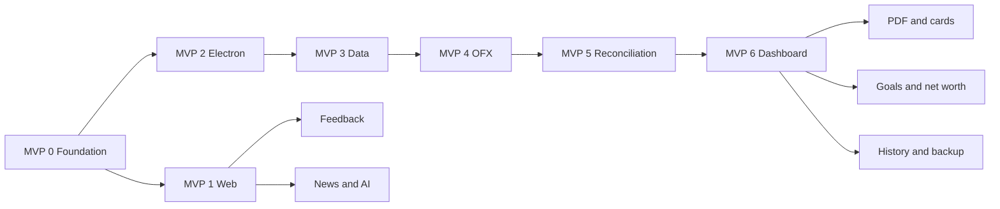

# Talentum Roadmap

This roadmap is the source of truth for Talentum's planned delivery order: the current state of the repository, the pre-MVP update notice, the MVP stages that produce the first usable release, and the later stages, each with its goal, scope, exit criteria and dependencies. The operational MVP plan (order, routes, APIs, migrations and verifiable criteria) is in [PRODUCT.md](PRODUCT.md); architecture is in [ARCHITECTURE.md](ARCHITECTURE.md). Dates are not promised until capacity and estimates are validated.

## Contents

- [Status and purpose](#status-and-purpose)
- [Current state (pre-alpha)](#current-state-pre-alpha)
- [Cross-cutting rules for every stage](#cross-cutting-rules-for-every-stage)
- [Pre-MVP: new version notice](#pre-mvp-new-version-notice)
- [MVP: first usable release](#mvp-first-usable-release)
- [Later stages: one macro-feature per stage](#later-stages-one-macro-feature-per-stage)
- [Dependencies between stages](#dependencies-between-stages)
- [Out of scope without an ADR](#out-of-scope-without-an-adr)
- [How to update this roadmap](#how-to-update-this-roadmap)

## Status and purpose

This roadmap was originally consolidated from the code and all project documentation on 2026-09-05 and its status was re-verified against the repository on 2026-11-20.

States used in this document:

- **Current:** verifiable in the repository.
- **MVP:** required to prove the core value and produce the first usable release.
- **Next stage:** a macro-feature after the MVP.
- **Planned:** agreed scope not yet implemented.
- **Open:** depends on an ADR, research or validation, or on resolving a conflict.

The presence of a dependency, a table or a scaffold does not mean the corresponding capability is implemented.

## Current state (pre-alpha)

Status: **Current** (verified 2026-11-20).

What exists today:

- A local Next.js application (UI plus local API) with six local API route handlers: `action-codes`, `dashboard`, `dashboard/categories`, `health/live`, `local-summary` and `system/status`.
- Local action codes: opaque, single-use, 60-second codes issued by `/api/action-codes` and required by `dashboard`, `dashboard/categories`, `local-summary` and `system/status` (`health/live` is exempt).
- Prisma/SQLite with nine models (`LocalProfile`, `UserPreference`, `Institution`, `Account`, `BalanceSnapshot`, `Category`, `ImportBatch`, `Transaction`, `ScheduledObligation`) created by three migrations, with money stored as `BigInt` cents.
- A dashboard that reads real local SQLite data through `/api/dashboard`, with pure, tested metric formulas in `src/server/dashboard-metrics.ts` (consolidated balance, income, expenses, daily average, committed obligations, risk-free balance, category breakdown, month-to-date periods).
- A hardened Electron shell (context isolation, sandbox, no Node integration, navigation and window-open guards, deny-all permissions, trusted-sender IPC) that loads the local application.
- A Cloudflare Worker with Google OAuth/OIDC Authorization Code plus PKCE, opaque hashed sessions, refresh-token rotation with reuse detection and family revocation, logout, `/api/me`, `/api/releases`, release download grants, Worker action codes stored in D1, IP-keyed rate limits for code issuance and login, and two D1 migrations.
- The public landing page (`apps/web`) with its BFF (auth start, callback, refresh and logout routes, download-grant form handler) and the protected `/downloads` page, served with CSP and HSTS.
- A Node test suite of about 18 files in `tests/` (including a regression suite in `tests/regression/` and an in-memory D1 Worker harness) enforced by versioned Git hooks.
- Brand vectors and per-theme state illustrations generated from versioned sources, and Docker images for the local application and the landing page.

What does not exist yet: import (OFX/CSV/PDF), categorization, reconciliation, CRUD for accounts and categories, onboarding beyond a stub, Turnstile, CORS handling, per-user rate limits, the update notice, packaged or signed installers, CI, a `LICENSE` file and the packager ADR.

## Cross-cutting rules for every stage

A stage ends only when it includes implementation, tests, applicable migrations and contracts, and updates to the related documents.

- The frontend talks exclusively to a documented backend.
- Every functional call uses an opaque, short-lived, untraceable, single-use action code.
- Every persisted table has an `id`, and relations use foreign-key IDs.
- Financial data stays local and never enters telemetry.
- Short-lived access token, rotating refresh token, server-side authorization, rate limiting and replay protection.
- Secret scanning, dependency analysis, reproducible builds and license review.
- Bootstrap Icons as the icon family.
- Keyboard accessibility, contrast and screen-reader support from the start.
- No stage may present planned functionality as finished.

## Pre-MVP: new version notice

Status: **Planned.** The full specification is in [PRODUCT.md](PRODUCT.md). The `nova-versao` state illustration exists; no update-check code exists.

The application queries the releases of the official GitHub repository and, when a stable version newer than the installed one exists, opens a dialog with the `nova-versao` illustration and two buttons: `Baixar agora` (download now), which downloads the Windows installer, verifies checksum and signature, closes the app and opens the installer; and `Adiar` (postpone), which suppresses the notice for that version for 24 hours.

It comes before the MVP by the maintainer's decision: whoever installs the first version must receive the following fixes without looking for the landing page. It depends on signed installers published to GitHub Releases (MVP 1 and MVP 2) to operate; until then the checker finds no version and shows nothing.

**Exit:** a new stable release triggers the notice, `Adiar` respects 24 hours, and no installer without a signature or with a mismatched checksum is executed.

## MVP: first usable release

The MVP ends when a person can sign up, install Talentum, import an OFX file, review their entries and see the free balance locally. It does not include PDF, AI, ARCA, cloud backup, gamification or community. The operational route-by-route plan is in [PRODUCT.md](PRODUCT.md).

### MVP 0 — Technical foundation and security

**Goal:** turn the shell into an executable, verifiable base.

- Create the Next.js/TypeScript application and a responsive design system.
- Separate web, Electron renderer, local backend and Worker with clear boundaries.
- Standardize on Bootstrap Icons, with Lucide allowed only as a documented exception (done: the former Lucide dependency was removed).
- Implement validated configuration, safe errors and redacted logging.
- Implement atomic issuance and consumption of the short-lived action code.
- Set up lint, typecheck, tests, CI, CodeQL/dependency analysis and secret scanning.
- Formalize the open-source license, contribution guide, code of conduct and security policy.
- Define the Next.js/Electron packaging ADR and complete the Workers versus Vercel spike.

**Exit:** web and Electron start in development, CI passes and no frontend layer accesses persistence directly.

Partial state (**Current**): the Next.js application, local REST API, Prisma/SQLite, Docker files, layer separation, Bootstrap Icons (Lucide removed), local and Worker action codes, typecheck, the test suite with regression tests and the Git hooks exist. The Workers versus Vercel decision is recorded in [decisions/0001-web-hosting.md](decisions/0001-web-hosting.md). Still missing (**Planned**): a real linter and formatter (`pnpm lint` only runs the typecheck), CI, CodeQL and secret scanning in CI, the `LICENSE` file and community policies, and the packaging ADR.

### MVP 1 — Landing page, sign-up and downloads

**Goal:** deliver the public path to the installer.

- Responsive landing page with value proposition, privacy, platforms and license.
- Publish only the landing page and BFF on Vercel, with a deploy context isolated from the desktop system.
- OAuth/OIDC Authorization Code plus PKCE.
- Short access token, rotating refresh token, revocation and reuse detection.
- Cloud tables for user, profile, identity, session, tokens, consent, release, artifact and grant.
- Protected page with Windows and Linux buttons.
- Windows/Linux installers produced outside Vercel and published to GitHub Releases with checksum, signature and metadata in D1.
- WAF, rate limiting, adaptive Turnstile, CSP, HSTS, CSRF protection and private caching.
- Terms, privacy, account deletion and minimal retention.

**Exit:** only a validated user obtains an authentic, temporarily authorized installer.

Partial state (**Current**): the landing page, the BFF, Google OAuth/OIDC with PKCE, opaque sessions, refresh rotation with reuse detection, logout, `/api/me`, release listing, download grants recorded in D1, the protected `/downloads` page, Worker action codes, IP-keyed rate limits on code issuance and login, CSP and HSTS on the landing page, and the D1 cloud schema exist. **Planned:** Turnstile, CORS handling (`ALLOWED_ORIGIN` is declared but unused), per-user rate limits, WAF rules, an allowlist-verified isolated Vercel deploy context, signed installers in GitHub Releases, terms, privacy, account deletion and retention.

**Open:** the public domain conflicts between sources. The landing page code uses `talentum-tech.vercel.app` (its comment says `talentum.vercel.app` belongs to another project), while the Worker configuration (`ALLOWED_ORIGIN`, `PUBLIC_WEB_URL`) and earlier documents use `talentum.vercel.app`. The canonical domain must be decided and both sides aligned.

### MVP 2 — Secure Electron and first access

**Goal:** install, authenticate and create the local environment.

- Signed builds for Windows and Linux.
- `contextIsolation`, sandbox, CSP, `nodeIntegration: false`, minimal IPC and fuses.
- Local backend on loopback with a per-run ephemeral secret.
- Login through the system browser and the refresh token in the OS keychain.
- Creation and initial migration of SQLite.
- Short onboarding presenting import, organization and privacy.
- Progressive financial snapshot as described in [PRODUCT.md](PRODUCT.md), with a local draft and final review.
- Basic preferences and currency/time zone selection.

**Exit:** the installed application opens securely and prepares the local database without sending finances to the cloud.

Partial state (**Current**): context isolation, sandbox, `nodeIntegration: false`, navigation and permission guards, trusted-sender IPC, loopback-only binding and automatic SQLite migration on start exist. **Planned:** signed builds, a CSP for the local application, Electron fuses, a random port and per-run secret (the shell loads a fixed `http://localhost:3000` or `TALENTUM_URL`), system-browser login with keychain storage, onboarding (the route is a stub) and preferences selection.

### MVP 3 — Accounts, categories and obligations

**Goal:** create the minimum financial structure.

- Local profile, institutions and accounts.
- Multiple accounts, incomes, encrypted local Pix keys and identification of own transfers.
- Categories and simple merchant rules.
- Reported balances and snapshots.
- Recurring bills, due dates and expected debits.
- Full CRUD through the local API, validation and relations by IDs.
- Values in cents/Decimal and correct financial dates.

**Exit:** the user configures the bases needed to interpret a statement.

Partial state (**Current**): the `LocalProfile`, `Institution`, `Account`, `Category`, `BalanceSnapshot` and `ScheduledObligation` tables exist with relations by IDs and money in `BigInt` cents, and the dashboard reads them. **Planned:** CRUD routes and validation in the local API, the screens that create and edit these records, encrypted Pix keys, own-transfer identification and merchant rules.

### MVP 4 — OFX import

**Goal:** eliminate manual typing for the most structured format.

- Drag and drop or selection of OFX files.
- Type, size and content validation; an isolated, bounded parser.
- Batch, file, fingerprint, diagnostics and progress by IDs.
- Transaction normalization and duplicate prevention.
- Discarding or retaining the original according to an explicit policy.
- Exclusively synthetic fixtures for different institutions.

**Exit:** a valid OFX file produces local transactions traceable to their source batch.

Partial state: the `ImportBatch` and `Transaction` tables and the `ofx-data-extractor` dependency exist (**Current**); no parser or import route exists (**Planned**).

### MVP 5 — Categorization and reconciliation

**Goal:** let automation and the user reach reliable data.

- Deterministic categorization by local rules.
- Confidence level and a pending queue.
- Smart triage to confirm or correct a category.
- Safe editing, interest, discounts and quick cash entries.
- Checking transactions against obligations.
- Before/after history and reversal of MVP changes.

**Exit:** the user corrects ambiguities without losing the original data.

Status: **Planned.** The `/conciliacao` screens are navigable layouts only.

### MVP 6 — Dashboard and Risk-Free Balance

**Goal:** prove Talentum's core proposition.

- Current balance per account and consolidated.
- Expected bills/obligations deducted from the available amount.
- Risk-Free Balance with an explainable formula and period.
- Spending by category, daily average and month-to-date consumption.
- Accessible charts and empty/error/offline states.
- Essential local alerts for due dates and stale data.
- Unit tests for the formulas and end-to-end tests of the OFX flow.

**Exit:** the first MVP release for Windows and Linux, with installation, usage, security and limitations documentation.

Partial state (**Current**): the dashboard reads SQLite and computes consolidated balance, committed obligations up to period end, risk-free balance, income, expenses, daily average, period-over-period change and category breakdown in a pure module with unit tests; empty and error state illustrations exist for both themes. **Planned:** local due-date and stale-data alerts, end-to-end tests of the OFX flow (blocked on MVP 4) and the release documentation.

## Later stages: one macro-feature per stage

Every stage below is a **Next stage** and **Planned** unless marked **Open**.

### Stage 7 — PDF import

Local parsers per institution/layout, defensive extraction, per-field confidence, tests with hostile synthetic files and versioned parser maintenance. Open Finance is not part of this stage.

### Stage 8 — Cards, statements and benefits

Cards, closing/due dates, statement items, statement-to-bank-statement reconciliation, annual fee, fee-waiver thermometer, cashback, points, miles and expiration.

### Stage 9 — Budget and monthly planning

Limits per category, planned versus actual comparison, projections, moving average, surplus and monthly review, without personalized financial recommendations.

### Stage 10 — Notification center

Actionable local notifications for bills, statements, pending imports and budget; preferences, quiet mode, deduplication and accessibility. Remote push requires its own ADR.

### Stage 11 — History and restoration

Filterable timeline, events per domain, restore points, safe undo/redo, snapshots before migrations and a secret-free trail.

### Stage 12 — Goals and savings pots

Objectives, target value, deadline, contributions, monthly calculation, feasibility, progress and suggestions for allocating the surplus.

### Stage 13 — Survival mode and debts

Debts, interest, arrears, priority by cost, payoff plan and a liquidity focus. Requires legal review and clear financial-education copy.

### Stage 14 — Net worth and the ARCA methodology

Assets and snapshots, four pillars, the 22.5%–27.5% band, balance status and next-contribution simulation without suggesting sales. Attribution of the methodology and a no-recommendation notice are mandatory.

### Stage 15 — Economic news

Server-side aggregation from permitted sources, RSS/licenses, general filters and credit/link to the original. Detailed portfolio data is not sent to the cloud; personalization must be local or minimized.

### Stage 16 — AI summaries

On-demand summaries of public content through Workers AI, prompt-injection protection, quality/cost evaluation and a fallback without AI. Ollama remains a future option after an ADR.

### Stage 17 — Gamification

XP for useful habits, levels, missions and badges. Scoring avoids incentives for artificial spending or contributions; social ranking stays opt-in and never reveals financial values.

### Stage 18 — E2EE backup and restoration

**Open.** Encrypted local snapshot with AEAD, versioning, key recovery, retention, validated restoration and disaster tests. D1 may store only metadata; no snapshot will be stored in it. A suitable provider needs a future ADR. Do not advertise "zero knowledge" before an audit.

### Stage 19 — Export, portability and deletion

JSON/CSV export, schema documentation, local/cloud deletion, session revocation, retention and a verifiable portability flow.

### Stage 20 — Feedback community

Public posts, comments/replies, likes, reports and moderation through the Worker and D1; dedicated tables with IDs, a minimal public profile, anti-spam, rate limiting, Turnstile, tombstones, auditing and a community policy. **Current:** the D1 feedback tables exist from the initial migration; no Worker route serves them.

### Stage 21 — Automatic updates and release channels

Signed manifests, stable/beta channels, differential updates when safe, rollback, release notes, SBOM, provenance and a response plan for compromised artifacts.

### Stage 22 — Open Finance

**Open.** Regulatory research, consent, provider, cost, scopes, revocation and minimization. Talentum will never collect banking credentials; integration only proceeds after a threat model and an ADR.

### Stage 23 — Multi-device synchronization

**Open.** Preserve local-first with E2EE synchronization, conflict resolution and user-controlled keys. Not a requirement of the initial product.

### Stage 24 — Internationalization and platform expansion

Languages, currencies, regional formats and evaluation of macOS. Each platform requires its own signing, packaging and test matrix.

### Stage 25 — Webhooks and event-driven integrations

**Optional and Open.** Allow outgoing webhooks for explicitly authorized cloud events, such as a release publication or a feedback update. Local financial data cannot be sent. The implementation requires endpoints registered by ID, per-subscription secrets stored in the secret store, HMAC with timestamp, replay protection, an event allowlist, queues, retry with backoff, idempotency, a circuit breaker, redacted logs, rotation/revocation and a test panel. Incoming webhooks require a separate ADR and threat model before being accepted.

## Dependencies between stages

## Out of scope without an ADR

- Automatic buying or selling of investments.
- Individual asset recommendations.
- Cloud storage of finances in clear text.
- Scraping that violates terms of service or copyright.
- Advertising based on financial behavior.
- Identifiable telemetry or use of the action code for tracking.
- Plugins running untrusted code with database access.

## How to update this roadmap

A new macro-feature gets its own stage, dependencies, exit criteria and affected documents. A change of order or scope records its justification in the pull request; irreversible, regulatory or provider changes get an ADR. Marking a stage as complete requires evidence of tests, documentation and a verifiable release. Partial-state notes are updated whenever a change lands, and must describe only what is verifiable in the repository.
