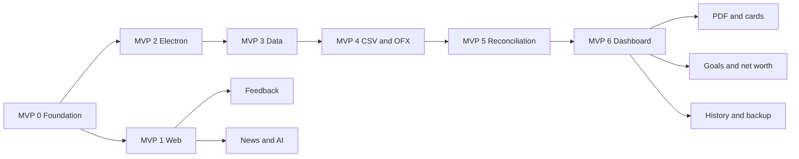

# Talentum Roadmap

This roadmap is the source of truth for Talentum's planned delivery order: the current state of the repository, the pre-MVP update notice, the MVP stages that produce the first usable release, and the later stages, each with its goal, scope, exit criteria and dependencies. The operational MVP plan (order, routes, APIs, migrations and verifiable criteria) is in [PRODUCT.md](PRODUCT.md); architecture is in [ARCHITECTURE.md](ARCHITECTURE.md). Dates are not promised until capacity and estimates are validated.

## Contents

- [Status and purpose](#status-and-purpose)
- [Current state (pre-alpha)](#current-state-pre-alpha)
- [Cross-cutting rules for every stage](#cross-cutting-rules-for-every-stage)
- [Pre-MVP: new version notice](#pre-mvp-new-version-notice)
- [MVP: first usable release](#mvp-first-usable-release)
- [Later stages: one macro-feature per stage](#later-stages-one-macro-feature-per-stage)
- [Dependencies between stages](#dependencies-between-stages)
- [Out of scope without an ADR](#out-of-scope-without-an-adr)
- [How to update this roadmap](#how-to-update-this-roadmap)

## Status and purpose

This roadmap was originally consolidated from the code and all project documentation on 2026-09-05 and its status was re-verified against the repository on 2026-11-20.

Status labels (Current, Partial, Planned, Open) are defined in [README.md](README.md#status-labels). This document adds two scope labels:

- **MVP:** required to prove the core value and produce the first usable release.
- **Next stage:** a macro-feature after the MVP.

The presence of a dependency, a table or a scaffold does not mean the corresponding capability is implemented.

## Current state (pre-alpha)

Status: **Current** (verified 2026-11-20).

What exists today:

- A local Next.js application (UI plus local API) with 101 local API route files (listed in [ARCHITECTURE.md](ARCHITECTURE.md) §4.8), covering MVP features 1 to 8 and Stages 7 to 14 and 17 to 19.
- A local vault ([ADR 0009](decisions/0009-local-vault-and-encrypted-database.md)): local password and one-time recovery code, the whole SQLite file encrypted at rest with libSQL, a session required by every route except the vault routes and the liveness probe, idle auto-lock, optional local TOTP, and its own migration runner.
- Local action codes: opaque, single-use, 60-second codes bound to method and path, issued only to an unlocked session.
- Prisma/SQLite (through the libSQL adapter) with 37 models created by 15 migrations, money stored as `BigInt` cents.
- CSV, OFX and PDF import; automatic categorization by merchant rules with confidence; own-transfer suggestions; quick cash entries; the reconciliation queue; cards, statements, benefits and statement-payment checks; budget, goals, debts and survival mode; net worth with the ARCA methodology; local notifications; restore points, a passphrase-encrypted backup, JSON and CSV export and local data deletion; habit-based gamification; a redacted timeline with reversal; the dashboard with local alerts; the new-version notice.
- A hardened Electron shell with fuses, a nonce CSP, lock on sleep and screen lock, desktop "Entrar com Google" through the system browser (RFC 8252) with the token in the OS keychain, and `electron-builder` targets for Windows, Linux and macOS (no build signed or exercised end to end).
- A Cloudflare Worker with Google OAuth/OIDC plus PKCE, TOTP two-step verification, exact CORS, Turnstile verification, per-route and per-person rate limits, security and audit events, enforced download grants, account deletion, consent records, the feedback community, public news with AI summaries and a non-AI fallback, a retention cron, and four D1 migrations.
- The public landing page (`apps/web`) with its BFF, sign-in, two-step verification, account, community, terms and privacy (drafts pending legal review) and the protected `/downloads` page with Windows, Linux and macOS ("em breve").
- 79 Node test files (including `tests/regression/`) and a Playwright suite over the twelve viewport classes in both themes, enforced by versioned Git hooks and CI; CI also runs gitleaks, dependency review, CodeQL and a Vercel-isolation check, and Dependabot is configured.
- ADRs 0001 to 0009.

What does not exist yet: signed or published installers, and a validated packaged build on Windows and macOS (the Linux AppImage was built and exercised end to end on 2026-11-20); provider-side settings (Turnstile widget, Worker secrets, remote D1 migrations, WAF rules, Workers AI, the production domain); process isolation of the CSV and OFX parsers (PDF parsing already runs in an isolated worker thread); legal review of the terms, privacy and debt copy; Stages 21 (beyond the notice) to 25.

## Cross-cutting rules for every stage

A stage ends only when it includes implementation, tests, applicable migrations and contracts, and updates to the related documents.

- The frontend talks exclusively to a documented backend.
- Every functional call uses an opaque, short-lived, untraceable, single-use action code.
- Every persisted table has an `id`, and relations use foreign-key IDs.
- Financial data stays local and never enters telemetry.
- Short-lived access token, rotating refresh token, server-side authorization, rate limiting and replay protection.
- Secret scanning, dependency analysis, reproducible builds and license review.
- Bootstrap Icons as the icon family.
- Keyboard accessibility, contrast and screen-reader support from the start.
- No stage may present planned functionality as finished.

## Pre-MVP: new version notice

Status: **Partial.** `GET /api/updates` queries GitHub Releases from the backend and the app shell shows the `nova-versao` dialog with `Baixar agora` and `Adiar` (24 hours per version). Installation is gated: the Electron main process verifies checksum and signature and refuses everything while no signing public key exists, so the dialog links to the release page. **Planned:** the signing key and signed installers.

The application queries the releases of the official GitHub repository and, when a stable version newer than the installed one exists, opens a dialog with the `nova-versao` illustration and two buttons: `Baixar agora` (download now), which downloads the Windows installer, verifies checksum and signature, closes the app and opens the installer; and `Adiar` (postpone), which suppresses the notice for that version for 24 hours.

"Pre-MVP" is the maintainer's decision about release content, not build order: the notice must ship in the first installer that reaches anyone, so that whoever installs it receives the following fixes without looking for the landing page. It is built alongside MVP 1 and MVP 2 because it needs their signed installers on GitHub Releases to operate; until then the checker finds no version and shows nothing.

**Exit:** a new stable release triggers the notice, `Adiar` respects 24 hours, and no installer without a signature or with a mismatched checksum is executed.

## MVP: first usable release

The MVP ends when a person can sign up, install Talentum, import a CSV or OFX file, review their entries and see the free balance locally. It does not include PDF, AI, ARCA, cloud backup, gamification or community. The operational route-by-route plan is in [PRODUCT.md](PRODUCT.md).

### MVP 0 — Technical foundation and security

**Goal:** turn the shell into an executable, verifiable base.

- Create the Next.js/TypeScript application and a responsive design system.
- Separate web, Electron renderer, local backend and Worker with clear boundaries.
- Standardize on Bootstrap Icons, with Lucide allowed only as a documented exception (done: the former Lucide dependency was removed).
- Implement validated configuration, safe errors and redacted logging.
- Implement atomic issuance and consumption of the short-lived action code.
- Set up lint, typecheck, tests, CI, CodeQL/dependency analysis and secret scanning.
- Formalize the open-source license, contribution guide, code of conduct and security policy.
- Define the Next.js/Electron packaging ADR and complete the Workers versus Vercel spike.

**Exit:** web and Electron start in development, CI passes and no frontend layer accesses persistence directly.

Partial state (**Current**): everything in the list above, plus Biome, the Playwright suite, CI with Prisma, typecheck, lint, tests, end-to-end tests, the three builds, gitleaks, dependency review, CodeQL and Dependabot. **Planned:** enforcing the Biome formatter after a one-time formatting commit.

### MVP 1 — Landing page, sign-up and downloads

**Goal:** deliver the public path to the installer.

- Responsive landing page with value proposition, privacy, platforms and license.
- Publish only the landing page and BFF on Vercel, with a deploy context isolated from the desktop system.
- OAuth/OIDC Authorization Code plus PKCE, account creation with Google and two-step verification with an authenticator app (added by the maintainer on 2026-11-20).
- Short access token, rotating refresh token, revocation and reuse detection.
- Cloud tables for user, profile, identity, session, tokens, consent, release, artifact and grant.
- Protected page with Windows and Linux buttons.
- Windows/Linux installers produced outside Vercel and published to GitHub Releases with checksum, signature and metadata in D1.
- WAF, rate limiting, adaptive Turnstile, CSP, HSTS, CSRF protection and private caching.
- Terms, privacy, account deletion and minimal retention.

**Exit:** only a validated user obtains an authentic, temporarily authorized installer.

Partial state (**Current**): landing page, BFF, Google OAuth/OIDC with PKCE, TOTP two-step verification with recovery codes, refresh rotation with reuse detection, exact CORS, Turnstile verification (fails closed in production without its secret), per-route and per-person rate limits, security and audit events, enforced single-use download grants, consent records, account deletion with tombstones, a retention cron, CSP and HSTS. **Planned:** provider settings (Turnstile widget, Worker secrets, WAF rules, isolated Vercel root), signed installers in GitHub Releases and legal review of the terms and privacy drafts.

**Open:** the production domain is undecided; see [ARCHITECTURE.md §3.4](ARCHITECTURE.md#34-domain).

### MVP 2 — Secure Electron and first access

**Goal:** install, authenticate and create the local environment.

- Local login on the installed app (password, recovery code, auto-lock, optional TOTP) and the whole database encrypted at rest (added by the maintainer on 2026-11-20).

- Signed builds for Windows, Linux and macOS (macOS added by the maintainer on 2026-11-20; signing and notarization need an Apple Developer ID).
- `contextIsolation`, sandbox, CSP, `nodeIntegration: false`, minimal IPC and fuses.
- Local backend on loopback with a per-run ephemeral secret.
- Login through the system browser and the refresh token in the OS keychain.
- Creation and initial migration of SQLite.
- Short onboarding presenting import, organization and privacy.
- Progressive financial snapshot as described in [PRODUCT.md](PRODUCT.md), with a local draft and final review.
- Basic preferences and currency/time zone selection.

**Exit:** the installed application opens securely and prepares the local database without sending finances to the cloud.

Partial state (**Current**): the local vault (password, recovery code, encrypted database, session, auto-lock, local TOTP), the nonce CSP, Electron fuses (`runAsNode` stays on), lock on sleep, system-browser Google sign-in with the token in the OS keychain, macOS lifecycle handling, the four-step onboarding and the encrypted migration runner. **Open:** the packaged startup is unverified on every platform and the packaged app has no Worker URL until the domain is decided. **Planned:** signed builds and the fuller progressive snapshot of [PRODUCT.md](PRODUCT.md).

### MVP 3 — Accounts, categories and obligations

**Goal:** create the minimum financial structure.

- Local profile, institutions and accounts.
- Multiple accounts, incomes, encrypted local Pix keys and identification of own transfers.
- Categories and simple merchant rules.
- Reported balances and snapshots.
- Recurring bills, due dates and expected debits.
- Full CRUD through the local API, validation and relations by IDs.
- Values in cents/Decimal and correct financial dates.

**Exit:** the user configures the bases needed to interpret a statement.

Status (**Current**): profile, institutions, accounts, balances, income sources, categories, merchant rules (applied automatically) and obligations, encrypted own Pix keys, and own-transfer suggestions by amount, date and Pix key.

### MVP 4 — CSV and OFX import

**Goal:** eliminate manual typing for the two formats banks export most (the MVP formats are defined in [PRODUCT.md](PRODUCT.md), Feature 4).

- Drag and drop or selection of CSV and OFX files, with column mapping for CSV.
- Type, size and content validation; an isolated, bounded parser.
- Batch, file, fingerprint, diagnostics and progress by IDs.
- Transaction normalization and duplicate prevention.
- Discarding or retaining the original according to an explicit policy.
- Exclusively synthetic fixtures for different institutions.

**Exit:** a valid CSV or OFX file produces local transactions traceable to their source batch.

Status (**Current**): CSV, OFX and PDF import with content-based detection, enforced limits (size by `Content-Length` before buffering, rows, columns, parse deadline), two-step inspect-then-write, fingerprint and per-entry deduplication, batch undo and synthetic fixtures. **Open:** the parsers run in the request process.

### MVP 5 — Categorization and reconciliation

**Goal:** let automation and the user reach reliable data.

- Deterministic categorization by local rules.
- Confidence level and a pending queue.
- Smart triage to confirm or correct a category.
- Safe editing, interest, discounts and quick cash entries.
- Checking transactions against obligations.
- Before/after history and reversal of MVP changes.

**Exit:** the user corrects ambiguities without losing the original data.

Status (**Current**): deterministic categorization by local rules with confidence (exact and starts-with rules apply, contains rules suggest), the persistent queue, own-transfer suggestions, quick cash entries, reversible decisions with before/after snapshots and transaction edit history.

### MVP 6 — Dashboard and Risk-Free Balance

**Goal:** prove Talentum's core proposition.

- Current balance per account and consolidated.
- Expected bills/obligations deducted from the available amount.
- Risk-Free Balance with an explainable formula and period.
- Spending by category, daily average and month-to-date consumption.
- Accessible charts and empty/error/offline states.
- Essential local alerts for due dates and stale data.
- Unit tests for the formulas and end-to-end tests of the import flow.

**Exit:** the first MVP release for Windows and Linux, with installation, usage, security and limitations documentation.

Partial state (**Current**): all dashboard elements with pure tested formulas, open card statements counted as committed, one balance and one reference currency for the verdict and the projection (L-4 resolved), local due-date and stale-data alerts, empty and error states in both themes and end-to-end tests. A bill entered both as an obligation and as a card statement is subtracted once: an obligation linked to a card gives way to that card's statement of the same month (**Current**, see [PRODUCT.md](PRODUCT.md), V). **Planned:** release documentation for the first installer.

## Later stages: one macro-feature per stage

Every stage below is a **Next stage** and **Planned** unless marked **Open**.

### Stage 7 — PDF import

**Current** ([ADR 0006](decisions/0006-pdf-import.md)): local PDF.js extraction in an isolated worker thread (no environment or secrets, 256 MiB heap limit, 12-second hard deadline with `terminate()`, validated output) under page, character and time limits, a versioned layout-reader registry with two generic readers, per-field confidence and hostile synthetic fixtures. **Open:** no institution-specific reader yet.

Local parsers per institution/layout, defensive extraction, per-field confidence, tests with hostile synthetic files and versioned parser maintenance. Open Finance is not part of this stage.

### Stage 8 — Cards, statements and benefits

**Current:** cards, closing and due dates, statements and items (typed or imported), statement-to-bank-statement payment checks, annual fee, the fee-waiver thermometer and benefits with expiration. **Planned:** instalment projection, available limit and benefit earning rules.

Cards, closing/due dates, statement items, statement-to-bank-statement reconciliation, annual fee, fee-waiver thermometer, cashback, points, miles and expiration.

### Stage 9 — Budget and monthly planning

**Current:** limits per category and month, planned versus actual, projection, three-month average from fully covered months, surplus and the monthly review.

Limits per category, planned versus actual comparison, projections, moving average, surplus and monthly review, without personalized financial recommendations.

### Stage 10 — Notification center

**Current:** notifications derived from local data with read and dismissed state, per-kind preferences, quiet mode, deduplication by key, the header bell and `/notificacoes`.

Actionable local notifications for bills, statements, pending imports and budget; preferences, quiet mode, deduplication and accessibility. Remote push requires its own ADR.

### Stage 11 — History and restoration

**Current:** timeline filtered by domain and period, encrypted restore points (manual, before migrations, before a restore and before deletion), verified restore applied at the next unlock, and the destructive-migration gate.

Filterable timeline, events per domain, restore points, safe undo/redo, snapshots before migrations and a secret-free trail. **Current** groundwork from the MVP: a redacted local timeline for imports, edits and reconciliation with reversal, `DatabaseBackup` metadata and a destructive-migration gate; Stage 11 added encrypted restore points, including an automatic `pre_migration` point at unlock (ADR 0007 amendment).

### Stage 12 — Goals and savings pots

**Current:** goals, dated contributions with idempotency, required monthly amount, feasibility and an arithmetic surplus split.

Objectives, target value, deadline, contributions, monthly calculation, feasibility, progress and suggestions for allocating the surplus.

### Stage 13 — Survival mode and debts

**Current:** debts, avalanche and snowball orders, payoff simulation and survival mode with essential categories. **Open:** legal review of the copy.

Debts, interest, arrears, priority by cost, payoff plan and a liquidity focus. Requires legal review and clear financial-education copy.

### Stage 14 — Net worth and the ARCA methodology

**Current:** assets with dated values, the four pillars, the 22.5%–27.5% band and a contribution simulation that only allocates new money, with attribution and a no-recommendation notice.

Assets and snapshots, four pillars, the 22.5%–27.5% band, balance status and next-contribution simulation without suggesting sales. Attribution of the methodology and a no-recommendation notice are mandatory.

### Stage 15 — Economic news

**Current:** the Worker aggregates one permitted source (Agência Brasil Economia) with credit and a defensive parser; `/invest` reads it through the local backend. **Open:** further sources whose reuse terms are unconfirmed.

Server-side aggregation from permitted sources, RSS/licenses, general filters and credit/link to the original. Detailed portfolio data is not sent to the cloud; personalization must be local or minimized.

### Stage 16 — AI summaries

**Current:** on-demand summaries through the Workers AI binding with prompt-injection hardening, a global budget and a deterministic non-AI fallback. **Planned:** enabling the binding (provider setting, with cost).

On-demand summaries of public content through Workers AI, prompt-injection protection, quality/cost evaluation and a fallback without AI. Ollama remains a future option after an ADR.

### Stage 17 — Gamification

**Current:** XP for habits only, levels, missions and badges, local, with no ranking.

XP for useful habits, levels, missions and badges. Scoring avoids incentives for artificial spending or contributions; social ranking stays opt-in and never reveals financial values.

### Stage 18 — E2EE backup and restoration

**Partial** ([ADR 0007](decisions/0007-local-encrypted-backup.md)): a local passphrase-encrypted backup (AES-256-GCM, scrypt) with verified restore and no key recovery. **Open:** any cloud storage provider.

**Open.** Encrypted local snapshot with AEAD, versioning, key recovery, retention, validated restoration and disaster tests. D1 may store only metadata; no snapshot will be stored in it. A suitable provider needs a future ADR. Do not advertise "zero knowledge" before an audit.

### Stage 19 — Export, portability and deletion

**Current:** JSON and CSV export with formula neutralization, local data deletion with a restore point first, and cloud account deletion with session revocation.

JSON/CSV export, schema documentation, local/cloud deletion, session revocation, retention and a verifiable portability flow.

### Stage 20 — Feedback community

**Current:** Worker routes and landing-page screens for posts, comments, votes, reports and moderation, with Turnstile, rate limits, idempotency and tombstones. **Open:** a published community policy and appeal channel.

Public posts, comments/replies, likes, reports and moderation through the Worker and D1; dedicated tables with IDs, a minimal public profile, anti-spam, rate limiting, Turnstile, tombstones, auditing and a community policy. **Current:** the D1 feedback tables exist from the initial migration; no Worker route serves them.

### Stage 21 — Automatic updates and release channels

**Partial:** the new-version notice (see Pre-MVP). **Planned:** everything else in this stage.

Signed manifests, stable/beta channels, differential updates when safe, rollback, release notes, SBOM, provenance and a response plan for compromised artifacts.

### Stage 22 — Open Finance

**Open.** Regulatory research, consent, provider, cost, scopes, revocation and minimization. Talentum will never collect banking credentials; integration only proceeds after a threat model and an ADR.

### Stage 23 — Multi-device synchronization

**Open.** Preserve local-first with E2EE synchronization, conflict resolution and user-controlled keys. Not a requirement of the initial product.

### Stage 24 — Internationalization and platform expansion

Languages, currencies and regional formats. macOS is no longer evaluated here: it ships with the desktop releases (MVP 2). Each platform requires its own signing, packaging and test matrix.

### Stage 25 — Webhooks and event-driven integrations

**Optional and Open.** Allow outgoing webhooks for explicitly authorized cloud events, such as a release publication or a feedback update. Local financial data cannot be sent. The implementation requires endpoints registered by ID, per-subscription secrets stored in the secret store, HMAC with timestamp, replay protection, an event allowlist, queues, retry with backoff, idempotency, a circuit breaker, redacted logs, rotation/revocation and a test panel. Incoming webhooks require a separate ADR and threat model before being accepted.

## Dependencies between stages

## Out of scope without an ADR

- Automatic buying or selling of investments.
- Individual asset recommendations.
- Cloud storage of finances in clear text.
- Scraping that violates terms of service or copyright.
- Advertising based on financial behavior.
- Identifiable telemetry or use of the action code for tracking.
- Plugins running untrusted code with database access.

## How to update this roadmap

A new macro-feature gets its own stage, dependencies, exit criteria and affected documents. A change of order or scope records its justification in the pull request; irreversible, regulatory or provider changes get an ADR. Marking a stage as complete requires evidence of tests, documentation and a verifiable release. Partial-state notes are updated whenever a change lands, and must describe only what is verifiable in the repository.
